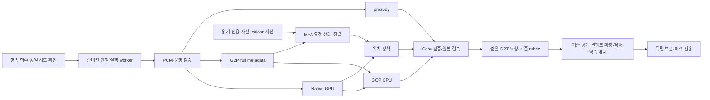

# 전체 분석 파이프라인 추가 지연 단축 계획

이 문서는 **계획**이다. 구현·운영 반영·신규 시간 실측 결과가 아니다.
후속 [구현·운영 반영 결과](pipeline-latency-implementation-20261025.md)에 실제 적용 범위와
미측정·조건부 후속 작업을 구분했다.
브랜치는 local main `ee8eefb377226d42b59b05d1b06950b050ca1b5e`에서 만든
`docs/pipeline-latency-next-20261025`이며 직전 미커밋 변경·테스트 삭제를 유지했다.
이번 변경 범위는 이 문서와 docs 목차다. 모델과 정책은 `gpt-6-luna / none / default`,
기존 음소·GOP·점수 근거를 유지하며 Fast mode는 제외한다.

## 목표와 판단 근거

4.27초 입력 한 건의 [직전 구현·실측](seungun-server-optimization-20261025.md)을 기준으로
한다. 다른 길이·화자·동시 접수의 성능은 이 관측에서 추정하지 않는다.
09:55:43 UTC의 job `be5891c7-cd43-4ea1-aa52-f0956b7bd74a`를 대표 재사용 요청으로
선택했다. 추가로 retained job/worker/CORE와 해당 v3 소스를 읽었고 새 API는 호출하지 않았다.

| 구간 | 관측 초 | 수정 우선순위 |
|---|---:|---|
| 접수된 job → 실행 선택 | 0.053 | 이미 짧다. 영속 기록 의미를 유지 |
| 실행 선택 → Python worker 시작 | **1.262** | 매 요청의 프로세스·import 재생성 제거 |
| Core producer | **7.794** | MFA 준비·오디오 준비·provenance 반복 작업 제거 |
| expression 전체 | **4.702** | 실제 GPT HTTP 4.468초 포함 |
| 결과 preflight | 0.305 | 동일 schema validator를 세대 내 재사용 |
| artifact durable·결과 게시 등 | 약 0.095 | fsync·원본 보관 순서 유지 |
| 서버 createdAt → resultReadyAt | **14.217** | 주된 목표 지표 |
| 클라이언트 전체 | **14.722** | polling·왕복 지연 포함, 서버 지표와 구분 |

Core 안의 MFA **6.304초** 중 setup은 **4.938초**다. normalize_text **1.176초**,
lexicon compiler **1.622초**, disambiguation 두 번 합계 **1.067초**가 남아 있다.
dictionary_setup 1.203초에는 첫 disambiguation 0.535초가 포함된다.
이 값들을 독립 구간처럼 합산하지 않는다. GOP 0.673초는 이미 MFA 안에 겹치고,
Native forward 0.033초·MFCC 0.049초는 재사용 회차에서 짧다.

예산 목표는 다음과 같다. GPT 응답 길이·provider 상태와 cache hit가 달라질 수 있어
아래 수치는 실측 보장값이 아니다. 첫 요청·cache miss·세대 교체는 별도로 집계한다.

| 서버 구간 | 현재 대표값 | 1차 목표, P1–P4 | 2차 목표, P5 이후 |
|---|---:|---:|---:|
| 실행 선택·worker 준비 | 1.32초 | 0.15–0.30초 | 동일 |
| Core | 7.79초 | 5.8–6.2초 | 3.7–4.7초 |
| expression | 4.70초 | 3.1–3.8초 | 동일 |
| preflight·영속 게시 | 약 0.40초 | 0.20–0.30초 | 동일 |
| **서버 전체** | **14.22초** | **약 9–11초** | **약 7–9초** |

## 수정 후 실행 구조

이는 목표 논리 구조다. G2P·Native는 독립적으로 준비하고 MFA는 Native logits를 기다릴
필요가 없다. GOP는 Native와 full metadata가 모두 준비된 뒤 실행한다. 작은 구간의 동시화는
주요 재사용 변경 뒤에 적용하며 별도 절감 예산을 크게 잡지 않는다. 요청 소유 task를 모두 join하고
기존 실패 우선순위·취소·deadline을 유지한다. GPU가 초기화된 프로세스를 fork하지 않는다.

GPT가 요구하는 근거가 검증된 뒤 한 번만 dispatch한다. MFA 이전의 부분 근거로 GPT를
미리 호출하거나 다른 요청의 음성·점수·응답을 재사용하지 않는다. GPU0의 독립 TTS는
분석 API의 직렬 단계가 아니므로 분석 시간에서 TTS 합성 시간을 빼는 계획을 만들지 않는다.

## P0 — 관측 정의와 운영 자원 수명 정리

새 공개 응답 필드 없이 private timing에 다음 경계를 둔다. 기존 기록에서 측정되지
않은 값은 null로 두며, 추정한 네트워크 시간을 실측처럼 쓰지 않는다.

- queued→dispatch, worker 획득, Python/import 준비, resident/사전 cache hit·miss,
  오디오 준비, G2P, provenance, MFA 준비·정렬·정리, H5 준비, provider, preflight,
  원본 durable, RESULT_READY를 같은 요청 identity로 연결한다.
- 현재 비스트리밍 `httpHeadersSeconds`는 연결·provider 처리·출력 생성 대기를 포함한다.
  이를 첫 토큰 시간이나 순수 모델 추론 시간으로 해석하지 않는다. 연결 재사용 여부와
  연결 수립·TLS 관측이 실제 지원되는 transport 경계에서만 분리한다.
- raw 음성·문장·프롬프트·응답·인증 header는 timing에 넣지 않는다.
- [cgroup helper](../../src/voice_coach/backend_analysis/cgroup_resources.py)를
  [resident의 standby 판정](../../src/voice_coach/backend_analysis/canonical_resident.py)에도
  연결한다. 현재 standby 함수는 v1 컨테이너의 하위 경로를 읽지 못해 unknown으로 남는다.
  hard limit이 확인되지 않으면 standby를 허용하지 않는 의미는 유지한다.
- 접수가 닫힌 내부 canonical의 구형 감시 로그에도 별도 고정 파생 릴리스로 순환·상한을
  적용한다. 현재 direct만 제한된 상태다. 살아 있는 세대·열린 FD를 가진 자료를 제거하지
  않으며, 작업 공간은 실제 가용량·inode를 검사한다. `/tmp` 증설을 속도 개선으로 계산하지 않는다.

**완료 조건:** 같은 span 정의로 합계와 포함 관계를 설명할 수 있고, cache hit·회차가
분리된다. 운영 자원 정리 자체에는 지연 절감 목표를 부여하지 않는다.

## P1 — 오디오·정적 메타데이터의 반복 작업 제거

대상은 frozen `audio.py`, `manifest.py`, `run_canonical_batch.py`와
[준비 WAV 측정](../../src/voice_coach/backend_analysis/canonical_media.py)이다.

1. direct 입력은 이미 mono PCM s16le 16kHz를 검사한다. Core에서 파일 descriptor를
   다시 안전하게 열어 실제 포맷·전체 frame bytes·길이·SHA를 검증한 경우에만 PCM fast path로
   준비 사본을 만든다. 기존 zero-input gate와 상한은 유지한다. 압축·확장 포맷·알 수 없는
   chunk 배치는 기존 변환 경로를 사용한다. client가 보낸 canonical 표시를 신뢰하지 않는다.
2. RIFF header만 보고 변환을 생략하지 않는다. source SHA는 유지하고 prepared SHA는
   실제 생성한 bytes에서 계산한다. header 정규화가 달라지면 preparation revision을
   명시하고 PCM frame identity와 association을 새 파일에 결속한다. 옛 prepared SHA를
   복사해 쓰지 않는다. 기준 녹음에서는 기존 prepared bytes까지 동일한 경로를 우선한다.
3. `manifest.collect_provenance`는 매 요청 ffmpeg/ffprobe `-version` subprocess를
   실행한다. 도구·패키지 버전과 불변 배포 정보를 READY 이전에 준비하고 자산·환경 identity가
   같은 세대에서 재사용한다. 요청 생성 시각·요청 음성·MFA 결과·실제 prepared identity는
   계속 요청별로 만든다. 동결 파일의 무결성 확인을 통째로 생략하지 않는다.
4. G2P 재사용은 같은 원문 bytes·G2P 버전·설정에 한정한 bounded cache로 설계한다.
   full metadata의 원래 word/syllable/expected index를 보존한다. 개인 음성 특징이나
   정렬·GOP 결과는 저장하지 않는다. 실제 G2P 비용이 작으면 이 항목은 생략한다.

Native/G2P 병렬 준비와 PCM만 읽는 prosody의 선행 실행도 요청별 task로 연결할 수 있다.
다만 재사용 Native 약 0.03초·prosody 약 0.02초이므로 첫 단계의 핵심 절감으로 계산하지 않는다.
사전·worker 재사용을 완료한 후에도 필요한지 판단한다.

**절감 가설:** 오디오 준비 0.4–0.5초 중 약 0.3–0.45초, provenance의 미분리 구간에서
약 0.1–0.3초. 별도 span으로 확인하기 전까지 상한 예산이다.

## P2 — 요청 실행 worker와 연결을 제한적으로 재사용

대상은 [direct service](../../src/voice_coach/direct_analysis/service.py),
[worker](../../src/voice_coach/direct_analysis/worker.py),
[transport](../../src/voice_coach/backend_analysis/canonical_transport.py),
[core bridge](../../src/voice_coach/backend_analysis/canonical_bridge.py)다.

- 현재 Native/MFA 모델 resident와 별도로, 매 요청 새로 시작하는 Python 실행 worker를
  준비된 단일 worker로 바꾼다. 내부 UDS 메시지는 작업 ID·허용된 spool 경로·실행 identity·
  deadline만 전달한다. 임의 경로나 shell command를 실행하는 RPC를 만들지 않는다.
- 초기에는 한 worker가 최대 3개 요청만 직렬 처리한다. 요청 context, private workspace,
  diagnostics, 실패 상태를 공유하지 않는다. 다음 worker는 준비 후 교체하고 API 프로세스와
  OS 프로세스 격리를 유지한다. 요청 동시 실행 수는 계속 1이다.
- 취소·deadline·정리 실패 시 현재 worker와 소유 resident subtree를 종료한다.
  `producer-started`와 durable completion을 기준으로 결과를 조정하며, 응답 유실을
  새 producer/GPT 실행의 근거로 삼지 않는다. 격리·회수가 확인되지 않으면 접수를 닫는다.
- H5 불변 schema validator·rubric·정적 prompt·배포 metadata는 worker 세대 단위로
  읽고 검증해 재사용한다. 요청의 binding·source/prepared SHA·결과 schema 검사는 유지한다.
- 저장소에 선언된 HTTP client를 활용해 같은 worker 안에서 HTTPS 연결을 재사용하는
  transport를 만든다. 실제 런타임 의존성을 먼저 확인한다. 고정 endpoint, proxy 비활성,
  redirect 거부, 최대 body 크기, 120초 정책·외부 deadline, 자동 retry 0을 유지한다.
  stale 연결의 POST 결과가 불명확하면 동일 요청을 자동 재전송하지 않는다.
- API key는 현재처럼 실행 worker에만 전달한다. API/Backend/B2 credential은 추가 전달하지
  않는다. 키나 release가 바뀌면 기존 client·worker를 함께 폐기한다.

**절감 가설:** 관측된 시작 1.262초 중 약 0.9–1.1초와 preflight 일부를 줄이는 것이 목표다.
연결 재사용의 절감 폭은 아직 분리 측정되지 않아 별도로 숫자를 더하지 않는다.

## P3 — MFA lexicon 컴파일을 요청 밖으로 이동

대상은 frozen `resident_worker.py`, `direct_adapter.py`와 MFA 3.4.1의
`dictionary/multispeaker.py:build_lexicon_compiler`다. 새 `mfa_lexicon_cache.py` helper와
읽기 전용 파생 자산을 만드는 구성을 제안한다. site-packages 원본은 수정하지 않는다.

현재 lexicon compiler 조회는 이미 column query다. ORM row 최적화를 다시 적용해
1.62초가 없어진다고 가정하지 않는다. 전체 발음 순회·FST 구성의 재사용이 목적이다.

1. 현재 compiler가 사용하는 ordered pronunciation rows, mapping ID, Word.included와
   word type, 발음·침묵 확률, phone/word symbol table, disambiguation 옵션, 언어·규칙·
   position-dependent phone·ignore-case·음향모델 설정을 cache identity로 명시한다.
   default dictionary의 집계 query와 일반 dictionary를 같은 key로 섞지 않는다.
2. 읽기 전용 기본 `L.fst`, `L_align.fst`, word/phone table을 준비 단계에 만든다.
   hash·MFA/Kalpy·설정 identity와 묶어 core manifest에 포함한다. 사용자 녹음이나
   가짜 발화를 넣는 warm-up은 만들지 않는다.
3. 요청의 정규화 후 실제 lexicon 의미가 기본 자산과 같은지 확인한다. 일치하면 새 요청
   소유 compiler/FST·symbol table로 읽어 사용한다. 전역 mutable compiler 객체를
   여러 요청에 넘기지 않는다. 현재 정렬이 쓰는 FST 종류·disambiguation 설정을 보존한다.
4. OOV·규칙·포함 단어·mapping이 바뀐 요청은 요청별 overlay 또는 기존 fresh compile로
   처리한다. 캐시 miss가 처음 정렬을 두 번 실행하는 원인이 되면 안 된다.
5. 캐시는 release별 entry·byte 상한과 reference 수를 가진다. fixed 자산의 hash가
   틀리면 실패·세대 폐기, 정상적인 OOV miss는 기존 컴파일이다. 요청의 단어만 남긴
   축소 사전으로 몰래 바꿔 decoder 검색 공간을 변경하지 않는다.

**절감 가설:** compiler 1.50–1.62초 중 lookup·복제 비용을 제외한 약 1.0–1.4초.
이 단계의 MFA 목표는 우선 약 5초대다. cache miss는 현재 경로보다 불리해지는지 별도 관측한다.

## P4 — GPT의 반복 입력·출력 직렬화 축소

현재 H5 `bridge/adapter.py`는 고정 RUBRIC을 변하는 script·Native/GOP 뒤의 user JSON에
넣고 있다. 실제 요청은 약 8,137 input tokens, cache read 1,980 tokens였고,
변경 후 output은 199–338 tokens였다. 그대로 이전 compact 후보를 활성화하지 않고
현재 v3 parent에 맞춘 새 H5로 파생한다.

1. 고정 지침·rubric·출력 규칙은 bytes가 안정적인 prefix로 옮기고 script·관측은 뒤에 둔다.
   기존 Chat Completions 경로의 implicit cache를 우선한다. Responses용 옵션·breakpoint를
   확인 없이 넣거나 cache hit를 보장하지 않는다. [OpenAI prompt caching](https://developers.openai.com/api/docs/guides/prompt-caching)
2. rubric의 각 기준에 필요한 Native/GOP 필드를 먼저 매핑한다. 완전히 중복된 모델 metadata·
   관측·상수는 한 번만 표현하되 음소 index·원래 관측·경계·coverage·모호성·기존 float 정밀도를
   유지한다. 전체 원본 CORE는 계속 보관한다. 입력을 잘라 예산에 맞추지 않는다.
3. 기존 [compact output 확장 코드](../../deploy/runpod/harnesses/compact_gop_output.py)를
   재사용 후보로 삼는다. GPT가 `levels[9]`, `score`, `feedback`를 내고 adapter가 고정 rubric
   순서에 따라 기존 결과로 펼친다. 서버가 level·점수를 새로 판정하거나 계산하지 않는다.
   null·UNSCORABLE·범위 검사와 공개 필드는 그대로다.
4. 설명은 근거에 연결된 짧은 문장으로 제한해 **약 120–220 output tokens**를 목표로 한다.
   관측이 없는 교정이나 불필요한 반복을 요구하지 않는다. 현재 3,000 token 상한을 먼저
   낮춰 JSON을 잘라내지 않는다. 입력 반감이 응답 시간 반감을 뜻하지 않으며, 출력 축소를
   우선한다. [OpenAI latency optimization](https://developers.openai.com/api/docs/guides/latency-optimization)
5. Luna, reasoning none, default tier, 한 번의 dispatch, 기존 실패 의미를 유지한다.
   공식 모델 문서에서도 none 지원을 확인했다. 모델 교체는 이 계획의 선행 조건이 아니다.
   [GPT-6 Luna](https://developers.openai.com/api/docs/models/gpt-6-luna)

**예산 목표:** expression 약 3.1–3.8초. 이는 서버의 목표이며 공식 문서가 이 애플리케이션의
단축 폭을 보장하는 것은 아니다. cache read/write와 output 길이를 함께 기록하고, JSON 구조
통과만으로 피드백 품질이 동등하다고 선언하지 않는다.

## P5 — 불변 사전 DB·정규화 lookup을 준비 자산으로 분리

P3 뒤에도 MFA가 목표를 넘을 때 진행한다. 현재 fresh corpus workflow는 유지하고
반복되는 dictionary import·disambiguation·전 사전 mapping 조립을 줄이는 단계다.

- 실제 DB schema를 읽어 Dictionary/Word/Pronunciation/Phone과 적용 규칙 등 사전 전용
  자료만 구분한다. Speaker/File/Utterance/CorpusWorkflow/feature·녹음 자료가 없는
  정합한 template를 만든다. 원래 primary/mapping ID, default 사전·특수 기호를 유지한다.
- template는 닫힌 읽기 전용 SQLite snapshot이다. 요청은 private workspace의 새 DB로
  backup/복제해 쓰고 connection·transaction·WAL·세션을 공유하지 않는다. writable
  hardlink나 이전 사용자의 완성 corpus DB를 재사용하지 않는다.
- `normalize_text`가 매번 전체 Word mapping을 읽는 부분을 immutable lookup과
  요청별 count·OOV·included 변화로 나눈다. lookup은 release·사전·tokenizer 설정과 결속한다.
  phonological rule 적용·OOV 생성·symbol ID·발음 확률이 달라지면 P3 key도 달라져야 한다.
- 준비된 첫 disambiguation과 요청 후 변경 감지를 분리한다. OOV·포함 발음이 바뀌지 않았음이
  확인된 경우에만 동일 갱신을 생략한다. 단순히 "같은 사전 파일"이라는 이유로 두 호출을
  무조건 제거하지 않는다. 요청별 정렬·MFCC·CMVN·시간 구간은 항상 새로 계산한다.

**추가 절감 가설:** P3 결과에서 약 1–2초. P3과 같은 사전 준비 비용을 다시 더하지 않는다.
MFA 약 3–4초대, 전체 서버 약 7–9초를 2차 목표로 삼는다.

## P6 — 세대 교체 지연과 corpus DB 없는 경로

먼저 관측된 첫 요청 비용과 재사용 비용을 구분한다. 직전 첫 요청은 Native 약 0.378초,
MFCC 약 1.153초였고 재사용은 각각 약 0.03초·0.05초였다. 이를 모두 재계산 비용으로
해석하지 않는다. 모듈 lazy import·초기화인지 별도 span으로 확인하고, 음성 없이 가능한
의존성 준비만 READY 이전으로 이동한다. 가짜 오디오·숨은 정렬 호출은 만들지 않는다.

[기존 standby 구현](../../src/voice_coach/backend_analysis/canonical_resident.py)은 존재하지만
[launcher](../../deploy/dlpc/launch.py)가 reserve/min-free를 0으로 설정한다. 따라서 단순 env
변경만으로 활성화된다고 계획하지 않는다. 실제 container/GPU 예산·운영 설정 parser를
함께 연결한 뒤 최대 한 standby만 허용한다. 교체 중 추가 headroom이 없으면 준비를 중단하고
접수 gate를 유지한다. 예열이 첫 실제 kernel/MFCC 호출 비용까지 없앤다고 주장하지 않는다.
초기 3-request 수명 제한도 근거 없이 늘리지 않는다.

P5 후에도 시간이 길면 설치된 MFA 3.4.1의 `command_line/align_one.py:align_one_function`을
참조해 corpus DB 없는 resident 단일 발화 adapter를 별도 파생 후보로 만든다. CLI를 매번
실행하는 방식이 아니라, 준비된 모델·lexicon과 요청별 KalpyUtterance를 사용한다.
MFCC/delta/CMVN, frame shift·dither, silence·scale·beam, tokenizer/G2P, phone/word mapping,
graph, alignments, TextGrid 변환·누락 상태를 현 경로와 대조한다.

이 경로는 단순 cache 변경과 다르다. serializer 형식 차이는 구분하되 현재 정밀도의 정규화된
시간 구간·위치 판정이 달라지면 속도만으로 승격하지 않는다. 임의의 10ms 허용 오차를 새로
정하지 않는다. 정합성을 설명할 수 없으면 현재 corpus 기반 경로를 유지한다.

## P7 — GPU 분산과 사용자 체감 지연

앞 단계의 단일 요청 목표 뒤에 검토한다. GPU1·2에 독립 Native worker를 배치하면
여러 요청의 queue 대기를 줄일 수 있지만 외부 GPT나 MFA의 사전 준비를 가속하지 않는다.
이미 겹친 GOP를 GPU로 옮긴 시간을 추가 절감으로 중복 계산하지 않는다.

- TTS용 GPU0의 자원 여유를 보존하고 GPU1/2의 worker·MFA workspace·CPU 예산을
  분리한다. 실제 affinity/physical core·cgroup·RAM·VRAM peak를 보고 NUMA 배치를 정한다.
- direct·Backend를 포함한 전역 coordinator를 먼저 정합화한 뒤 동시 실행 수 변경을 검토한다.
  초기 후보는 최대 2개이고 현재 max_active=1을 설정 하나로 풀지 않는다. GPU placement도
  새로운 release identity로 다룬다.
- JobStore는 이미 cache를 사용한다. 반복 job.json 전체 재독이 있다고 가정해 다시 만들지
  않는다. admission의 spool 크기 `rglob`와 전체 document 순회는 자료가 커질 때 별도 관측한다.
  quota accounting을 바꾸더라도 원자적 접수·재시작 복구와 디스크 한도는 유지한다.
- 결과는 현재도 B2/AWS 보관 ACK 이전에 로컬 원본을 durable하게 만든 뒤 게시한다.
  이 비동기 전송을 새 절감 항목으로 계산하거나 fsync를 없애지 않는다.
- 클라이언트 1초 polling을 줄일 필요가 남으면 기존 조회와 호환되는 결과 알림/long-poll
  계약을 Backend·FE와 별도 설계한다. 이는 RESULT_READY 이후 발견 지연 개선이다.
  서버 계산 단축과 분리하며 이번 계획에서 화면 변경·검증을 수행하지 않는다.

## 실행 순서·중단 기준·확인 방법

실제 구현 순서는 **P0 → P1 → P2 → P3 → P4 → P5**다. P6/P7은 앞 단계의 남은 비용에
따라 선택한다. 한 단계씩 새 core/H5·runtime 조합으로 반영해 효과를 분리한다.
목표에 도달하면 추가 구조 변경을 진행하지 않는다.

| 단계 | 주된 변경 위치 | 완료를 판단할 관측 |
|---|---|---|
| P0 | timing·cgroup·resident·감시 | 포함 관계·실제 한도·수명 상한 설명 가능 |
| P1 | frozen audio/manifest·PCM 측정 | 요청마다 도구 version subprocess 없음, PCM·binding 보존 |
| P2 | direct service/worker·transport·bridge | 준비된 worker 사용, 약 1.26초 시작 구간 감소, 요청·취소 격리 |
| P3 | MFA helper·dictionary/compiler 자산 | hit/miss 분리, 같은 lexicon 의미·출력, 요청 compiler 소유권 |
| P4 | H5 adapter/prompt·compact 확장·transport identity | 출력 감소, 기존 rubric·공개 결과·실패 의미 보존 |
| P5 | 사전 template·normalize lookup·disambiguation | 요청 DB 독립, OOV/included·mapping 보존, 누적 메모리 제한 |

확인은 타입·lint/필요한 구문 컴파일·schema·파일 SHA·실제 서비스 UID 사전 확인과 기존/정상
운영 관측으로 한다. 실제 음성 API 시간 측정이 요청되면 같은 입력·회차·cache 조건을 분리해
기록하고 성공률·정리·archive/history 상태도 포함한다. 테스트 코드·fixture·mock·상시 회귀
도구는 만들거나 실행하지 않으며 화면 검증도 수행하지 않는다. 일회성 파일이 필요하면 저장소
밖 허용 경로의 최대 10개로 제한하고 종료 전에 삭제한다.

고정 입력의 음소·GOP·prosody·정렬 의미와 source association을 대조한다. GPT 문장이 같아야
한다고 요구하지 않되, schema만 맞는 출력을 품질 동등성으로 표현하지 않는다. 다른 입력의
품질·p95는 그에 해당하는 실제 자료 없이는 미확인이다.

각 단계는 현재 v3를 부모로 한 새 core/H5 및 정확한 allowlist/schema 조합을 준비한다.
배포 전에 로컬 준비·정적 확인을 끝내고, 활성 작업 0과 소유 hold를 확인한 뒤 교체한다.
원복은 worker/transport·core/H5·schema·cache namespace·복구 selector를 함께 되돌린다.
진행 중 오류·결과 미확인은 재추론 사유가 아니다. readiness나 동등성이 충족되지 않으면
새로운 요청의 선택을 이전 조합으로 되돌리고 이미 실행한 요청은 재제출하지 않는다.

현재 필요한 다음 작업은 **P0/P1 구현**이다. 이 계획 작성에서는 소스·설정·운영 선택을
바꾸지 않았고 신규 API·학습·테스트·배포·commit·push·PR을 수행하지 않았다.
