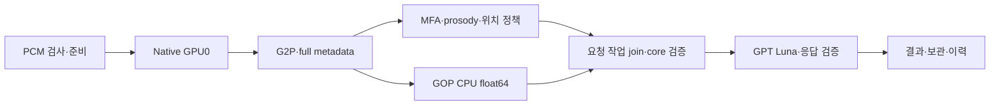

# Seungun 전체 경로 점검·J406 최적화·실측

작업 브랜치는 local main `ee8eefb377226d42b59b05d1b06950b050ca1b5e`에서 만든
`feat/seungun-server-optimization-20261025`다. 현재 실행 소스를 기준으로
자원 한도, 데이터 이동, 직렬 구간, 작업 소유권과 종료 시 정리를 점검했다.
학습·평가를 새로 실행하지 않았으며 실제 사용자 음성으로 변경 전 1회, 변경 후
3회의 공개 문장연습 API 시간을 측정했다. 화면 검증은 수행하지 않았다.

## 계획과 완료 기준

1. `seungun/src`·`seungun/scripts` 전체 Python 파일의 구조와 호출을 조사하고,
   실제 direct → canonical → Native/MFA/GOP → H5 → 보관 경로와 구분한다.
2. 프로세스가 실제 사용할 수 있는 CPU·메모리·GPU를 확인하고 기준 음성을
   변경 전 API에 한 번 제출한다. 원본·문장·정규화 WAV digest를 고정한다.
3. 모델 수식과 발음 정책을 유지하며 MFA 객체 생성 비용을 줄이고 독립 GOP를
   겹쳐 실행한다. MFA BLAS 예산은 4, Native와 GOP의 Torch 예산은 1로 둔다.
4. 파일 SHA·core/H5/lock의 닫힌 조합·schema·서비스 UID 접근을 확인한 후
   소유 admission hold와 활성 작업 0 확인을 거쳐 분석 서비스를 교체한다.
5. 첫 요청과 재사용 요청을 분리해 실측하고 TextGrid, 정렬 구간, 음소 근거,
   GOP 수치, DB·자식 프로세스·FD 정리와 보관 결과를 비교한다.

모든 단계가 수행됐다. 아래 수치는 해당 음성의 관측이며 일반적인 p50/p95나
동시 사용자 처리량을 뜻하지 않는다.

## 전체 코드 조사 범위

`seungun/src`와 `seungun/scripts`의 Python 20개, 3,430줄을 파일 단위로
열거·구문 분석하고 아래 책임·데이터 경계를 확인했다. 핵심 런타임과 연결부를
읽었으며, 학습이나 데이터 감사의 재실행으로 운영 성능을 추정하지 않았다.

| 소스 | 역할·확인한 비용과 판단 |
|---|---|
| `frozen_detector.py` | local-only 모델·MLP preload, 16kHz 변환, CTC와 layer-18 특징, CPU/GPU 복사, 음소별 특징·판정. 전체 hidden states와 추가 NumPy 복사가 있지만 이번 direct 실행 모델과 다르므로 교체하지 않았다. |
| `production_pipeline.py` | 원본 근거 snapshot·digest·threshold 검증·결정 포장. 음향 재추론 없이 기존 근거를 보존한다. |
| `evaluation/phone_alignment.py`, `training_utils.py` | 결정적인 edit alignment·CTC collapse·PER·학습 전 사람 검토 gate. 운영 판정을 바꿔 속도를 얻는 대상으로 삼지 않았다. |
| `data/aihub_reader.py`, `data/audit.py` | ZIP·JSON·TextGrid·음성 헤더와 데이터 분포 감사. archive CRC 검사·전체 분포 집계는 offline 작업이다. |
| `data/ctc_manifest.py`, `data/phone_vocab.py` | 관측 음소·QC·duration 검증과 어휘 ID 구성. 운영 음성 처리 시간에 포함되지 않는다. |
| `data/speaker_split.py` | 화자 단위 분할과 strata 집계. 전체 자료·화자 그룹을 메모리에 유지하는 batch 작업이다. |
| `data/textgrid_target_audit.py`, `data/training_manifest.py` | 라벨 정규화·분포 감사·symlink를 따르지 않는 manifest 로딩·train/dev 경계. 캐시를 넣어 검증 경계를 우회하지 않았다. |
| `io_utils.py`, package `__init__.py` 3개 | 원자적 JSON/CSV/JSONL 쓰기·export. 요청 처리와 학습 산출물의 수명을 구분했다. |
| `scripts/train_ctc.py` | 음성 decode/resample·padding·GPU 학습·dev 집계. bf16, gradient checkpointing, loader worker/prefetch 설정이 이미 존재한다. 이번 운영 모델 재학습은 하지 않았다. |
| 나머지 `scripts` 4개 | processor 생성, 데이터 준비, 두 감사 CLI. 온라인 DAG의 병목으로 계산하지 않았다. |

현재 공개 API는 패키지형 layer-18 detector를 새로 실행하지 않는다. 선택된
동결 canonical release의 `run_canonical_batch.py`가 실제 진입점이다. 배포
manifest의 Python 파일을 열거하고 Native forward, G2P, MFA sidecar와
DirectAligner, prosody, 위치 정책, GOP, resident/감시/전송을 연결해 확인했다.
서비스의 direct 접수·lease·worker·artifact 검증·H5 HTTP·보관 경계도 확인했다.

실제 DAG는 다음과 같다. GOP는 Native logits와 full phone metadata만 읽으며
MFA의 시간 구간을 입력으로 받지 않는다. 위치 기반 발음 정책은 계속 MFA 뒤에 있다.

## 실제 서버와 병렬 사용

J406에서 2026-10-25 조회했다. 호스트 전체 CPU 개수를 서비스 예산으로 사용하지 않았다.

| 항목 | 관측·적용 |
|---|---|
| CPU | Xeon Gold 6338, affinity 16 logical CPU / 13개 서로 다른 physical core. 보이는 cgroup v1 CPU 계층에 유한 quota 없음. |
| affinity | `13,17,23,25,35,45,47,57,61,63,79,87,103,107,111,127` |
| 메모리 | 실제 컨테이너 한도 195,421,011,968 bytes, 사전 점검 당시 여유 124,536,287,232 bytes. 호스트 MemAvailable만 보고 판단하던 오류 수정. |
| GPU | A100 80GB × 3. Native와 독립 TTS는 GPU0, GPU1·2는 이 경로에서 사용하지 않는다. |
| 예산 | Native Torch intra/inter-op 1, GOP 동일 float64 CPU 계산 1개 요청 소유 작업, MFA BLAS/OMP/MKL/OpenBLAS/NumExpr 4, NUM_JOBS 1, 활성 요청 1개 유지. |

고사양 하드웨어 전체가 균등하게 사용되는 구조는 아니다. 재사용 Native forward는
약 23–33ms이고 긴 구간은 Python·SQL·사전 준비다. GPU 수를 늘려 이 부분을
병렬화할 수는 없다. 하나의 음성을 여러 MFA job으로 나누면 기존 단일 발화
경계가 달라지므로 하지 않았다. 독립 GOP와 별도 MFA 프로세스는 실제로 겹친다.

BLAS 4 설정은 receipt에서 확인됐으나 MFA setup의 process CPU/wall은 약 1이다.
4배 병렬 처리나 4스레드 단독 개선 효과가 증명된 것은 아니다. 이번에는 Core-row
변경·겹침·스레드 예산을 함께 반영했으므로 각각의 효과를 완전히 분리한 실험은 아니다.

## 구현

- [MFA Core-row 조회](../../deploy/dlpc/performance/mfa_scalar_disambiguation.py):
  Word·Pronunciation의 full-column SELECT를 Core rows로 읽어 ORM 객체·관계
  조립 비용을 없앴다. 원래 Word 조회, 500-parent selectin batch, parent와 발음
  순서, autoflush, disambiguation 갱신·Phone 추가·commit·두 번의 호출은 유지한다.
  MFA 3.4.1 원본 함수·모듈·DB 정의 SHA, loader batch와 관계 order를 확인하고
  DirectAligner에만 설치한다. SQLite 파일이나 요청 결과를 캐시하지 않는다.
- [파생 release builder](../../deploy/dlpc/build_seungun_server_release.py):
  현재 부모 쌍을 검증하고 기존 request-owned `GopTask`를 새 runner에 연결한다.
  Native 이후 GOP를 시작하고 직렬 최종 단계에서 결과를 합친다. 정상·예외 모두
  join하며, 실행 중인 kernel이 반환하지 않으면 기존 외부 deadline이 세대를 종료한다.
  GOP 계산 소스·수식·float64·모델은 byte 단위로 유지했다.
- [cgroup 조회](../../src/voice_coach/backend_analysis/cgroup_resources.py)와
  [접수 예산](../../src/voice_coach/backend_analysis/resource_budget.py):
  `/proc/self/cgroup`와 mountinfo를 연결해 `cpu,cpuacct` combined mount 및
  실제 컨테이너·보이는 상위 계층을 읽는다. 자원 counter는 매번 새로 읽는다.
  같은 helper를 frozen MFA watchdog에 포함해 실제 v1 한도를 기록한다.
- [실행 identity](../../src/voice_coach/backend_analysis/canonical_harness.py),
  [Native 허용 조합](../../src/voice_coach/backend_analysis/native_execution.py),
  [private v4 schema](../contracts/runpod_result_v4.schema.json)에 정확한 새 쌍을 등록했다.
  공개 API·Backend v6 계약이나 점수 정책을 바꾼 변경은 아니다.
- [설치·원복 helper](../../deploy/dlpc/restore_seungun_server.py)와
  [복구 hook](../../deploy/dlpc/recover_on_start.py)에 고정 payload·이전 쌍 원복·새 selector
  우선순위를 연결했다. 이미 구현된 Luna·준비 재사용·관측 선행 변경도 main 기반
  새 브랜치에 포함했다. 원래 작업 디렉터리의 미커밋 변경은 수정하지 않았다.

사용자 지침에 따라 기존 테스트·fixture·전용 runner 251개도 이 브랜치에서 제거했다.
root/Seungun pyproject의 pytest 설정·test extra, scorer lock의 pytest·iniconfig·pluggy,
CI의 pytest·합성 fixture·테스트 단계를 제거했다. 새 테스트는 만들거나 실행하지 않았다.
운영 이미지에 이 저장소 정리 변경을 새 이미지 빌드로 배포한 것은 아니다.

## 실제 시간 측정

입력은 사용자 제공 `testaudio.m4a`(4.2666초), 문장은 **쌀과 콩을 깨끗한 그릇에 담아요**다.
16kHz mono PCM s16le로 변환해 같은 bytes를 제출했다. 각 시도는 POST 한 번이며
별도 clientAttemptId로 식별하고 GET으로 결과 준비를 확인했다. 로컬 클라이언트의
전체 시간에는 약 1초 간격 polling과 왕복 지연이 포함된다.

- 원본 m4a SHA: `c1c2249e067b093f6728a71ddd71fb797cdb8243deeb3673b09583ea212536f1`
- 제출·준비 WAV SHA: `71dd0b1bd6929f0d921a630725c14f6f047cc27dcb978ac4c38b6d0a08770a1d`
- 문장 SHA: `b9b4cab47fd1c9dafdd34167a478290a93e22b3fb2669e82907327aa45d9c3af`

| 구분 | POST UTC | jobId | MFA 회차 | 클라이언트 전체 초 |
|---|---|---|---:|---:|
| 변경 전 신규 측정 | 09:37:10.731856 | `7db5a04d-3698-48e0-a443-636a32228d10` | 2 | 18.871922 |
| 변경 후 첫 요청 | 09:55:10.434464 | `0431b973-7254-4cb5-a02b-e68a183beb3a` | 1 | 17.841181 |
| 변경 후 재사용 | 09:55:43.482296 | `be5891c7-cd43-4ea1-aa52-f0956b7bd74a` | 2 | 14.722442 |
| 변경 후 재사용 | 09:57:57.060508 | `2f30ae3e-faf7-4dd2-b1ad-37dd6ee1a78c` | 3 | 13.658412 |

비교 회차를 맞춘 신규 측정 결과는 다음과 같다. 서버 전체는 job.createdAt부터
resultReadyAt, core는 worker의 coreStartedAt부터 coreFinishedAt, MFA는 core의
mfa_start부터 mfa_done, provider는 실제 HTTP 요청 관측이다. 하위 span은
포함 관계가 있으므로 아래 열을 모두 합산하면 안 된다.

| 항목 | 변경 전 2회차 초 | 변경 후 2회차 초 | 관측 |
|---|---:|---:|---|
| 클라이언트 전체 | 18.871922 | 14.722442 | −22.0% |
| 서버 전체 | 17.676735 | 14.216821 | −19.6% |
| **core producer** | **9.985375** | **7.794078** | **−21.9%** |
| **MFA** | **7.749169** | **6.303525** | **−18.7%** |
| MFA setup | 6.332173 | 4.937977 | 주된 직렬 준비 구간 |
| **disambiguation 2회 합계** | **2.468388** | **1.067307** | **−56.8%, 약 1.40초 감소** |
| dictionary_setup, 하위 disambiguation 포함 | 2.010238 | 1.202591 | 하위 span과 중복 |
| normalize_text | 1.189207 | 1.176219 | 남은 병목 |
| build_lexicon_compiler | 1.465420 | 1.621787 | 이번 요청에서는 증가 |
| generate_features | 0.149976 | 0.105196 | 재사용 worker 회차 기준 |
| 그중 MFCC | 0.045127 | 0.049024 | 스레드 증가의 단독 개선 근거 없음 |
| graph / align | 0.067507 / 0.115932 | 0.053692 / 0.088882 | 원래부터 짧은 구간 |
| cleanup | 0.329969 | 0.298216 | DB·FD·child gate PASS |
| GOP | 0.770056 | 0.672534 | 변경 후 MFA 안에서 완료 |
| expression 전체 | 6.007897 | 4.701575 | 외부 provider 변동 포함 |
| GPT HTTP | 5.759251 | 4.467962 | CPU 변경 효과로 귀속하지 않음 |

변경 후 2회차 core 상대 시각은 GOP 시작 **0.953830**, 종료 **1.626364**,
MFA 시작 **0.954118**, 종료 **7.257642**초다. GOP 대기가 직렬 말미에서 제거됐다.
3회차에도 core **7.816503**, MFA **6.371855**초로 비슷한 시간이 관측됐다.

동일 이전 release의 첫 요청 job `57364a15-a9b7-437f-a06c-6a737a6c1aed`
(09:09:54 UTC)과 첫 요청끼리 비교하면 core **13.086307 → 10.104990초**,
MFA **9.895470 → 8.178084초**다. 첫 회차에는 Native kernel·MFCC 초기화 등이
포함되므로 재사용 요청과 섞지 않았다. 첫 요청도 모델을 매번 새로 로드한 cold boot
시간이나 서버 시작 시간 전체를 뜻하지 않는다.

GPT는 세 요청 모두 `gpt-6-luna / none / default`, HTTP 200, dispatch 1회,
finish=stop, reasoning token 0이었다. provider 시간은 **4.979012 / 4.467962 /
3.455361초**, completion token은 **318 / 338 / 199**, cached token은 모두 1,980이다.
Fast는 사용하지 않았다. 특히 3회차의 짧은 총 시간에는 출력 길이·provider 변동이
함께 작용하므로 이를 모두 Seungun 최적화 효과로 표현하지 않는다.

## 결과 동등성·운영 반영

변경 후 세 요청은 모두 ACCEPT·worker 성공·`SCHEMA_AND_STRUCTURAL_SEMANTICS_VALID`였고
archive/history sync는 모두 COMPLETE였다. trace는 각각 complete=true, 55 spans,
dropped=0이며 DB close/lifecycle PASS, 남은 request-scoped child/FD는 0이다.

직전 첫 요청과 신규 기준 요청 및 변경 후 세 요청에서 다음이 정확히 같았다.

- 준비 WAV SHA, MFA word/phone interval 배열, 원본 위치 기반 pronunciation_evidence.
- word interval 8개·phone interval 32개와 core prosody 문서도 정확히 일치했다.
- GOP 문서의 모든 수치·관측·alignment·coverage. elapsedSeconds만 비교에서 제외했다.
- TextGrid SHA: `d0880a56b4d563381c29cb6d3128fbb55e5a00a5d67b8a65e36ee0de91f4780e`.

이는 이 녹음에서의 결정적 근거 동등성이다. GPT 출력·점수의 동일성이나 다른 발화의
정확도를 증명한 결과는 아니다. 새 학습·대규모 품질 검증은 하지 않았다.

활성 direct 쌍은 아래와 같다. 내부 Backend의 이전 canonical 쌍과 닫힌 접수 상태는
유지했다. 분석만 재시작했고 TTS PID 460835는 유지됐다.

| 항목 | 값 |
|---|---|
| core 경로 | `/workspace/intelligentai/validation/canonical_dlpc_seungun_server_20261025_v3` |
| core manifest | `fb597319347d106e4a8e59d7bb6a254f031a7e85a21b87d8c349763829b0152d` |
| H5 manifest | `c41b820326cd6a95a9ef6ff502b400be0a078ee9d51c5cce99fdabca5c60ee1d` |
| H5 dependency lock | `ecc76bcc2ca505f4b717d7a49add8b556fef427c9a1bc61f84204f11ce572639` |
| prompt | `ad59ba9124fbe26b9451bcb1a04a5eb1afcb3c819c539d5a25d3ac09a1dc281d` |
| optimized MFA function | `ca0ead761af881968126cff43889e9282f4c8e5d41f9a3d666fb0179d74a0afb` |

core의 v1/v2는 활성화 전 작성한 후보이고 운영 선택은 v3뿐이다. 영속 selector는
`startup-20261006/seungun-server-20261025/selected=optimized`다. 원복 helper는
기존 disambiguation 쌍과 runtime·cgroup 모듈·접수 예산을 함께 복원한다.

MFA sampled peak RSS는 변경 전 재사용 요청 794,546,176 bytes, 변경 후
첫/2/3회차 699,981,824 / 760,221,696 / 762,978,304 bytes였다. sampled peak이며
전체 pipeline RSS나 PSS/USS를 측정한 값은 아니다. 세 요청 모두 실제 cgroup v1
한도와 headroom이 감시 receipt에 기록됐다.

`/tmp` 여유가 약 350MB인 상태도 확인했다. 서비스 UID의 열린 FD와 전체 cmdline
경로를 확인해 사용 중인 두 세대는 제외했다. 중지된 세대의 오래된 memory JSONL
4개는 private 운영 경로로 압축 보존하고 해시·inode·크기·mtime 불변을 확인한 뒤
tmpfs 사본을 제거해 **930,008,060 bytes**를 회수했다. 직후 여유는
**1,279,070,208 bytes**였다. 실제 음성·TextGrid·job 기록은 제거하지 않았다.

## 정적 확인과 인계 범위

- 변경·선행 소스 및 Seungun 전체를 포함한 Python **53개** 구문 컴파일,
  JSON **2개**, TOML **2개**, CI YAML 3 jobs 구문 확인 통과.
- 새 자원 helper·접수 예산·MFA helper·builder·설치 helper **5개**에 mypy
  `--check-untyped-defs`, Python 3.12 대상으로 확인해 오류 0개.
- 새 보고서의 상대 파일 링크 **9개**, 변경 diff 공백 검사 통과.
- 실제 서비스 UID의 실행 identity·schema 조합·전체 release 파일 SHA 사전 확인 통과.
- 최종 운영 경로의 runtime 파일 **11개** 해시, packaged Python **67개** 구문·해시,
  영속 설치·복구 helper와 작업 소스 일치 확인 통과.
- 저장소 테스트 파일 251개 제거와 별도로 운영 음성 API만 변경 전 1회·변경 후 3회
  실행했다. 측정용 WAV·관측 JSON은 저장소 밖 한 디렉터리의 최대 **6개**였고 종료 전
  제거했다. 단위·회귀·화면 검증, 학습, Docker 이미지 빌드는 수행하지 않았다.

운영 direct 반영과 Git 반영은 별개다. 이 작업에서는 commit·push·PR을 수행하지 않았다.
**10:15:19 UTC** 최종 확인에서 deployment health 200, activeJobs/directJobs=0,
local·공개 direct readiness 200/ready=true, admission hold 없음이었다. 측정 임시 파일
6개와 디렉터리를 제거했으며 `/tmp` 여유는 1,277,235,200 bytes였다.
추가 조회에서 local `/health/handoff`와 AWS Backend handoff readiness 모두
admissionEnabled=false였다. 저장된 handoff/admission env flag가 true인 것과 실제
접수 gate가 열렸다는 것은 다르다. 이번 작업은 해당 flag를 바꾸지 않았다.
서비스 재시작·새 resident 준비는 확인했고 전체 서버 cold boot 복원은 실행하지 않았다.

## 남은 개선 범위

재사용 요청에서 normalize_text 약 1.18초와 lexicon compiler 약 1.62초가 남아 있다.
다음 단계는 불변 사전·symbol mapping·규칙의 identity를 고정한 worker-local compiler
재사용 설계다. 요청별 OOV·word mapping·speaker·DB·feature 상태를 섞으면 안 된다.
약 0.4–0.5초의 ffprobe/ffmpeg 준비도 canonical PCM fast path 후보지만, 이번에는
입력 검증·원본 digest 경계를 바꾸지 않았다.

여러 GPU를 쓰는 처리량 개선은 독립 요청 슬롯·resident·MFA 임시 경로·GPU 할당·전역
접수 조정이 필요한 별도 변경이다. 이번 단일 요청 latency 결과로 동시 실행 수를
늘리지 않았다. 신규 접수가 닫힌 내부 canonical의 구형 감시기는 별도 순환 적용이 남아 있다.
