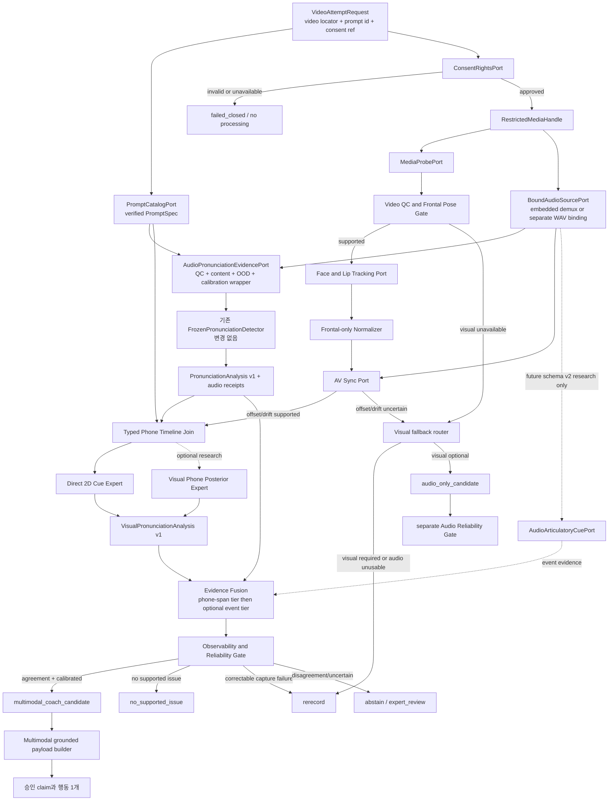

# seungun 입술 모양 발음 증거 파이프라인 설계

> 보존 상태: `historical_snapshot`. 현재 시각 sidecar 아키텍처 정본이 아니다.

- 기준일: 2026-08-25 (Asia/Seoul)
- 문서 상태: `design_only`
- 구현 상태: `not_implemented`
- 주장 범위: `engineering_design_proposal`
- 대상 입력: 서버 catalog의 고정 문장을 발음하는 사용자의 음성 포함 정면 고정 영상
- 핵심 원칙: **영상은 외부에서 보이는 조음 증거를 보강하지만, 영상만으로 음소 오류나 신체 내부 원인을 확정하지 않는다.**

## 1. 결론

현재 `seungun`의 음성 detector를 수정하지 않고 다음 두 결과를 나란히 만든 뒤,
feedback bridge 직전에 새 reliability/disagreement 계층에서 결합한다.

```text
기존 audio-only 경로 — 계약과 threshold를 변경하지 않음
WAV + expected phones
  -> FrozenPronunciationDetector
  -> PronunciationAnalysis v1
                         \
                          -> MultimodalReliabilityPolicy -> issue 0..1개
                         /
신규 visual sidecar 경로
Video + expected phones + 공통 시간축
  -> VisualPronunciationPipeline
  -> VisualPronunciationAnalysis v1
```

첫 MVP는 학습량과 설명 가능성을 고려해 **정면 고정 영상의 2D 입술·턱
landmark 궤적**을 우선 사용한다. 소형 appearance encoder, 영상→음소 CTC
head와 2.5D/3D 얼굴 복원은 direct-cue baseline보다 증분 가치가 확인된 뒤의
연구 항목으로 둔다. 정면 허용 pose 범위에서만 동결된 normalizer, capability
mask와 reference distribution을 사용하고 범위 밖 영상은 재촬영 또는
unsupported로 처리한다.

영상 단독 deviation, 시청각 불일치, sync 실패, 낮은 관측 가능성은 자동 코칭
근거가 아니다. 각각 `abstain`, `expert_review`, `rerecord`, 또는 명시적인
audio-only fallback으로 처리한다.

또한 현재 frozen audio detector에는 correctness calibration, 충분한 audio QC,
content-match/OOD를 결합한 reliability gate가 없다. 아래 target 구조의
`AudioPronunciationEvidencePort`가 이 receipts를 제공하기 전에는
`audio_reliability_unavailable`이며, 신규 경로의
`multimodal_coach_candidate`와 audio-only
fallback을 모두 차단한다. 이는 기존 detector를 고치는 작업이 아니라 변경 없이
감싸는 새 adapter/policy 선행조건이다.

## 2. 현재 구현과 이 설계의 경계

### 2.1 현재 로컬에서 관찰된 구현

다음은 현재 workspace에서 관찰된 코드 또는 artifact다.

- `FrozenPronunciationDetector.analyze(audio_path, expected_phones)`는
  `PronunciationAnalysis`를 반환한다.
- phone별 결과에는 `expected_index`, `expected_phone`, CTC
  `observed_candidate`, `start_ms/end_ms`, `error_score`, 동결 threshold,
  `is_error`가 있다.
- `error_score`는 보정된 정답 확률이 아니라 detector ranking score다.
- `observed_candidate`는 ground-truth 전사가 아니다.
- 현재 `seungun_bridge`는 threshold를 통과한 audio phone 중 top-1을 선택해
  승인된 generic 재연습 claim으로 바꾼다.
- threshold를 통과한 phone이 없으면 현재 bridge는 `no_issue` 결과를 만드는
  대신 예외를 내므로, 이 상태를 이미 구현된 동작으로 간주하지 않는다.
- 이 직접 실행 경로는 일반 `PronunciationFeedbackPipeline`에 통합된 HTTP
  서비스가 아니라 in-process/CLI 경로다.
- 동결 detector와 locked 결과 artifact는 로컬에 존재하지만 독립 재현,
  정본 상태 승격, 실제 학습자 타당성 및 전문가 검증은 완료로 간주하지 않는다.
- 기존 manual alignment audit의 `0.7417 < 0.95` 실패는 영상 branch가
  소급해서 해소하지 않는다.

현재 계약은
[frozen detector](../../seungun/src/korean_phone_ctc/frozen_detector.py),
[audio-only bridge](../../src/voice_coach/pronunciation_feedback/seungun_bridge.py),
[신뢰성 개선 제안](../../seungun/docs/PIPELINE_RELIABILITY_IMPROVEMENT_PROPOSAL_KO.md)을 기준으로 한다.

### 2.2 이 문서에서 구현하지 않은 것

이 문서 작성으로 다음 항목이 구현되거나 검증된 것은 아니다.

- video decode, face/lip tracking, 정면 pose 적합성 판정, quality gate, A/V sync
- visual cue 추출기, visual phone posterior, reference bank
- audio-visual 결합기, 보정기, disagreement policy, multimodal bridge
- 정면 고정 입력 성능, Korean L2 전이, latency, reload parity
- 영상 데이터 수집 동의, 삭제 절차, data card 및 전문가 annotation
- 사용자 발음 정확도 또는 교육 효과 개선

따라서 기존 audio 파일, frozen artifact, threshold, audio-only CLI 및 bridge
출력 계약은 이 설계의 수정 대상이 아니다.

## 3. 목표와 비목표

### 3.1 목표

1. 한 영상에서 음성과 입술 움직임을 같은 시간축으로 관찰한다.
2. 정면 허용 pose 범위에서 실제로 보이는 외부 조음 cue만 추출한다.
3. expected phone별 audio evidence를 덮어쓰지 않고 visual evidence를 나란히
   보존한다.
4. 관측 가능성, 품질, sync, OOD, calibration과 불일치를 통과한 경우에만
   발행 가능한 피드백 후보를 만든다.
5. 사용자에게 오류 한 건과 실행 가능한 행동 한 가지를 제공하고, 같은 동결
   scorer로 재시도 변화를 비교할 수 있게 한다.
6. 모든 외부 decoder/model/storage를 교체 가능한 typed port 뒤에 둔다.

### 3.2 비목표

- 영상만으로 정확한 음소, 발음 오류 또는 혀·성문·기류 원인을 확정
- 한국어 평음·경음·격음을 입 모양으로 분류
- homophene을 하나의 음소로 조기 확정
- 정면 허용 범위 밖 pose를 임의로 정면화하거나 지원 입력처럼 처리
- 합성 얼굴 animation을 사용자의 실제 관측 증거처럼 표시
- visual score로 기존 audio `error_score`, `is_error`, threshold를 재작성
- LLM이 새 음소, 오류 위치, 조음 원인 또는 행동을 생성
- 작은 smoke 결과를 production/교육 효과 근거로 승격

## 4. 전체 아키텍처



`BoundAudioSourcePort`는 영상 하나만 제출됐으면 컨테이너 audio track을 제한된
임시 공간의 WAV로 변환하고, 별도 WAV가 제출됐으면 두 source/clock을 하나의
binding receipt로 묶는다. 그 WAV를 현재 detector에 전달하되 detector 내부는
바꾸지 않는다. 별도 WAV와 영상은 동기화 marker 또는 검증된 sync 추정 없이는
결합하지 않는다.

video QC 또는 sync 실패는 visual timing/fusion만 무효화한다. 시각 피드백이
요청의 필수 조건이거나 audio도 사용할 수 없으면 `rerecord`, 그렇지 않으면
별도의 audio reliability gate로 routing한다. 동의·권리 실패는 촬영 품질 문제가
아니므로 `rerecord`가 아니라 처리 전 `failed_closed`다.

## 5. 컴포넌트와 책임

아래 경로는 **제안 경로**이며 현재 존재하거나 등록된 구현 경로가 아니다.

```text
seungun/src/korean_phone_ctc/visual_evidence/
  domain.py
  ports.py
  application/
    coordinator.py
  services/
    pipeline.py
    timeline_join.py
    observability.py
    evidence_fusion.py
    multimodal_policy.py
  adapters/
    consent_rights_ledger.py
    restricted_media.py
    media_probe.py
    audio_demux.py
    audio_source_binding.py
    detector_phone_projection.py
    audio_pronunciation.py          # frozen detector를 변경 없이 감싸는 adapter
    audio_articulatory_cues.py      # future research; schema v1에서는 호출 금지
    video_quality.py
    face_lip_tracker.py
    frontal_normalizer.py
    av_sync.py
    direct_2d_cues.py
    visual_phone_posterior.py       # optional research head
    visual_reference_bank.py
    decision_ledger_json.py         # restricted, append-only/atomic adapter

src/voice_coach/pronunciation_feedback/
  multimodal_seungun_bridge.py      # 기존 seungun_bridge의 sibling
  multimodal_advice_catalog.py
```

| 컴포넌트 | 책임 | 금지 책임 |
|---|---|---|
| `VideoAttemptCoordinator` | verified prompt와 opaque media handle로 port 호출, receipt 결합 | concrete detector/SDK 직접 import, audio threshold 변경 |
| `PromptCatalogPort`/`ExpectedPhonePort` | catalog의 `PromptSpec`, target text와 expected-phone source 제공 | caller가 보낸 phone을 정본으로 승인 |
| `ConsentRightsPort` | facial/voice 목적·역할·보존·삭제 권리와 receipt 검증 | 동의가 없을 때 media decode |
| `RestrictedMediaPort` | entrypoint locator를 opaque handle로 바꾸고 TTL/deletion receipt 관리 | domain/public/LLM에 path 노출 |
| `MediaProbePort` | container, codec, FPS, duration, frame timestamp 관찰 | shell 출력이나 path를 public 결과에 노출 |
| `BoundAudioSourcePort` | embedded track demux 또는 separate WAV를 tagged source receipt로 만들고 video/audio digest·clock을 binding | 별도 WAV를 embedded track처럼 가장하거나 원본 장기 저장 |
| `AudioPronunciationEvidencePort` | audio QC/content/OOD/calibration receipt와 원본 `PronunciationAnalysis` envelope 제공 | `error_score`, `is_error`, frozen threshold 재작성 |
| `AudioReliabilityPolicy` | QC·content·support·calibration·negative coverage를 `PASS/BLOCK/UNSUPPORTED`로 결정 | threshold 통과를 correctness confidence로 승격 |
| `DetectorPhoneProjectionPort` | canonical expected tokens를 frozen detector vocab에 투영하고 source↔detector index/identity receipt 보존 | unknown token heuristic repair 또는 display jamo로 identity 비교 |
| `AudioArticulatoryCuePort` | 별도 검증된 경우 matching acoustic event evidence 제공 | 현재 detector에 없는 VOT/burst/formant evidence가 있다고 가장 |
| `VideoQualityPort` | 얼굴 수, 정면 pose, blur, 가림, 조명, lip ROI coverage | 정면 범위 밖 pose나 낮은 품질을 score 0으로 치환 |
| `FaceLipTrackingPort` | frame timestamp별 얼굴·입술·턱 관측 | 정확한 음소 또는 내부 조음 원인 판정 |
| `AvSyncPort` | offset, drift, sync measurement reliability와 상태 | 실패한 sync를 0 ms로 가정 |
| `Direct2DCuePort` | 가시적인 cue 궤적과 event evidence | 한국어 음소를 hard label로 확정 |
| `VisualPhonePosteriorPort` | 후보 분포, entropy, calibration 상태 | LLM 복원 문장을 MDD evidence로 사용 |
| `VisualReferenceBankPort` | 정면 pose 범위·문맥·cue별 reference distribution 조회 | 단일 화자의 얼굴을 정답 템플릿으로 사용 |
| `EvidenceFusionService` | evidence ID, capability, calibration과 conflict를 보존한 결합 후보 생성 | 서로 다른 score를 무단 평균하거나 confidence로 개명 |
| `MultimodalReliabilityPolicy` | capability mask, agreement, abstention, 한 issue 선택 | 새 관측 사실 생성 또는 evidence 평균으로 충돌 은폐 |
| `MultimodalAdviceCatalogPort` | 동결 revision에서 `advice_id`와 승인 claim 본문 조회 | policy/LLM이 새 행동 문구 생성 |
| `DecisionLedgerPort` | analyses, fusion, selected/rejected evidence와 conflict를 append-only event로 보존 | raw media/path를 ledger에 기록하거나 과거 event 수정 |
| `multimodal_seungun_bridge` | 결정된 `advice_id`와 claim만 기존 표현 계약에 전달 | 기존 audio-only bridge 계약 또는 action 변경 |

모든 adapter는 backend ID, revision, 설정 hash와 실패 상태를 반환한다. domain과
policy는 파일시스템, 네트워크, GPU runtime 또는 특정 landmark SDK를 직접
import하지 않는다.

face tracker, landmark SDK, encoder weight와 model-hub artifact는 사용 전에
checksum, contract/license 허용 범위, timeout, retryability와 failure mapping을
검증한다. 얼굴·음성·landmark의 remote egress는 기본 `denied`이며, consent의
승인 purpose/data category와 adapter egress policy가 모두 명시적으로 허용한
경우가 아니면 local/offline adapter만 선택한다.

## 6. 단계별 파이프라인

### V0. 동의·권리·요청 계약

entrypoint 입력은 `video_locator`, `prompt_id`, consent receipt reference와
선택적 별도 audio locator뿐이다. coordinator는 기존 `PromptCatalogPort`와
`ExpectedPhonePort`로 `PromptSpec`, target text, target language와 expected phones를
서버 측에서 얻는다. caller가 편의를 위해 target text/phone/version 복제본을
제공하더라도 trusted artifact와 exact match를 검사할 뿐 정본으로 사용하지 않는다.
unsupported target language, catalog version mismatch 또는 content mismatch는
MDD 전에 fail-closed한다.

수집 목적에 facial video/biometric-derived data,
모델 개선 사용 여부, 보존 기간, 삭제 경로가 포함되지 않으면 fail-closed한다.

prompt text, expected/canonical phone, model-observed candidate와
`expert_adjudicated_auditory_label`은 서로 다른 역할로 저장하고 annotator
uncertainty를 보존한다. expected label이나 전문가 청지각 label을 물리적 실현의
절대 ground truth로 간주하지 않는다.

### V1. media intake와 제한된 작업 공간

- 지원 container/codec을 allowlist로 검사한다.
- entrypoint의 locator는 즉시 `RestrictedMediaHandle`로 바꾸고 이후 domain과
  application service에는 locator/path를 전달하지 않는다.
- 가변 frame rate는 실제 presentation timestamp를 보존한다.
- 전체 duration과 audio/video track 존재를 검사한다.
- 원본 video, demux WAV와 debug crop은 request 범위의 제한된 임시 공간에만 둔다.
- 성공·실패 모두에서 TTL 기반 정리를 수행하고 typed deletion receipt를 남긴다.
- 삭제 실패는 숨기지 않고 retry/incident/tombstone 상태를 기록하며, cleanup
  policy가 요구하는 경우 결과 publication도 fail-closed한다.
- public log에는 path, 얼굴 frame, transcript, participant ID를 기록하지 않는다.

### V1-A. audio evidence envelope와 차단 선행조건

`AudioPronunciationEvidencePort`는 tagged audio-source receipt와 verified
`PromptSpec`을 받아
다음을 하나의 immutable envelope로 반환한다.

- source kind, video/source-audio/detector-input-WAV digest와 clock; embedded이면
  track ID/최초 audio PTS
- trim/pad/gain 여부, sample rate/channel, adapter revision/config hash
- typed audio QC, content match, support/OOD, calibration, negative coverage와
  `AudioReliabilityReceipt`
- expected-phone source revision, canonical digest와 `DetectorPhoneProjectionReceipt`
- 변경하지 않은 원본 `PronunciationAnalysis v1`과 canonical analysis digest

기존 `ExpectedPhoneSequence.tokens`는 word boundary `|`를 보존할 수 있지만 현재
frozen seungun detector vocabulary는 이를 expected phone으로 받지 않는다.
`DetectorPhoneProjectionPort`는 동결 policy에 명시된 boundary만 제거하고 모든
source token index→detector expected index를 보존한다. detector token,
문맥·음절 위치가 포함된 internal phone ID와 UI display jamo를 분리한다. unknown,
비결정적 또는 지원되지 않는 다대일/일대다 projection은 fail-closed한다.

현재 `PronunciationAnalysis` 자체에는 prompt ID/version, input audio digest 또는
audio timebase가 없으므로 envelope가 같은 attempt와 prompt에 대한 결과임을
결합한다. 기존 frozen detector를 직접 바꾸거나 score를 보정된 confidence로
개명하지 않는다. 이 wrapper와 보정 artifact가 없으면 상태는
`audio_reliability_unavailable`이며 신규 `multimodal_coach_candidate`,
`no_supported_issue`와
audio-only fallback을 모두 발행하지 않는다. 기존 CLI/bridge는 별도 legacy
경로로 입력·출력·후보 없음 예외와 exit code를 그대로 유지한다.

### V2. video QC와 정면 pose gate

frame 또는 짧은 구간별로 다음을 관찰한다.

- 얼굴 수와 target face track continuity
- yaw/pitch/roll과 `FrontalCaptureVerdict.COMPLIANT | UNSUPPORTED`
- lip ROI coverage, occlusion, motion blur, illumination, effective resolution
- frame timestamp gap, dropped/duplicated frame, usable segment ratio
- 안경·마스크·손·머리카락 등 입 주변 가림

정확한 정면 허용 yaw/pitch/roll, blur, coverage, 밝기 threshold는 이 문서에서
임의로 정하지 않는다. 라벨된 정면 QC set에서 보정하고 `VisualThresholdSet`
artifact에 동결한다. 지원 범위를 벗어난 pose를 무리하게 정면화하지 않고
`rerecord`한다.

### V3. tracking과 정면 전용 정규화

첫 MVP는 얼굴 전체 RGB보다 입술 outer/inner contour, mouth corner, 턱 기준점,
head pose와 시간 derivative를 우선 사용한다.

- 얼굴/머리 움직임을 제거한 local lip coordinate를 계산한다.
- 얼굴 또는 inter-ocular scale과 개인 neutral baseline으로 크기를 정규화한다.
- frame timestamp를 기준으로 trajectory를 resample하되 원본 timestamp를
  provenance로 보존한다.
- 정면 전용 normalizer 하나를 version/hash pin하고 허용 yaw/pitch/roll 범위 밖으로
  외삽하지 않는다.
- mirror 여부를 명시적으로 기록하고 검증된 canonical orientation transform
  뒤에서만 좌우 비대칭 cue를 계산한다.
- track switch나 장시간 gap은 low confidence가 아니라 명시적 실패 상태다.

### V4. A/V sync

container timestamp를 1차 기준으로 사용하고, 필요할 때 mouth-motion signal과
audio envelope/phonetic event의 상관을 보조 evidence로 사용한다. 출력은
`offset_ms`, drift estimate, 구간별 measurement reliability, method와 revision을
포함한다. transform의 방향은 다음처럼 schema에 고정한다.

```text
video_ms = audio_ms + offset_ms + drift_ms_per_ms * (audio_ms - anchor_audio_ms)
```

sync measurement reliability는 cue deviation confidence나 최종 오류 probability가
아니며 서로 직접 비교하지 않는다.

다음에는 visual timing claim과 event fusion을 중단한다.

- audio와 video duration/clock이 호환되지 않음
- offset 또는 drift가 동결된 지원 범위 밖임
- 상관 peak가 모호하거나 발화 구간이 너무 짧음
- separate capture인데 동기화 marker가 없고 보조 추정도 불확실함

sync가 실패해도 임의로 `offset_ms=0`을 넣지 않는다.

### V5. expected-phone 공통 시간축

기존 audio `PhoneEvidence`를 변경하지 않고 join anchor로 사용한다.

1. catalog에서 얻은 `VerifiedPromptBinding`과 `AudioEvidenceEnvelope`의 prompt,
   expected-phone source revision 및 canonical digest가 일치하는지 검사한다.
2. audio-source receipt의 source video/audio/clock과 visual input binding이 같은지
   검사한다.
3. 모든 `PhoneEvidence.expected_index`가 연속이고 projection entry의
   `detector_expected_index`와 일치하는지 검사한다.
4. `PhoneEvidence.expected_phone`은 projection entry의 `detector_token`과만
   비교하고, 그 entry를 통해 internal phone ID/display jamo/context에 연결한다.
5. detector `expected_index`를 의미 anchor로 사용하되 source token index도
   ledger에 보존한다.
6. 유효한 `start_ms/end_ms`를 명시된 A/V transform으로 video timestamp에 옮긴다.
7. `span_source`, `alignment_state`, boundary uncertainty와 time overlap을 별도
   `PhoneTimelineJoinResult`에 기록한다.
8. index, media binding 또는 span이 불일치하면 positional heuristic으로
   복구하지 않는다.

현재 CTC span은 predicted run을 WAV 길이에 비례시킨 관측이고 gold boundary가
아니다. 특히 deletion은 span이 `None`이고 insertion에는 index/time evidence가
충분하지 않다. 따라서 이 경우 visual evidence로 빈 audio evidence를 채우거나
오류 위치를 발명하지 않는다. 검증된 expected-phone aligner가 별도 port로
추가되기 전에는 `alignment_unavailable`로 처리한다.

### V6. direct 2D cue 추출

phone/event span마다 가능한 경우 다음 trajectory와 사건을 계산한다.

- lip aperture와 최소 lip distance
- 영상에서 두 입술 경계가 맞닿거나 근접한 상태의 onset, duration, release
- rounding/spreading의 상대 변화
- jaw opening의 onset, peak, release
- head motion을 제거한 좌우 비대칭
- trajectory velocity, acceleration과 안정성

raw 값만으로 좋고 나쁨을 판단하지 않는다. phone context, 앞뒤 phone, speaking
rate, 정면 profile/pose bin, device, participant neutral baseline과 reference
distribution을 함께 사용한다. reference가 없거나 OOD이면 coaching score를
만들지 않는다.

### V7. 선택적 visual phone posterior 연구 head

학습형 branch를 추가한다면 hard phone 하나가 아니라 다음을 출력한다.

- frame/phone-span posterior distribution
- top-k 후보와 homophene group
- entropy, calibration state, OOD state
- frontal profile/pose bin, visibility, boundary reliability
- backend/revision/checkpoint hash

한국어 viseme mapping은 confusion prior, auxiliary loss 또는 error analysis에만
사용할 수 있다. 최종 phone label을 viseme으로 축소하지 않는다. 영상에서 문장을
복원하는 LLM/LM 결과는 실제 오류를 정상 문장으로 고칠 수 있으므로 MDD evidence로
사용하지 않는다. 이 head는 direct cue baseline보다 유의한 증분 가치와 안전성을
입증하기 전에는 자동 코칭 권한이 없다.

### V8. reference 비교와 observability routing

각 cue에 대해 `observed`, `missing`, `low_confidence`, `out_of_distribution`,
`backend_unavailable`, `not_applicable`을 구분한다. `missing`이나
`not_applicable`을 숫자 0으로 변환하지 않는다.

reference bank는 단일 원어민의 얼굴 궤적이 아니라 phone-context, 정면 pose bin,
speaking rate와 허용 개인차를 포함한 분포를 반환해야 한다. reference 또는 calibration
revision이 요청 조건을 지원하지 않으면 visual coaching을 금지한다.
각 조회는 feature schema, cohort, speaker/sample support, rights basis, manifest와
reviewer를 결합한 `VisualReferenceDistributionReceipt`를 반환한다. 최종 cue와
decision에는 `ELIGIBLE` receipt ID를 붙이며 다른 상태는 score 0이 아니라
`insufficient_support/unsupported`로 routing한다.

### V9. phone/event 단위 late fusion

초기 feature concatenation이 아니라 두 단계의 의미가 명시된 late fusion을 쓴다.

#### Tier 1 — 현재 audio 계약을 보존한 phone-span 결합

현재 `PronunciationAnalysis`가 제공하는 것은 phone-level CTC candidate/span,
ranking score와 soft features다. closure, burst, VOT, formant 또는 F0 사건을
제공하지 않는다. 따라서 첫 결합은 다음처럼 제한한다.

```text
audio: threshold-passed phone error candidate, 단 reliability는 별도 gate 필요
visual: 같은 trusted expected index와 불확실성을 포함한 span의 visible cue
result: co_located_phone_span_support 또는 conflict
```

이 결과를 `audio와 visual이 같은 물리 사건을 관측했다`고 표현하지 않는다.
visual cue에 대한 행동 지시도 paired calibration과 전문가가 승인한
phone-context→cue catalog가 생기기 전에는 발행하지 않는다.

#### Tier 2 — 선택적 event-matched 결합

별도 `AudioArticulatoryCuePort`가 독립적으로 검증됐을 때만 다음 사건을 같은
event type으로 결합할 수 있다.

| 사건 | 별도 audio cue evidence | visual evidence | 결합 규칙 |
|---|---|---|---|
| 양순 폐쇄/해제 | closure/release/burst/timing | 최소 입술 거리, 접촉 proxy duration, release | 양쪽 cue와 sync/calibration이 모두 지원될 때만 event agreement |
| 원순성 | formant/spectrum/vowel posterior | rounding과 aperture proxy | phone/context별 capability 안에서만 결합 |
| 턱/입술 timing | 검증된 phone boundary/duration | onset, peak, release | boundary uncertainty를 함께 전파 |
| voicing/기식 | VOT, F0, voicing, burst | `not_applicable` | audio-only evidence로만 판단 |
| 내부 접촉/기류 | acoustic candidate만 제한적으로 가능 | `not_applicable` | 신체 원인 claim 금지 |

Tier 2는 v1 구현 범위가 아니다. v1 policy는 `EVENT_MATCHED_SUPPORT`를 입력받으면
fail-closed하고 `COLOCATED_PHONE_SPAN_SUPPORT`까지만 허용한다. Tier 2를 활성화하려면
새 schema/policy major version에서 `AudioArticulatoryCueEvidence`의 event type,
단위, span/boundary uncertainty, score semantics, calibration target/OOD와 provenance
계약을 먼저 동결해야 한다. 독립 event annotation, boundary 평가, Tier 1 대비
증분효과, reload/calibration과 새 locked test를 모두 통과하기 전에는 research-only다.

작은 한국어 L2 data 단계에서는 cue별 logistic/monotonic stacker와 hard
capability mask처럼 감사 가능한 모델을 우선한다. 학습된 fusion도 paired
calibration split에서 동결되기 전에는 단순 score 평균보다 안전하다는 주장을
할 수 없다.

### V10. reliability, disagreement와 내부 route

policy는 audio evidence를 다시 점수화하지 않고 발행 가능성만 결정한다. 현재
audio `error_score` 또는 operating threshold 통과는
`audio_reliability_gate_pass`가 아니며, 별도 learner/expert calibration 전에는
`audio_calibration_unavailable`로 자동 코칭을 막는다.
아래 `audio_gate_pass`는 `AudioReliabilityReceipt.outcome=PASS`를 뜻하며 QC,
content match, support scope, calibration과 negative coverage가 모두 typed
reason code와 함께 평가된 경우에만 존재한다.

| audio 상태 | visual 상태 | 결과 | 허용 피드백 |
|---|---|---|---|
| `audio_gate_pass/error_candidate` | visual 품질/sync 실패 | `audio_only_candidate` 또는 `rerecord` | 별도 audio policy만; 입술/신체 claim 금지 |
| `unreliable`/`uncalibrated` | `visual_gate_pass/deviation` | `abstain` 또는 `rerecord` | 오류 확정 금지 |
| `audio_gate_pass/error_candidate` | `visual_gate_pass`, co-located 또는 event agreement | `multimodal_coach_candidate` | paired calibration allowlist 안의 외부 cue 행동 1개 |
| `audio_gate_pass` | `visual_gate_pass`지만 불일치 | `expert_review` | 평균으로 상쇄하지 않음 |
| `no_supported_issue` | visual deviation | `abstain`/`expert_review` | visual-only 오류 단정 금지 |
| 충분한 audio negative coverage | 충분한 visual coverage에서 no supported deviation | `no_supported_issue` | 별도 no-issue gate 전 정확한 발음이라고 표현 금지 |
| 어느 쪽이든 OOD/insufficient support | 해당 없음 | `abstain` 또는 `unsupported` | 재촬영으로 해결 가능한 QC만 `rerecord` |
| 비가시 음소 특성 | `not_applicable` | audio policy 유지 | visual confidence를 만들지 않음 |

`audio_only_candidate`의 실제 발행 여부도 현재 audio detector의 reliability
gate가 독립적으로 통과한 경우에만 허용한다. 영상 branch가 현재 미완료 audio
validation을 보완했다고 간주하지 않는다. 이는 terminal coaching 결과가 아니라
audio-only policy로 넘길 수 있다는 routing 상태다.

`no_supported_issue`는 “정확한 발음”이 아니라 “지원 범위에서 발행 가능한 오류를
찾지 못함”을 뜻한다. homophene과 비가시 조음 때문에 visual negative evidence는
발음 오류가 없음을 증명하지 않는다. `completed_no_issue`는 audio reliability
gate와 문항별 사전등록 coverage가 충분할 때만 허용한다.

### V11. grounded feedback와 재시도

최종 출력은 다음 순서로 구성한다.

1. 문장/음소 index와 허용되는 경우 time span
2. 귀로 관측된 차이와 그 불확실성
3. 눈으로 직접 관측 가능한 외부 차이와 그 불확실성
4. 승인 catalog의 행동 지시 한 가지
5. 실제 관측 overlay 또는 `explanatory_animation`이라고 표시한 설명용 시각물
6. 같은 frozen audio/visual scorer로 다시 촬영하는 안내

예: audio phone-error candidate와 양순 폐쇄 visual cue가 함께 calibrated되고
전문가 catalog가 승인했을 때만 “목표 음소에서 두 입술 경계가 맞닿는 순간을
만든 뒤 다시 발음해 보세요” 같은 allowlisted claim을 정책이 선택할 수 있다.
“혀뿌리를 올리세요”, “성대를 더 조이세요” 같은 내부 원인은 RGB evidence로
만들 수 없다.

정책은 LLM 호출 전에 `advice_id`와 허용 claim을 불변으로 선택한다. 현재
`GroundedAdvicePlan`에는 별도 `action_id`가 없으므로 제안 action ID는 기존
`advice_id`에 매핑한다. LLM은 허용된 claim 안에서 bounded style과 candidate
disclosure만 선택하며 새 오류·phone·위치·score·신체 원인·행동을 생성할 수
없다. invalid output, timeout 또는 model abstain은 exact catalog 문구로
fallback한다. 관측 overlay는 LLM/public JSON이 아니라 인증·TTL이 적용된 별도
media channel로 제공한다.

## 7. 정면 고정 촬영 capability contract

| cue | 정면 입력 지원 | 정책 |
|---|---:|---|
| lip closure/aperture | 지원 | inner/outer contour visibility와 tracking gate 통과 시만 사용 |
| lip spreading/rounding | 지원 | 정면 reference distribution과 개인 neutral baseline 사용 |
| 좌우 symmetry | 조건부 지원 | mirror 정규화와 양쪽 contour visibility 통과 시만 사용 |
| jaw image-plane trajectory | 지원 | head pose를 제거한 image-plane proxy이며 anatomical jaw motion claim 금지 |
| protrusion/depth | 첫 MVP 미지원 | 정면 RGB로 absolute depth 또는 protrusion 원인 claim 금지 |
| 치아 노출 | 조건부 지원 | 실제 visibility가 확인된 frame만 사용 |
| 혀끝 | 연구 전용 | 첫 MVP 자동 coaching allowlist에서 제외; 별도 visibility detector 필요 |
| 혀 등/혀뿌리/접촉점 | 미지원 | 자동 claim 금지 |
| 연구개·성문·성대·airflow | 미지원 | audio도 신체 원인을 직접 확정하지 않음 |

한국어 평음·경음·격음의 구별은 VOT, burst, 후행 F0 등 음향 evidence가
주도해야 한다. 동일하거나 유사한 입 모양을 공유하는 음소는 후보 분포를
보존하고 visual hard label을 만들지 않는다.

## 8. 제안 domain contract

다음은 구현 전에 동결할 in-process contract의 최소 형태다. 필드명과 enum은
구현 과정에서 review할 수 있지만 의미를 암묵적인 `None`이나 score 0으로
축소해서는 안 된다.

```python
class FrontalCaptureVerdict(StrEnum):
    COMPLIANT = "frontal_compliant"
    UNSUPPORTED = "unsupported"

class MirrorState(StrEnum):
    NOT_MIRRORED = "not_mirrored"
    MIRRORED = "mirrored"
    UNKNOWN = "unknown"

class SpanSource(StrEnum):
    CTC_PREDICTED_RUN = "ctc_predicted_run"
    VALIDATED_ALIGNER = "validated_aligner"
    UNAVAILABLE = "unavailable"

class EvidenceState(StrEnum):
    OBSERVED = "observed"
    MISSING = "missing"
    LOW_CONFIDENCE = "low_confidence"
    OUT_OF_DISTRIBUTION = "out_of_distribution"
    BACKEND_UNAVAILABLE = "backend_unavailable"
    NOT_APPLICABLE = "not_applicable"
    INSUFFICIENT_SUPPORT = "insufficient_support"

class DecisionRoute(StrEnum):  # terminal status와 분리된 내부 routing
    MULTIMODAL_COACH_CANDIDATE = "multimodal_coach_candidate"
    AUDIO_ONLY_CANDIDATE = "audio_only_candidate"
    NO_SUPPORTED_ISSUE = "no_supported_issue"
    RERECORD = "rerecord"
    ABSTAIN = "abstain"
    EXPERT_REVIEW = "expert_review"
    UNSUPPORTED = "unsupported"
    FAILED_CLOSED = "failed_closed"

class RightsState(StrEnum):
    ALLOWED = "allowed"
    DENIED = "denied"
    UNAVAILABLE = "unavailable"

class DeletionState(StrEnum):
    DELETED = "deleted"
    RETRY_PENDING = "retry_pending"
    INCIDENT_OPEN = "incident_open"

class AudioCandidateState(StrEnum):
    ERROR_CANDIDATE = "error_candidate"
    NO_SUPPORTED_ISSUE = "no_supported_issue"
    UNRELIABLE = "unreliable"
    ANALYSIS_FAILED = "analysis_failed"

class ContentMatchVerdict(StrEnum):
    MATCH = "match"
    MISMATCH = "mismatch"
    UNAVAILABLE = "unavailable"

class SyncVerdict(StrEnum):
    SUPPORTED = "supported"
    OUT_OF_RANGE = "out_of_range"
    UNAVAILABLE = "unavailable"
    FAILED = "failed"

class CalibrationSupportState(StrEnum):
    SUPPORTED = "supported"
    UNCALIBRATED = "uncalibrated"
    CONTEXT_UNSUPPORTED = "context_unsupported"
    UNAVAILABLE = "unavailable"

class SupportScopeState(StrEnum):
    SUPPORTED = "supported"
    OUT_OF_DISTRIBUTION = "out_of_distribution"
    INSUFFICIENT_SUPPORT = "insufficient_support"
    UNKNOWN = "unknown"

class VideoQcVerdict(StrEnum):
    PASS = "pass"
    RERECORD = "rerecord"
    UNSUPPORTED = "unsupported"
    FAILED = "failed"

class AudioReliabilityOutcome(StrEnum):
    PASS = "pass"
    BLOCK = "block"
    UNSUPPORTED = "unsupported"

class AudioSourceKind(StrEnum):
    EMBEDDED_TRACK = "embedded_track"
    SEPARATE_FILE = "separate_file"

class ReferenceEligibilityState(StrEnum):
    ELIGIBLE = "eligible"
    INSUFFICIENT_SUPPORT = "insufficient_support"
    RIGHTS_UNAVAILABLE = "rights_unavailable"
    CONTEXT_UNSUPPORTED = "context_unsupported"

class AgreementState(StrEnum):
    COLOCATED_PHONE_SPAN_SUPPORT = "co_located_phone_span_support"
    EVENT_MATCHED_SUPPORT = "event_matched_support"
    DISAGREEMENT = "disagreement"
    NOT_COMPARABLE = "not_comparable"
    NOT_EVALUATED = "not_evaluated"

@dataclass(frozen=True, slots=True)
class AdapterReceipt:
    backend_id: str
    backend_revision: str
    config_sha256: str
    contract_version: str
    run_status: AdapterRunStatus
    failure_code: ExternalFailureCode | None
    latency_ms: int
    timeout_policy_id: str
    retryable: bool
    model_asset_sha256: str | None
    asset_license_id: str | None
    asset_license_status: LicenseStatus
    sensitive_data_egress: EgressState
    egress_policy_id: str

@dataclass(frozen=True, slots=True)
class EntrypointVideoRequest:  # CLI/upload adapter에만 존재
    video_locator: str
    separate_audio_locator: str | None
    prompt_id: str
    consent_receipt_ref: str
    visual_feedback_required: bool

@dataclass(frozen=True, slots=True)
class RestrictedMediaHandleRef:  # path가 아닌 process-local opaque reference
    handle_id: str
    media_role: MediaRole

@dataclass(frozen=True, slots=True)
class RestrictedVideoAttempt:  # coordinator가 받는 첫 command
    video: RestrictedMediaHandleRef
    separate_audio: RestrictedMediaHandleRef | None
    prompt_id: str
    rights: "ConsentRightsReceipt"
    visual_feedback_required: bool

@dataclass(frozen=True, slots=True)
class VerifiedPromptBinding:
    prompt_id: str
    prompt_version: str
    target_language: TargetLanguage  # 기존 canonical enum 재사용
    normalized_text_sha256: str
    phone_inventory_id: str
    pronunciation_rule_version: str
    expected_phone_tokens: tuple[str, ...]       # 기존 ExpectedPhoneSequence.tokens
    expected_phone_ids: tuple[str, ...]
    expected_phone_sequence_sha256: str
    expected_phone_backend_id: str
    expected_phone_backend_revision: str
    detector_projection_revision: str
    detector_projection_sha256: str

@dataclass(frozen=True, slots=True)
class DetectorPhoneEntry:
    detector_expected_index: int
    source_token_index: int
    detector_token: str
    internal_phone_id: str
    display_jamo: str
    syllable_position: SyllablePosition
    left_phone_id: str | None
    right_phone_id: str | None

@dataclass(frozen=True, slots=True)
class DetectorPhoneProjectionReceipt:
    source_sequence_sha256: str
    detector_inventory_id: str
    mapping_revision: str
    mapping_sha256: str
    entries: tuple[DetectorPhoneEntry, ...]
    dropped_boundary_source_indices: tuple[int, ...]
    projection_sha256: str

@dataclass(frozen=True, slots=True)
class ConsentRightsReceipt:
    state: RightsState
    subject_pseudonym_ref: str
    attempt_id: str
    media_admission_sha256: str
    approved_data_categories: tuple[DataCategory, ...]
    approved_purposes: tuple[ProcessingPurpose, ...]
    permitted_roles: tuple[DataRole, ...]
    retention_policy_id: str | None
    deletion_policy_id: str | None
    effective_at: str
    expires_at: str | None
    revoked_at: str | None
    ledger_entry_sha256: str
    receipt_revision: str

@dataclass(frozen=True, slots=True)
class DeletionReceipt:
    state: DeletionState
    attempt_id: str
    policy_id: str
    covered_source_sha256s: tuple[str, ...]
    derivative_manifest_sha256: str
    tombstone_id: str | None   # restricted internal ID
    completed_at: str | None
    receipt_sha256: str

@dataclass(frozen=True, slots=True)
class AudioSourceReceipt:
    source_kind: AudioSourceKind
    source_video_sha256: str
    source_audio_sha256: str
    detector_input_audio_sha256: str
    audio_track_id: str | None       # embedded일 때만 필수
    first_audio_pts: int | None      # embedded일 때만 필수
    audio_timebase: str
    audio_clock_id: str
    sample_rate_hz: int
    channels: int
    trim_pad_gain_operations: tuple[str, ...]
    adapter: AdapterReceipt

@dataclass(frozen=True, slots=True)
class AudioReliabilityReceipt:
    outcome: AudioReliabilityOutcome
    candidate_state: AudioCandidateState
    audio_qc_status: AudioQcStatus  # 기존 domain enum 재사용
    content_match: ContentMatchVerdict
    support_scope: SupportScopeState
    calibration_state: CalibrationSupportState
    calibration_target_id: str | None
    label_schema_revision: str | None
    annotator_blinding_protocol_id: str | None
    calibration_revision: str | None
    negative_coverage_state: SupportScopeState
    selective_risk_value: float | None
    selective_risk_semantics: str | None
    reason_codes: tuple[AudioReliabilityReasonCode, ...]
    policy_revision: str
    policy_config_sha256: str

@dataclass(frozen=True, slots=True)
class AudioEvidenceEnvelope:
    prompt: VerifiedPromptBinding
    projection: DetectorPhoneProjectionReceipt
    audio_source: AudioSourceReceipt
    pronunciation_analysis: PronunciationAnalysis  # 기존 v1 그대로
    analysis_sha256: str
    reliability: AudioReliabilityReceipt
    wrapper: AdapterReceipt

@dataclass(frozen=True, slots=True)
class QualityMeasurement:
    metric: VideoQualityMetric
    state: EvidenceState
    value: float | None
    unit: str | None
    threshold_set_id: str | None
    reason_code: VisualFailureCode | None

@dataclass(frozen=True, slots=True)
class VideoObservation:
    schema_version: str
    decode_status: DecodeStatus
    qc_verdict: VideoQcVerdict
    failure_code: VisualFailureCode | None
    frontal_capture_verdict: FrontalCaptureVerdict | None
    frontal_profile_id: str | None
    frontal_pose_bin_id: str | None
    mirror_state: MirrorState | None
    duration_ms: int | None
    frame_timebase: str | None
    source_video_sha256: str
    quality: tuple[QualityMeasurement, ...]
    usable_intervals_ms: tuple[tuple[int, int], ...]
    adapter: AdapterReceipt
    notices: tuple[str, ...]

@dataclass(frozen=True, slots=True)
class AvSyncObservation:
    verdict: SyncVerdict
    method: str
    audio_clock_id: str
    video_clock_id: str
    transform_direction: ClockTransformDirection  # VIDEO_MS_FROM_AUDIO_MS
    anchor_audio_ms: float | None
    offset_ms: float | None
    drift_ms_per_ms: float | None
    boundary_uncertainty_ms: float | None
    measurement_reliability_score: float | None
    reliability_score_semantics: str | None
    calibrator_revision: str | None
    media_binding_sha256: str
    adapter: AdapterReceipt

@dataclass(frozen=True, slots=True)
class PhoneTimelineJoinResult:
    expected_index: int               # frozen detector expected index
    source_token_index: int
    detector_token: str
    expected_phone_id: str
    span_source: SpanSource
    alignment_state: EvidenceState
    audio_start_ms: int | None
    audio_end_ms: int | None
    video_start_ms: int | None
    video_end_ms: int | None
    boundary_reliability_score: float | None
    boundary_score_semantics: str | None
    boundary_uncertainty_ms: float | None
    boundary_calibrator_revision: str | None
    reason_codes: tuple[TimelineReasonCode, ...]

@dataclass(frozen=True, slots=True)
class VisualReferenceDistributionReceipt:
    receipt_id: str
    eligibility: ReferenceEligibilityState
    phone_inventory_id: str
    expected_phone_id: str
    left_phone_id: str | None
    right_phone_id: str | None
    syllable_position: SyllablePosition
    frontal_profile_id: str
    frontal_pose_bin_id: str
    speaking_rate_bin: SpeakingRateBin
    feature_schema_revision: str
    cohort_scope_id: str
    speaker_count: int
    sample_count: int
    minimum_speaker_count: int
    minimum_sample_count: int
    rights_basis_id: str
    reviewer_receipt_id: str
    manifest_sha256: str
    reference_revision: str

@dataclass(frozen=True, slots=True)
class VisualCueEvidence:
    evidence_id: str
    expected_index: int
    source_token_index: int
    expected_phone_id: str
    display_jamo: str
    syllable_position: SyllablePosition
    left_phone_id: str | None
    right_phone_id: str | None
    timeline: PhoneTimelineJoinResult
    cue_type: VisualCueType
    state: EvidenceState
    frontal_profile_id: str
    frontal_pose_bin_id: str
    observed_summary: tuple[NamedMeasurement, ...] | None
    feature_schema_revision: str
    reference_receipt_id: str | None
    deviation_score: float | None
    deviation_score_semantics: str | None
    measurement_quality_score: float | None
    calibrated_deviation_probability: float | None
    calibration_state: CalibrationSupportState
    calibration_target_id: str | None
    label_schema_revision: str | None
    annotator_blinding_protocol_id: str | None
    calibrator_revision: str | None
    reason_codes: tuple[VisualReasonCode, ...]
    adapter: AdapterReceipt

@dataclass(frozen=True, slots=True)
class VisualPhoneEvidence:  # optional research branch only
    evidence_id: str
    expected_index: int
    source_token_index: int
    expected_phone_id: str
    phone_inventory_id: str
    viseme_mapping_revision: str | None
    timeline: PhoneTimelineJoinResult
    posterior: tuple[PhonePosteriorItem, ...] | None
    top_candidates: tuple[str, ...] | None
    entropy: float | None
    state: EvidenceState
    frontal_profile_id: str
    frontal_pose_bin_id: str
    model_revision: str
    checkpoint_sha256: str
    calibration_state: CalibrationSupportState
    calibration_target_id: str | None
    label_schema_revision: str | None
    annotator_blinding_protocol_id: str | None
    calibrator_revision: str | None
    adapter: AdapterReceipt

@dataclass(frozen=True, slots=True)
class VisualPronunciationAnalysis:
    schema_version: str
    prompt: VerifiedPromptBinding
    video_observation: VideoObservation
    sync_observation: AvSyncObservation
    cue_branch_state: EvidenceState
    cues: tuple[VisualCueEvidence, ...]
    phone_branch_state: EvidenceState
    phone_evidence: tuple[VisualPhoneEvidence, ...]
    threshold_set_id: str | None
    reference_receipts: tuple[VisualReferenceDistributionReceipt, ...]
    analysis_sha256: str
    notices: tuple[str, ...]

@dataclass(frozen=True, slots=True)
class MultimodalHypothesis:
    hypothesis_id: str
    expected_index: int
    expected_phone_id: str
    agreement_state: AgreementState
    audio_calibration_revision: str | None
    visual_calibration_revision: str | None
    supporting_evidence_ids: tuple[str, ...]
    non_supporting_evidence_ids: tuple[str, ...]
    conflict_codes: tuple[FusionConflictCode, ...]
    score: float | None
    score_semantics: str | None

@dataclass(frozen=True, slots=True)
class EvidenceFusionResult:
    schema_version: str
    hypotheses: tuple[MultimodalHypothesis, ...]
    capability_mask_revision: str
    fusion_revision: str
    fusion_config_sha256: str

@dataclass(frozen=True, slots=True)
class SelectedAudioEvidenceSnapshot:
    expected_index: int
    source_token_index: int
    detector_token: str
    expected_phone_id: str
    raw_observed_candidate: str | None       # restricted evidence에만 보존
    grounded_observed_candidate: str | None # 현행 safe allowlist 통과 시만
    grounded_candidate_state: GroundedCandidateState
    detector_score: float
    operating_threshold: float
    score_semantics: str

@dataclass(frozen=True, slots=True)
class MultimodalPronunciationDecision:
    schema_version: str
    route: DecisionRoute
    selected_expected_index: int | None
    selected_source_token_index: int | None
    selected_expected_phone_id: str | None
    display_jamo: str | None
    time_span: PhoneTimelineJoinResult | None
    audio_candidate: SelectedAudioEvidenceSnapshot | None
    selected_hypothesis_id: str | None
    agreement_state: AgreementState
    selected_evidence_ids: tuple[str, ...]
    rejected_evidence_ids: tuple[str, ...]
    conflict_codes: tuple[FusionConflictCode, ...]
    advice_id: str | None            # 현행 GroundedAdvicePlan의 action key
    approved_claim_ids: tuple[str, ...]
    catalog_revision: str | None
    catalog_sha256: str | None
    reason_codes: tuple[DecisionReasonCode, ...]
    next_action: NextAction
    claim_scope: ClaimScope          # engineering_provisional by default
    audio_analysis_sha256: str       # restricted internal receipt only
    visual_analysis_sha256: str | None
    policy_revision: str
    policy_config_sha256: str
    notices: tuple[str, ...]

@dataclass(frozen=True, slots=True)
class DecisionLedgerEvent:  # restricted internal, append-only
    event_id: str
    decision_schema_version: str
    audio_analysis_sha256: str
    visual_analysis_sha256: str | None
    fusion_revision: str
    hypothesis_ids: tuple[str, ...]
    hypothesis_dispositions: tuple[HypothesisDispositionRecord, ...]
    selected_evidence_ids: tuple[str, ...]
    rejected_evidence_ids: tuple[str, ...]
    conflict_codes: tuple[FusionConflictCode, ...]
    route: DecisionRoute
    policy_revision: str
    catalog_revision: str | None
    created_at: str
```

위 예시에서 별도 class body를 생략한 `MediaRole`, `DataCategory`,
`ProcessingPurpose`, `DataRole`, `AdapterRunStatus`, `ExternalFailureCode`,
`LicenseStatus`, `EgressState`, `DecodeStatus`, `VideoQualityMetric`,
`VisualFailureCode`, `VisualCueType`, `SyllablePosition`, `SpeakingRateBin`,
`ClockTransformDirection`, `GroundedCandidateState`, `ClaimScope`,
`TimelineReasonCode`, `FusionConflictCode`, `HypothesisDispositionRecord`,
`DecisionReasonCode`, `NextAction`도 자유 문자열이
아니라 구현 전에 동결할 `StrEnum` 또는 typed dataclass다. canonical phone
sequence digest는 Unicode normalization, inventory ID, token separator와
serialization을 명시하고 기존 `ExpectedPhoneSequence`의
backend/revision/hash 계약을 우선 재사용한다. 각 SHA-256은 자기 digest 필드를
제외한 canonical payload에 대해 계산한다.

### 8.1 내부 route와 기존 terminal 상태의 전체 매핑

`DecisionRoute`는 최종 API 상태가 아니다. 기존 `AttemptStatus`를 바꾸지 않고
다음처럼 전부 매핑한다.

| 내부 route | 조건 | 기존 `AttemptStatus` | failure/next action |
|---|---|---|---|
| `multimodal_coach_candidate` | 모든 calibration·catalog·privacy gate 통과 | `coaching_ready` | failure 없음 / `retry_same_prompt` |
| `audio_only_candidate` | 별도 audio policy 통과 전 | terminal 아님 | `route_audio_only_policy`; gate 없음이면 `uncertain` |
| `no_supported_issue` | audio negative coverage와 문항 coverage 충분 | `completed_no_issue` | “정확함”이 아닌 지원 오류 없음 / optional retry |
| `no_supported_issue` | coverage 부족 | `uncertain` | `insufficient_support` / expert 또는 지원 capture |
| `rerecord` | blur·가림·pose·sync처럼 재촬영 가능 | `rerecord_required` | typed QC reason / `rerecord` |
| `abstain` | calibration/OOD/불충분 | `uncertain` | typed reason / `none` 또는 지원 capture |
| `expert_review` | 양쪽 usable evidence가 불일치 | `uncertain` | `audio_visual_disagreement` / `expert_review` |
| `unsupported` | 재촬영으로 해결되지 않는 phone/정면 pose 범위/cohort | `uncertain` | `unsupported_scope` / alternate modality |
| `failed_closed` | 권리, binding, digest, artifact, backend 불변식 실패 | `failed_closed` | typed failure / `none` |

현재 `FailureCode`에 없는 visual 전용 code는 구현 시 versioned schema로 추가하되,
기존 code 의미를 재사용하거나 바꾸지 않는다. 신규 video coordinator에서만
`completed_no_issue`를 만들 수 있고, legacy audio bridge/CLI의 후보 없음 예외와
exit code 2는 회귀 호환을 위해 그대로 둔다.

### 8.2 핵심 불변식

- `EvidenceState != observed`이면 관련 summary, posterior, entropy, score,
  probability와 measurement value는 모두 `None` 또는 빈 tuple이어야 한다.
- `not_applicable`과 `insufficient_support`는 `deviation_score=0`을 뜻하지 않는다.
- visual cue/posterior 생성은 video decode 성공,
  `VideoQcVerdict.PASS`, `FrontalCaptureVerdict.COMPLIANT`와 non-null
  `frontal_profile_id/frontal_pose_bin_id`를 모두 요구한다.
- video observation, cue, optional phone posterior, reference distribution,
  threshold와 calibrator의 frontal profile/pose bin이 모두 같아야 한다.
  `UNSUPPORTED`, 누락 또는 mismatch이면 cue/phone evidence tuple을 비우고
  correctable pose는 `rerecord`, 지원 범위 밖 pose는 `unsupported`로 routing하며
  fusion을 호출하지 않는다.
- observed posterior는 finite이고 같은 inventory에서 합이 허용오차 내 1이어야
  하며, 단일 phone verdict로 축소하지 않는다.
- 모든 phone evidence는 contiguous expected index와 trusted internal phone ID가
  일치해야 한다. UI용 `display_jamo`는 판정 key가 아니다.
- time bound는 둘 다 `None`이거나 `0 <= start < end <= media duration`이어야
  한다. 검증되지 않은 boundary는 public 위치를 생략한다.
- source video/audio digest, track ID, prompt binding과 A/V sync media binding이
  하나라도 다르면 fail-closed한다.
- `EMBEDDED_TRACK`은 track ID와 first PTS가 필요하고 `SEPARATE_FILE`은 둘을
  비워야 한다. 두 경우 모두 source audio와 detector-input WAV digest를 분리하고
  실제 detector input digest가 analysis envelope와 일치해야 한다.
- v1의 `trim_pad_gain_operations`는 빈 tuple만 허용한다. trim/pad/gain이 필요하면
  score와 span을 바꿀 수 있으므로 source→detector clock transform과 parity를
  검증한 새 audio-source schema 전에는 fail-closed한다.
- `PromptSpec.expected_phones`가 없거나 detector projection에 unknown/non-bijective
  mapping이 있으면 detector를 호출하지 않는다. detector output token은 오직
  projection의 detector token과 비교하고 internal phone ID/display jamo와 직접
  비교하지 않는다.
- current detector threshold 통과만으로 audio reliability 또는 correctness
  confidence를 만들 수 없다.
- `AudioReliabilityReceipt.outcome != PASS`이면 multimodal coaching과
  `completed_no_issue`를 모두 만들 수 없다.
- sync measurement reliability, tracking quality, reference deviation,
  calibrated deviation probability와 final selective risk는 서로 다른 target이며
  직접 비교하거나 같은 `confidence` 필드로 합치지 않는다.
- `multimodal_coach_candidate`에는 정확히 하나의 issue, observed audio evidence,
  supported visual evidence, selected evidence IDs, 고정 `advice_id`, claim IDs,
  catalog revision/hash와 `claim_scope`가 필요하다.
- fusion은 모든 supported expected phone/cue 조합을 `MultimodalHypothesis` tuple로
  반환하고 top-1을 고르지 않는다. policy만 0..1 hypothesis를 선택하며 ledger는
  모든 hypothesis와 탈락 사유를 보존한다.
- coaching에 기여하는 모든 visual cue는 같은 frontal profile/pose bin,
  context/feature/cohort를
  지원하고 rights와 최소 speaker/sample 기준을 통과한 `ELIGIBLE` reference
  receipt를 가져야 한다.
- audio MDD, visible-cue deviation과 feedback safety는 서로 다른
  `calibration_target_id`, label schema와 blinding protocol을 사용한다.
- schema v1에서는 `EVENT_MATCHED_SUPPORT`를 허용하지 않고
  `COLOCATED_PHONE_SPAN_SUPPORT`까지만 허용한다.
- visual evidence만으로 `multimodal_coach_candidate`를 생성할 수 없다.
- frozen CTC의 `spn`, `<unk>` 또는 현행 grounded safe pattern을 벗어난 raw
  candidate는 내부 evidence에만 보존한다. sibling builder에는 안전한 Hangul/Jamo
  candidate이면서 expected detector token과 다른 경우만 전달한다. unsafe 또는
  target과 같은 candidate는 현행 bridge처럼 `None`과 `not_available`로 강제한다.
- `audio_only_candidate`에는 visual claim/action을 포함하지 않는다.
- `expert_review`, `abstain`, `rerecord`, `unsupported`, `no_supported_issue`와
  `failed_closed`에는 coaching claim을 포함하지 않는다.
- selected/rejected evidence와 conflict code를 모두 decision ledger에 보존한다.
- atomic decision-ledger append가 실패하면 coaching 결과를 발행하지 않는다.
- analysis digest와 media binding은 restricted receipt에만 있고 public/LLM
  payload로 전달하지 않는다.
- public object에 raw video, face crop, landmark array, embedding, local path,
  opaque media handle, speaker/participant identifier를 넣지 않는다.
- required deletion receipt가 `deleted`가 아니면 해당 privacy policy가 허용할
  때까지 publication을 fail-closed한다.
- adapter의 contract/license/asset checksum이 허용되지 않았거나 biometric
  egress가 명시적으로 승인되지 않으면 backend를 호출하지 않는다.

### 8.3 호출 형태

첫 구현은 HTTP endpoint가 아니라 명시적인 in-process coordinator로 둔다.

```python
entry = entrypoint_parser.parse(raw_arguments)
practice_prompt, prompt_spec = existing_pronunciation_pipeline.prepare_prompt(
    entry.prompt_id
)  # 내부적으로 실제 get_prompt()와 expected_phones(normalized_text)를 사용
projection = detector_phone_projection_port.project(
    expected_phones=prompt_spec.expected_phones,
    phone_inventory_id=PHONE_INVENTORY_ID,
)
preliminary_rights = consent_rights_port.validate_reference(
    entry.consent_receipt_ref
)

pending_result = None
with restricted_media_port.admit(
    video_locator=entry.video_locator,
    separate_audio_locator=entry.separate_audio_locator,
) as media:
    rights = consent_rights_port.bind_media_and_require_allowed(
        preliminary_rights,
        media_admission_sha256=media.admission_sha256,
        approved_purpose=ProcessingPurpose.PRONUNCIATION_FEEDBACK,
    )
    request = RestrictedVideoAttempt(
        video=media.video_handle,
        separate_audio=media.audio_handle,
        prompt_id=entry.prompt_id,
        rights=rights,
        visual_feedback_required=entry.visual_feedback_required,
    )
    audio_source = bound_audio_source_port.prepare(
        video=request.video,
        separate_audio=request.separate_audio,
    )
    audio_observation = audio_pronunciation_port.analyze(
        audio_source=audio_source,
        prompt_spec=prompt_spec,
        detector_projection=projection,
    )  # adapter 내부에서 기존 FrozenPronunciationDetector를 변경 없이 호출
    audio_reliability = audio_reliability_policy.evaluate(
        audio_observation=audio_observation,
        prompt_spec=prompt_spec,
    )
    audio = audio_observation.attach_reliability(audio_reliability)
    video = video_intake_port.observe(request.video)
    sync = av_sync_port.analyze(
        video=request.video,
        audio_source=audio.audio_source,
        video_observation=video,
    )
    timeline = timeline_join_service.join(
        prompt=prompt_spec,
        audio=audio,
        video=video,
        sync=sync,
    )
    visual = visual_pipeline.analyze(
        media=request.video,
        prompt=prompt_spec,
        timeline=timeline,
    )
    fusion = evidence_fusion_service.fuse(audio=audio, visual=visual)
    decision = multimodal_policy.decide(audio=audio, visual=visual, fusion=fusion)
    ledger_receipt = decision_ledger.append(decision=decision, fusion=fusion)
    if decision.route is DecisionRoute.MULTIMODAL_COACH_CANDIDATE:
        catalog_entry = multimodal_advice_catalog.require_frozen_entry(
            advice_id=decision.advice_id,
            claim_ids=decision.approved_claim_ids,
            revision=decision.catalog_revision,
        )
        pending_result = build_grounded_payload_from_multimodal_decision(
            decision=decision,
            prompt=prompt_spec,
            catalog_entry=catalog_entry,
        )
    else:
        pending_result = internal_result_from_route(decision)

deletion = media.require_deletion_receipt()
result = publication_gate.release(
    pending_result=pending_result,
    rights=rights,
    deletion=deletion,
    ledger_receipt=ledger_receipt,
)
```

기존 `build_grounded_payload_from_seungun()`은 audio-only 호환 경로로 유지한다.
새 builder가 최종 issue와 immutable catalog entry를 입력받게 하여 bridge 안에서
audio top-1이나 action을 다시 선택하지 않도록 한다. decision의
`SelectedAudioEvidenceSnapshot`이 현행 `GroundedCoachingPayload`가 요구하는
detector score/threshold/semantics 삼중항을 공급하고, catalog entry가 승인 claim
본문을 공급한다. `advice_id`는 현행 `GroundedAdvicePlan`의 행동 key로 유지한다.
`no_supported_issue`, `rerecord`, `abstain`, `expert_review`, `unsupported`와
`failed_closed`에서는 coaching payload builder를 호출하지 않는다.
`audio_only_candidate`도 이 coordinator에서 learner-facing 결과로 발행하지 않고,
이미 생성된 `AudioReliabilityReceipt`와 함께 기존/별도 audio-only policy로 넘기는
internal route로 유지한다. `with` block의 finalizer가 source와 derivative manifest를
정리한 뒤 받은 deletion receipt까지 publication gate가 확인해야 외부 결과를
반환한다.

## 9. 외부 출력 예시

실제 public result는 원시 생체정보를 제거하고 판단 근거의 의미만 제공한다.

```json
{
  "schemaVersion": "visual_pronunciation_feedback.v1",
  "status": "coaching_ready",
  "claimScope": "engineering_provisional",
  "implementationState": "schema_example_not_runtime",
  "target": {
    "detectorExpectedIndex": 3,
    "sourceTokenIndex": 4,
    "phoneInventoryId": "project_korean_phone_inventory_v1",
    "pronunciationRuleVersion": "example_only",
    "expectedPhoneId": "example_onset_bilabial_stop",
    "displayJamo": "ㅂ",
    "syllablePosition": "onset",
    "leftPhoneId": "example_left_context",
    "rightPhoneId": "example_right_context",
    "timeSpan": {
      "state": "withheld_alignment_not_validated"
    }
  },
  "evidence": {
    "audio": {
      "state": "observed",
      "summary": "동결 detector의 phone 오류 후보",
      "reliabilityState": "hypothetical_external_gate_pass",
      "scoreSemantics": "detector_ranking_score_not_calibrated_correctness_confidence"
    },
    "visual": {
      "state": "observed",
      "frontalProfileId": "frontal_capture_v1",
      "frontalPoseBinId": "center_supported",
      "cue": "bilabial_closure_timing",
      "summary": "목표 phone에 join된 구간의 입술 경계 접촉 proxy가 reference 범위와 다름"
    },
    "agreement": "co_located_phone_span_support"
  },
  "feedback": {
    "adviceId": "RETRY_LIP_BOUNDARY_CONTACT_001",
    "claimId": "MM_BILABIAL_CLOSURE_001",
    "message": "목표 음소에서 두 입술 경계가 맞닿는 순간을 만든 뒤 다시 발음해 보세요."
  },
  "nextAction": "retry_same_prompt",
  "reasonCodes": ["AUDIO_PHONE_VISUAL_CUE_COLOCATION"],
  "notices": [
    "audio score is not a calibrated correctness probability",
    "visual evidence supports an external cue, not an internal articulatory cause",
    "time location was withheld because a validated boundary was unavailable"
  ]
}
```

위 JSON은 모든 선행 gate가 통과했다고 가정한 schema 예시일 뿐 현재 runtime
출력이 아니다. 예시의 inventory/rule/phone/advice ID도 동결 artifact가 아니다.
실제 필드와 claim은 전문가 검토, privacy review와 schema freeze 후에만
발행한다. boundary가 검증되면 `spanSource`, `alignmentState`,
`boundaryReliabilityScore`, `boundaryUncertaintyMs`와 time range를 함께 제공하고,
그렇지 않으면 위처럼 시간 위치를 생략한다.

## 10. 데이터·annotation·privacy 계약

### 10.1 필요한 데이터 역할

| data role | 필요한 label | 사용 범위 |
|---|---|---|
| representation pretraining | 한국어 paired A/V와 transcript | encoder 초기화만; learner 오류 gold가 아님 |
| MDD primary gold | prompt-hidden audio-only `human_perceived_phone/error`와 uncertainty | phone-error training/calibration/primary endpoint |
| visual cue gold | audio-muted video-only visibility, cue/event와 uncertainty | QC/direct cue training/calibration endpoint |
| reference-bank construction | 다화자 반복발화, phone context·정면 pose bin·rate별 cue 분포와 reviewer receipt | 최소 support를 만족한 reference만 발행 |
| feedback correctness/safety | A/V를 본 전문가의 cue-claim 사실성, action 안전성 | secondary endpoint; MDD/visual gold 덮어쓰기 금지 |
| target-specific calibration | participant-disjoint score와 위 세 target 중 명시된 하나 | target ID별 threshold/probability 보정 |
| locked test | 봉인된 learner·session·device와 정면 pose 범위별 세 endpoint | 최종 one-shot 평가 |
| user validation | 행동 이해·즉시 개선·전이·유지 효과 | 모델/전문가 정확도와 별도 평가 |

annotation은 가능한 경우 다음 순서를 분리한다.

1. prompt-hidden audio-only annotator가 heard-as phone과 시간 불확실성을 기록하고,
   target-conditioned error rating이 필요하면 video-hidden 별도 단계에서 수행
2. audio-muted video-only annotator가 visible cue/event와 visibility만 기록
3. audio-visual 전문가는 modality conflict와 feedback claim/action의
   correctness/safety를 secondary label로 기록

한 annotator가 prompt와 모든 modality를 먼저 본 뒤 만든 label만 사용하면
prompt bias와 modality leakage를 분리할 수 없다.
annotator와 adjudicator 역할의 독립성, blind 범위, agreement metric과 최소 허용
기준은 label을 학습에 사용하기 전에 사전등록한다. 세 endpoint는 서로를
덮어쓰지 않고 `calibration_target_id`, `label_schema_revision`,
`annotator_blinding_protocol_id`로 모든 calibration/evidence artifact에 결합한다.

### 10.2 split과 누수 방지

최소한 다음 key가 split을 넘지 않게 audit한다.

- participant/speaker ID
- recording session과 take family
- 원본 audio digest와 video digest
- 동일 영상에서 파생된 crop, frame, audio track
- prompt/문장 family의 평가 목적상 필요한 holdout
- device/camera, 정면 pose bin, site와 수집 cohort
- reference speaker와 learner participant
- feedback wording/learning-effect study participant

`pretrain`, `reference-bank`, `train`, `dev`, `fusion-train`, `calibration`,
`locked-test`, `feedback-study` 역할을 분리하고 reference speaker와 learner
split의 교집합을 0으로 검사한다. threshold 또는 policy를 locked-test 결과로
다시 조정하지 않는다. 기존 audio split 성능은 visual generalization 근거가
아니다.

### 10.3 개인정보와 보존

얼굴 영상, face/lip crop, landmarks, mesh coefficients, embeddings와 voice는
biometric 또는 pseudonymous data로 취급한다.

- Git, issue, 일반 로그, LLM prompt에 원본 또는 파생 생체정보를 넣지 않는다.
- 원본·파생물별 수집 목적, 허용 역할, 보존 기간, 삭제 전파를 data card와
  license/consent ledger에 기록한다.
- 학습용 장기 보존과 1회 추론용 임시 보존을 분리한다.
- debug artifact는 opt-in, 제한된 접근, 짧은 TTL과 audit log를 요구한다.
- external landmark/model API에는 승인된 adapter만 사용하고 전송 범위를
  명시한다. 기본은 local/offline processing이다.
- 출력과 LLM 입력은 aggregate cue, reason code와 승인된 claim만 포함한다.

현재 audio data license가 얼굴 영상 수집과 모델 학습을 자동으로 허용한다고
간주하지 않는다. 별도 audiovisual data card와 동의/삭제 검증이 선행되어야 한다.

## 11. threshold, calibration과 reference freeze

다음 artifact를 독립적으로 version/hash pin한다.

- `visual_qc_thresholds.json`
- `frontal_normalizer.json` 또는 model artifact
- `visual_cue_model` 및 optional `visual_phone_posterior_model`
- `visual_reference_bank` manifest
- `av_sync_config.json`
- `audio_reliability_wrapper.json`과 별도 calibration artifact
- `phone_inventory.json`, pronunciation rule과 optional viseme mapping revision
- `evidence_fusion.json`과 capability mask
- `multimodal_policy.json`
- `claim_action_catalog.json`

threshold set은 frontal profile/pose bin, cue, context, device/cohort 지원 범위를
명시해야 한다.
operating threshold와 uncalibrated score를 probability로 표현하지 않는다.
calibration은 학습과 분리된 participant-disjoint set에서 수행하고 expected
calibration error, reliability diagram, slice별 coverage를 함께 보고한다. sync
measurement, tracker quality, visual deviation와 final issue는 target/outcome이
다르므로 각각 별도의 semantics와 calibrator를 사용한다.

## 12. 검증 계획과 fail-closed gate

전체 학습부터 시작하지 않고 다음 gate를 순서대로 통과한다.

### Gate 0 — 계약·권리·ontology audit

- audiovisual data card, consent, retention/deletion, permitted role 승인
- face tracker/landmark/encoder SDK·weight의 checksum, contract/license와 biometric
  egress policy 승인
- expected/canonical, realized, observed candidate, visual cue label 분리
- MDD primary/audio-only, visual-cue/video-only, feedback-safety/A-V secondary의
  label schema·blinding protocol·calibration target 분리
- participant/session/digest 기반 누수 audit
- trusted prompt/expected-phone/phone-inventory와 content-match 계약
- reference speaker와 learner split 교집합 0 및 최소 reference support
- 정면 허용 yaw/pitch/roll과 `unsupported` 판정 annotation guide
- cue별 visible/conditional/audio-primary/forbidden allowlist 전문가 검토
- annotator/adjudicator 독립성, agreement metric과 최소 기준
- primary endpoint, participant-cluster CI 방식, FAR/miss 비열등 한계, 최소
  coaching/abstention coverage와 중단 규칙 사전등록

실패하면 video 수집·학습을 시작하지 않는다.

### Gate 1 — 순수 contract와 synthetic test

- missing/not-applicable/OOD/backend failure serialization
- deletion/insertion/no-span join fail-closed
- prompt/audio/video/demux digest mismatch와 expected sequence mismatch fail-closed
- 최초 PTS, offset 부호와 drift가 포함된 sync transform 및 frontal profile mismatch
- consent/retention/deletion failure와 cleanup incident 상태
- audio-only regression: 기존 detector/bridge 결과가 byte/semantic parity 유지
- 모든 phone `is_error=False`일 때 legacy bridge 예외와 CLI exit code 2 유지;
  신규 coordinator는 payload/LLM을 호출하지 않고 typed route 반환
- disagreement가 `multimodal_coach_candidate`로 새지 않음
- catalog revision/hash mismatch와 action 변경 거부
- public/LLM payload privacy field denylist

이 단계는 실제 모델 성능을 주장하지 않는다.

### Gate 2 — 소규모 실제 정면 영상 QC smoke

- 동의된 소수 참가자의 정면 고정 동일 발화 반복 capture
- codec/VFR/frame timestamp, face/lip tracking, frontal pose gate, A/V sync 점검
- 다른 조명, device, 안경/가림, 속도 slice
- 임시 파일 삭제와 reload parity

연구와 서비스 입력 모두 한 대의 정면 고정 camera를 기준으로 한다. 반복 촬영은
take 순서를 무작위화하고 camera 높이·거리·수평 정렬을 receipt에 기록하며,
허용 범위 안의 작은 yaw/pitch/roll 변화와 take variability를 모델링한다.

QC threshold를 이 소규모 set에 과적합하지 않는다. 실패 사례는 그대로 보존한다.

### Gate 3 — interpretable 2D cue baseline

- closure/aperture/rounding/jaw timing의 annotation agreement
- participant-disjoint dev 성능과 정면 pose 범위별 calibration
- audio-only 대비 visual cue의 incremental value
- audio-only, video-only, late-fusion baseline 비교

필수 negative/control 실험:

- 다른 사용자의 video를 섞는 `video shuffle`
- 시간축을 이동하는 `sync offset/drift` stress
- audio mute와 video mask
- prompt drop/swap/sham
- landmark freeze/repeat
- 정면 허용 yaw/pitch/roll 경계 stress
- visual reference를 잘못 매칭한 control
- external-visible cue와 acoustic-primary/internal-unobservable target 분리
- single-reference와 multi-reference distribution 비교
- identity/neutral normalization on/off
- 같은 화자 반복 촬영의 test-retest ICC
- human boundary 대비 CTC/join span F1 또는 IoU

모델이 실제 visual timing을 쓰면 shuffle/sync 오류에서 성능이 적절히 하락해야
한다. 하락하지 않으면 prompt/audio leakage를 의심하고 자동 코칭을 중단한다.
visual-only baseline은 평가용 control일 뿐 어떤 성능에서도 coaching 권한이 없다.

### Gate 4 — fusion calibration과 reload

- fusion-train과 calibration set 분리
- phone/context/frontal pose bin/device/cohort slice별 AUROC보다 오류 희소성을 고려한
  macro-AUPRC, FAR, miss rate, calibration, coverage-accuracy 보고
- MDD primary, visible-cue와 feedback correctness/safety endpoint를 별도 표로
  보고하고 하나의 `adjudicated outcome`으로 합치지 않음
- `coach`, `abstain`, `rerecord`, `expert_review` coverage와 오류 비용 보고
- disagreement abstention on/off의 selective-risk 비교
- 양쪽 gate 통과 disagreement case의 전문가 audit
- clean process reload 후 동일 hash, 결과 parity와 latency/memory 측정

confidence interval은 phone/frame row를 독립 표본으로 두지 않고 participant 단위
cluster bootstrap 또는 사전등록한 계층 모델로 계산한다. phone×frontal pose
bin×context의
support가 기준 미달이면 score 0이 아니라 `insufficient_support`다. 2D branch가
audio-only 대비 사전등록한 macro-AUPRC/FAR/calibration 비열등·개선 조건을
충족하지 못하면 visual automatic coaching을 중단하고 관찰/연구 모드로 남긴다.

paired audio-video calibration 없이 단순 score 합산을 배포하지 않는다.

### Gate 5 — sealed/독립 검증

- participant/session/take 완전 disjoint locked test one-shot
- 정면 허용 pose 범위를 사전 정의된 yaw/pitch/roll bin으로 각 partition에
  포함하고 locked 결과를 bin별 독립 보고
- 학습·보정에 없거나 정면 허용 범위 밖인 각도는 일반화 연구 slice로만 보고
  `unsupported/out_of_distribution` 처리하며 자동 코칭 금지
- device/site는 사전 정의한 supported와 generalization slice를 구분
- audio-only 대비 paired visual 증분효과와 confidence interval
- visual-only가 오류를 단정하지 않는 policy audit
- 전문가 blind review: 위치, cue 사실성, action 안전성, 불필요한 신체 claim
- privacy, deletion, incident recovery rehearsal
- locked input read-zero receipt를 freeze 전에 남기고 one-shot 후 deviation ledger 기록
- artifact 원자 publish, partial publish cleanup과 hash 재검증

locked 결과로 threshold를 재조정하면 새 버전과 새 locked set이 필요하다.

### Gate 6 — 교육 효과

진단 정확도와 별도로 즉시 재시도 개선, 새로운 단어로의 전이, 유지 효과,
사용자 이해·불편·접근성을 평가한다. 모델 성능이 높아도 교육 효과가 자동으로
입증되는 것은 아니다.

### Post-v1 Gate T2 — event-matched fusion 연구

v1 locked/expert gate와 별개로 audio event ontology/단위, 독립 event annotation,
boundary uncertainty, OOD/calibration, Tier 1 대비 증분효과, reload와 새 locked set을
사전등록해 검증한다. 모두 통과하고 새 major schema/policy를 freeze하기 전에는
`EVENT_MATCHED_SUPPORT`를 활성화하지 않는다.

## 13. 구현 순서

| 단계 | 산출물 | 완료 조건 |
|---|---|---|
| P0 계약 | trusted prompt, detector projection, rights/media binding, domain/ports, route mapping, synthetic fixtures | audio-only regression과 모든 fail-closed unit test 통과 |
| P1 intake/QC | media probe, bound audio source, audio wrapper/reliability, frontal pose/QC adapter, restricted temp lifecycle | paired 소규모 정면 A/V에서 binding·receipt·삭제 검증 |
| P2 timeline/2D | sync, join, tracking, frontal normalizer, direct cue expert | 정면 pose slice별 smoke와 reload parity |
| P3 policy/feedback | reference port, observability router, late fusion, multimodal sibling bridge | disagreement/privacy/catalog test 통과 |
| P4 calibration | fusion/calibration artifacts와 evaluation report | participant-disjoint dev gate 통과 |
| P5 optional learned head | 별도 data audit→tiny smoke→reload→dev/calibration을 거친 visual phone posterior | 2D baseline 대비 사전 정의된 증분 가치 |
| P6 locked/expert | sealed evaluation, 전문가 및 privacy audit | 승인 전까지 production claim 금지 |
| P7 future Tier 2 | 별도 audio-event 계약과 Post-v1 Gate T2 | 새 major schema 전 v1 호출 금지 |

P0~P2 전에는 대형 end-to-end video model 전체 학습을 시작하지 않는다.

## 14. 테스트 항목

### 단위 테스트

- frontal pose/capability matrix와 mirror canonicalization
- zero가 아닌 typed missing/not-applicable 상태
- variable frame rate timestamp 보존
- sync offset/drift 실패
- no-face, multi-face, track switch, occlusion, unsupported pose
- expected sequence mismatch, deletion/insertion/no-span join
- word-boundary drop projection과 source↔detector index map; unknown/non-bijective
  phone identity fail-closed
- embedded/separate audio tagged receipt와 source/detector-input digest 검증
- v1 trim/pad/gain 거부와 raw `spn`/`<unk>`/target-equal candidate의 grounded
  payload 제거
- posterior 합, entropy, NaN/inf와 OOD fail-closed
- non-observed evidence에 summary/posterior/entropy/수치가 남지 않음
- visual-only deviation이 `multimodal_coach_candidate`를 만들지 못함
- audio/video disagreement가 평균으로 사라지지 않음
- 한 issue와 한 action 불변식
- fusion이 모든 hypothesis를 보존하고 policy만 0..1개 선택
- reference receipt의 frontal profile/pose bin/context/schema/cohort/rights/min-support 불일치 거부
- threshold 통과가 audio reliability/confidence로 승격되지 않음
- phone inventory/context와 UI display jamo 분리
- start/end both-or-neither와 media duration 범위
- public/LLM payload의 biometric/path/identifier 차단
- external asset license/checksum 실패와 remote biometric egress 기본 거부
- schema v1에서 `EVENT_MATCHED_SUPPORT` 거부

### 통합 테스트

- video demux WAV가 기존 detector 입력 계약을 만족
- context finalizer, deletion/async tombstone와 publication ordering
- 기존 audio-only CLI와 bridge 회귀 없음
- legacy 후보 0개 예외/exit 2와 신규 coordinator의 no-payload route 분리
- trusted prompt/catalog과 caller duplicate mismatch 거부
- video/audio/prompt/demux digest binding mismatch 거부
- 최초 PTS·offset 부호·drift를 포함한 time transform
- 정면 고정 동일 발화 반복 take 처리
- backend failure와 timeout의 deterministic route/terminal mapping
- artifact, catalog, reference, phone inventory와 calibration revision mismatch
- decision/analysis digest가 public/LLM payload로 유출되지 않음
- clean-process reload parity와 임시 media 삭제 receipt
- 설치된 package/entrypoint에서 `src` path 삽입 없이 import·실행 가능

### 평가 보고서 필수 slice

- expected phone/viseme confusion, 오류 유형과 문맥
- 정면 yaw/pitch/roll bin과 허용 경계 근접 구간
- participant 성별·연령·피부색 등 승인된 공정성 slice
- 안경/수염/메이크업/가림·조명·device·resolution·frame rate
- speaking rate, head motion, face scale
- audio quality와 sync quality
- native/learner 및 숙련도 cohort

민감 slice는 동의·최소화·표본 크기와 재식별 위험을 검토한 경우에만 보고한다.

## 15. 주요 위험과 완화

| 위험 | 결과 | 완화 |
|---|---|---|
| homophene | 다른 phone을 같은 입 모양으로 확정 | posterior/후보 보존, audio-primary, visual-only verdict 금지 |
| 정면 pose drift | 허용 범위 밖 yaw/pitch/roll에서 score 왜곡 | frontal pose gate, 범위 밖 OOD, 정면 전용 normalizer/reference/calibration |
| sync 오류 | 올바른 cue를 다른 phone에 귀속 | timestamp+sync contract, 실패 시 timing fusion 금지 |
| CTC span 불확실성 | deletion/insertion 위치 발명 | no-span typed state, 검증된 aligner 전 heuristic 금지 |
| 개인 얼굴 차이 | 얼굴 형태를 오류로 오인 | neutral baseline, 다화자 분포, participant-disjoint 평가 |
| prompt leakage | 실제 움직임 없이 높은 성능 | video shuffle/mute/mask/sync ablation |
| audio detector 미보정 | fusion confidence 과장 | ranking score 의미 유지, 별도 calibration과 abstention |
| visual score 미보정 | 과신 피드백 | slice별 calibration, OOD, coverage-accuracy 보고 |
| 생체정보 유출 | 프라이버시·법적 피해 | restricted local processing, 최소 보존, 삭제 전파, LLM 차단 |
| LLM 환각 | 새 조음 원인/행동 생성 | claim/action allowlist와 exact fallback |
| 작은 L2 데이터 | 과적합·재현 실패 | 2D baseline 우선, disjoint split, 작은 smoke 후 단계 확장 |
| 문서/로컬 artifact 충돌 | 구현 상태 과장 | 코드/artifact/검증/정본 상태를 별도 기록 |

## 16. 아직 답하지 못한 연구 질문

- 정면 허용 yaw/pitch/roll 범위를 어느 수준으로 동결해야 안전한가?
- camera 높이·거리·해상도 변화가 정면 cue calibration에 미치는 영향은 무엇인가?
- 영어 visual-phone representation이 한국어 phone error에 전이되는가?
- 한국어 viseme confusion prior가 실제 learner 오류 분류에 증분 가치를 주는가?
- 현재 CTC predicted span과 video event를 어느 수준까지 안정적으로 join할 수 있는가?
- direct 2D cue가 audio-only MDD의 macro-AUPRC/FAR/calibration을 개선하는가?
- 어떤 품질·sync·OOD threshold가 device와 사용자군에 걸쳐 안전한가?
- 사용자별 neutral calibration이 공용 reference보다 효과적이며 공정한가?
- 입술 overlay와 행동 지시가 실제 학습·전이·유지에 도움이 되는가?

이 질문들의 결과가 나오기 전에는 정면 영상 기반 자동 피드백 정확도 또는 교육
효과를 주장하지 않는다.

## 17. 근거 문서

- [발음 피드백 정본 파이프라인](PRONUNCIATION_FEEDBACK_PIPELINE_KO.md)
- [현재 seungun audio pipeline](../../seungun/docs/CURRENT_PIPELINE_KO.md.md)
- [seungun audio 신뢰성 개선 제안](../../seungun/docs/PIPELINE_RELIABILITY_IMPROVEMENT_PROPOSAL_KO.md)
- [O-GPF audio-visual MDD 설계](../paper/VC논문/입술모양인식/개선방향_문헌_2026-08-25/IMPROVED_AUDIO_VISUAL_MDD_MVP_ARCHITECTURE_KO.md)
- [audio-visual MDD 타당성 검토](../paper/VC논문/입술모양인식/개선방향_문헌_2026-08-25/FEASIBILITY_AND_PRACTICALITY_REVIEW_KO.md)
- [한국어 phoneme-viseme 후속 문헌](../paper/VC논문/입술모양인식/후속_음소_비짐_문헌_2026-08-25/SOURCES.md)
- [데이터·개인정보 경계](../constraints/DATA_PRIVACY_BOUNDARY_KO.md)
- [데이터 license/role matrix](../constraints/DATA_LICENSE_AND_ROLE_MATRIX_KO.md)
