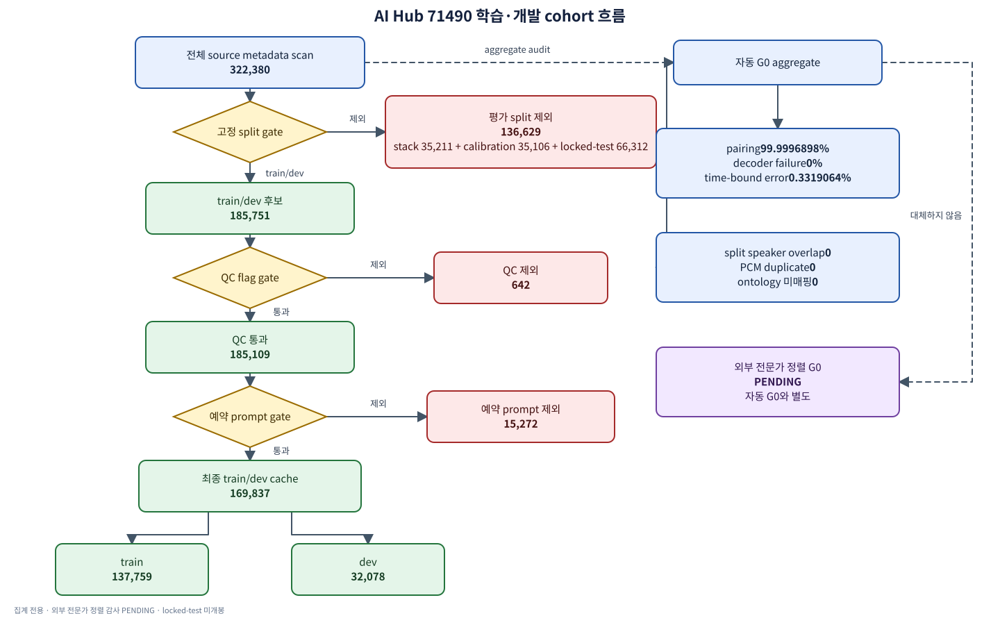

# 한국어 L2 발음 진단과 폐쇄루프 보이스 코칭

## AI Hub 중·일어권 학습자 데이터에서의 재현 가능한 실증 연구

원고 상태: 실험 진행 중  
최종 갱신: 2026-07-29 KST

> 이 파일은 기존 10쪽 설계 PDF를 실제 결과 논문으로 개정하기 위한 편집
> 가능한 원고다. `[PENDING: ...]`은 실제 artifact가 생성되기 전에는
> 숫자로 대체하지 않는다.

## 초록

본 연구는 한국어 제2언어 학습자의 분절음·유창성·운율을 진단하고 근거가
있는 교정과 다중 기준음을 제공하는 폐쇄루프 보이스 코칭 시스템을
검증하는 것을 목표로 한다. 중국어·일본어권 학습자를 중심으로 한
AI Hub 71490 발음 데이터 322,380건, 1,830화자, 344.208시간을 화자 비중첩
train/dev/stack/
calibration/locked-test로 재분할했다. 자동 데이터 감사에서 삼중 modality
pairing 99.9997%, decoder failure 0%, time-bound error 0.3319%를
확인했고 split 간 화자와 PCM 중복은 없었다.

Gold target boundary를 입력에 사용하고 silver 오류 label을 정답으로
둔 train/dev 명시적 기준선에서 phone macro F1은 0.4902, 유창성 Spearman은
0.4780이었다. 두 값 모두 사전 engineering gate 0.60/0.50에 미달했고,
이는 locked-test 성능이 아닌 provisional failure다.
실패 원인을 확인한 뒤 실시한 dev-only 사후 탐색적 threshold ablation은
phone macro F1을 0.5599로 높였지만 AUPRC는 0.1613으로 변하지 않았고
0.60 gate에도 미달했다. 따라서 이 결과는 기준선 실패를 번복하거나
모델 승격에 사용할 수 없다.
Frozen WavLM Base+ head의 3-seed dev 평가도 완료했지만, 이 결과 역시
oracle target boundary와 silver label을 사용한 provisional engineering
결과이며 독립 gold, locked-test 또는 배포 성능이 아니다.

[PENDING: B05/S108 — explicit 기준선과 최종 S1의 phone F1, utterance ICC,
ECE, worst-group 결과]  
[PENDING: S203 — 독립 S2 감사 결과]  
[PENDING: R04/H04 — 다중 참조음 blind 평가와 학습 효과]

## 1. 서론

기존 설계 보고서의 문제 정의를 출발점으로 삼되, 관련연구 주장은 원문
source와 인용을 확인한 것만 유지한다. 본 실증 연구의 1차 일반화 범위는
중국어·일본어 L1 한국어 학습자로 제한한다. 더 넓은 한국어 L2 모집단에
대한 주장은 추가 L1 데이터와 외부 평가가 있을 때만 한다.

### 1.1 관련연구와 적용 경계

WavLM은 masked prediction과 denoising을 결합한 자기지도 음성 표현이며
Base, Base+, Large 변형이 보고됐다 [1]. HiPAMA는
phoneme→word→utterance 계층 표현과 level별 multi-aspect attention을
영어 비원어민 SpeechOcean762에서 평가했다 [2]. 두 연구는 본 연구의
후속 표현·구조 후보를 뒷받침하지만, 한국어 L2 오류 탐지 개선이나
WavLM–HiPAMA 결합의 우월성을 직접 입증하지 않는다.

Whisper는 multilingual ASR·translation·language identification을 수행하는
transcript 생성 모델이고 [3], HuBERT는 masked hidden-unit prediction에
기반한 별도 자기지도 표현이다 [4]. 본 연구에서는 각각 content
consistency/WER gate와 대안 backbone 후보로 역할을 제한한다. 다른
backbone을 사용한다는 사실만으로 독립 감사가 성립하지 않으며,
label·alignment·학습자료 분리와 후속 protocol로 독립성을 검증해야 한다.

CosyVoice 2 기술보고서와 고정된
[공식 CosyVoice2 GRPO recipe](https://github.com/QwenAudio/CosyVoice/tree/074ca6dc9e80a2f424f1f74b48bdd7d3fea531cc/examples/grpo/cosyvoice2)는
모델과 학습 recipe의 공개 존재를 확인한다 [5]. 이는 한국어 학습자의
기준음 품질·학습 효과 또는 본 프로젝트의 실행 완료를 뜻하지 않는다.

발음 훈련에서 여러 reference utterance를 제시한 사례 [6], native/TTS
기준음으로 영어 학습자의 문장 운율을 비교한 사례 [7], 별도 음질 문제에서
reference codebook의 median minimum distance를 사용한 사례 [8]가 있다.
그러나 이 인접 근거는 한국어 L2 reference bank에서 `k-nearest median`이나
`trimmed soft-min`의 우월성을 검증하지 않는다. 이 집계법은 단일
reference와 pure minimum에 대한 사전 지정 ablation 후보일 뿐이다.

UTMOS는 VoiceMOS 자료의 MOS 예측을 위해 개발됐고 in-domain/OOD track에서
평가됐다 [10]. 최근 cross-domain 인간 MOS 비교는 UTMOS 상관이 domain에
따라 일관되지 않을 수 있음을 보였다 [11]. 따라서 UTMOS는 artifact
gate로만 사용하고 blind 인간평가를 병행한다. 이를 근거로 UTMOS가 한국어
L2 억양을 과도하게 벌점한다고 단정하지 않는다. 또한 어떤 외부 인용도
본 프로젝트가 정확도 상한을 확장했거나 온라인 루프를 확보했다는 내부
달성 증거를 대신하지 못한다.

본 연구 질문은 다음과 같다.

1. 명시적 음향 특징 대비 frozen/fine-tuned WavLM이 phone 오류와 발화
   평정을 얼마나 개선하는가?
2. 계층 모델과 confidence-aware fusion이 calibration과 하위집단 성능을
   악화시키지 않으면서 주 지표를 개선하는가?
3. 독립 S2가 S1의 false-high-score를 탐지하고 reward hacking을 줄이는가?
4. 다중 참조와 근거 제한 코칭이 전문가 평가와 실제 학습자의 재시도·유지
   성과를 개선하는가?

## 2. 데이터와 방법

### 2.1 데이터

| 항목 | 값 |
|---|---:|
| 발화 | 322,380 |
| 화자 | 1,830 |
| 총 음성 | 344.208시간 |
| 고유 prompt | 229 |
| train | 150,677 |
| dev | 35,074 |
| stack | 35,211 |
| calibration | 35,106 |
| locked test | 66,312 |

중국어 L1은 198,502건, 일본어 L1은 123,172건이며 소수 표기
`Zhuang; Chuang` 706건은 primary training에서 제외하고 감사 slice로
보존한다. 성별 `O` 2,736건도 같은 원칙을 적용한다. 발화 sample rate는
8–192 kHz로 다양하므로 SSL 입력은 decoder 뒤 16 kHz로 polyphase
resample한다.

원어민 외부평가·정렬·ASR 기준선용으로 FLEURS ko-KR, KSS, Seoul
Corpus, ZEROTH-Korean 38,729개 audio object, 118.519시간을 별도
catalog로 고정했다. 이 자료는 학습자 오류 정답으로 사용하지 않는다.
source별 object 수는 FLEURS 2,915개, KSS 12,854개, Seoul Corpus
240개, ZEROTH-Korean 22,720개다.
KSS와 Seoul Corpus는 비상업 연구 경로로 분리하고, source마다 원래
split과 license lineage를 보존한다.

### 2.2 감독 label

목표 phone은 38종이며 실제 TextGrid 표기는 free-form annotation을 포함해
1,715종이다. 보수적 NFC/호환 자모 tokenizer의 occurrence coverage는
99.9682%이고 나머지는 `<unk>`로 보존한다. 공식 오류 tag 17종,
176,523구간은 고정 ontology로 100% 매핑됐다.

발화 평정의 유효 coverage는 발음 322,337건, 이해도 322,337건, 유창성
81,780건이다. 원본 0은 1–5 척도의 미평정 sentinel로 mask한다.

### 2.3 누수 방지와 평가 분할

모든 주 split은 화자 비중첩이며 split 간 동일 PCM은 없다. 모든 229개
prompt가 기존 다섯 split에 나타나므로 20개 prompt를 사전 예약했다.
예약 prompt 중 locked-test 화자의 5,522건만 prompt challenge로 사용하고,
다른 split의 동일 prompt 21,240건은 학습·튜닝·stack/calibration 후보에서
제외한다. 실제 train/dev explicit cache에서는 평가 split 136,629건,
QC flag 642건, 예약 prompt 15,272건을 제외해 train 137,759건과 dev
32,078건을 남겼다.

Gold TextGrid boundary를 입력에 쓰는 결과는 `oracle alignment`로
명시한다. 배포 가능 결과는 predicted MFA/CTC alignment를 사용해 별도로
보고한다. 수동 G0 통과 전에는 locked-test metric을 계산하지 않는다.

### 2.4 모델과 통계

명시적 phone 기준선은 목표 phone과 앞·뒤 목표 phone, oracle 구간 길이,
구간 RMS와 zero-crossing rate만 입력으로 사용한다. realized phone,
alignment operation과 error tag는 feature에서 제외한다. substitution과
deletion을 오류, match를 정상으로 둔 balanced logistic regression의
`C∈{0.1,1,10}`을 dev에서 선택한다.

이 phone 정답은 AI Hub 목표 annotation과 TextGrid 실현 annotation의
일대일 overlap에서 파생한 silver label이다. 독립 전문가 gold와 같다고
간주하지 않으며, 수동 G0·D07 재평가 전 결과는 annotation 재현
engineering 지표로만 해석한다.

기준선 실패 뒤의 threshold ablation은 사전 고정된 주 분석이 아니라
`post-hoc/exploratory` 분석으로 격리했다. 각 seed에서 primary train
화자 860명을 hash 기반 speaker-disjoint inner train/validation
688/172명으로 나누고, 같은 여섯 명시적 특징과 balanced logistic
regression만 사용했다. `C∈{0.1,1,10}`과 decision threshold
`0.05–0.95`(0.01 간격)를 inner validation macro F1만으로 선택한 뒤,
선택한 C로 primary train 전체를 재학습하고 threshold를 그대로
이전했다. Dev는 seed별 최종 평가에서 한 번만 예측했으며
stack/calibration/locked-test는 읽지 않았다. 이 분석은 기준선 결과나
B06 상태를 덮어쓸 수 없고 승격 판단에도 사용할 수 없다.

발화 기준선은 길이, RMS/peak/clipping/ZCR, 휴지 수·비율, 유성 비율,
F0 중앙값·범위, 단어·phone 수, phone speech/articulation rate와 target
duration nPVI를 사용한다. Ridge `α∈{0.1,1,10,100}`과 cumulative ordinal
logistic을 비교하고 dev QWK, Spearman, MAE 순으로 선택한다. 결측 F0는
train median으로 대치하고, 1–5 점수가 없는 발화는 해당 outcome
loss/metric에서 mask한다. 이 기준선은 gold target boundary를 사용한
oracle-alignment 진단이며 배포 성능이 아니다.

Frozen SSL 입력은 로컬에 고정한 `microsoft/wavlm-base-plus` revision
`4c66d4806a428f2e922ccfa1a962776e232d487b`의 768차원 hidden
representation이다. 16 kHz로 복호화한 음성을 최대 20.0초의
target-phone-label-aware chunk로 나눴다. 발화에는 hidden mean과 standard
deviation을 이어 붙인 1,536차원 벡터를, phone과 word에는 각각
768차원 mean vector를 저장했다.

Cache 생성기는 source 322,380건의 metadata를 끝까지 scan해 split, QC와
예약 prompt 정책을 적용했다. 이 중 evaluation split 136,629건은
`split_not_allowed`로 제외했으며, QC와 예약 prompt까지 제외한
train/dev 169,837건만 audio decode와 frozen encoder 입력 대상으로
삼았다. 실행 report의 `evaluation_split_metric_access`는 `forbidden`,
`metric_evaluation_performed`는 `false`이고 holistic score column을 읽은
수는 0개다. 따라서 source 전체 metadata scan은 evaluation audio
inference나 metric 계산을 뜻하지 않는다.

Encoder 호출에는 bfloat16 autocast를 요청했지만, 실제 172,412개 chunk의
관측 hidden output dtype은 모두 float32였다. 이를 BF16 hidden
representation이 관측됐다고 해석하지 않고, pooling 뒤 cache 저장
dtype만 float16으로 변환했다. 독립 validator는 source modeling
manifest를 다시 읽지 않았으며(`source_modeling_manifest.read=false`),
완성된 report와 모든 Parquet shard를 한 row group씩 검사했다.

Frozen-head S101 분석은 사전 지정한 protocol로 실행했다. 각 seed에서 train
화자만 speaker-disjoint inner train/validation으로 나누고, early stopping과
phone threshold를 inner
validation에서만 고정한다. Checkpoint와 threshold를 고정한 뒤 dev는
task·seed당 한 번만 추론하며 선택이나 재튜닝에 사용하지 않는다.
Stack/calibration/locked-test는 이 단계에서 읽지 않는다. Task가 바뀔 때
RNG를 같은 seed로 다시 초기화하며, completed head report는 이 결정성
계약과 CUDA 초기화 전 `CUBLAS_WORKSPACE_CONFIG=:4096:8` 고정을 확인했다.

학습효과 연구도 등록·승인된 결과가 아니라 planning/preregistration
draft다. `C3 − C0`와 `C5 − C3`를 각각 participant 단위 1:1 무작위 배정
병렬 비교로 두고 crossover는 사용하지 않는다. Post는 2주 intervention
종료 시점, retention은 post 4주 후이며 두 명 이상 blind 평가자의
comprehensibility를 primary outcome으로 둔다. 분석 계획은 ITT,
participant·sentence·rater random intercept의 mixed model,
MAR multiple imputation·MNAR pattern-mixture·complete-case sensitivity와
family별 Holm이다. 현재 IRB·모집·녹음·empirical pilot은 없고 최종
표본수는 `null`이므로 학습 효과나 powered sample size로 해석하지 않는다.

[PENDING: B05 — 최종 locked-test 평가 절차와 bootstrap 결과]  
[PENDING: S101–S108 — WavLM/head/fusion/calibration 정의]  
[PENDING: S200–S203 — 독립 S2 정의]

후속 비교의 사전 분석 프로토콜은 학습 seed를 42/43/44로 고정한다. 모델
비교에는 화자 단위 5,000회 bootstrap 95% CI와 Holm 다중비교 보정을
사용하도록 규정한다. 보고 지표는 phone macro F1/AUPRC/event F1, 발화
QWK/Spearman/MAE/ICC(2,1), calibration ECE/Brier/risk-coverage다.

현재 실행된 통계와 아직 실행되지 않은 분석 계획은 다음처럼 분리한다.

| 분석 | 현재 증거 상태 | 원고에서 허용하는 범위 |
|---|---|---|
| explicit primary와 threshold ablation | train/dev 분석 실행 | dev point metric과 탐색적 operating-point 변화만 보고; locked-test CI·Holm 결과 없음 |
| S101 Base+ frozen head | train/dev 3-seed 분석·registry 종료 | oracle/silver primary-dev point metric과 seed 표본 SD만 보고; 승격·배포·locked-test 근거 없음 |
| B05 | 미실행 계획 | G04 통과 뒤 사전 승인된 locked-test 1회와 speaker bootstrap·Holm을 실행 |
| S103 | Base+/Large 3-seed 분석과 strict paired comparison·CI·Holm 완료 | oracle/silver primary-dev 비교와 사전 gate 실패만 보고; 다음 adapter 분기는 Base+로 고정하며 승격·배포 근거로 사용하지 않음 |
| H04 | planning-only, 사람 자료 없음 | ITT mixed model, 결측 sensitivity와 family별 Holm을 승인 SAP에 고정한 뒤 실행 |

## 3. 결과

### 3.1 데이터 품질

| 지표 | 관측/상태 | gate |
|---|---:|---:|
| WAV–JSON–TextGrid pairing | 99.9996898% | ≥99% |
| decoder failure | 0% | ≤0.1% |
| time-bound error | 0.3319064% | ≤1% |
| split 간 화자 중복 | 0 | 0 |
| split 간 PCM 중복 | 0 | 0 |
| error tag ontology 미매핑 | 0 | ≤1% |
| 수동 정렬 정확도 | [PENDING: G04] | ≥95% |

자동 G0는 통과했지만 전체 G0는 전문가 240건 감사가 완료될 때까지
pending이다. `interval_out_of_bounds` 1,070건과 phone tier 누락 1건은
primary 학습에서 제외하고 failure-analysis slice로 보존한다.

| explicit cache filtering 단계 | 단계 제외 | 잔여 |
|---|---:|---:|
| 전체 source scan | - | 322,380 |
| stack/calibration/locked-test 제외 | 136,629 | 185,751 |
| QC flag 제외 | 642 | 185,109 |
| 예약 prompt 제외 | 15,272 | 169,837 |

전체 cohort·고정 split·자동 G0와 filter disposition은
[데이터·split·QC 표](tables/aihub71490_data_qc.md)에 정리했으며,
편집 가능한 [cohort/filter flow source](figures/aihub71490_cohort_flow.mmd)도
함께 제공한다. 검증된 벡터 렌더는 다음과 같다.

Flow의 외부 전문가 G0는 자동 결과와 분리된 `PENDING` 상태다.

완결된 train/dev oracle phone cache는 2,233,039개 target interval이며 silver
binary label은 정상 2,088,825개(93.542%), 오류 144,214개(6.458%)다.
이 불균형 때문에 accuracy를 primary metric으로 사용하지 않는다.

### 3.2 명시적 기준선

| task/outcome | QWK | Spearman | MAE | ICC(2,1) |
|---|---:|---:|---:|---:|
| pronunciation | 0.1233 | 0.1655 | 0.8624 | 0.1435 |
| fluency | 0.4483 | 0.4780 | 0.8036 | 0.4698 |
| comprehensibility | 0.1153 | 0.1633 | 0.9060 | 0.1299 |

Phone binary 오류 탐지의 primary dev macro F1/AUPRC는
0.4902/0.1613이었다. all-dev audit F1은 0.4901이었다. seed
42/43/44는 결정적 scikit-learn pipeline에서 같은 결과를 냈으므로 seed
표준편차 0을 통계적 불확실성 부재로 해석하지 않는다.

사전 지정된 phone smoke gate 0.50과 engineering gate 0.60은 모두 실패했다.
유창성이 발화 outcome 중 가장 높았지만 Spearman 0.4780으로 0.50 gate에
미달했다. 따라서 이 기준선을 승격하지 않았다. Train-only inner
validation threshold ablation은 아래와 같이 사후 분석으로 격리했고,
frozen WavLM과 GOP 보강을 후속 비교한다. 이 결과는 development
model-selection 결과이며 locked test는 열지 않았다.

실패 분석에서 primary-dev 정상 class의 precision/recall/F1은
0.9408/0.6414/0.7628, 오류 class는 0.1340/0.5789/0.2176이었다.
All-dev audit의 silver 오류 label 비율은 8.746%였지만 기본 threshold 0.5에서
오류 예측 비율은 37.781%였다. All-dev slice 중 Chinese/Japanese의
macro F1은 0.4888/0.4925였고, primary 범위 밖 gender `O`는 0.4265였다.
숙련도별 최저값은 `Advance` 0.4710, target-phone별 최저값은
`ㅠ` 0.1347, `spn` 0.1576, `ㅇ` 0.1618이었다. 모든 slice는
최소 100건 조건을 적용한 privacy-safe aggregate이며, 개별 발화나 화자
식별자는 분석하지 않았다.

사후 threshold ablation에서 seed 42/43/44가 선택한 C는 모두 10,
threshold는 각각 0.68/0.67/0.68이었다. Primary-dev macro F1은
각각 0.5588/0.5621/0.5588, 평균±표본 표준편차는
0.5599±0.0019로 사전 실행한 기준선 관측값보다 0.0697 높았다. 그러나 AUPRC는 세
seed 모두 0.1613으로 기준선과 동일했다. Threshold 조정은 순위를
바꾸지 않으므로 이 결과는 표현력 개선이 아니라 operating point 조정의
효과다. 사전 지정된 smoke 0.50은 사후 분석에서 넘었지만 engineering
0.60은 여전히 실패했으며 B06은 `failed_unchanged`로 유지한다. 상세 결과는
[사후 threshold ablation 표](tables/explicit_threshold_ablation_dev.md)에
고정했다.

[PENDING: B05 — locked-test confusion matrix, slice forest plot,
speaker bootstrap CI와 Holm 보정]

### 3.3 WavLM과 계층·fusion ablation

WavLM Base+ frozen feature cache 생성 상태는 `completed`, 독립 전수검증
상태는 `passed`였다. 실제 cache의 행·vector, shard와 Parquet byte 수는
다음과 같다.

| cache 단위 | utterance | phone | word | 합계 |
|---|---:|---:|---:|---:|
| 행·embedding vector | 169,837 | 2,233,039 | 408,790 | 2,811,666 |
| Parquet shard | 17 | 9 | 5 | 31 |
| 실제 Parquet byte | 500,362,108 | 3,315,599,726 | 611,884,827 | 4,427,846,661 |

독립 validator는 전체 2,289,794,304개 embedding scalar를 확인했다.
Non-finite scalar, all-zero vector, forbidden-split row와 validation
error의 합은 0이었다. 검증기는 full embedding matrix를 만들지 않고
한 번에 최대 2,048행, 3,145,728 embedding byte만 메모리에 올렸다.

Full cache 생성의 측정 resource는 decoded audio 178.998시간,
elapsed 3,927.819초, 43.2395 utterance/s, audio realtime
164.059배였고 CUDA OOM은 0회였다. Peak CUDA allocated/reserved는
각각 718.893/888.000 MiB, peak process RSS는 2,830.676 MiB였다.

별도의 fresh-process CUDA frozen-head preflight 상태도 `passed`였다.
이 검사는 `synthetic_tensors_only=true`인 forward/backward/AdamW
step smoke이며 feature cache와 dev, stack, calibration, locked-test를
읽지 않았다. 그러므로 cache 완결성이나 CUDA 실행 가능성을 phone 또는
utterance 성능으로 해석하지 않는다.

그 뒤 Base+ frozen-head 실행 report 상태는 `completed`, registry metadata의
종료 상태도 `completed`였다. Report가 완료한 seed는 3개(42/43/44)이며,
아래 값은 primary dev에서 계산한 3-seed 평균 ± 표본 표준편차다.

| phone head | macro F1 | AUPRC | train-inner 선택 threshold(seed 42/43/44) |
|---|---:|---:|---:|
| Base+ frozen phone | 0.6697 ± 0.0016 | 0.3532 ± 0.0022 | 0.65/0.70/0.70 |

| 발화 outcome | QWK | Spearman | MAE | ICC(2,1) |
|---|---:|---:|---:|---:|
| Base+ pronunciation | 0.0980 ± 0.0073 | 0.1852 ± 0.0081 | 0.8374 ± 0.0190 | 0.0583 ± 0.0070 |
| Base+ fluency | 0.0371 ± 0.0456 | 0.1993 ± 0.0151 | 0.8508 ± 0.0041 | 0.0431 ± 0.0188 |
| Base+ comprehensibility | 0.0803 ± 0.0189 | 0.1552 ± 0.0069 | 0.7918 ± 0.0025 | 0.0521 ± 0.0056 |

Phone threshold는 dev가 아니라 각 seed의 train-only inner validation에서
선택됐다. Phone 오류 정답은 독립 전문가 gold가 아닌 silver label이고,
발화 평정도 oracle-alignment 입력을 사용했다. 세 seed의 표본 표준편차는
불확실성 CI가 아니며, Base+와 explicit 또는 Large 사이의 유의한 우월성을
뜻하지 않는다. Stack/calibration/locked-test는 읽지 않았고 report의
`promotion_decision_allowed`는 `false`다. 따라서 이 Base+ 단독 표는
후속 Large/S103 비교 표나 아래의 전체 S101–S108 PENDING 표를 대체하지
않는다.

<!-- BEGIN WAVLM_S103_RESULTS_TABLE -->
#### WavLM frozen-head development results

> Oracle-alignment, development-only results. These values are not locked-test or deployable-alignment evidence.

##### Phone metrics

| Model | Seed | Macro F1 | AUPRC | Event F1 |
|---|---:|---:|---:|---:|
| WavLM Base+ | 42 | 0.670951 | 0.350682 | 0.436980 |
| WavLM Base+ | 43 | 0.667857 | 0.354563 | 0.426826 |
| WavLM Base+ | 44 | 0.670288 | 0.354484 | 0.428424 |
| WavLM Base+ | Mean ± sample SD | 0.669699 ± 0.001629 | 0.353243 ± 0.002218 | 0.430743 ± 0.005460 |
| WavLM Large | 42 | 0.670732 | 0.360086 | 0.433647 |
| WavLM Large | 43 | 0.671617 | 0.361384 | 0.435450 |
| WavLM Large | 44 | 0.671145 | 0.361019 | 0.433379 |
| WavLM Large | Mean ± sample SD | 0.671164 ± 0.000443 | 0.360830 ± 0.000669 | 0.434159 ± 0.001127 |
| Large − Base+ | 42 | -0.000219 | 0.009405 | -0.003334 |
| Large − Base+ | 43 | 0.003759 | 0.006821 | 0.008624 |
| Large − Base+ | 44 | 0.000857 | 0.006535 | 0.004955 |
| Large − Base+ | Mean ± sample SD | 0.001466 ± 0.002058 | 0.007587 ± 0.001581 | 0.003415 ± 0.006126 |

##### Utterance outcomes

| Model | Outcome | Seed | QWK | Spearman | MAE | ICC(2,1) |
|---|---|---:|---:|---:|---:|---:|
| WavLM Base+ | pronunciation_score | 42 | 0.096779 | 0.184806 | 0.821747 | 0.066344 |
| WavLM Base+ | pronunciation_score | 43 | 0.105941 | 0.177262 | 0.832062 | 0.053888 |
| WavLM Base+ | pronunciation_score | 44 | 0.091406 | 0.193515 | 0.858527 | 0.054715 |
| WavLM Base+ | pronunciation_score | Mean ± sample SD | 0.098042 ± 0.007350 | 0.185194 ± 0.008133 | 0.837445 ± 0.018972 | 0.058316 ± 0.006965 |
| WavLM Base+ | fluency_score | 42 | 0.088870 | 0.212882 | 0.850875 | 0.064648 |
| WavLM Base+ | fluency_score | 43 | 0.003203 | 0.183041 | 0.846663 | 0.030403 |
| WavLM Base+ | fluency_score | 44 | 0.019162 | 0.202021 | 0.854897 | 0.034135 |
| WavLM Base+ | fluency_score | Mean ± sample SD | 0.037078 ± 0.045557 | 0.199315 ± 0.015103 | 0.850812 ± 0.004118 | 0.043062 ± 0.018787 |
| WavLM Base+ | comprehensibility_score | 42 | 0.079903 | 0.158051 | 0.789024 | 0.057439 |
| WavLM Base+ | comprehensibility_score | 43 | 0.099355 | 0.160133 | 0.792560 | 0.052786 |
| WavLM Base+ | comprehensibility_score | 44 | 0.061497 | 0.147315 | 0.793821 | 0.046214 |
| WavLM Base+ | comprehensibility_score | Mean ± sample SD | 0.080252 ± 0.018932 | 0.155166 ± 0.006879 | 0.791802 ± 0.002487 | 0.052146 ± 0.005640 |
| WavLM Large | pronunciation_score | 42 | 0.151946 | 0.265361 | 0.795459 | 0.133280 |
| WavLM Large | pronunciation_score | 43 | 0.168292 | 0.278187 | 0.812273 | 0.145566 |
| WavLM Large | pronunciation_score | 44 | 0.168052 | 0.280468 | 0.800008 | 0.141321 |
| WavLM Large | pronunciation_score | Mean ± sample SD | 0.162764 ± 0.009369 | 0.274672 ± 0.008144 | 0.802580 ± 0.008697 | 0.140056 ± 0.006240 |
| WavLM Large | fluency_score | 42 | 0.204336 | 0.482002 | 0.829030 | 0.250553 |
| WavLM Large | fluency_score | 43 | 0.303073 | 0.501918 | 0.782175 | 0.336326 |
| WavLM Large | fluency_score | 44 | 0.308010 | 0.501088 | 0.762982 | 0.336520 |
| WavLM Large | fluency_score | Mean ± sample SD | 0.271806 ± 0.058483 | 0.495003 ± 0.011267 | 0.791396 ± 0.033976 | 0.307800 ± 0.049577 |
| WavLM Large | comprehensibility_score | 42 | 0.139147 | 0.251785 | 0.763767 | 0.128353 |
| WavLM Large | comprehensibility_score | 43 | 0.117923 | 0.267039 | 0.784594 | 0.140983 |
| WavLM Large | comprehensibility_score | 44 | 0.131579 | 0.263760 | 0.767360 | 0.137885 |
| WavLM Large | comprehensibility_score | Mean ± sample SD | 0.129550 ± 0.010757 | 0.260861 ± 0.008029 | 0.771907 ± 0.011133 | 0.135741 ± 0.006583 |
| Large − Base+ | pronunciation_score | 42 | 0.055168 | 0.080555 | -0.026288 | 0.066937 |
| Large − Base+ | pronunciation_score | 43 | 0.062351 | 0.100925 | -0.019789 | 0.091677 |
| Large − Base+ | pronunciation_score | 44 | 0.076647 | 0.086954 | -0.058520 | 0.086607 |
| Large − Base+ | pronunciation_score | Mean ± sample SD | 0.064722 ± 0.010934 | 0.089478 ± 0.010417 | -0.034865 ± 0.020741 | 0.081740 ± 0.013069 |
| Large − Base+ | fluency_score | 42 | 0.115466 | 0.269120 | -0.021845 | 0.185906 |
| Large − Base+ | fluency_score | 43 | 0.299870 | 0.318877 | -0.064488 | 0.305923 |
| Large − Base+ | fluency_score | 44 | 0.288849 | 0.299068 | -0.091915 | 0.302385 |
| Large − Base+ | fluency_score | Mean ± sample SD | 0.234728 ± 0.103431 | 0.295688 ± 0.025050 | -0.059416 ± 0.035309 | 0.264738 ± 0.068294 |
| Large − Base+ | comprehensibility_score | 42 | 0.059244 | 0.093735 | -0.025257 | 0.070914 |
| Large − Base+ | comprehensibility_score | 43 | 0.018567 | 0.106906 | -0.007967 | 0.088197 |
| Large − Base+ | comprehensibility_score | 44 | 0.070082 | 0.116445 | -0.026461 | 0.091671 |
| Large − Base+ | comprehensibility_score | Mean ± sample SD | 0.049298 ± 0.027160 | 0.105695 ± 0.011404 | -0.019895 ± 0.010348 | 0.083594 ± 0.011118 |

##### S103 Large − Base+ primary comparison

| Metric | Paired estimate | 95% CI | Gate | Decision |
|---|---:|---:|---:|---|
| Phone macro F1 | 0.001466 | [0.000006, 0.002990] | ≥ 0.030000 | failed |

Bootstrap unit: speaker; repetitions: 5,000; valid repetitions: 5,000.
<!-- END WAVLM_S103_RESULTS_TABLE -->

[PENDING: S101–S108 — explicit/Base+/Large/adapter/HiPAMA/fusion 표]  
[PENDING: S107 — reliability diagram과 risk-coverage]

### 3.4 독립 감사와 metamorphic 평가

[PENDING: S203/E01 — S1 단독 대 S1+S2, perturbation별 결과]

### 3.5 코칭과 다중 참조음

R01 후보 생성 전에 R00 텍스트 패키지를 고정했다. 이 패키지는 다른
코퍼스 전사를 가져오지 않고 프로젝트에서 직접 작성한 한국어 통제 문장
20개이며, 정확한 문장 텍스트의 SPDX 라이선스는 `CC0-1.0`이다. 독립
validator 상태는 `valid`였다.

| R00 텍스트 패키지 검사 | 관측값 |
|---|---:|
| 고정 문장 | 20 |
| 고유 정규화 hash | 20 |
| 초성 coverage | 19 |
| 관측 한국어 모음 coverage | 18 |
| 받침 표면군 coverage | 7 |
| 음운 규칙 coverage | 8 |
| 운율 target coverage | 11 |
| AI Hub 예약 prompt hash 교집합 | 0 |
| PII pattern match | 0 |
| 금칙 content match | 0 |

이 결과는 문장 텍스트·선정 규칙·라이선스의 완료만 뜻한다. R00
validator에서 TTS/audio 생성과 사람 평가는 모두 미완료였으므로 후보
음질, 원어민 적합성, 교육 효과 또는 reference bank의 승격 근거로
사용하지 않는다.

[PENDING: C03/R04 — 전문가 정확도, unsupported claim, MOS/CMOS]

### 3.6 학습 효과

[PENDING: H04 — C0↔C3, C3↔C5 pre/post/retention mixed-model 결과]

## 4. 논의

명시적 기준선은 balanced loss와 threshold 0.5의 조합에서 silver 오류
label 비율보다 훨씬 많은 오류를 발행했다. Train-only threshold 선택은 macro
F1을 개선했지만 AUPRC를 전혀 개선하지 못했고 0.60 gate에도 미달했다.
이는 단순 임계값 교정만으로 부족함을 시사한다. 다만 target phone·길이·
RMS·ZCR의 제한된 표현이 오류 class와 특히 일부 phone을 충분히 분리하지
못한다는 기제는 후속 ablation으로 검증해야 한다. 따라서 이 ablation을
성능 향상 주장이나 승격 근거로 사용하지 않는다. S103에서는 Large의
phone macro F1 점추정 증가가 사전 `+0.03` gate를 충족하지 못해 다음
adapter 분기를 Base+로 고정했다. 한편 Large의 발화 지표는 Base+보다
높은 양상을 보였으므로, phone gate 실패를 모든 outcome의 열세 또는
배포 가능성의 부재로 일반화하지 않고 후속 adapter·GOP·fusion
ablation에서 ranking·subgroup·발화 지표를 함께 검증한다.

### 4.1 실패와 engineering 교정

- **개인정보 cache** — 발견: 초기 전량 cache의 중간 감사에서 원본 file
  stem prefix와 `UserID`의 연결 가능성을 확인했다. 중단: 공개·canonical
  publish 전 실행을 멈추고 미완성 cache와 이전 smoke를 폐기했다. 수정:
  join key를 namespaced SHA-256으로 바꾸고 modeling manifest를 R1 운영
  제한 artifact로 재분류했다. 재검증: 새 schema의 smoke와 full cache
  validator에서 해시 형식, 금지 열 부재와 aggregate-only 출력을
  확인했다. 한계: 이 조치는 가명화이며 익명화를 보장하거나 데이터
  라이선스의 반출 허가를 대신하지 않는다.
- **실행·registry** — 발견: 주 분석 범위를 잘못 잡은 초기 run,
  Large preprocessor의 pinned `do_normalize` 불일치, registry 종료 실패
  뒤 canonical output이 남을 수 있는 원자성 결함을 각각 확인했다. 중단:
  첫 run은 publish 전에 멈추고 `failed/KeyboardInterrupt` registry로
  보존했으며 Large 실행과 결함 있는 head publish를 차단했다. 수정:
  분석 범위를 교정하고 pinned preprocessing과 SHA를 맞췄으며 registry
  실패 시 output을 원자 격리·삭제하고 trainer/head source hash-chain을
  추가했다. 재검증: 교정된 explicit run, Large 사전 review·synthetic
  regression, registry fault-injection 검사를 각각 통과했다. 이후
  Large 정본 실행과 독립 재계산도 완료했다. 한계: 이 교정과
  development-only 결과는 구현·provenance 및 oracle/silver dev 성능
  근거일 뿐, Base+나 Large의 배포·일반화 성능을 보증하지 않는다.

기존 PDF의 “정확도 상한을 확장했다”, “온라인 루프를 확보했다” 같은
표현은 아직 실증 결론으로 사용하지 않는다. 이후 각 가설의 채택·기각,
oracle/predicted alignment 간 차이, TTS 지표와 실제 학습 효과의 인과
간극은 해당 결과가 생성된 뒤 기술한다.

## 5. 윤리·개인정보·재현성

AI Hub 원본과 원천경로가 필요한 운영용 manifest는 제한 저장소에서만
처리한다. raw `UserID` 필드를 제거하더라도 원본 file stem prefix가 이를
간접 노출할 수 있으므로 운영용 manifest는 공개하지 않는다. 학습
feature cache와 결과에는 namespaced SHA-256 발화·화자 ID만 남기고 원본
stem·경로를 금지한다. 학습자 파일럿은 기관 윤리 검토, 동의·철회,
보존·폐기 계획이 승인된 뒤에만 진행하며 현재 완료 결과로 간주하지
않는다. 원어민 녹음과 전문가 평정도 별도 동의와 비식별 정책을 적용한다.

| 구역·자료 | 현재 역할 | 외부 반출·사용 조건 |
|---|---|---|
| R0 원천 제한 | AI Hub WAV/JSON/TextGrid, 원시 ID·음성·전사 | 반출 금지, 승인된 접근자·보존·폐기 정책 적용 |
| R1 운영 제한 | 원천경로·stem이 있는 manifest와 수동 감사 worksheet | 반출 금지, D1 생성과 내부 감사에만 사용 |
| D1 가명 실험 | namespaced SHA-256 ID의 feature·prediction | 연구 데이터로 보호하고 license·연구승인을 별도 확인 |
| A1 집계 결과 | count·분포·metric·CI·checksum과 논문 표·그림 | 식별 위험·license·승인 범위를 검토한 뒤에만 공개 |
| C1 공개 코드 | 코드·schema·config·문서와 상대 예시 경로 | secret·원천 locator·제한 데이터가 없을 때 공개 가능 |
| AI Hub 71490 | 중국어·일본어 L1 감독학습·내부 평가 | 승인 기반 제한 데이터이며 원본·annotation·경로 재배포 금지 |
| FLEURS·ZEROTH | 원어민 ASR·alignment 외부평가 | CC-BY attribution, 학습자 오류 label 대체 금지 |
| KSS·Seoul Corpus | 연구용 TTS/reference·정렬/운율 평가 | 비상업 경로 격리, 상업 artifact lineage와 분리 |
| 사람 평가·파일럿 | 아직 미수집인 전문가·원어민·학습자 자료 | 성인 전문가·원어민 평가는 개인 연구 scope attestation과 목적 제한 동의, 철회, 접근자, 보존·폐기를 수집 전에 고정; 학습자 모집·중재·RCT는 IRB/기관 승인과 미성년자·위해 중단 절차를 추가 |

Namespaced SHA-256은 재식별 위험을 낮추는 가명화일 뿐 익명화가 아니다.
대응표는 연구 데이터와 분리하고 음성·자유서술 note는 승인된 담당자가
반출 전에 검토한다. Checksum도 재현 식별자이지 공개 허가가 아니다.
사람 대상 승인·동의 문서는 부정확한 AI 피드백 위험과 인간 문의 경로를
설명해야 한다. 개인정보 침해나 예상하지 못한 중대한 intervention 관련
위해가 있으면 수집을 pause하고 기관·연구책임자 승인 전에는 재개하지
않으며, condition별 adverse feedback도 계획된 aggregate 항목으로
기록한다. 이는 위해 사건이 이미 관측됐다는 뜻이 아니다.

F5-TTS 논문과 공식 SWivid 구현의 대응은 확인됐지만 [9], artifact별 사용
조건은 분리한다. 감사한
[공식 code commit](https://github.com/SWivid/F5-TTS/tree/9c614e9657089213efc6a7421b30630be138a3f5)은
MIT이고
[공식 pretrained weight revision](https://huggingface.co/SWivid/F5-TTS/tree/84e5a410d9cead4de2f847e7c9369a6440bdfaca)의
README/Hugging Face card 선언은 CC-BY-NC-4.0이며 weight repository에는
standalone LICENSE 파일이 없다. 이 조건을 모든 F5 계열, 제3자 fine-tune
또는 새로 학습한 weight에 일반화하지 않는다.
자료별 공식 원문·역할·재배포 경계를 기록한 당시 data-license
source ledger는 현재 tracked tree에서 퇴역했다. 따라서 그 ledger를
현재 라이선스 완료 증거로 인용하지 않으며, original-license·
model-artifact·재배포 검토와 원고의 license `PENDING`을 그대로 유지한다.

데이터·split·모델·config checksum, git 상태, package lock, seed,
prediction과 metric report를 run별로 보존한다.
Exact scorer lock은 site-package를 재사용하지 않은 격리 clean 환경에서
재설치했고 고정 외부 package 79개가 모두 일치했다. 같은 환경에서 실제
CUDA matrix multiplication과 전체 회귀 suite를 실행했으며 알려진
platform metadata 경고는 숨기지 않았다. 운영체제·architecture·Python·
GPU·CUDA runtime도 aggregate 환경 metadata로 함께 기록했다.
격리 clean recreation report의 SHA-256은
`76ffff9b632b335d28145f3d3ecdee1379823e81bae08632c13f5a6985545c07`다.

결정적 frozen-head runner는 CUDA 초기화 전에
`CUBLAS_WORKSPACE_CONFIG=:4096:8`을 고정하고 task별 RNG를 다시
초기화한다. Completed Base+ report의 CUBLAS workspace 값은 `:4096:8`이며,
deterministic algorithm, fresh-process 초기화와 task별 RNG 재초기화
flag가 모두 실행 계약과 일치했다. Registry는 config/data/model/source/
checkpoint hash, seed, runtime과 metric을 기록한다. 산출물은 `.part`에서
검증한 뒤 원자 publish하고 registry 실패 시 canonical output을
격리·제거한다.

Base+ head report는 raw manifest와 환경 파일을 읽거나 등록하지 않았고
stack/calibration/locked-test 접근을 모두 `false`로 기록했다. 환경 파일
read/register 항목도 0/0개였다. 완료 registry에는 seed별 checkpoint,
phone·utterance prediction, slice report와 최종 report를 합쳐 13개
artifact가 등록됐다.

Evidence validator는 고정 aggregate artifact의 hash와 원고 claim,
PENDING marker multiset, locked-test 접근 flag와 registry split을 함께
검사한다. 이 편집에서도 marker 18개의 문구와 multiset을 유지하며,
검증 통과 전에는 새 수치를 결과로 간주하지 않는다.

현재 명시적 dev report의 SHA-256은
`a5c3ade0738777409bb57956b088e025081cb63886808c6d6fc87724d0875519`,
experiment registry metadata의 SHA-256은
`0445d69cb18fd9105a531a4e5d342d60c7cad94050c6a031c0d7ee3ef6e2141e`이며
registry run ID는
`aihub71490-explicit-v1-dev-primary-20260729`이다.

Privacy-safe 실패 분석 JSON/Markdown의 SHA-256은 각각
`bfdcff140326dfb73b09b0c564dbcaef75b1a4a028d865819cc6f9e53aece65b`,
`aff130481880aac4324034bf9c77562d46733d64e6fa79f2c3c282a72f467eb4`다.
사후 threshold ablation config/report/registry metadata의 SHA-256은
각각
`62323455d80807ed9ad534bc53f6b21b41feb66836038699cefedc4b8fdedb10`,
`ef16c405ad01d1c5add4c05ce077072b218836ee683e626e12a0e24f4637a7e1`,
`e9c6ba64729f0b4a8bab577f569444f0a1e5689795fde71fc28544d1bdb43c99`이며,
registry run ID는
`aihub71490-explicit-threshold-ablation-v1-20260729`이다. Report에는
등록된 checkpoint·prediction·slice artifact 10개의 개별 SHA-256도
포함한다.

WavLM Base+ full cache report, 독립 validation report와 CUDA head smoke
report의 SHA-256은 각각
`34da4c3ec48088b88e1e44763868cd15a21b7baaa06a2cb253338866262ef41d`,
`7abb93395af73460e4542ecc92b0edb3dd1e96b942551ad4759972da5fdd6c4b`,
`878842435419924894c6b9713f7e133afec73d492b6379d05eed47f3dfec32f6`다.

Base+ head config/trainer/model-source SHA-256은 각각
`9d0b8de8e8f41c66028c4bf895cb653dc77e69b64cdce3b9f1f7d0c59e8e0291`,
`0c0bd3b76e5e9bf0b9159c80c2d6267dde5ed2f74b88f88f639efecbe37d94a3`,
`e5cdad3ece84e0ff8320b7366a64f0255a4be1a52d9df39654fb714f8f62f78b`다.
Base+ frozen-head report/registry metadata SHA-256은 각각
`112eedfeb6348c1b5a258ae2ca7fd4b435c96b433d3326ade94a7f4399949a2c`,
`0f994aa578a503697c53a3ed84377baea38ca34ebd4fc6e01bafac7a31b9f79f`이며,
registry run ID는
`aihub71490-wavlm-base-plus-frozen-head-v1-dev`이다.

## 참고문헌

1. S. Chen et al., “WavLM: Large-Scale Self-Supervised Pre-Training for
   Full Stack Speech Processing,” *IEEE Journal of Selected Topics in
   Signal Processing*, 16(6), 1505–1518, 2022.
   [doi:10.1109/JSTSP.2022.3188113](https://doi.org/10.1109/JSTSP.2022.3188113)
2. H. Do, Y. Kim, G. G. Lee, “Hierarchical Pronunciation Assessment with
   Multi-Aspect Attention,” *ICASSP 2023*, 1–5.
   [doi:10.1109/ICASSP49357.2023.10095733](https://doi.org/10.1109/ICASSP49357.2023.10095733)
3. A. Radford et al., “Robust Speech Recognition via Large-Scale Weak
   Supervision,” technical report, 2022.
   [arXiv:2212.04356](https://arxiv.org/abs/2212.04356)
4. W.-N. Hsu et al., “HuBERT: Self-Supervised Speech Representation
   Learning by Masked Prediction of Hidden Units,” *IEEE/ACM Transactions
   on Audio, Speech, and Language Processing*, 29, 3451–3460, 2021.
   [doi:10.1109/TASLP.2021.3122291](https://doi.org/10.1109/TASLP.2021.3122291)
5. Z. Du et al., “CosyVoice 2: Scalable Streaming Speech Synthesis with
   Large Language Models,” technical report, 2024.
   [arXiv:2412.10117](https://arxiv.org/abs/2412.10117)
6. J. Nouza, “Training Speech through Visual Feedback Patterns,”
   *ICSLP 1998*.
   [doi:10.21437/ICSLP.1998-821](https://doi.org/10.21437/ICSLP.1998-821)
7. Y. Xiao, F. K. Soong, “Proficiency Assessment of ESL Learner’s
   Sentence Prosody with TTS Synthesized Voice as Reference,”
   *Interspeech 2017*, 1755–1759.
   [doi:10.21437/Interspeech.2017-64](https://doi.org/10.21437/Interspeech.2017-64)
8. D. Picovici, A. E. Mahdi, “New Output-Based Perceptual Measure for
   Predicting Subjective Quality of Speech,” *ICASSP 2004*, V-633–V-636.
   [doi:10.1109/ICASSP.2004.1327190](https://doi.org/10.1109/ICASSP.2004.1327190)
9. Y. Chen et al., “F5-TTS: A Fairytaler that Fakes Fluent and Faithful
   Speech with Flow Matching,” *ICLR 2025*; author manuscript:
   [arXiv:2410.06885](https://arxiv.org/abs/2410.06885)
10. T. Saeki et al., “UTMOS: UTokyo-SaruLab System for VoiceMOS Challenge
    2022,” *Interspeech 2022*, 4521–4525.
    [doi:10.21437/Interspeech.2022-439](https://doi.org/10.21437/Interspeech.2022-439)
11. C. Minixhofer, O. Klejch, P. Bell, “TTSDS2: Robust Objective
    Evaluation for Human-Quality Synthetic Speech,” *SSW 2025*, 68–75.
    [doi:10.21437/SSW.2025-11](https://doi.org/10.21437/SSW.2025-11)

## 부록

- [PENDING: 전체 hyperparameter와 seed별 결과]
- [PENDING: error taxonomy와 advice ontology]
- [PENDING: 실패 사례와 S1/S2 disagreement]
- [PENDING: 데이터·모델 라이선스 표]
