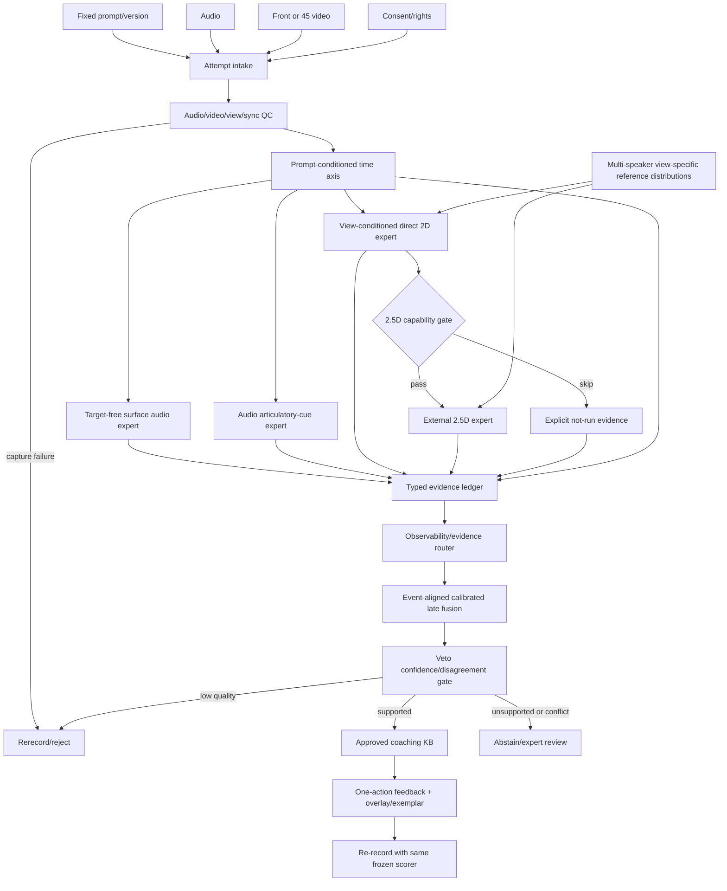

# 관찰가능성 제약형 병렬 증거 융합 MDD MVP 설계

- 기준일: 2026-08-25
- 문서 상태: `design_only`
- 구현 상태: `not_implemented`
- 주장 범위: `engineering_design_proposal`
- 근거 범위: 검증 PDF 46건(신규 45건 + 기존 OLKAVS 1건)
- 세부 근거: [논문 근거표](./PAPER_EVIDENCE_MATRIX.csv), [실현성 검토](./FEASIBILITY_AND_PRACTICALITY_REVIEW_KO.md)

> **2026-08-26 현재 아키텍처 결정:** 이 문서의 full O-GPF는 audio와
> visual expert를 동등한 병렬 소유자로 두는 **대안 연구 제안**이다.
> 현재 프로젝트 정본은 [`seungun` 종속 시각 sidecar](../../../../architecture/README_KO.md)이며,
> audio 분석·판정·전역 coaching은 `seungun`이 소유한다. 아래 구조는
> 비교·ablation을 위한 `historical_alternative_design` 근거로 보존하며,
> 현재 구현 경계나 로드맵으로 해석하지 않는다.

> 이 문서는 논문을 종합해 설계한 후속 MVP 사양이다. 새 영상 모델, 2D/3D
> 추출기, 융합기, 한국어 L2 성능, 사용자 학습 효과를 구현하거나 실행한 결과가
> 아니다. 현재 저장소의 음성 prototype도 학습자 음성·전문가 label로 보정되지
> 않았으므로 `engineering_provisional` 이상으로 해석하지 않는다.

## 1. 결론

기존의 순차 구조

```text
audio-only MDD → audio-derived 조음 특징 → 2D 입술 특징 → 선택적 3D 계수
```

를 다음 구조로 교체한다.

```text
고정 프롬프트 + 음성 + 정면 또는 45° 영상
                    │
          동의·권리·품질·동기화 gate
                    │
    prompt-conditioned 공통 phone/event 시간축
                    │
       ┌────────────┼─────────────┬────────────────┐
       │            │             │                │
 target-free    음향 조음      직접 관측       조건부 외부
 surface MDD    cue expert      2D expert       2.5D expert
       │            │             │                │
       └────────────┴──────┬──────┴────────────────┘
                           │
       phone·cue별 관찰가능성/품질 evidence router
                           │
         사건 시점 일치 + 보정된 gated late fusion
                           │
             증거 원장 + veto형 confidence gate
                           │
       coach | no issue | rerecord | abstain | expert review
                           │
      전문가 KB 기반 한 가지 행동 지시 + 동일 scorer 재시도
```

권고 MVP의 이름은 **O-GPF(Observability-Gated Parallel Fusion)**로 한다.

핵심 결정은 다음과 같다.

1. 음성·2D·2.5D를 순차 보정하지 않고 독립 expert로 병렬 실행한다.
2. 프롬프트는 위치 정렬에 사용하되, 실제 들린 소리를 보존하는 target-free
   경로를 별도로 둔다.
3. 영상은 외부에서 직접 관찰 가능한 입술·턱 동작에만 진단 권한을 가진다.
4. 단안 3D는 실제 구강 3D가 아니라 pose-normalized **외부 표면 2.5D**다.
5. raw feature concatenation 대신 phone·오류 유형별 gated late fusion을 쓴다.
6. 한 아나운서의 mesh가 아니라 문항·문맥·시점별 다화자 허용분포와 비교한다.
7. 보이지 않는 구조, 품질 저하, OOD, modality 충돌은 평균으로 지우지 않고
   재녹음·보류·전문가 검토로 보낸다.

## 2. 목적과 MVP 성공 조건

### 2.1 목적

사용자가 고정 문장을 읽은 정면 또는 45° audio-video 한 쌍에서 다음을 한다.

- 실제 들린 음소·음향 cue의 이상 후보를 찾는다.
- 외부에서 보이는 입술·턱 동작의 이상 후보를 찾는다.
- 두 증거를 같은 phone/event 시간축에서 비교한다.
- 근거가 충분한 한 가지 오류만 행동 가능한 피드백으로 제시한다.
- 재녹음 전후를 같은 동결 scorer로 비교한다.

여기서 `구강·신체적 오류 탐지`는 **카메라에서 관찰된 외부 동작 편차와
음향 결과**로 제한한다. 일반 RGB 영상으로 혀·연구개·성문·성대·airflow 또는
의학적·해부학적 원인을 직접 진단한다는 뜻이 아니다.

### 2.2 최소 성공 조건

MVP는 다음을 모두 만족해야 한다.

- 정면 또는 45° 한 시점으로 동작한다.
- 영상이 없거나 불량이면 audio-only로 명시적으로 degrade한다.
- 영상이 음성 판단을 바꾼 경우 어떤 cue가 기여했는지 추적 가능하다.
- 영상 deviation만으로 발음 오류를 확정하지 않는다.
- 2.5D가 2D보다 추가 가치를 보이지 않으면 진단 경로에서 제거할 수 있다.
- 학습자·전문가 보정 전에는 자동 코칭을 발행하지 않는다.
- 사용자에게는 한 번에 하나의 evidence-backed 행동만 제시한다.

### 2.3 MVP가 주장하지 않는 것

- 한국어 L2에서 영상이 audio-only MDD보다 정확하다는 주장
- 정면보다 45°가 우월하다는 주장
- 단안 2.5D가 실제 얼굴 깊이 또는 구강 내부를 측정한다는 주장
- AAI가 예측한 혀·성문 변수가 사용자의 실제 신체 상태라는 주장
- 한 기준 화자의 동작이 모든 사용자의 정답이라는 주장
- 피드백이 발음 학습·전이·유지에 효과가 있다는 주장
- 임상적 언어장애·해부학적 이상·근육 긴장을 진단한다는 주장

## 3. 기존 순차 구조보다 나은 이유

| 기존 문제 | O-GPF 개선 | 기대 효과 | 현재 근거 수준 |
|---|---|---|---|
| 앞 단계 오류가 뒤 단계 입력을 오염 | expert 독립 실행과 원시 evidence 보존 | 오류 전파와 원인 불명확성 감소 | 구조적 설계 근거; 한국어 실측 미완료 |
| prompt가 그럴듯한 정답으로 복원 | target-free surface 경로와 constrained alignment 분리 | ASR overcorrection 감사 가능 | Park(2026), Yan(2020) |
| audio가 AV 결정을 지배하거나 영상이 장식화 | cue별 modality capability mask와 late fusion | 영상의 실제 증분 기여 측정 | AV 표현 학습 근거는 있으나 MDD 융합은 가설 |
| 모든 음소에 영상을 사용 | observability router | 혀·연구개·성문에 대한 허위 시각 판정 방지 | 직접 관찰 범위에 대한 문헌 종합 |
| 한 아나운서 raw mesh와 좌표 거리 | 다화자·문맥·시점별 정규화 분포 | 개인 해부학·속도·공동조음 편향 감소 | Birkholz(2013), Sering(2023) |
| 3D를 마지막 정답처럼 사용 | 필요 cue에서만 외부 2.5D expert 실행 | 비용·prior 편향·허위 깊이 최소화 | DECA, AVFace, SPECTRE |
| modality 충돌을 평균으로 상쇄 | `uncertain/expert_review`로 보존 | 과신과 잘못된 신체 피드백 감소 | 안전 설계; threshold는 신규 보정 필요 |
| 생성 mesh를 관측값으로 오인 | 생성은 설명용, 관측 기반 2D/2.5D만 진단 입력 | 평균화로 오류가 사라지는 문제 방지 | VOCA/FaceFormer/CodeTalker 한계 |

## 4. 관찰가능성 taxonomy

### 4.1 진단 권한

| 클래스 | 예시 | 허용 evidence | 자동 피드백 정책 |
|---|---|---|---|
| `external_visible` | 양순 폐쇄, lip aperture, rounding/spreading, 턱 열림, 외부 timing | 품질을 통과한 2D + 관련 음향 사건 | A/V가 합치하고 보정됐을 때만 구체적 코칭 |
| `external_conditional` | 상대적 protrusion, 치아 노출, 실제로 보이는 혀끝 | visibility detector가 해당 frame에서 관측을 확인한 2D/2.5D | 시점별 reference와 높은 추적 신뢰도 필요 |
| `acoustic_primary` | S/D/I/M, VOT, burst, 후행 F0, formant, frication, voicing, duration, 억양·쉼 | surface phone posterior와 명시적 음향 cue | 들리는 현상만 설명; 물리 원인 단정 금지 |
| `internal_unobservable` | 혀 등·혀뿌리·접촉점, 연구개, 성문·성대, 구강 내 협착, airflow | RGB에서는 없음; 음향 proxy는 별도 표기 | physical-cause abstention 또는 전문가/직접 센서 연구 |
| `capture_only` | head pose, blur, 가림, 조명, 얼굴 크기, AV sync, 목·어깨 이동 | 촬영 QC/행동 관찰 | 발음 오류가 아니라 재촬영 또는 관찰 사실로만 표현 |

한국어 평음·경음·격음은 입 모양만으로 분류하지 않는다. VOT, closure/burst,
후행 모음 F0 등 음향 evidence가 주가 되고, 영상은 직접 관찰 가능한 외부 사건이
있을 때만 보조한다.

### 4.2 출력 언어 경계

허용 예시:

- `“ㅂ” 구간에서 두 입술의 완전한 닫힘이 기준분포보다 짧게 관측됐습니다.`
- `소리에서는 release timing 차이가 함께 감지됐습니다.`
- `정면 영상이 아니어서 좌우 대칭은 판단하지 않았습니다.`

금지 예시:

- `혀뿌리가 뒤로 갔습니다.`
- `연구개가 충분히 올라가지 않았습니다.`
- `성대가 잘 닫히지 않습니다.`
- `목 근육이 잘못 움직여서 발음이 틀렸습니다.`
- `3D로 복원한 구강 내부가 정답과 다릅니다.`

## 5. 시점과 2D/2.5D 선택 정책

| 입력 경로 | 주로 허용할 특징 | 약점 | MVP 역할 |
|---|---|---|---|
| 정면 2D | 폐쇄, aperture, spread, 좌우 대칭, 턱 수직 움직임 | protrusion 깊이 | 기본 경로 |
| 45° 2D | 폐쇄·개구, profile 기반 상대 protrusion, 턱 궤적 | 대칭·입 너비 왜곡 | view-specific 기본 경로 |
| 단안 외부 2.5D | pose 정규화, jaw/expression 계수, 외부 표면 깊이 proxy | 얼굴 prior·재투영 오차·내부 구강 미관측 | 조건부 보조 경로 |
| 정면+45° 동시 | aperture와 profile의 상보성 | 동기화·촬영 부담 | 연구 비교용 상한; 서비스 필수 입력 아님 |

Petridis et al.(2017)의 10구문 폐쇄집합 분류에서 단일 정면 91.8%, 단일
45° 88.8%, 정면+45° 93.6%였다는 결과는 시점 상보성을 시사할 뿐 MDD 성능이
아니다. OLKAVS도 다중시점 한국어 AVSR/VSR 자료이지 L2 오류 gold가 아니다.

서비스 입력은 다음처럼 처리한다.

1. `front | oblique_45 | unsupported`를 자동 분류하고 사용자가 선택한 시점과
   대조한다.
2. 시점별 normalizer, capability mask, reference distribution을 사용한다.
3. 서로 다른 시점의 raw landmark/mesh 좌표를 직접 비교하지 않는다.
4. 시점이 지원범위를 벗어나면 재촬영하고, 임의로 정면화해 진단하지 않는다.

### 5.1 2.5D 실행 조건

다음 조건을 **모두** 만족할 때만 외부 2.5D expert를 실행한다.

- 해당 cue가 depth/protrusion 또는 pose normalization의 추가 정보를 필요로 함
- face ROI, blur, occlusion, head pose가 사전등록 범위 안임
- 2D landmark/segmentation과 2.5D 재투영 오차가 허용범위 안임
- frame 간 coefficient가 비정상적으로 흔들리지 않음
- backend/model/FLAME 계열 자산의 사용권과 배포권이 확인됨
- 같은 split의 B2 대비 증분 가치가 dev에서 관측됨

2.5D 산출물에는 반드시 다음 provenance를 붙인다.

```text
geometry_scope = external_surface
depth_basis = monocular_prior
view_type
reprojection_error
temporal_stability
uncertainty
backend_id
revision
```

`true_tongue_position`, `true_vocal_tract`, `measured_airflow` 같은 필드는 schema에서
허용하지 않는다.

## 6. 모듈 아키텍처와 데이터 흐름



### 6.1 모듈별 책임

| 모듈 | 책임 | 금지 |
|---|---|---|
| `AttemptIntake` | prompt/version, media, consent scope, 가명 attempt 결합 | raw path를 결과 payload에 노출 |
| `CaptureQualityGate` | audio/video/view/sync/content route 결정 | 낮은 품질을 점수 0으로 변환 |
| `PromptAlignment` | expected surface lattice와 phone/event 시간축 | expected phone을 observed phone으로 저장 |
| `SurfaceAudioExpert` | target-free heard-as posterior/lattice, S/D/I/M 후보 | prompt 정답으로 posterior 덮어쓰기 |
| `AudioCueExpert` | VOT/formant/voicing/duration 등 관측 음향 cue | 실제 혀·성문 위치라고 명명 |
| `Direct2DExpert` | 정규화된 외부 lip/jaw/appearance/timing cue | 내부 구강 또는 unsupported view 판정 |
| `External2_5DExpert` | 외부 표면·jaw/expression·pose proxy | 생성 mesh를 측정 gold로 사용 |
| `VisualReferenceBank` | 문항·문맥·view·feature-version별 허용분포 | 한 화자 raw mesh를 절대 정답으로 사용 |
| `EvidenceLedger` | evidence 원본, 상태, provenance, contradiction 보존 | missing을 0.0으로 대체 |
| `ObservabilityRouter` | hypothesis별 허용 modality와 cue 결정 | 모든 음소에 모든 modality 사용 |
| `FusionService` | 사건 단위 reliability-gated late fusion | 충돌 evidence를 평균으로 삭제 |
| `DecisionGate` | calibration·OOD·support·allowlist veto | threshold 미보정 상태에서 자동 코칭 |
| `FeedbackComposer` | 승인 KB의 한 행동 지시와 시각화 | 새 오류·신체 원인·위치를 생성 |

### 6.2 사건 단위 결합

단순 phone class 확률을 이어 붙이기보다 다음 조음 사건의 시간적 합치를
비교한다.

| 가설 | 음향 사건 | 영상 사건 | fusion 규칙 |
|---|---|---|---|
| 양순 폐쇄 이상 후보 | closure/release/burst/VOT | 두 입술 간 거리 최소값, 완전 폐쇄 duration | 두 사건의 존재와 onset/offset 차이를 결합 |
| 원순성 이상 후보 | formant·스펙트럼·vowel posterior | rounding, aperture, 상대 protrusion | audio cue가 이상일 때 video가 외부 동작 설명을 보강 |
| 개구·턱 timing 후보 | 음소 경계·duration | jaw/lip onset/peak/release | phone span 내 상대 timing으로 정규화 |
| voicing·기식·긴장 후보 | VOT/F0/voicing/aspiration proxy | 지원 evidence 없음 | audio-only; visual weight를 0이 아닌 `not_applicable`로 기록 |
| 혀·연구개·성문 원인 | 간접 음향 proxy | 지원 evidence 없음 | 물리 원인 확정 금지, abstain 또는 전문가 검토 |

초기 fusion은 대규모 end-to-end AV Transformer가 아니라, cue별 작은
calibrated logistic/monotonic stacker와 hard capability mask를 권고한다.
작은 한국어 L2 자료에서 더 해석 가능하고 modality contribution을 감사하기
쉽기 때문이다. 정확한 fusion 방식은 비교 실험에서 기각 가능한 가설로 둔다.

## 7. I/O와 도메인 계약

### 7.1 재사용할 현재 계약

현재 workspace prototype에서 다음 철학을 재사용한다.

- `MetricState`: observed/missing/low-confidence/OOD/backend-unavailable 분리
- `AttemptStatus`: coaching-ready/no-issue/rerecord/uncertain/failed-closed
- port 주입과 stage receipt/provenance
- S1/S2 독립성 veto
- evidence·confidence·calibration·allowlist veto
- LLM에는 raw media/path/ID가 아니라 승인된 구조화 claim만 전달
- `AttemptResult.claim_scope` 기본값 `engineering_provisional`

현재 workspace에는 CTC alignment, GOP S1, Qwen audio auditor의 lazy wiring이
있지만 dirty/untracked prototype이며, threshold는 합성 reference 낭독으로만
고정됐다. 학습자 발화의 issue operating point과 전문가 타당성은 검증되지 않았다.
따라서 이 wiring은 새 AV 설계의 audio baseline 후보이지 검증된 제품이 아니다.

### 7.2 새 입력 계약

```text
AudioVideoAttemptInput
  attempt_id_sha256
  prompt_id
  prompt_version
  target_language
  audio_locator          # entrypoint/adapter boundary only
  video_locator          # entrypoint/adapter boundary only
  requested_view         # front | oblique_45
  device_profile_id
  consent_scope_id
  analysis_profile
```

Domain과 사용자 응답에는 locator, raw speaker ID, prompt 원문 복제, 얼굴 image,
mesh vertex를 넣지 않는다. adapter가 hash/QC/provenance로 변환한 뒤 pipeline에
전달한다.

### 7.3 새 관측 계약

```text
VideoObservation
  video_sha256
  duration_ms
  fps
  width, height
  detected_view
  face_roi_coverage
  lip_roi_resolution
  blur_score
  occlusion_score
  exposure_score
  head_pose
  tracking_state
  qc_failures[]
  backend_id, revision

AvSyncObservation
  offset_ms
  drift_ms
  confidence
  state
  backend_id, revision

CueEvidence
  evidence_id
  phone_span
  modality              # audio_surface | audio_cue | visual_2d | external_2_5d
  cue_id
  measurement, unit     # state=observed일 때만 존재
  measurement_state
  verdict               # compatible | incompatible_candidate | uncertain | not_applicable
  observability_class
  view_type
  quality
  calibrated_confidence
  reference_profile_id
  contraindications[]
  backend_id, revision
```

visual-specific 실패는 `measurement_state`와 별개로 reason을 보존한다.

```text
visually_unobservable
tracking_failed
sync_failed
unsupported_view
reference_unavailable
calibration_unavailable
```

### 7.4 진단과 결과 계약

```text
ErrorHypothesis
  hypothesis_id
  phone_span
  target_phone
  observed_phone_candidates[]   # target-free audio에서만; 없으면 비워 둠
  issue_type
  observability_class
  evidence_ids[]
  modality_support[]
  disagreement_flags[]
  calibrated_confidence
  severity
  support_state
  contraindications[]

DiagnosticDecision
  status             # coach | no_issue | rerecord | abstain | expert_review | failed_closed
  selected_hypothesis_id | null
  reason_codes[]
  allowed_claim_ids[]
  prohibited_claim_ids[]
  next_action
  claim_scope

FeedbackPlan
  span
  auditory_observation | null
  visual_observation | null
  action_directive_id
  exemplar_or_overlay_id | null
  disclosure_notices[]
  evidence_ids[]
```

기존 `AttemptStatus`와의 호환 mapping은 다음과 같다.

| 새 결정 | 기존 상태 | next action |
|---|---|---|
| `coach` | `coaching_ready` | `coach_then_rerecord` |
| `no_issue` | `completed_no_issue` | `none` |
| `rerecord` | `rerecord_required` | `rerecord` |
| `abstain` | `uncertain` | `no_physical_claim` |
| `expert_review` | `uncertain` | `expert_review` |
| `failed_closed` | `failed_closed` | `none` |

### 7.5 신규 port 제안

```text
VideoIntakePort.observe(video_path) -> VideoObservation
AvSyncPort.synchronize(audio, video) -> AvSyncObservation
ViewCapabilityPort.capabilities(video_observation) -> ViewCapability
SurfaceAudioEvidencePort.extract(...) -> EvidenceBundle
AudioArticulatoryCuePort.extract(...) -> EvidenceBundle
Visual2DEvidencePort.extract(...) -> EvidenceBundle
ExternalGeometryEvidencePort.extract(...) -> EvidenceBundle
VisualReferenceBankPort.distribution_for(...) -> VisualReferenceDistribution
ObservabilityPolicyPort.policy_for(phone, context, view) -> EvidencePolicy
EvidenceFusionPort.fuse(policy, bundles) -> HypothesisBundle
```

기존 audio `ReferenceBank`에 얼굴·landmark·mesh를 억지로 넣지 않고,
생체정보 권리와 feature-version을 가진 별도 visual reference 계약을 만든다.

## 8. Decision gate

| 상태 | 처리 |
|---|---|
| 동의·권리 누락 | 저장·학습·추론 거부 |
| audio clipping/SNR/VAD/content 실패 | 재녹음; 발음 판정 안 함 |
| video blur/가림/pose/ROI 실패 | visual-required cue면 재녹음, 아니면 명시적 audio-only fallback |
| AV offset/drift 실패 | AV 결합 금지; visual timing claim 금지 |
| alignment 저신뢰 또는 OOD | 재녹음; 반복되면 전문가 검토 |
| audio 고신뢰, video 저신뢰 | acoustic-only 진단 가능; 신체 피드백 금지 |
| audio 저신뢰, video deviation 고신뢰 | 발음 오류로 확정하지 않고 재녹음/보류 |
| A/V 양쪽 고신뢰·합치 | 지원 ontology와 보정 threshold 안에서만 코칭 |
| A/V 양쪽 고신뢰·불일치 | 평균하지 않고 `expert_review` |
| 내부 조음 원인 요구 | `physical_cause_unobservable` abstention |
| visual reference 없음 | visual 비교 생략; 임의 기준화 금지 |
| AV calibration 없음 | automatic visual coaching 금지 |
| 2.5D가 2D보다 열등/동등 | 2.5D 진단 비활성, 설명용 animation만 허용 |

영상 branch를 전역 required branch로 만들지 않는다. `missing video = score 0`이
아니며, visual-specific claim만 차단한다. 반대로 visual cue가 핵심인 문항에서
사용자가 visual feedback을 요청했다면 audio-only로 조용히 성공시키지 않고
재촬영 이유를 알려야 한다.

## 9. Reference 설계

한 명의 아나운서는 다음 역할까지만 맡는다.

- 여러 기준 화자 중 한 명
- 교육용 문구와 과장 animation 감수자
- 허용 변이와 금지 해부학 claim의 전문가 reviewer

Visual reference bank는 다음 key로 분리한다.

```text
prompt_id
left_phone, target_phone, right_phone
view_type
speaking_rate_bin
cue_id
feature_schema_version
camera_profile
reference_distribution_id
```

저장값은 raw mesh가 아니라 identity/head-pose/scale을 제거한 cue trajectory의
분포, 허용구간, support count, reviewer receipt다. 비교는 phone/event duration으로
정규화하고, 제한된 DTW 또는 landmark event alignment를 사용한다. 원 mesh
vertex-to-vertex L2 거리는 사용하지 않는다.

기준 화자 수 3–5명은 **planning range**일 뿐 binding floor가 아니다. 실제 floor,
반복 수, QC, adjudication은 수집 전에 동결한다. 기존 audio 동의는 얼굴 영상,
neutral face, landmark, 2.5D coefficient, 교육용 rendering 권리를 포함하지 않으므로
별도 동의와 사용권이 필요하다.

## 10. 데이터와 주석

### 10.1 최소 prompt 범위

- 기존 R00 20개 고정 문장을 시작점으로 사용한다.
- 그중 전문가가 외부 cue coverage를 확인한 8–12개를 first visual smoke subset으로
  별도 version/data card에 고정한다.
- 현재 R00의 철자 기반 음운 coverage를 visible-cue coverage로 오인하지 않는다.
- coverage가 부족하면 R00을 조용히 수정하지 않고 새 versioned prompt card를 만든다.

first MVP ontology는 2–3개 cue군으로 제한한다.

1. 양순 폐쇄 완전성·timing
2. lip rounding/spreading·aperture
3. jaw/lip onset·peak·release timing

### 10.2 수집 계획

기술 smoke용 planning 예시는 다음과 같다. 표본 충분성이나 성능을 주장하는
숫자가 아니다.

- 기준 화자: 3–5명, 문항당 3회
- 학습자 smoke: 8–12명, 문항당 2회
- 연구 수집: 같은 발화를 정면+45°로 동시 촬영
- 서비스 평가: 한 시점씩 제거한 paired comparison으로 front/45° 각각 평가
- confirmatory 규모: pilot 효과크기와 화자 단위 power analysis 후 결정

OLKAVS는 한국어 AV representation/view robustness 사전학습 후보로만 사용한다.
L2 오류, visible cue, 3D, 내부 조음 gold로 사용하지 않는다. AI Hub 71490의
expected/realized phone 역할도 그대로 분리하고, 시각 label을 추정해 추가하지 않는다.

### 10.3 주석 protocol

1. **audio-only, prompt hidden**: perceived-phone soft label, 대안, S/D/I/M,
   span, confidence를 주석한다.
2. **video-only, audio muted**: front와 45°를 서로 blind 처리하고 cue,
   timing, observability, tracking confidence를 주석한다.
3. **AV adjudication, prompt visible**: 허용 변이, intelligibility 영향,
   evidence 합치/충돌을 판정한다.
4. **coaching KB**: cue별 허용 행동 지시, 금지 claim, exemplar/overlay를 승인한다.

두 명 이상이 독립 주석하고 불일치는 별도 adjudicator가 처리한다. 원평정을
보존한다. 범주형은 kappa/alpha, timing·심각도는 ICC와 boundary-tolerance F1을
보고하며, 통과값은 main annotation 전에 사전등록한다.

`expected_phone`, `human_perceived_phone`, `model_observed_candidate`,
`visible_cue`, `generated_feedback`은 서로 다른 role로 저장한다. 미해결 label을
규칙이나 prompt, 2.5D prior로 복구하지 않는다.

### 10.4 split

```text
reference | train | dev | fusion-stack | calibration | locked | feedback-study
```

다음 교집합을 모두 0으로 강제한다.

- speaker/participant
- session
- PCM/audio digest
- 원본 video digest
- camera/device profile(held-out 평가 정책에 따라)
- reference speaker와 learner speaker

기존 `train/dev/stack/calibration/locked = 50/10/10/10/20` deterministic group split
계약을 후보로 재사용할 수 있지만, AV 자료에서는 subject/session/device/view/site
누수를 추가 검사해야 한다. 비율은 실제 표본 support를 본 뒤 사전등록한다.

## 11. 개인정보·라이선스

음성, 얼굴 RGB, neutral face, landmark trajectory, face embedding, 2.5D/mesh
coefficient는 모두 생체정보 또는 재식별 가능한 파생물로 취급한다.

| 구역 | AV 자료 예 | 정책 |
|---|---|---|
| R0 | 원본 audio/video | 접근 제한, Git·외부 LLM 전송 금지 |
| R1 | locator, session/camera/consent metadata | 운영 제한, 외부 반출 금지 |
| D1 | 가명 ID, normalized cue, embedding, coefficient, prediction | 연구 제한; 익명으로 간주 금지 |
| A1 | count, metric, CI, aggregate failure | 검토 후 공개 가능 |
| C1 | 코드, schema, synthetic fixture, 문서 | 공개 가능 |

필수 동의 범위:

- 음성·얼굴 촬영과 분석
- landmark/embedding/2.5D 파생물 생성
- 모델 학습/평가와 기준 영상 표시의 분리된 목적
- 교육용 overlay/avatar rendering 여부
- 보존기간, 접근권한, 철회, 원본과 파생물 삭제
- 외부 서비스/모델 사용 여부

가능하면 raw video는 local/ephemeral하게 처리하고 normalized cue만 보존한다.
그러나 cue도 익명은 아니다. LLM에는 raw media, face coefficient, path, speaker ID,
digest를 보내지 않고 승인 claim ID만 전달한다. DECA/FLAME/VOCASET/MEAD 계열
자산은 논문 공개와 모델·데이터의 상업 사용권을 분리해 확인한다.

## 12. 기준선, ablation과 평가

### 12.1 기준선

같은 speaker split과 계산 예산에서 비교한다.

| ID | 구성 | 목적 |
|---|---|---|
| B0 | canonical GOP/audio MDD | 가장 싼 음성 기준선 |
| B1 | target-conditioned alignment + target-free surface MDD | prompt 복원 편향을 분리한 audio 기준선 |
| B2 | B1 + audio-derived articulatory cue | 영상 전에 비교할 강한 저비용 기준선 |
| B3-F | B2 + front 2D + O-GPF | 정면 서비스 후보 |
| B3-45 | B2 + 45° 2D + O-GPF | 45° 서비스 후보 |
| B4 | B2 + front+45° 2D | 연구용 상한 |
| B5-F/B5-45 | 해당 B3 + 조건부 외부 2.5D | 3D 증분가치 검증 |
| B6 | raw early-concatenation AV | O-GPF 구조의 비교 대조군 |

### 12.2 필수 ablation/metamorphic test

- prompt on/drop/swap/sham
- audio mute와 video mute
- 다른 화자 video, 시간 shuffle, frozen frame
- AV offset/drift 주입
- front 대 45°의 동일 발화 paired 비교
- good/poor blur·조명·가림·head pose
- visible/acoustic-only/unobservable cue slice
- single-reference 대 multi-reference distribution
- identity normalization on/off
- 2D 대 외부 2.5D
- modality disagreement abstention on/off
- generated mesh를 진단 입력에서 완전히 제거했는지 확인

기대되는 안전 변환은 다음과 같다.

- prompt swap 시 target-free posterior는 변하지 않아야 한다.
- video shuffle/frozen frame 시 visual confidence 또는 sync gate가 하락해야 한다.
- video가 사라져도 audio metric은 그대로이고 visual claim만 사라져야 한다.
- unsupported phone에서 visual feature를 주입해도 physical claim이 생기지 않아야 한다.

### 12.3 지표

진단:

- phone/error-type macro-AUPRC, macro-F1
- missed-error/FAR, false-alarm/FRR, DER
- phone span boundary F1/IoU
- visible-cue AUPRC와 observability별 recall
- calibration ECE, Brier, NLL
- coverage-selective risk, abstention/expert-review rate
- speaker bootstrap CI와 worst-group 결과

운영:

- capture QC 통과율, 재녹음률, audio-only fallback률
- tracking/sync failure율
- front/45°별 실패율
- latency p50/p95, peak GPU/메모리, upload 크기
- 사용자 완료시간

slice:

- L1, 성별, 연령, 피부색, 안경/수염, device, 조명, view, speaking rate
- visible vs acoustic-primary vs unobservable
- 정상 허용변이와 오류 유형별 support

성능값이 없는 slice는 0점으로 보고하지 않고 `insufficient_support`로 표시한다.

### 12.4 2D/2.5D 채택 gate

- B3-F와 B3-45 중 서비스 기본시점은 paired dev/calibration 결과와 촬영 실패·
  지연·사용자 부담을 함께 보고 정한다.
- B5는 대응 B3보다 phone/error macro-AUPRC 또는 전문가 feedback correctness를
  사전등록 기준으로 개선하고 FAR·지연·실패율 비열등성을 만족해야 한다.
- 위 기준을 locked test에서 만족하지 못하면 2.5D는 진단에서 제거하고
  `설명용 애니메이션`으로만 남긴다.
- exact threshold, CI 방법, non-inferiority margin은 결과를 보기 전에 동결한다.

## 13. 구현·검증 단계

### Phase 0 — 범위·권리·ontology 동결

산출물:

- visual smoke prompt subset/data card
- observability/cue ontology와 금지 claim
- consent/license/privacy/retention 문서
- reference와 learner 수집 protocol
- split, metric, ablation, stop rule 사전등록

통과 전에는 사람 데이터를 수집하거나 3D 모델을 선택하지 않는다.

### Phase 1 — 계약과 synthetic fixture

구현 후보:

- `VideoObservation`, `AvSyncObservation`, `CueEvidence`
- 신규 visual ports와 adapter boundary
- 기존 `MetricState`, `AttemptStatus`, receipt, veto gate 연결
- synthetic front/45°, blur, occlusion, sync-failure fixture
- schema, privacy, missing-state, unsupported-claim 단위 테스트

검증:

- 8–16 clip tiny-overfit/shape smoke
- NaN/Inf, span, evidence pointer, hash, no-path/no-ID 검사
- 성능 또는 진단 타당성 주장은 하지 않음

### Phase 2 — 2D capture/QC/reference smoke

- consent 완료 소수 화자의 front+45° 동시촬영
- view classifier, face/lip ROI, blur/occlusion/pose, AV sync
- neutral-face/identity/scale/head-pose normalization
- 다화자 view-specific 2D reference distribution
- 동일 화자 반복 신뢰도와 전문가 observability 확인

QC가 성립하지 않으면 모델 학습을 시작하지 않는다.

### Phase 3 — audio와 2D 독립 expert

- B0/B1/B2 audio baseline 재현
- direct 2D cue extractor와 appearance 보조특징
- 각 expert의 독립 calibration 전 raw evidence 보존
- phone/event timeline join
- speaker/session/device/view-disjoint dev smoke

### Phase 4 — O-GPF fusion

- observability policy와 capability mask
- cue별 calibrated late fusion/stacker
- A/V disagreement와 audio-only degradation
- B3-F/B3-45/B4/B6 비교
- 필수 metamorphic/ablation

### Phase 5 — 조건부 외부 2.5D

- 2D 통과 후에만 DECA/SPECTRE/AVFace 계열 후보의 라이선스·재투영·temporal
  stability를 비교
- B5-F/B5-45를 대응 2D baseline과 직접 비교
- 증분가치가 없으면 즉시 진단 범위에서 중단

### Phase 6 — reload, calibration, sealed evaluation

1. encoder, normalizer, reference bank, ontology, fusion, calibrator, threshold의
   hash를 고정한다.
2. 새 process/container에서 재로드하고 허용오차 내 prediction 재현을 확인한다.
3. dev 선택을 끝내고 calibration split에서만 threshold를 산출한다.
4. locked path read가 이전 단계에서 0이었음을 확인한다.
5. sealed locked test를 한 번 실행한다.
6. 실패 후 같은 locked 결과로 재튜닝하지 않고 새 protocol version을 만든다.

### Phase 7 — 전문가 피드백 감사

전문가가 다음을 blind 비교한다.

- audio-only
- audio + front/45° 2D
- 기술 gate를 통과한 경우만 audio + 2.5D

평가 항목은 factual correctness, evidence fidelity, 행동 가능성, 허위 해부학
claim, 위해 가능성이다. 여기까지 통과해도 학습효과를 주장하지 않는다.

### Phase 8 — 별도 사용자 학습효과 연구

- no-feedback/audio-only/audio+2D 비교
- 2.5D는 Phase 5·7 통과 시에만 포함
- 즉시 재시도, 미훈련 문항 전이, 1주 후 유지
- 주 endpoint는 동결 모델 자기점수가 아니라 blind 인간 comprehensibility와
  오류 평정
- power, MID, 표본 수, 중단 규칙을 사전등록

이 단계 전에는 `이해하기 쉽다`, `도움이 된다`, `발음이 향상된다`를 제품
효능으로 주장하지 않는다.

## 14. 피드백 정책

자동 피드백은 가장 높은 우선순위의 coachable issue 하나만 제시한다.

```text
1. 위치: 어느 음절/시간 구간인가
2. 귀: 음성에서 무엇이 관측됐는가
3. 눈: 지원된 경우 외부에서 무엇이 관측됐는가
4. 행동: 한 번에 하나의 directive
5. 표시: 2D overlay 또는 명시적으로 '설명용'인 animation
6. 재시도: 같은 frozen scorer로 변화와 불확실성 표시
```

예시:

```text
구[수]해요의 2.96–3.13초 구간을 다시 연습해 보세요.
소리에서는 목표 모음과 다른 음향 패턴이 감지됐습니다.
정면 영상에서는 입술 둥글림이 기준분포보다 작게 관측됐습니다.
이번에는 입술을 조금 더 둥글게 유지한 채 같은 속도로 다시 읽어 보세요.
```

이 문구는 실제 calibration과 전문가 KB 승인을 통과하기 전에는 synthetic
contract fixture일 뿐이다.

시각 evidence가 없을 때:

```text
영상 추적이 불안정해 입술 움직임은 판단하지 않았습니다.
발음 판정을 계속하려면 밝은 곳에서 입 전체가 보이도록 다시 촬영해 주세요.
```

내부 조음 원인을 요구할 때:

```text
일반 영상으로 혀 뒤쪽·연구개·성대의 실제 위치는 확인할 수 없습니다.
소리의 차이는 표시할 수 있지만 신체적 원인은 자동으로 단정하지 않습니다.
```

LLM은 승인된 claim/directive ID의 표현 순서와 문장화만 담당한다. 새 phone,
issue, score, 위치, 신체 부위, 행동 지시를 생성할 수 없다.

## 15. 수집 논문 전체의 설계 반영 지도

46행 근거표의 모든 논문은 다음 여섯 evidence cluster로 반영했다.

| 근거 ID | 논문군 | 설계 반영 | 반영하지 않은 주장 |
|---|---|---|---|
| C01–C04 | 수치·VTL·공기역학 주장 감사 | 지표 역할 분리, 23/30 parameter를 사용자 측정값으로 쓰지 않음 | 67.84를 AV MDD 정확도로 해석, 23+7 구조 |
| M01–M08 | audio MDD/APA/AF | target-free surface, explicit cue, FAR/FRR/DER, audio AF baseline | 낮은 WER를 MDD 정확도로 해석, 영어 수치를 한국어로 전이 |
| V01–V07 | multi-view VSR/AVSR/OLKAVS | view-specific QC·encoder·paired front/45 비교, 잡음 조건 | VSR/CER를 phone 오류 또는 신체 진단 정확도로 해석 |
| D01–D10 | 3D/4D face reconstruction/generation | 외부 2.5D normalization, reprojection/stability, 설명 animation | 생성 mesh를 사용자 실제 articulation 또는 internal 3D로 사용 |
| A01–A09 | VTL/AAI/EMA/RT-MRI | internal-unobservable 경계, audio proxy 표기, 연구용 직접 sensor 상한 | RGB/AAI 결과를 실제 혀·연구개·성문 측정값으로 사용 |
| F01–F08 | visual feedback/CAPT/LLM | 한 행동 지시, overlay·과장 animation disclosure, 인간평가 분리 | demo/MOS/소표본을 장기 학습효과로 주장 |

대표적인 직접 연결은 다음과 같다.

- [Park 2026](./00_주장감사/2026_Park_Intent_vs_Surface_ASR_Overcorrection.pdf),
  [Yan 2020](./01_MDD_음성/2020_Yan_End-to-End_MDD_Anti-Phone.pdf):
  target-free surface 경로
- [Wei 2025](./01_MDD_음성/2025_Wei_Articulatory_Information_E2E_MDD.pdf):
  audio-derived AF baseline
- [Petridis 2017](./02_시각음성_다중시점/2017_Petridis_End-to-End_Multi-View_Lipreading.pdf),
  [OLKAVS](../2301.06375v2.pdf): view-specific/paired angle 실험
- [DECA 2021](./03_3D_4D_얼굴복원/2021_Feng_DECA.pdf),
  [AVFace 2023](./03_3D_4D_얼굴복원/2023_Chatziagapi_AVFace.pdf),
  [SPECTRE 2023](./03_3D_4D_얼굴복원/2023_Filntisis_SPECTRE.pdf): 외부
  2.5D 후보와 깊이 한계
- [Birkholz 2013](./04_조음역추정_MRI/2013_Birkholz_CV_Coarticulation_Articulatory_Synthesis.pdf):
  공동조음·시간 정규화
- [McGhee 2023](./04_조음역추정_MRI/2023_McGhee_AAI_for_Pronunciation_Training.pdf),
  [Hao 2024](./04_조음역추정_MRI/2024_Hao_Cross-lingual_AAI_SSL.pdf):
  숨은 조음 proxy와 언어·화자 전이 한계
- [Suzuki 2017](./05_시각피드백/2017_Suzuki_Visual_Learning_2.pdf),
  [Bu 2020](./05_시각피드백/2020_Bu_Visual-Speech_Synthesis_Exaggerated_Corrective_Feedback.pdf),
  [Zhong 2024](./05_시각피드백/2024_Zhong_LLM_Articulatory_Feedback_CAPT.pdf):
  feedback UX와 제한형 문장화

## 16. 실현성·실용성 판정

| 구성 | 기술 실현성 | 서비스 실용성 | 판정 |
|---|---:|---:|---|
| 고정 prompt + audio dual path | 높음 | 높음 | 기존 prototype을 baseline으로 재사용 가능, learner calibration 필요 |
| view-conditioned 2D 외부 cue | 중상 | 높음 | 권고 MVP 핵심; 한국어 L2 error gold 필요 |
| gated late fusion | 중상 | 중상 | 구현 가능하나 한국어 증분효과는 미검증 가설 |
| 단안 외부 2.5D | 중간 | 중간 | 2D 대비 증분가치가 있을 때만 유지 |
| 단일 정면 또는 45° 서비스 | 중상 | 높음 | paired 연구 후 view-specific capability로 제공 |
| 실제 internal vocal-tract 3D | 낮음 | 낮음 | 소비자 RGB MVP 범위 밖 |
| evidence-backed 한 행동 피드백 | 중상 | 높음 | 전문가 KB/안전 감사 전 자동 발행 금지 |
| 학습효과·유지 | 미검증 | 미정 | 별도 사용자 연구 필요 |

이 대안 연구안에서의 최종 권고는 다음과 같다.

> full O-GPF는 독립 audio·visual expert의 병렬 융합을 비교하는
> `historical_alternative_design`으로만 유지한다. 현재 프로젝트에서는
> `seungun`이 phone identity, audio evidence, reliability gate와 최종 coaching
> 판단을 소유한다. 시각 sidecar는 immutable `seungun` analysis를 소비하고,
> 외부에서 직접 관찰된 2D/2.5D lip/jaw cue의
> `VisualFeedbackSupplement`만 반환한다. 시각 근거는 upstream audio
> 판정을 덮어쓰거나 독립적으로 최종 피드백을 발행하지 않는다.

## 17. 현재 구현과 미검증 항목

### 현재 workspace에서 정적으로 확인한 것

- fixed R00 prompt/version과 audio intake/QC 계약
- CTC alignment + GOP S1 + 독립 Qwen audio auditor lazy wiring
- typed missing/OOD/confidence 상태와 veto gate
- evidence/allowlist 기반 grounded feedback 경계
- deterministic speaker group split 기반

### 현재 결과로 승격할 수 없는 것

- 현재 wiring은 dirty/untracked workspace prototype이며 안정된 release 계약이 아님
- 합성 reference 낭독 기반 threshold는 learner/error/전문가 calibration이 아님
- target-free realized-phone recognizer의 한국어 타당성
- production 17-tag ontology, C02/C03/E02 실제 실행
- 검증된 human multi-speaker audio/visual reference bank
- 모든 video/2D/2.5D port, model, metric, latency
- 정면/45° 우열과 단일 시점 충분성
- 신체적 오류 원인 진단
- 전문가 feedback 정확성, 사용자 이해도, 학습·전이·유지 효과

따라서 이 문서 작성으로 완료된 것은 **문헌 기반 설계와 검증 계약**뿐이다.
모델 구현, 데이터 수집, smoke, 학습, reload, calibration, locked test, 전문가
감사, 사용자 연구는 모두 미실행이다.
