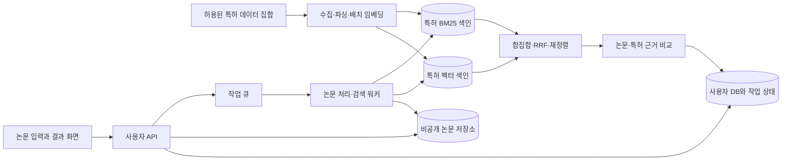

# 내 논문으로 관련 특허 찾기 — 구현 계획

작성일: 2026-09-13 · 재검토일: 2026-09-14 · 설계 revision: `paper-patent.semantic.v2`. 상태: 설계 제안. 이 문서는 기능 구현·데이터 이용 신청·서버 배포 완료를 의미하지 않는다.

후속 실행: [2026-09-14 실제 수집·모델 비교·구현 기록](patent_search_execution_20260914.md)과 [로컬 파일럿 실행 안내](patent_search_pilot.md)를 추가했다. 미국 공개 특허 512건·음성/시청각 분야 공개 논문 2편으로 독립적인 의미 검색과 API를 실행했다. 아래 전체 목표 중 한국 데이터·B2·근거 판정·제품 배포는 미완료이며 설계와 실제 구현 범위는 수행 기록을 기준으로 구분한다.

개정 사항: 사용자의 의미 검색 요구를 반영하여 **특허 집합에 대한 독립적인 벡터 검색을 첫 버전의 필수 기능으로 변경**했다. 키워드 API로 찾은 후보만 의미 비교하던 이전 방식은 이 요구를 충족하지 못한다.

이번 재검토에서는 첨부 텍스트에 섞인 구안과 개정안을 대조하고, 이 파일의 의미 검색안을 정본으로 유지했다. 키워드 후보 300건만 재정렬하는 방식·4~6주 일정·의미 검색 장애의 조용한 대체는 채택하지 않는다. 아래 후보 수·가중치·일정은 검증 전 기본안이며 사용자 확정이나 실측 결과가 아니다.

## 0. 재검토 결과와 보완 결정

**독립적인 dense 검색 + BM25 + 후보 결합 + 재정렬이라는 방향은 유지한다.** 다만 벡터 검색을 추가하는 것만으로 낮은 어휘 중복의 관련 특허가 최종 결과까지 살아남는 것은 보장되지 않는다.

| 발견한 설계 빈틈 | 이번 보완 |
|---|---|
| 한국 전체와 일부 분야 색인의 목표가 혼재 | 실제 확보 범위의 파일럿과 범위 확대를 구분. 이용 권한·샘플 파싱·문서 수 확인을 착수 조건으로 구체화 |
| 문단·다중 질의를 공보 순위로 바꾸는 방식이 미정 | 문단의 공보별 최대값, 질의·필드 가중 순위 결합, 동점 규칙 명시 |
| RRF 상위 100건에서 dense 전용 후보가 사라질 수 있음 | 상위 80건 + dense 전용 10건 + BM25 전용 10건의 후보 보존안을 비교 기준에 추가 |
| 8개 기술 요소를 5쌍만 재정렬하면서 전체 비교처럼 보일 위험 | 500쌍 재정렬과 최종 근거 확인의 예산 분리, 요소별 미평가 상태 유지 |
| 모델별 길이 제한과 청구항 의존 관계 충돌 | 검색용 짧은 문단과 근거 확인용 부모 문맥 분리, 잘린 범위 기록 |
| dense/BM25 색인 전환·필터 후 누락 정책 부족 | 같은 corpus의 색인 묶음 고정, 조건부 ANN 탐색·정확 검색 대안, 원자적 전환 |
| 의미 검색 실패·설명 실패·정상 0건의 구분 불충분 | 경로/단계 상태와 결과 수 분리, 무관련 결과를 억지로 반환하지 않음 |
| 알려진 정답만으로 회수율을 과대 해석할 위험 | 공보·패밀리 단위 분리, 단계별 생존율·미판정·무관련 사례와 지연 분포까지 수동 평가 |

## 1. 목표와 설계 전제

**논문과 같은 기술을 다른 용어로 설명한 특허까지 찾고, 논문 문단과 특허의 초록·청구항을 근거로 관련 이유와 차이를 보여준다.** 의미 검색과 키워드 검색이 각각 후보를 찾도록 구성한다. 첫 버전은 확보·색인한 한국 특허 집합을 대상으로 만들고, 한국 내 검색 범위 확대와 해외 특허·논문 직접 인용 검색을 순서대로 확장한다.

2026-09-14 재검토 기준은 `agent/runpod-http-v1_1`, HEAD `b4057a008ad45c89f540e4cb6e19b6f29cd53aed`다. `pyproject.toml`은 음성 코칭 프로젝트이며 `src`에서 patent/Patent/hybrid_semantic 검색 구현은 확인되지 않았다. 이전 `fb54a1b...` 검토는 과거 기록이다. 대상 서비스에 대한 별도 답변이 없어 독립 기능을 기본안으로 삼는다. 기존 음성 분석 API·Clova·RunPod에 바로 결합하지 않고, 실제 구현 저장소를 정한 뒤 아래 책임을 배치한다.

| 항목 | 첫 버전 제안 | 후속 확장 |
|---|---|---|
| 논문 입력 | 텍스트 PDF 1편 또는 제목·초록 입력, 한국어·영어 | DOI 자동 가져오기, 스캔 PDF OCR, 여러 논문 |
| 검색 대상 | 확보·색인한 한국 공개·등록 특허. 국가·기간·분야·본문 확보 범위 표시 | 한국 전체 범위 확대, 해외 특허 |
| 검색 방식 | 문맥 임베딩의 코사인 검색 + BM25 독립 검색 + 순위 결합·재정렬 | 학습된 희소 검색, 토큰별 의미 비교, 분류·인용 확장 |
| 검색 목적 | 같은 키워드가 없어도 기술 내용이 관련된 특허 탐색 | 논문을 직접 인용한 특허 탐색 |
| 출력 | 상위 20건 이내, 근거·차이·원문 링크·검색 범위 | 비교표 내보내기, 저장 검색·신규 특허 알림 |
| 법적 판단 | 기능 범위에 포함하지 않음 | 별도 요구사항과 검토 절차로 설계 |

실제 논문은 아직 제공되지 않았으므로 특정 분야에 맞는 검색어·모델·검색 품질은 미검증이다. 아래 후보 수, 시간, 비용 제한과 일정은 구현을 시작하기 위한 제안값이다.

## 2. 사용자 흐름

1. **논문 입력:** PDF를 업로드하거나 제목·초록을 붙여 넣는다. 기본 제한은 PDF 20MB·50쪽으로 두고, 암호화·텍스트 추출 실패를 즉시 알려준다.
2. **핵심 기술 확인:** 연구 문제, 방법, 구성 요소, 입력·출력, 적용 분야를 추출한다. 사용자에게 핵심 요소 3~8개와 한국어·영어 검색어를 보여주고 수정할 수 있게 한다. 수정된 항목은 별도 버전으로 보존한다.
3. **검색 실행:** 한국을 기본값으로 하고 실제 색인 범위·갱신일을 보여준다. 공개일 범위, 출원인, 특허·실용신안 선택을 받는다. 자체 색인 검색과 외부 API 보충 조회를 구분하고, 미공개 논문의 검색어를 외부로 보낼 때는 먼저 확인하게 한다.
4. **결과 탐색:** 관련 이유, 일치하는 기술 요소, 근거를 확보하지 못한 요소, 공개번호·출원인·공개일·원문 링크를 표시한다. 특허 패밀리 정보가 있으면 묶어서 볼 수 있다.
5. **상세 비교:** 논문의 해당 페이지·문단과 특허의 해당 공보·청구항 또는 초록을 나란히 보여준다. 검색어를 바꾸어 새 검색을 실행하고, 이전 검색 결과는 검색 이력에서 다시 열 수 있게 한다.

결과에는 `청구항 근거 확보`, `초록 기반`, `직접 인용 확인`처럼 실제 데이터가 뒷받침하는 표시를 사용한다. 관련성 점수를 출원 가능성·침해 가능성의 백분율로 보여주지 않는다. 자료가 없는 경우는 `확인 불가`로 표시한다.

## 3. 데이터 공급원과 먼저 확인할 사항

| 공급원 | 공식 자료에서 확인한 기능 | 계획상 사용 위치와 선행 조건 |
|---|---|---|
| KIPRISPlus | 한국 공보 REST/XML 검색·상세·전문 경로와 BULK 공보 상품을 안내 | **한국 색인 구축의 우선 검토 공급원.** Bulk/API별 초록·청구항 텍스트 확보 경로, 수집 범위, 갱신·저장·색인 권한을 확인한다. 전문 PDF 제공과 구조화된 청구항 텍스트 제공은 구분한다. [공식 상품 목록](https://plus.kipris.or.kr/portal/search/clasList/List.do) |
| EPO OPS | 서지·법적 사건·전문·이미지 데이터를 제공하며 등록과 OAuth 인증을 안내 | 해외 검색의 다음 공급원. 국가·언어·문서별 전문 제공 여부를 확인하고, 초록·청구항을 항상 받을 수 있다고 가정하지 않는다. [공식 OPS 안내](https://www.epo.org/en/searching-for-patents/data/web-services/ops) |
| Lens | 논문과 특허 API, DOI 기반 논문 검색 및 특허 인용 연결을 안내 | 직접 인용 검색의 후보. Scholarly/Patent API 접근 범위와 이용 목적·표시·저장 조건을 승인받은 뒤 도입한다. [API 안내](https://docs.api.lens.org/), [DOI·특허 인용 예제](https://docs.api.lens.org/examples-scholar.html) |
| Crossref | DOI를 기준으로 출판사가 등록한 서지정보와 제공된 초록을 조회 | DOI 입력 확장에 사용한다. 메타데이터 조회와 논문 전문 확보를 구분하고, 초록이 없으면 업로드·붙여넣기로 연결한다. [공식 REST API 안내](https://www.crossref.org/documentation/retrieve-metadata/rest-api/) |

KIPRISPlus는 확인일 기준 **매월 1,000회 호출까지 무료**로 안내한다. 검색 한 번이 API 호출 한 번이라는 뜻은 아니다. 검색식별 조회·페이지 이동·상세·전문 조회를 모두 계측하고, 출시 전에 계정별 실제 요금·쿼터·이용 상품을 확정한다. [공식 수수료 안내](https://plus.kipris.or.kr/portal/use/paymentMmg.do?menuNo=210112)

OPS는 주 4GB까지 무료 이용을 안내한다. 해외 확장 시 용량과 요청 제한을 별도로 관리한다. 이 한도를 KIPRIS 호출 한도와 같은 단위로 계산하지 않는다. [OPS 이용 조건](https://www.epo.org/en/searching-for-patents/data/web-services/ops)

**착수 조건:** KIPRIS 실제 자격으로 공보 집합 확보 → 텍스트 추출 → 임베딩·색인까지 가능한지 개발자가 직접 확인하고, 저장·검색 색인·임베딩·발췌 표시가 허용되는 범위와 갱신 주기를 기록한다. 월 무료 API 호출만으로 대규모 특허 집합을 구축한다고 가정하지 않는다. 자체 색인용 데이터 확보가 불가능하면, 전체 검색 범위에서 독립적인 의미 검색을 제공하는 계약형 공급원을 검토해야 한다. 키워드 후보 재정렬만으로 대체한 기능을 의미 검색 완료로 보고하지 않는다.

현재 작업에서는 계정 생성·키 발급·유료 신청·API 인증 호출을 수행하지 않았다. 특정 외부 API 경로나 필드 이름은 승인된 명세와 실제 응답을 확인한 뒤 어댑터에 고정한다.

### 3.1 데이터 착수 산출물

첫 파일럿은 한 논문의 검색 결과가 아닌 **선언된 분야·인접 분야·기간의 공보 집합**으로 구성한다. 1만~10만 공보를 용량·개발 산정의 예시로 두되 확보를 약속한 수량은 아니다. 한국 전체라는 표시는 전체 범위의 실제 확보·색인·누락을 확인한 뒤 사용한다.

| 제출물 | 확인할 내용 |
|---|---|
| 상품·사용 범위 기록 | 상품 ID, 국가·기간, 원문 저장·색인·임베딩·발췌 제공 허용 범위, 공급 중단 시 보존·삭제 조건 |
| 실제 샘플 | 여러 기간·공보 종류의 샘플로 식별자, 초록/청구항 형식, 본문 인코딩, 항 의존 관계와 파싱 실패 확인 |
| 수집 manifest | 예상·수신·정규화·검색 가능 공보 수를 분리. 누락 기간·중복·초록/청구항 확보율 기록 |
| 갱신 계획 | 공급 지연, 증분 식별자, 정정/삭제 반영, 실패 재처리, 다음 동기화 시각과 담당자 |
| 비용표 | Bulk/API 확보 비용, 초기 배치 임베딩, 월별 증분·색인 운영비. 무료 API 호출과 별도 계산 |

청구항 텍스트를 확보하지 못하면 초록 기반 파일럿으로 범위를 명시한다. 이 경우 청구항 비교 완료나 청구항 기반 검색 품질을 출시 근거로 사용하지 않는다. 수집·저장 권한이 미확정인 데이터로 공용 색인을 먼저 구축하지 않는다.

## 4. 논문을 검색 가능한 기술 정보로 변환

- PDF 텍스트를 페이지·문단 단위로 추출하고, 원본 SHA-256, 파일 버전, 페이지 번호, 문자 위치를 보존한다. 다단 편집 순서와 표·수식 추출 상태를 따로 기록한다.
- 초록·방법·결론을 중심으로 핵심 기술을 추출한다. 참고문헌과 선행연구 설명은 본 논문의 기여와 구분하여 검색어가 기존 연구에 치우치는 것을 줄인다.
- 기술 요소마다 `요소 ID`, `설명`, `원문 위치`, `원문에서 추출/사용자 추가`, `한국어·영어 동의어`를 둔다. 모델이 추정한 요소를 원문 확인 사실로 표시하지 않는다.
- 한국어·영어 용어를 함께 검색하되 수식 기호, 화합물·유전자명, 약어처럼 변형에 민감한 항목은 원문을 유지한다. 도메인별 처리가 필요한 사례는 수동 검수에서 별도 분류한다.
- 텍스트 PDF부터 지원한다. 이미지 위주 PDF는 `OCR 필요`로 안내하고 제목·초록 입력을 제공한다. OCR 추가 시 낮은 인식 신뢰도와 원문 위치를 유지한다.
- 생성 모델은 구조화 출력과 근거 연결에 사용한다. 출력 형식이 틀리거나 원문 근거가 없으면 해당 요소를 제외한다. 이때도 확인된 원문 문단을 직접 임베딩하여 의미 검색할 수 있게 하고, 사용자 입력 검색어를 보조 경로에 사용한다.

## 5. 검색과 순위화

### 5.1 검색할 특허 집합을 먼저 색인

의미 검색이 후보를 직접 찾으려면 **검색 대상 특허가 미리 벡터로 표현되어 있어야 한다.** 현재 논문의 키워드로 내려받은 특허만 색인하면 이전 방식의 누락 문제가 그대로 남는다.

1. 데이터 계약에 맞춰 국가·공개일 구간·수집 단위를 정하고 공보를 수집한다. 한국 전체의 제목·초록 색인을 우선 목표로 삼되, 첫 개발 단계에서 범위를 줄인다면 분야와 인접 분야·기간을 명시한다. 특정 논문의 키워드 검색 결과만으로 초기 집합을 구성하지 않는다.
2. 초록, 독립항, 연결된 종속항, 상세 설명의 기술 문단을 별도로 처리한다. 기본 비교 단위는 250~450 모델 토큰의 문단을 제안한다. 청구항을 나눌 때는 항 번호·의존 관계·원문 위치를 보존하고 문맥을 복원할 수 있게 한다.
3. 공보별 제목+초록 벡터와 기술 문단·청구항 벡터를 함께 저장한다. 논문 전체와 특허 전체를 각각 한 벡터로 평균내면 작은 핵심 기술이 희석될 수 있으므로 전체 주제 검색과 요소별 검색을 병행한다.
4. 같은 원문을 BM25용 역색인에도 넣는다. 한국어 분석과 영어 기술어·약어·식별자를 위한 필드를 구분하고, 청구항·초록·설명 필드를 보존한다.
5. 공보별 원문·파싱·임베딩 버전을 기록하고 증분 수집, 실패 문서 재처리, 변경 문서 재색인을 운영한다. 모델을 바꿀 때는 새 색인을 완성한 뒤 전환하며 이전 색인으로 돌아갈 수 있게 한다.

`CorpusManifest`에는 실제 문서 수, 국가·기간·분야, 누락 구간, 초록/청구항 확보율, 공급원, 최근 동기화 시각을 기록한다. `IndexManifest`에는 모델·토크나이저 revision, 차원, 입력 prefix, 정규화·청킹 규칙, 실제 색인된 문서 수를 기록한다. 문서가 없어 못 찾은 경우와 검색 알고리즘이 놓친 경우를 구분한다.

청킹은 **검색용 자식 문단과 근거 확인용 부모 문맥**을 연결한다. `parentChunkId`, 공보 kind·원문 revision, claim 번호·의존 항 번호·문자 위치를 저장한다. 긴 항을 나눠 검색하더라도 근거 단계에서 원 항과 필요한 의존 경로를 복원한다. 서로 다른 의존 대안을 모두 만족하는 하나의 조합으로 합치지 않는다. 문맥을 전부 읽지 못하면 비교 범위를 표시한다.

250~450토큰은 본문 예산의 시작값이다. prefix·제목·특수 토큰·부모 문맥을 포함한 실제 입력을 해당 모델 tokenizer로 계산한다. 입력 초과 시 조용한 truncation 대신 다시 분할하고, 문단 overlap은 같은 근거가 중복 집계되지 않도록 위치로 제거한다. 검색용 정규화 텍스트와 원문을 별도 보관하여 정규화 후 문자 위치를 원 PDF 위치로 바로 오인하지 않는다.

### 5.2 코사인 유사도로 독립적인 의미 검색

논문과 특허를 같은 임베딩 모델·revision의 호환되는 질의/문서 인코더로 변환한다. 단어 빈도 벡터의 코사인은 여전히 어휘 중심이다. 여기서는 문맥을 학습한 다국어 임베딩을 사용한다.

```text
q = embed_query(논문 요약 또는 기술 요소와 근거 문단)
d = embed_document(특허 초록 또는 청구항·기술 문단)
cosine(q, d) = dot(q, d) / (norm(q) * norm(d))
```

논문 요약 1개와 확인된 기술 요소 최대 8개를 각각 질의로 만든다. 각 질의가 **사용자 필터를 만족하는 전체 색인 집합**에서 가까운 벡터를 찾는다. BM25 일치나 동일 IPC/CPC를 필수 조건으로 걸지 않는다. 예컨대 가상의 표현인 `입술 영상 기반 발음 교정`과 `구강의 시각 특징과 음향 신호를 결합한 조음 평가`가 같은 단어를 쓰지 않더라도 검토 후보에 들어올 수 있게 하는 것이 목표다. 이 예시는 실제 검색 결과가 아니다.

벡터가 L2 정규화되면 내적과 코사인 순위가 같고, 제곱 유클리드 거리는 `2 - 2 * cosine`이므로 같은 벡터에 이 계산식들을 중복 적용하는 것은 새로운 검색 신호가 아니다. 모델의 학습 방식에 맞는 거리 함수를 선택한다. 영벡터·차원 불일치·서로 다른 모델의 벡터는 비교하지 않는다.

작은 집합에서는 정확한 최근접 검색으로 기준을 확인하고, 커지면 HNSW 같은 근사 최근접 검색(ANN)을 사용한다. ANN은 속도를 위해 일부 이웃을 놓칠 수 있으므로 코사인 자체의 문제와 구분한다. 국가·날짜 필터 적용 때문에 후보가 부족해지는지도 별도로 확인한다. [pgvector 공식 설명](https://github.com/pgvector/pgvector#querying)

`코사인 0.8 = 기술 관련성 80%`로 표시하지 않는다. 임곗값은 모델·분야·언어별 검수 후 정한다. 벡터의 상대 순위와 실제 근거를 우선한다.

국가·날짜·권한·명시적 사용자 필터는 양쪽 검색에 동일하게 적용한다. ANN 상위 k를 찾은 뒤 필터로 제거만 하는 방식은 후보 부족을 만들 수 있다. 선택 엔진이 지원하는 필터 결합 검색을 우선하고, 부족하면 탐색량을 제한적으로 늘리거나 작은 필터 집합에서 정확 검색을 사용한다. 예산을 넘기면 `candidateBudgetExhausted`를 기록하며 필터를 임의 해제하지 않는다. OpenSearch는 필터 방식별 동작을, pgvector는 필터 후 부족과 iterative scan을 문서화한다. [OpenSearch 필터 안내](https://docs.opensearch.org/latest/vector-search/filter-search-knn/index/), [pgvector 필터 안내](https://github.com/pgvector/pgvector#filtering)

### 5.3 비교할 검색 방법과 도입 순서

| 방법 | 찾아내는 방식과 역할 | 한계·도입 판단 |
|---|---|---|
| **Dense embedding + cosine** | 문장·문단의 의미 표현으로 키워드가 다른 특허를 직접 회수 | 첫 버전 필수. 비슷한 주제지만 다른 기술도 가까워질 수 있어 후속 검토 필요 |
| **BM25** | 희귀 기술어, 약어, 물질명, 정확한 구문을 독립 검색 | 첫 버전 필수 보완 경로. 어휘가 다르면 놓칠 수 있음 |
| **학습된 희소 검색** | SPLADE처럼 학습한 어휘 가중치·확장으로 역색인 검색 | 2차 비교 후보. 한국어·특허 분야 성능과 모델 조건을 확인. BGE-M3의 sparse 출력과 SPLADE식 확장을 동일시하지 않음 |
| **다중 벡터·late interaction** | ColBERT 계열처럼 질의와 문서의 토큰별 의미를 비교 | 여러 기술 요소의 세밀한 대응 후보. 토큰 벡터 저장·연산량 증가. 처음에는 상위 후보 재정렬로 비교 |
| **질의 확장·기술 서술 변환** | 한·영 동의어, 기능·효과·구성 관점으로 질의를 여러 개 생성 | 원문 근거가 있는 표현 변환부터 사용. 확장만으로 전체 집합의 의미 검색을 대체하지 않음 |
| **IPC/CPC·인용 관계 확장** | 관련 분류와 검증된 인용 관계를 따라 다른 표현의 특허를 탐색 | 데이터 확보 후 추가 경로로 사용. 분류를 강제 필터로 쓰거나 피인용 수만으로 순위를 올리지 않음 |
| **Cross-encoder 재정렬** | 논문 기술 요소와 후보 특허 문단을 함께 읽어 관계를 점수화 | 첫 버전 상위 후보에 적용. 새 특허를 찾아오는 검색기가 아니므로 후보 누락을 해결하지 못함 |

BM25 역할은 [OpenSearch 공식 키워드 검색 설명](https://docs.opensearch.org/latest/search-plugins/keyword-search/), 희소 확장은 [SPLADE 원논문](https://arxiv.org/abs/2107.05720), 토큰별 비교는 [ColBERT 원논문](https://arxiv.org/abs/2004.12832)을 참고한다. 위 도입 순서는 이 기능을 위한 설계 제안이며 논문↔한국 특허에서의 우열을 검증한 결과가 아니다.

HyDE처럼 가상의 특허식 기술 설명을 생성하고 그 임베딩으로 실제 문서를 검색하는 방법도 후속 비교 대상으로 둔다. 생성문은 검색 보조 표현일 뿐 근거가 아니며, 실제 논문에 없는 기술 요소를 추가하는 경우 검색 범위가 잘못 넓어질 수 있다. 원문 질의를 유지한 추가 경로로만 비교하고 첫 버전 기본값에서는 제외한다. [HyDE 원논문](https://arxiv.org/abs/2212.10496)

### 5.4 병렬 검색 → 합집합 → 순위 결합 → 근거 비교

첫 버전의 시작 설정은 다음과 같다. 숫자는 실측 전 제안값이다.

1. **Dense 경로:** 요약·요소별 질의마다 공보 제목·초록 벡터에서 최대 100개 공보를 직접 회수하고, 문단 벡터에서도 상위 100개 문단부터 조회한다. 문단 중복으로 고유 공보가 부족하면 질의당 최대 500개 문단까지 추가 조회한다. 최대 9개 질의에서 원시 결과는 5,400개 이내이며, 이를 경로 안에서 공보 단위로 정리해 최대 300개 특허를 유지한다. 같은 특허의 많은 문단이 단순 합산으로 유리해지지 않게 하고 실제 고유 공보 수와 중복·예산 제한을 기록한다. 문단 결과를 모두 받은 뒤 중복만 제거하는 방식에 의존하지 않는다.
2. **BM25 경로:** 같은 범위의 역색인에서 질의별 최대 300개 공보를 검색한다. 최대 9개 질의의 원시 결과 2,700개 이내를 경로 내부에서 결합해 최대 300개 공보를 유지한다. Dense 경로의 입력 목록을 이 결과로 제한하지 않는다.
3. **합집합:** 두 경로를 공개번호 기준으로 합쳐 최대 600개 후보와 원래 순위를 보존한다. 키워드 경로에 없는 dense 전용 후보도 그대로 들어온다. 여러 요소별 질의를 먼저 경로 안에서 정리하여 질의가 많은 경로가 과도한 표를 얻지 않게 한다.
4. **RRF 결합:** 서로 척도가 다른 BM25·코사인 점수를 그대로 더하지 않고 순위를 결합한다. 기본식은 `RRF(d) = sum(1 / (k + rank_r(d)))`, 미등장 경로의 기여는 0으로 한다. `k=60`은 비교 시작값이며 고정된 정답이 아니다. [RRF 공식 설명](https://www.elastic.co/docs/reference/elasticsearch/rest-apis/reciprocal-rank-fusion)
5. **재정렬 후보 보존:** RRF 상위 80개 공보를 먼저 선택한다. 나머지에서 dense 전용 상위 10개, BM25 전용 상위 10개를 각 경로 순위로 추가한다. 전용은 상대 경로의 상위 300개에 없는 공보를 뜻한다. 부족한 슬롯은 미선택 RRF 순서로 채워 최대 100개로 한다. 이는 후보 보존 기본안이며 RRF 상위 100개만 사용하는 안과 비교한다. 후보 수가 100개 미만이면 모두 사용한다.
6. **재정렬:** 위 최대 100개에서 관련 문단·청구항을 골라 cross-encoder로 평가한다. 재정렬 모델도 한국어·영어 조합과 입력 길이를 확인하고 필요한 문맥을 무조건 잘라 넣지 않는다. 서로 다른 독립항의 요소를 하나의 조합처럼 합치지 않는다. 별도 근거 확인 규칙은 5.8절을 적용한다.
7. **표시:** 내부 최대 100건과 단계별 후보를 수동 검수에 보존하고 사용자에게는 상위 20건 이내의 근거 설명을 제공한다. 최종 순위에 경로별 강제 할당량을 적용하지 않는다. 패밀리 중복을 접고 기술적 차이가 있는 결과를 볼 수 있게 한다.

경로 내부 순위의 기본안을 다음처럼 고정하여 문단 수·질의 수가 점수에 임의로 누적되지 않게 한다.

- 질의마다 제목·초록 목록과 문단 목록을 별도로 만든다. 문단 목록은 회수된 문단 중 **공보별 최대 코사인**으로 공보 순위를 만들고 중복 문단을 합산하지 않는다. 전체 공보의 모든 문단을 비교한 최대값으로 표현하지 않는다.
- 요약 질의에 가중치 0.5, 확인된 m개 기술 요소 질의에 각각 0.5/m을 준다. 요소가 없으면 사용자가 확인한 원문 요약 질의에 1을 준다. 번역·동의어 변형은 원래 요소의 예산·가중치를 나누며 새 독립 요소로 세지 않는다.
- Dense의 각 질의에서 제목·초록과 문단 목록에 각각 0.5를 배정하고 `질의 가중치 × 필드 가중치 / (60 + 공보 순위)`를 합산해 경로 상위 300개를 만든다. 미등장 기여는 0이다. 전 범위에 문단 색인이 없는 초록 전용 모드는 별도 설정 revision으로 선언하고 제목·초록에 1을 사용한다.
- BM25는 질의별 공보 목록을 동일 질의 가중치의 순위 결합으로 정리한다. 희귀어·식별자 보존 필드와 한국어 분석 필드의 실제 mapping·분석기·boost를 revision으로 남긴다. 누락 필드는 추가 불일치 근거로 취급하지 않는다.
- 경로 간 RRF에는 정리된 dense 목록 1개와 BM25 목록 1개만 넣는다. 동점은 정규화된 `국가:공개번호:kind` 순으로 결정하고 원래 점수·근거 chunk를 보존한다. 가중치 자체가 특허 기술의 중요도나 관련 확률은 아니다.

후보 보존의 이유는 RRF 식으로 확인할 수 있다. k=60일 때 dense에만 1위인 공보의 기여는 `1/61≈0.01639`, 두 경로에 각각 60위인 공보는 `2/120≈0.01667`이다. 따라서 의미 검색 1위도 공통 후보에 밀릴 수 있다. 이는 공식 RRF 식에 대한 계산 예시이며 실제 품질 결과는 아니다. 후보 보존도 누락을 완전히 해결하지 않으므로 원시 회수 → 경로별 300 → 합집합 → 재정렬 100 → 최종 결과의 탈락을 구분한다.

모든 방법을 처음부터 동시에 넣지 않는다. **Dense + BM25 + RRF + cross-encoder**를 기준선으로 만들고, sparse·multi-vector·분류·인용을 하나씩 추가해 누락 감소와 비용을 확인한다. Dense만으로 새로 찾은 관련 문서가 결합·재정렬에서 탈락하는지도 추적하고, 필요하면 후보 창·경로별 예산을 조정한다.

### 5.5 임베딩 모델과 검색 엔진 후보

| 후보 | 확인된 특성 | 이 계획에서의 사용 |
|---|---|---|
| BGE-M3 | 다국어, dense/sparse/multi-vector 출력, dense 1024차원, 최대 8192토큰을 안내 | 첫 비교 후보. 긴 입력 지원 여부와 별개로 문단·청구항 구조를 보존하여 청킹. sparse 출력은 등장 토큰 가중치 기반임에 주의. [공식 모델 카드](https://huggingface.co/BAAI/bge-m3) |
| multilingual-e5-large | 비영어에도 검색 입력에 `query:`/`passage:` prefix가 필요하고 최대 512토큰을 안내 | Dense 비교 기준 후보. 모델별 청킹·prefix 적용. 코사인 절대값이 높게 모일 수 있어 공통 임곗값을 사용하지 않음. [공식 모델 카드](https://huggingface.co/intfloat/multilingual-e5-large) |

한국어·영어 논문과 특허의 실제 관련 문서로 비교한 뒤 모델 revision을 고정한다. 일반 다국어 성능을 특허 검색 성능으로 대신 보고하지 않는다. 후속 학습이 필요하면 수동으로 확인한 관련 논문–특허 쌍과 분야는 같지만 관련성이 낮은 특허 사례를 확보한다. 인용 기록이 없다는 이유만으로 무관한 사례로 취급하지 않고, 패밀리·논문 버전이 학습/검수 양쪽에 섞이지 않게 한다.

검색 엔진은 **OpenSearch의 텍스트 검색·벡터 검색을 함께 쓰는 안**을 우선 검토하고, 사용자 DB는 별도로 유지한다. 순위 결합은 선택한 엔진 버전의 기능·필터 동작을 확인해 엔진 또는 워커에 둔다. [OpenSearch 하이브리드 검색](https://docs.opensearch.org/latest/vector-search/ai-search/hybrid-search/index/)

기존 PostgreSQL을 활용해야 하는 작은 집합에서는 pgvector도 대안이다. 다만 PostgreSQL 기본 전문 검색 점수를 BM25라고 부르지 않으며 BM25 구현은 별도로 선택해야 한다. 모든 검색 엔진을 함께 운영하는 구성은 피한다. 어떤 엔진이든 문서/질의 모델·전처리 버전, 코사인 거리와 표시 점수의 변환을 일치시킨다.

초기 선택은 BGE-M3 dense와 multilingual-e5-large를 같은 공보·필터·예산으로 비교하고 하나만 운영하는 방식이다. E5의 prefix와 512토큰 제한을 BGE-M3에 그대로 적용하지 않는다. 모델 카드의 범용 성능이나 최대 길이만으로 승자를 정하지 않는다. cross-encoder도 별도 모델·tokenizer revision과 두 입력의 합산 길이를 기록한다. 설치·모델 다운로드·GPU 배포는 이번 설계 검토에 포함하지 않는다.

### 5.6 논문을 실제로 인용한 특허

이 기능은 기술 유사성과 다른 검색 경로다. DOI나 검증된 논문 식별자로 인용 연결을 조회하고 결과에 인용 데이터의 출처를 보존한다. Lens 공식 문서는 DOI를 이용한 특허 인용 조회 예제를 제공한다. 최신 검색 필드 문서는 기존 `patent_citation.lens_id` 대신 `referenced_by_patent.lens_id` 사용을 권고하므로, 구현 때 요청·응답 계약을 각각 확인한다. [공식 검색 필드](https://docs.api.lens.org/request-scholar.html)

DOI가 없으면 제목·저자·연도를 함께 대조한다. 제목의 일부가 닮았다는 이유만으로 직접 인용으로 확정하지 않는다. 사용 중인 공급원이 인용 데이터를 지원하지 않으면 `인용 검색 미지원`, 조회에 실패하면 `조회 실패`, 지원 범위 안에서 찾지 못하면 `확인된 인용 없음`을 구분한다.

### 5.7 청구항과 논문 근거의 대응

- 독립항과 필요한 종속항의 연결을 유지한다. 여러 청구항의 요소를 임의로 합쳐 하나의 조합이 존재한다고 설명하지 않는다.
- 결과별로 `논문 요소 → 논문 위치 → 특허 공보·청구항/문단 → 관련 설명`을 연결한다. 기술 목적만 비슷한 경우와 구체적인 구성·처리 단계까지 겹치는 경우를 구분한다.
- 문서에서 확인한 차이와 자료 부족으로 확인하지 못한 항목을 구분한다. 청구항이 없으면 초록 근거만 설명한다.
- 생성된 설명의 특허 ID와 근거 위치가 검색 결과에 실제 존재하는지 확인한다. 연결할 수 없는 문장은 제거하고 확보된 메타데이터와 짧은 근거로 대체한다.
- 등록공보와 공개공보의 청구항을 구분한다. 번역문은 보조로 제공하고 원문 언어·공보 버전·출처를 유지한다.

### 5.8 요소별 근거 확인과 결과 수 결정

재정렬 점수는 관련 후보의 순서를 정하는 값이다. 두 문단의 관계가 입증됐다는 판단은 별도 근거 확인 단계에서 수행한다.

| 단계 | 예산 기본안 | 결과 의미 |
|---|---|---|
| 후보 재정렬 | 최대 100공보 × 5쌍 = 500쌍 | 서로 다른 요소를 우선 평가. 미평가 요소는 점수 0이나 불일치로 대체하지 않음 |
| 최종 근거 확인 | 최대 20공보 × 8요소 × 2문맥 = 320문맥 검토 | 원문 위치·부모 항 문맥·구성 관계 확인. 별도 토큰·시간 예산 계측 |
| 설명 생성 | 근거가 연결된 최대 20공보 | 확인된 대응과 차이만 설명. 추가 문서를 설명하려면 남은 공보·문맥 예산 확인 |

공보 재정렬 기본값은 평가한 요소별 최대 cross-encoder 점수 중 최댓값으로 두고 같은 점수면 기존 RRF 순서를 쓴다. 일부 기술만 관련된 특허를 찾는 목적의 출발점이며, 한 요소만 과도하게 유리해지는 문제를 수동 검수한다. 확인하지 않은 요소까지 포함한 평균 점수를 만들지 않는다. 목적만 비슷한 문서를 걸러내는 최종 근거 확인과 다요소 대응 표를 함께 제공한다.

요소별 상태는 `SUPPORTED`(해당 기술 대응 근거 확인), `DIFFERENT`(구체적 차이 근거 확인), `NOT_FOUND_IN_REVIEWED_TEXT`(읽은 범위에서 못 찾음), `NOT_EVALUATED`(예산 등으로 미평가), `SOURCE_UNAVAILABLE`(원문 미확보)로 나눈다. `NOT_FOUND_IN_REVIEWED_TEXT`는 특허 전체에 기술이 없다는 뜻이 아니다. 같은 문맥에서 구성의 결합·관계를 확인하지 않았다면 개별 요소의 일치만 표시한다.

상위 k 최근접 검색은 무관한 논문에도 후보를 돌려줄 수 있다. 최종 확인에서 대응 근거가 부족하면 후보 목록과 `검토한 범위에서 관련 근거 부족`을 구분해 표시하고 20건을 억지로 채우지 않는다. 코사인 전역 임곗값으로 판정하지 않으며 분야·언어별 판단 기준을 수동 검수로 고정한다. 자료 부족·검토 예산 소진·모델 장애로 판단하지 못한 경우는 정상적인 관련 결과 0건과 구분한다.

## 6. 중복·날짜·상태 처리

공개번호는 국가, 번호, kind code를 포함하여 보존하고 출원번호와 구분한다. 동일 출원의 공개공보와 등록공보는 관련 문서로 연결하되 근거 문서는 합치지 않는다.

패밀리 식별자가 공급원에서 제공되면 공급원과 패밀리 정의를 함께 저장한다. DOCDB simple family와 INPADOC extended family는 묶음 범위가 다르므로 같은 의미로 취급하지 않는다. 제목 유사도만으로 패밀리를 만들지 않는다. [EPO 특허 패밀리 설명](https://www.epo.org/en/searching-for-patents/helpful-resources/first-time-here/patent-families)

검색 필터의 기본 날짜는 **공개일**로 명시하고, 출원일·우선일은 별도 표시한다. 날짜가 없으면 임의로 보완하지 않는다. 논문 공개일 이전 자료 보기 기능을 제공하더라도 이를 법적 선행기술 판정으로 표현하지 않는다. 법적 상태는 출처·확인일을 표시하며, 최신 상태를 확인하지 못하면 `미확인`을 유지한다.

과거 날짜로 필터링한 결과의 근거는 그 날짜에 공개된 해당 공보 revision에만 연결한다. 이후 등록공보의 청구항이나 현재 최신 본문을 과거 공개공보의 근거로 대체하지 않는다. 패밀리를 접을 때도 실제 점수가 높고 필터를 만족하는 공보를 대표로 선택하며 다른 공보의 근거는 출처를 분리한다. 화면은 최대 20공보에서 패밀리를 접으므로 표시 그룹이 20개보다 적을 수 있다. 20개 패밀리를 보장하려면 별도 후보·설명 예산 확대가 필요하다.

## 7. 시스템 구성과 책임



| 구성 요소 | 책임 |
|---|---|
| 프런트엔드 | 업로드, 추출된 기술 요소 수정, 검색 진행 상태, 결과·근거 비교 |
| 사용자 Backend | 로그인·소유 관계, 업로드 권한, 작업 생성·조회·취소, 사용량 제한 |
| 수집·색인 워커 | 특허 집합의 초도 수집·증분 갱신, 파싱, 배치 임베딩, 색인 검증·전환 |
| 검색 워커 | 논문 질의 임베딩, 독립적인 dense/BM25 검색, 후보 결합·재정렬, 근거 생성 |
| 공급원 어댑터 | Bulk/API 수집·갱신, 상세·전문·패밀리·인용의 지원 여부, 인증·쿼터·형식 변환 |
| 검색 색인 | 특허 단위/문단 단위 벡터와 텍스트 색인, 동일 범위 필터, 버전·문서 삭제 반영 |
| DB·객체 저장소 | 논문·작업·결과·근거의 수명 관리, 특허 원문·색인 manifest·재처리 이력 |
| 선택적 모델 서비스 | 워커와 분리하여 모델 교체 가능. GPU가 필요한 경우에만 별도 배포 |

Backend와 워커는 비동기 작업으로 연결한다. 특허 집합의 배치 색인 큐와 사용자 검색 큐는 분리하여 대량 수집이 사용자 검색을 막지 않게 한다. 큐 전달은 중복될 수 있다고 보고 작업 ID·실행 버전으로 중복 처리를 막는다. 별도 서비스라면 Python API/워커, 관계형 사용자 DB, 텍스트·벡터 검색 엔진으로 구성하고 세부 제품·버전은 배포 환경에 맞춰 확정한다.

이 프로젝트와 통합할 경우에도 음성 분석 DTO와 작업 큐는 공유하지 않는다. 사용자 논문은 전용 비공개 저장 영역을 지정하고, 외부 특허 원문·파생 자료를 영구 보존할 때는 프로젝트의 B2 원칙과 공급원 이용 조건을 함께 적용한다. RunPod는 배치 임베딩 또는 검색 시 모델 추론에 필요한 경우 별도 사용한다. 검색 색인과 원본은 Pod 교체와 관계없이 유지되어야 한다.

### 7.1 색인 배포·동기화·재현성

`indexRevision`은 단일 벡터 모델 이름이 아니라 **같은 corpus snapshot에 대한 dense 색인·BM25 색인·전처리 설정의 묶음**을 식별한다. 외부 요청에서는 이 묶음 revision을 사용하고 내부에는 실제 인덱스 ID를 기록한다. PostgreSQL은 사용자 작업 원장, 검색 엔진은 재구축 가능한 읽기 색인으로 구분한다.

1. `수집 → 정규화 → 청킹 → 임베딩 → 두 색인 적재 → 검수 → 활성화`를 사용자 검색 작업과 분리한다. 입력 digest와 단계 revision으로 중복 적재·부분 실패를 식별한다.
2. 동일 공보 집합의 검색 가능 ID와 텍스트 revision을 대조한다. dense 생성 실패 문서는 재처리하거나 양쪽 활성 검색 범위에서 제외하고 누락 수를 manifest에 표시한다. 두 경로의 검색 범위 차이를 숨긴 채 모델 성능을 비교하지 않는다.
3. 두 색인·호환 질의 인코더가 준비된 뒤 애플리케이션의 활성 묶음 포인터를 원자적으로 전환한다. 한 엔진의 alias만 먼저 바꿔 서로 다른 세대를 검색하지 않는다.
4. 진행 중 작업은 접수 시 고정한 묶음을 끝까지 사용한다. 이전 묶음은 참조 작업 종료와 보존 정책 확인 후 제거한다. 장애 시 호환되는 인코더와 색인 묶음을 함께 원복한다.
5. corpus 갱신 주기와 최대 허용 지연은 데이터 공급 주기에 맞춰 정한다. 지연 중에도 허용된 snapshot을 검색할 수 있지만 `lastSuccessfulSyncAt`, `freshnessStatus`, 누락 범위를 표시한다. 이용 권한 종료·강제 삭제 대상은 오래된 snapshot에서도 제공하지 않으며 관련 작업·캐시를 무효화한다.

### 7.2 첫 배포 구조의 선택

Python API/검색 워커 + 관계형 사용자 DB + OpenSearch 검색 계층을 우선 검토한다. dense·BM25 결합은 워커에서 위 규칙으로 수행하는 기본안으로 두어 엔진 내부 기본 점수 결합과 중복 적용하지 않는다. 엔진의 native hybrid 기능으로 옮길 때는 동일 입력·필터·후보 예산에서 결과 차이를 확인한다. [OpenSearch 하이브리드 검색](https://docs.opensearch.org/latest/vector-search/ai-search/hybrid-search/index/)

현재 AWS·RunPod 음성 분석 서버에 검색 엔진을 바로 설치하지 않는다. 파일럿의 문서·벡터 수, 동시 검색 수, 메모리·디스크와 CPU/GPU 실측 후 인프라를 결정한다. GPU는 임베딩·재정렬 처리량으로 필요성을 판단하며 검색 색인을 GPU Pod의 임시 디스크에만 두지 않는다.

## 8. 제안 API와 데이터 구조

아래 경로는 새 기능의 계약 초안이며 현재 존재하는 API가 아니다.

| 메서드·경로 | 처리 |
|---|---|
| `POST /api/papers` | 논문 등록과 추출 작업 시작. 입력 종류, 제목·초록 또는 업로드 정보를 받아 `202`, `paperId`와 상태 반환 |
| `GET /api/papers/{paperId}` | 처리 상태, 추출된 기술 요소, 논문 버전 조회 |
| `PATCH /api/papers/{paperId}/features` | 사용자가 기술 요소·검색어 수정. 낡은 버전 수정은 충돌 처리 |
| `POST /api/papers/{paperId}/features/confirm` | 검색에 사용할 논문·기술 요소 버전 확인. 수정·재추출 시 새 확인 필요 |
| `GET /api/papers/{paperId}/patent-search-jobs` | 해당 논문의 검색 이력 조회 |
| `GET /api/patent-search-capabilities` | 실제 국가·기간·분야·본문 확보 범위, 색인 갱신일, 지원 검색 경로 조회 |
| `POST /api/patent-search-jobs` | 논문·요소 버전과 필터로 작업 생성. 기본 `hybrid_semantic`, `202`와 `jobId` 반환 |
| `GET /api/patent-search-jobs/{jobId}` | 단계, 결과 요약, 공급원별 성공·미지원·실패 상태 조회 |
| `GET /api/patent-search-jobs/{jobId}/results` | 커서 기반 결과 조회, 조회된 검색 범위·버전 포함 |
| `GET /api/patent-search-jobs/{jobId}/results/{resultId}` | 해당 검색에서 사용한 특허 정보와 논문·특허 근거 비교 |
| `POST /api/patent-search-jobs/{jobId}/cancel` | 진행 중 작업 취소 요청 |
| `DELETE /api/papers/{paperId}` | 관련 작업 중지와 사용자 원문·파생물·결과 삭제 절차 시작 |

작업 생성에는 사용자별 `Idempotency-Key`를 사용한다. 같은 키와 같은 요청은 기존 작업을 반환하고, 같은 키의 다른 요청은 `409`로 거절한다. 미확인 파일·권한·입력 오류는 접수 전에 거절하며 모델·외부 API 오류는 작업 상태에 반영한다. 검색 접수 시 사용자가 확인한 `paperVersion + featureVersion`과 사용할 `corpusRevision + indexRevision + queryEncoderRevision`을 고정한다. 결과 커서는 같은 검색 결과 버전에 묶어 순위 변경에 따른 중복·누락을 막는다.

`hybrid_semantic` 요청을 의미 검색이 준비되지 않은 상태에서 키워드 검색으로 조용히 대체하지 않는다. 사전에 미준비이면 `503 SEMANTIC_INDEX_UNAVAILABLE`, 실행 도중 경로가 실패하면 실패 경로가 표시된 `PARTIAL` 또는 `FAILED`를 반환한다. 연구용 `dense_only`·`lexical_only` 비교 모드는 개발자 검수에 사용한다.

추출 결과 확인은 `POST /api/papers/{paperId}/features/confirm`을 추가하는 초안으로 둔다. 현재 paperVersion·featureVersion에 대한 명시적 확인을 저장하며 추출 실패 시 사용자가 선택한 원문 구간도 확인할 수 있다. 검색 생성 시 낡은 버전은 `409 PAPER_VERSION_CONFLICT`, 미확인 버전은 `409 FEATURES_NOT_CONFIRMED`로 거절한다. 최종 필드·상태 코드는 구현 전 API Schema로 고정한다.

capabilities와 검색 결과에는 검색 가능한 공보 수·초록/청구항 확보 범위, corpus/index revision, 마지막 갱신 시각, 실행 경로를 포함한다. 검색 job은 `retrievalConfigRevision`, `rerankerRevision`, `evidencePolicyRevision`, `explanationRevision`, 외부 전송 허용 범위를 추가 고정한다. `Idempotency-Key` 중복 비교는 사용자 요청 본문으로 하며, 같은 키 재전송 때 활성 색인이 바뀌었다는 이유로 새 작업을 만들지 않는다.

업로드는 완료된 파일의 소유권·digest·형식·용량 확인 후 추출로 넘긴다. 멱등 키 보존 기간·업로드 만료·작업 lease/heartbeat·삭제와 재시작 정책은 이 기능 전용 계약으로 정하고 음성 분석의 90초/15분 계약을 그대로 복사하지 않는다.

주요 데이터는 다음처럼 나눈다.

| 데이터 | 보존할 핵심 항목 |
|---|---|
| Paper / PaperVersion | 사용자, 입력 종류, object key, digest, DOI(있을 때), 언어, 삭제 상태 |
| PaperChunk / Feature | 페이지·문단·위치, 기술 요소, 추출/사용자 추가 구분, 처리 버전 |
| SearchJob / Attempt | 논문·기술 요소·색인 묶음·검색/재정렬/근거 정책 revision, 필터, 실행 ID, 상태, 경로별 예산·시간 한도 |
| PatentPublication | 국가·공개번호·kind, 출원번호, 날짜, 출원인, 분류, 원문 출처·조회일·digest |
| PatentChunk / Embedding | 공보·항 번호·문단 위치, 텍스트 digest, 모델/토크나이저·청킹 버전, 벡터 차원·정규화 |
| CorpusManifest / IndexManifest | 선언된 범위·실제 확보/색인 수·누락, 동기화 시각, 활성 색인·모델 revision |
| PatentFamily / Citation | 공급원별 패밀리와 문서 관계, 논문 식별자, 인용 확인 근거·상태 |
| RetrievalTrace | 경로별 최초 후보·순위·질의 요소, raw cosine/BM25/RRF/rerank 점수 구분, 단계별 탈락 이유 |
| SearchResult / Evidence | 순위, 요소별 5가지 평가 상태, 양쪽 원문 위치·부모 항 연결, 근거 수준, 모델·설명 버전 |

원문을 저장할 수 없는 공급원은 허용된 메타데이터·링크·처리 이력만 보존한다. 특허 원문 버전이 바뀌면 기존 근거를 새 문서에 그대로 연결하지 않는다. 사용자 논문의 임베딩과 설명은 사용자 전용 데이터로 취급한다.

## 9. 작업 상태·실패·비용 관리

논문 준비와 특허 검색은 별도 생명주기로 관리한다. 논문 등록은 `UPLOADED → EXTRACTING → READY_FOR_REVIEW`로 진행하고, 추출 실패를 따로 기록한다. 사용자가 기술 요소를 확인한 버전만 검색에 사용한다. 재추출이 필요하면 새 논문·기술 요소 버전을 만들고 다시 확인을 받으며, 이미 접수한 검색어를 변경하지 않는다.

특허 검색 작업은 `QUEUED → EMBEDDING_QUERY → RETRIEVING → RANKING → EXPLAINING → COMPLETED`로 진행한다. 종료 상태로 `PARTIAL`, `FAILED`, `CANCELLED`를 두고, 실패한 검색 경로·공급원·근거 단계의 이유를 남긴다. 특허 초도 수집·색인은 이 사용자 작업과 별도 관리한다.

| 상황 | 처리 |
|---|---|
| 정상 검색 결과 0건 | 두 검색 경로가 정상 완료한 경우만 0건 완료. 범위·검색어 표시. 관련 근거 부족과 후보 자체 0건도 구분 |
| 색인 미준비·모델 revision 불일치 | 의미 검색 요청 접수 거절. 키워드 검색 성공으로 대체하지 않음 |
| 공급원 미연결·권한 없음 | 자체 색인의 가용 범위와 동기화 상태를 표시하고 영향받는 보충 조회를 미지원/미설정으로 표시 |
| 시간 초과·429·5xx | 응답 지시와 작업 예산에 따른 제한된 재시도. 확보한 결과는 부분 완료로 제공 |
| 전문·청구항 없음 | 초록 수준의 근거로 표시. 청구항 비교 문구를 생성하지 않음 |
| 임베딩 모델·벡터 검색 장애 | 의미 검색 실패를 명시. BM25 결과가 남아도 전체 검색 완료로 표시하지 않음 |
| 재정렬·설명 모델 장애 | 이미 회수한 결과와 근거를 부분 제공하고 실패한 단계 표시 |
| 워커 재시작 | 임대 만료된 실행을 회수하고 단계별 저장 지점에서 재개. 이전 실행의 늦은 결과 차단 |
| 취소·논문 삭제 | 후속 호출·결과 쓰기를 차단하고 작업 중 임시 파일까지 삭제 |

검색 시 기본 제한은 dense/BM25 각 300개 공보, 합집합 최대 600개, 재정렬 100개, 상세 설명 20개로 제안한다. 논문–특허 문단 쌍도 공보당 최대 5쌍에서 시작하여 최대 500쌍의 재정렬 예산을 별도로 둔다. 쌍 선정은 서로 다른 기술 요소를 포함하도록 하고, 8개 요소 중 예산 때문에 비교하지 못한 요소는 `미평가`로 남겨 `불일치`나 `해당 기술 없음`으로 설명하지 않는다. 외부 상세·인용 보충 조회는 요청당 최대 20회, 전체 사용자 작업은 3분을 제안한다. 실제 문서 길이·모델 처리 시간을 측정하여 조정하며, 한도 도달 시 결과와 제한 사유를 표시한다. 최초 특허 집합 구축 시간은 이 3분에 포함하지 않는다.

3분은 **확인된 논문 버전으로 검색을 접수한 시점부터** 큐 대기·질의 임베딩·검색·재정렬·근거 확인·설명까지의 목표다. 업로드·PDF 추출·사용자 검토와 초도 corpus 구축은 별도 표시한다. 최종 근거 확인 최대 320문맥은 500쌍 재정렬에 포함되지 않는 추가 비용이다. 모델 호출 수만 세지 않고 실제 tokenizer 입력/출력 상한과 단계별 남은 시간을 제한한다.

작업 응답은 `retrievalStatus`, `rankingStatus`, `evidenceStatus`, `explanationStatus`와 실패 이유·실제 처리량을 분리한다. 필수 경로 중 하나가 실패했지만 안전하게 제공할 결과가 있으면 PARTIAL, 필수 검색이 실패하고 제공할 결과도 없으면 FAILED다. 정상적인 top-k 절단은 설정된 검색 범위지만 시간 초과·필수 단계 중단은 성공으로 감추지 않는다. PARTIAL 결과를 완료 결과 캐시로 재사용하지 않는다. 개별 필드 미확보가 원래 선언된 corpus 범위에 속한 경우에는 실패와 구분해 근거 수준에 표시한다.

비용은 `데이터 구입·초도 수집 + 배치 임베딩·증분 갱신 + 검색 색인 상시 운영 + 요청별 질의 임베딩·재정렬·설명`으로 나눈다. 의미 검색 요청마다 전체 특허를 다시 임베딩하거나 외부 API로 검색하지 않는다. 외부 무료 호출 한도와 별개로 색인 저장·메모리·배치 연산 비용이 발생한다.

용량 산정 예시로 공보 10만 건에 평균 8개 벡터, 1024차원 float32를 저장하면 벡터 값만 약 3.3GB다. 이는 단순 계산이며 실제 청크 수를 제한하라는 뜻이 아니다. HNSW 구조·텍스트·메타데이터·복제·재색인 중 공존하는 구버전은 추가 용량이다. 저장 압축이나 양자화는 근접 문서 누락에 미치는 영향을 확인한 뒤 적용한다.

검색별 질의 수·ANN 탐색량·재정렬 쌍 수·외부 호출·모델 처리량을 계측한다. 사용자·서비스 전체 예산을 각각 적용하고, 사용자 논문 기반 결과 캐시는 공개 특허 색인과 분리한다. 모델·추출·색인·검색 설정 버전이 다르면 이전 결과를 무조건 재사용하지 않는다.

## 10. 논문 취급과 외부 연결

- 논문은 기본 비공개로 두고 업로드·조회·삭제마다 사용자 소유 관계를 검증한다. 원문·임베딩을 공용 특허 색인에 섞지 않는다.
- 미공개 원고는 원문뿐 아니라 검색어도 연구 내용을 드러낼 수 있다. 기본값은 자체 처리이며, 외부 검색에는 사용자가 확인한 검색어만 전달한다. 외부 모델에 보내야 한다면 전달 범위와 보존 조건을 먼저 확정한다. 외부 전달을 허용하지 않는 경우에는 외부 검색을 실행하지 않는 입력 정책을 제공한다.
- 키는 서버 비밀 설정으로 주입하고 브라우저 URL·로그·클라이언트 응답에 남기지 않는다. 공급원 명세가 쿼리 매개변수 인증을 요구하면 서버에서만 호출하고 요청 URL의 인증값을 로그에서 제거한다. PDF와 공급원 응답 속 텍스트는 자료로만 처리하고 모델의 운영 지시로 실행하지 않는다.
- 원문 URL 다운로드는 허용된 공급원 호스트·프로토콜·용량·리다이렉트 제한을 적용한다. DOI 입력 확장에서도 임의 URL과 내부 주소를 가져오지 않는다.
- 원본·추출 텍스트·임베딩·검색 결과·백업의 보존 기간과 삭제 시점을 제품 설정으로 명시한다. 삭제 요청 뒤 도착한 워커 결과가 데이터를 복원하지 못하게 한다.

## 11. 개발 순서와 완료 기준

Backend/AI 개발 1명과 프런트엔드 개발 1명이 협업하고, 허용된 특허 텍스트 집합이 준비되어 있을 때 **파일럿 약 6~8주**를 초기 추정으로 유지한다. 이는 견적이나 일정 확약이 아니다. 데이터 계약·제공 대기, 대규모 PDF OCR·한국 전체 초도 수집, 해외 확장은 별도 산정한다. 3.1절 샘플 파싱과 작은 색인의 처리량을 확인한 뒤 개발 일정을 다시 산정한다.

| 단계 | 작업 | 완료 기준 |
|---|---|---|
| 0. 범위·데이터 확인 | 구현 저장소, 논문 분야, 특허 집합 확보·임베딩·저장 권한, 비용 확인 | 국가·기간·분야와 원문/초록/청구항 확보 경로 확정 |
| 1. 색인·의미 검색 | 공보 정규화·청킹, 모델 비교, dense와 BM25 색인 구축 | 키워드 검색에 없는 관련 공보가 dense 경로에서 독립적으로 회수됨 |
| 2. 결합·근거 | RRF, cross-encoder, 공보 중복 정리, 논문 문단·청구항 대응 | 경로별 후보와 누락을 추적하고 결과·근거를 상세 화면에서 확인 가능 |
| 3. 제품·운영 | 비동기 상태, 취소·삭제, 필터, 증분 갱신·색인 전환, 예산·권한·장애 처리 | 색인 범위·버전이 명시되고 검색 경로의 실패가 구분됨 |
| 4. 수동 검수·출시 | 대상 분야 논문으로 검색 품질·비용·시간 확인, 운영 설정 확정 | 아래 수동 검수 기준을 충족한 범위만 공개 |
| 후속 | sparse/multi-vector/HyDE 비교, 분류·인용 확장, DOI·OCR, 해외 범위·알림 | 기준선 대비 새 관련 문서 회수와 비용을 확인한 기능부터 추가 |

데이터 접근 확인과 업로드 화면·작업 API 설계는 병행할 수 있다. 품질 검수는 개발자가 직접 수행하며 도메인 판정이 필요하면 해당 분야 검토자를 참여시킨다. 이 저장소의 지침에 따라 브라우저 자동화·자동 회귀 테스트와 관련 산출물은 실행·생성하지 않는다.

수동 검수의 초기 기준안:

- 대상 분야 한국어·영어 논문 총 20편 이상으로 확인하고, 설정을 조정한 논문과 최종 판정용 논문·패밀리를 구분한다. 단어 겹침이 낮은 관련 특허, 언어가 다른 사례, 같은 단어지만 다른 기술, 초록보다 청구항에 근거가 있는 사례를 반드시 포함한다.
- 같은 특허 집합과 필터에서 `BM25 단독`, `dense 단독`, `BM25+dense`, `결합+재정렬` 결과를 개발자가 직접 비교한다. sparse·multi-vector·질의 확장은 추가 비교군으로 하나씩 검토한다.
- **핵심 기준은 dense 경로가 BM25 상위 300건에 없던 관련 특허를 실제로 새로 찾는지다.** 낮은 어휘 중복 사례의 후보 회수율과 추가로 발견한 관련 특허 수를 별도로 보고한다. 이 개선이 확인되지 않으면 의미 검색 목표를 충족했다고 보고하지 않는다.
- 후보 합집합 최대 600건의 알려진 관련 특허 포함률(Recall@600), 재정렬 투입 집합 최대 100건의 포함률, 재정렬 후 상위 20건의 포함률, Precision@10과 nDCG@10을 구분한다. **같은 100개를 재정렬하는 것만으로 Recall@100이 달라지지는 않는다.** 재정렬 효과는 상위 10/20건과 nDCG로 판단한다. 각 방법의 후보를 함께 수동 판정하며 미판정을 자동 오답으로 처리하지 않고 판정 범위도 보고한다.
- 최종 상위 10건의 관련 비율은 평균 70% 이상을 초기 목표로 두되, 수치만 맞추고 의미 검색이 찾은 문서를 잃지 않도록 낮은 어휘 중복 사례를 별도 확인한다. 이 숫자는 성능 보장이 아니다.
- 색인에 존재하는 문서만을 대상으로 ANN 결과와 정확한 코사인 최근접 결과를 비교한다. 이것은 인덱스의 근접 이웃 회수 확인이며, 특허가 기술적으로 관련 있는지에 대한 판정과 별개다. 국가·날짜 필터와 문단→공보 집계에 따른 누락도 확인한다.
- 표시된 특허 번호·출처·인용 근거의 오연결은 허용하지 않는다. 근거가 있는 설명인지와 검색 순위가 유용한지는 별도로 판단한다.
- PDF 추출 실패, 낮은 관련성, 미색인 자료, 임베딩 모델·검색 경로·공급원 장애, 할당량 소진, 삭제·취소를 개발자가 직접 확인한다. 부분 결과를 성공적인 전체 검색으로 표시하지 않아야 한다.
- 확인된 논문 버전의 검색 접수부터 3분 목표와 검색 1건당 실제 비용을 확인한다. PDF 처리 시간은 별도로 보고한다. 대상·설정·동시 사용자 수, 초기 모델 로딩/준비된 모델 상태, p50·p95 및 시간 초과 비율을 함께 남긴다.

### 11.1 의미 검색 목표의 판정 방법

공보 관련성은 `0 무관 / 1 주제만 유사 / 2 일부 구체적 기술 대응 / 3 핵심 구성·관계 대응`으로 수동 판정하는 기본안을 둔다. Precision·Recall의 관련 문서는 2 이상으로 정의하고 nDCG는 같은 등급 기준을 사용한다. 다른 목적의 서비스라면 기준을 먼저 변경하고 평가한다. 일부 결과를 두 검토자가 독립 판정하여 의견 차이를 조정한다.

| 항목 | 측정·판정 규칙 |
|---|---|
| 실제 데이터 범위 | 알려진 관련 공보 중 corpus 미확보, 파싱 실패, 색인 제외를 먼저 분리. 검색 알고리즘의 실패와 섞지 않음 |
| dense 추가 발견 | BM25 상위 300개 밖의 수동 확인 관련 공보 수, 이를 하나 이상 찾은 논문 비율, 패밀리 중복 제거 수를 함께 보고 |
| 단계별 생존 | dense 추가 발견 공보가 경로별 300·합집합·재정렬 100·최종 20에서 얼마나 남는지 확인 |
| 후보 보존 효과 | 동일 100개 예산에서 RRF 상위 100안과 80+10+10안을 비교. 낮은 어휘 중복 회수 증가와 일반 사례 순위 저하를 함께 판단 |
| ANN 품질 | 같은 필터·snapshot에서 정확한 벡터 검색 대비 이웃 포함률 확인. 문단 단위와 공보 집계 후를 각각 확인 |
| 공보·패밀리 평가 | 원문 근거 정확성은 공보 단위, 중복 없는 발견 수는 확인된 패밀리 단위. 평가 단위를 혼용하지 않음 |
| 관련 자료 없는 사례 | 주제만 비슷한 후보를 관련 결과로 제시하는 비율, 근거 부족·자료 부족 구분 확인 |
| 설명 근거 | 실제 텍스트와 인용 위치 일치, 결합 관계의 과장, 미평가→불일치 오표시 확인 |

20편은 초기 파일럿 표본이며 일반 성능의 보장이 아니다. 조정용·최종 판정용 논문과 패밀리를 분리하고, 낮은 어휘 중복·한영 교차·청구항 중심·무관련 사례의 분모와 개별 결과를 함께 보고한다. 알려진 관련 문서가 없는 사례의 Recall과 이상적 순위가 없는 경우의 nDCG는 N/A로 구분한다. Precision@10은 실제 반환 수를 함께 기록하고 10건 미만 반환으로 분모를 임의로 줄여 목표를 맞추지 않는다.

의미 검색 목표는 **추가 관련 공보 회수와 최종 결과까지의 생존이 미사용 판정 논문에서도 확인될 때** 충족으로 판단한다. 단순 dense 전용 후보 개수 증가는 관련 특허 발견 근거가 아니다. 목표 미달 시 원인을 corpus → 필터/ANN → 모델 → 후보 절단 → 재정렬 → 근거 판정 순서로 분리해 보완하고, 모델 종류를 한꺼번에 늘리지 않는다.

## 12. 구현 착수 시 확정할 항목

| 미확정 항목 | 현재 계획의 기본값 | 확정 책임 |
|---|---|---|
| 대상 서비스·저장소 | 독립 모듈, 기존 음성 분석 흐름과 분리 | 서비스 담당자 |
| 특허 범위 | 한국 우선, 실제 확보·색인한 국가·기간·분야 표시 | 서비스·데이터 담당자 |
| 주요 논문 분야·실제 샘플 | 분야 미정, 한국어·영어 텍스트 PDF | 서비스 담당자·검토자 |
| 데이터 접근·예산·색인 권한 | KIPRIS Bulk/API 우선 검토, 저장·임베딩·갱신 조건 확인 | 데이터·운영 담당자 |
| 미공개 원고·외부 모델 이용 | 비공개 저장, 자체 처리 기본 | 서비스·운영 담당자 |
| 모델·검색 엔진·서버 | BGE-M3/E5 비교, dense+BM25 필수, 배치와 검색 시 연산 별도 산정 | Backend/AI·운영 담당자 |
| 운영 색인·보존 기간 | corpus/index revision과 삭제·재색인 정책 확정 | 데이터·운영 담당자 |

**첫 구현 목표는 논문과 키워드가 다른 관련 특허를 전체 허용 색인에서 직접 찾고, 확인 가능한 근거와 원문 링크까지 보여주는 흐름이다.** 특허 집합 확보·벡터 색인·독립적인 dense 검색을 필수 작업으로 삼고, BM25와 재정렬로 정확도를 보완한다.

## 13. 이번 재검토의 근거와 수행 범위

2026-09-14에 KIPRISPlus 상품·수수료 안내, BGE-M3·multilingual-e5-large 모델 카드, OpenSearch 하이브리드·필터 안내, pgvector 필터·ANN 문서, RRF 설명, EPO OPS·Lens 검색 문서를 조회했다. 공급원 이용 자격·실제 응답·한국어 특허 검색 품질까지 검증한 것은 아니다. 문서의 공식 기능 설명과 이 프로젝트에서 제안한 80+10+10 배분·가중치·판정 기준을 구분한다.

이번 변경은 이 설계 문서의 보완과 링크·번호·예산 계산의 정적 확인이다. 특허 수집·색인 생성·모델 설치·사용자 논문 처리·자동 회귀 테스트·AWS/RunPod 변경·commit/push/배포는 수행하지 않았다. 실제 구현 착수에 필요한 우선 입력은 대상 저장소, 대표 논문 분야·샘플, 사용할 특허 집합과 이용 조건이다.
