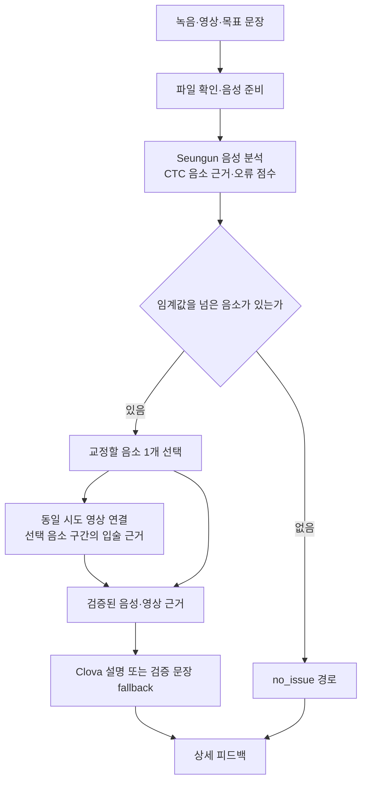
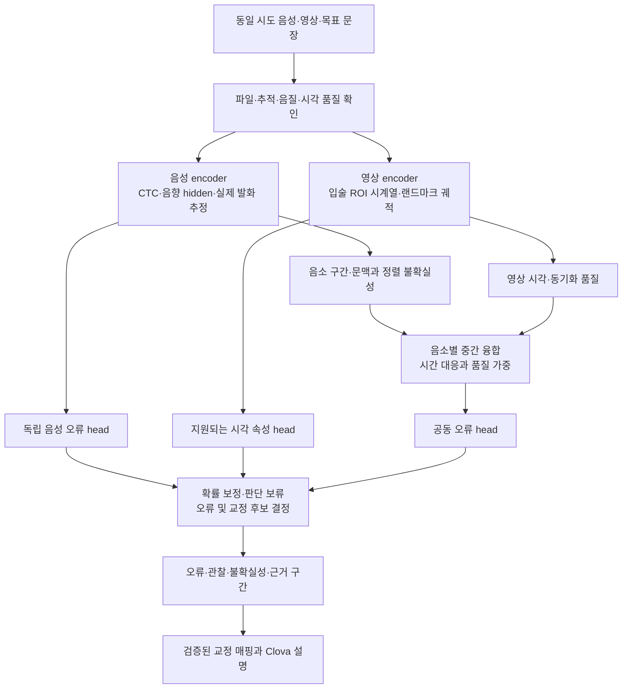

# 음성·영상 공동 분석을 통한 한국어 발음 진단 개선

## 1. 결론과 권고

**발음 오류 진단과 교정 정확도가 목표라면, 음성과 영상을 오류 결정 전에 함께 활용하는 방향은 타당하다. 현재 프로젝트에는 음성·영상별 encoder를 유지하면서 음소 시간 구간에서 특징을 결합하는 구조가 가장 적합한 첫 연구 후보다.** 다만 공개 논문만으로 현재 시스템보다 정확해진다고 확정하거나, 하나의 거대 시청각 모델로 교체할 근거는 부족하다.

시청각 음성 인식은 특히 잡음 조건에서 강한 성과를 보인다. 그러나 단어를 올바르게 복원하는 능력과 학습자가 실제로 틀린 소리를 찾아내는 능력은 다르다. 또한 틀린 소리를 맞게 찾아내는 것과 적절한 교정 지시를 주어 재발음을 개선하는 것도 별도의 문제다. 이 세 목표를 구분해야 모델 선택이 실제 서비스 품질로 이어진다.[^29][^22][^7]

권장 방향은 다음과 같다.

| 판단 대상 | 권고 | 근거의 강도와 범위 |
|---|---|---|
| 음성과 영상을 함께 쓰는 연구 | 추진할 가치가 큼 | AV 인식에는 반복된 긍정 근거; 한국어 L2 진단으로의 전이는 미확인 |
| 단순 동시 실행 | 지연 최적화 항목으로 분리 | 실행 순서만 바꾸면 진단 규칙은 그대로 |
| 진단 전 음소별 특징 융합 | 첫 비교 대상으로 권고 | 현재 코드의 사후 보완 한계를 직접 겨냥하는 설계 판단 |
| 통합 AVSR 모델 즉시 교체 | 보류 | 정상 문장 복원과 실제 오류 보존의 목표 차이 |
| 범용 멀티모달 LLM의 직접 채점 | 초기 도입 우선순위 낮음 | 오류 위치·원인·설명의 근거성을 별도로 입증해야 함 |
| 실제 발음 교정 효과 | 사람의 재발음 평가로 확인 | 사용성 설문·WER·모델 점수 상승으로 대체할 수 없음 |

이 권고는 **후속 연구 설계**다. 현재 운영 계약인 “Seungun이 진단과 선택 음소를 결정하고, 같은 시도의 입술 근거와 Clova 설명을 연결한다”는 결정을 변경한 것이 아니다. 우선은 기존 결과를 유지하면서 새 융합 결과를 비교하는 연구 경로가 적절하다.

## 2. 현재 프로젝트의 분석 흐름

### 2.1 코드에서 확인되는 처리 순서

현재 소스 기준 흐름은 다음과 같다. 영상 처리 전후의 사실 관계를 파악하기 위한 개략도이며 원격 서비스의 현재 실행 상태를 나타내지는 않는다.



[Backend 분석 서비스](C:/Users/to264/Documents/GitHub/intelligentAI/src/voice_coach/backend_analysis/service.py:123)는 Seungun 분석을 먼저 실행하고 그 결과를 시각 보완과 설명 생성에 전달한다. [선택 정책](C:/Users/to264/Documents/GitHub/intelligentAI/seungun/src/korean_phone_ctc/production_pipeline.py:188)은 임계값을 통과한 후보 중 가장 높은 오류 점수의 음소 하나를 고른다. 후보가 없으면 `no_issue`다.

[음성 검출기](C:/Users/to264/Documents/GitHub/intelligentAI/seungun/src/korean_phone_ctc/frozen_detector.py:130)는 CTC 음향 근거와 layer-18 hidden representation 등으로 음소별 오류 점수를 산출한다. 이 점수는 현재 코드상 순위·임계값 판단을 위한 값이며, 별도 확률 보정이 입증된 진단 신뢰도로 읽으면 안 된다. 기대 음소에 대한 정렬과 실제 발화의 추정이 틀리면 뒤의 영상 연결도 영향을 받는다.

[시각 연결 어댑터](C:/Users/to264/Documents/GitHub/intelligentAI/src/voice_coach/backend_analysis/adapters/visual.py:169)는 이미 얻은 Seungun 결과를 재사용한다. 영상에서 파생된 PCM digest와 분석 음성의 digest, 기대 음소열을 확인하여 다른 시도의 근거가 섞이지 않도록 한다. 즉, 현재 구조를 “음성 인식 모델 두 개가 같은 일을 반복한다”는 전제로 비용 비교하면 부정확하다.

[영상 sidecar](C:/Users/to264/Documents/GitHub/intelligentAI/src/voice_coach/pronunciation_attempts/adapters/production_visual_sidecar.py:464)는 선택 음소 주변의 dense frame window와 프레임 계보를 다룬다. 공개 aperture cue는 해당 음소 중간 시각에 가장 가까운 프레임에서 얻고, 별도 경로에는 입술 궤적 표현이 있다. 따라서 현재를 “영상 전체를 한 장으로만 처리한다”고 설명하기보다, **시간 구간 처리는 이미 있으나 진단 선택은 음성에서 선행하고 공개 cue는 중심 프레임에 의존한다**고 설명하는 편이 정확하다.

### 2.2 정확도 측면의 구조적 한계

가장 중요한 한계는 영상의 참여 시점이다. 음성에서 어떤 음소를 놓쳤다면 그 음소가 영상 진단 후보로 되살아나기 어렵다. 음성에서 선택된 음소만 설명할 때 영상을 사용하는 구조는, 음성과 영상이 서로의 오류를 보완하며 후보를 고르는 구조와 다르다.

동시에 현재 구조에는 보존할 장점이 있다. 음성·영상 근거를 구분할 수 있고, 영상이 실패해도 음성 결과를 유지하며, 같은 파일·같은 음소·같은 시간 구간이라는 추적 가능성이 있다. 공동 모델 연구에서도 이 속성을 유지해야 “어떤 근거로 이 교정을 했는가”를 검토할 수 있다.

또한 [Seungun README](C:/Users/to264/Documents/GitHub/intelligentAI/seungun/README.md:5)는 독립 수동 정렬 감사 240건 중 178건 적합, 0.7417로 기존 0.95 gate를 통과하지 못했다고 기록한다. **이 값은 전체 서비스의 발음 진단 정확도가 아니다.** 정렬 자료의 신뢰성 문제가 남아 있다는 근거이며, 모델을 크게 바꾸기 전에 해결할 우선 항목이다.

## 3. 문헌 범위와 근거 해석

핵심 비교표는 **서로 다른 논문 62편**을 포함한다. 시청각 진단·평가 5편, 교정·학습 효과 9편, 음성 MDD·평가 15편, AV 표현·인식 14편, 결측·효율 9편, 데이터 6편, 동기화·지각 4편이다. [논문별 비교표](C:/Users/to264/Documents/GitHub/intelligentAI/docs/research/av_pronunciation_fusion_papers_20260913.md)에 제목, 저자, 연도, 원문, 입력 방식, 자료, 결과, 한계와 프로젝트 활용을 기록했다.

공개 범위는 2026-09-13까지다. 주요 검색 축은 audiovisual mispronunciation detection, L2 pronunciation assessment, visual articulatory feedback, AV-HuBERT·AVSR, missing modality, Korean phoneme recognition 및 한국어 멀티모달 발음 오류 검출이다. 학회 아카이브, 출판사, 원문 저장소와 저자 자료를 우선했고, 가까운 연구의 참고문헌을 따라 직접 진단·교육 효과·반대 결과를 함께 포함했다.

이는 범위를 넓게 검토한 문헌 분석이며, 모든 논문의 전문 정독 또는 체계적 메타분석은 아니다. 초록·서지 수준으로 확인한 연구와 주요 방법·결과까지 확인한 연구를 비교표에서 구분한다. 동일 연구의 arXiv와 출판본은 한 편으로 계산했다. 제목에 ‘multimodal’이 있어도 음성+텍스트일 수 있으므로 입력을 별도로 확인했다.[^16][^62]

다음 구별이 특히 중요하다.

| 논문이 측정한 것 | 직접 답할 수 있는 질문 | 직접 답할 수 없는 질문 |
|---|---|---|
| WER / CER | 문장이나 글자를 얼마나 잘 복원하는가 | 어떤 음소가 왜 틀렸는가 |
| 음소 오류 검출 precision·recall | 틀렸다고 지적한 대상이 맞는가, 얼마나 놓치는가 | 교정 동작이 효과적인가 |
| 점수와 사람 평가의 PCC | 높은·낮은 평가의 경향이 맞는가 | 특정 학습자에게 내린 교정이 맞는가 |
| AV 동기화 오차 | 소리와 영상의 대응을 찾는가 | 자연스러운 시차가 발음 오류인가 |
| 사용성·만족도 | 설명을 편하게 이해하는가 | 실제 발음이 개선되는가 |
| 재발음·지연 평가 | 학습과 교정이 유지되는가 | 모델 자체의 오류 위치 탐지가 정확한가 |

따라서 서로 다른 데이터셋의 최고 수치를 모아 모델 순위를 만들거나, AVSR의 개선율을 현재 프로젝트의 예상 진단 향상률로 환산하지 않았다.

## 4. 직접적인 시청각 진단 근거

### 4.1 가까운 연구도 평가 목표를 살펴야 한다

| 연구 | 확인되는 기여 | 적용 전 남는 문제 |
|---|---|---|
| Picard 외, 2010 [1] | 음향·시각 특징을 함께 사용해 특정 모음 대비를 구별 | 올바르게 발음된 모음만 사용한 대리 과제; 특징 선택에 따라 악화도 있음 |
| Karbasi 외, 2019 [2] | 잡음 환경의 AV 결합 방식과 음소 대비를 평가 | 실제 오발음이 없는 GRID; 화자 종속 실험 |
| Sage 외, 2024 [61] | 아동 치찰음에서 음향·시각 특징의 차별적 기여를 분석 | 특징의 통계적 차이는 새로운 화자의 오류 검출 성능과 다름 |
| 박희준, 2026 [4] | 포먼트와 입술 윤곽을 함께 활용하는 모바일 시스템 | 초록으로 확인된 설계 수준; 독립 진단·교정 평가 범위 미확인 |
| Yu 외, 2026 [3] | 시청각 시간 대응을 설명 가능한 피드백으로 표현 | 사전공개; 동기화·사용성 결과가 진단 정답 평가를 대신하지 못함 |

표의 근거는 각 원문 또는 확인 가능한 등록 초록이다.[^1][^2][^61][^4][^3]

Picard 연구의 제목만 보면 실제 학습자 오발음 검출에서 높은 정확도를 얻은 것으로 읽기 쉽다. 그러나 실험에는 평가자가 올바르다고 인정한 모음만 들어갔다. 이런 실험은 시각 특징이 음소 구별에 정보를 제공한다는 근거지만, 연속 발화에서 어떤 음소가 잘못됐는지를 검출하는 서비스 수준의 성능은 아니다.[^1]

Karbasi 연구도 GRID의 정상 발화 음소 대비를 오발음의 대리 과제로 활용한다. 따라서 핵심 교훈은 “AV를 붙이면 진단이 완성된다”가 아니라, **특징을 어떻게 결합하는지와 어떤 조건에서 평가하는지가 중요하다**는 것이다.[^2]

Sage 연구는 실제 아동 발음 진단과 더 가깝고, 음소에 따라 시각 특징의 기여가 달라짐을 보여준다. 그러나 폴란드어 아동 자료의 통계적 특징 분석을 한국어 성인 L2의 일반화된 분류 정확도로 읽을 수는 없다. 이 결과는 음소별 영상 가중치를 검토할 근거로 적합하다.[^61]

### 4.2 최신 L2 시청각 논문의 역할

Yu 외의 2026년 9월 사전공개 연구는 이 프로젝트와 제목·목적이 매우 가깝다. 시간 대응을 설명하는 접근은 참고할 만하지만, 교사·학생 30명의 사용성 평가는 음소별 오류 정답과의 일치도나 통제된 재발음 개선 실험이 아니다. 따라서 해당 모델이나 lip-sync 점수를 진단 정답으로 바로 채택할 이유는 없다.[^3]

**직접 근거의 결론은 제한적이다.** 시청각 정보가 특정 발음 구별을 보완할 가능성은 있으나, 한국어 L2의 다양한 오류에 대해 음성 단독보다 우수하고 교정 결과까지 개선한다는 대규모 독립 검증은 이 문헌 집합에서 확보되지 않았다. 이는 연구를 하지 말아야 한다는 뜻이 아니라, 도입 판단의 마지막 근거를 프로젝트 자료에서 만들어야 한다는 뜻이다.

## 5. 시청각 인식의 성과와 진단으로의 전이

### 5.1 공동 표현은 기술적으로 충분히 유력하다

AV-HuBERT, RAVEn, BRAVEn, AV2vec, u-HuBERT는 음향과 입 움직임을 함께 학습하는 여러 방식을 보여준다. Conformer 기반 AVSR, Auto-AVSR와 USR는 모달리티별 표현을 결합하거나 여러 입력 조합을 한 모델로 처리하는 경로를 제시한다. 이는 공동 분석 자체의 구현 가능성이 낮은 문제가 아님을 뜻한다.[^28][^33][^34][^36][^37][^38][^39][^49]

대표적으로 Robust AV-HuBERT 연구는 LRS3의 논문 내 잡음 평가에서 음성 기반 모델의 평균 WER 25.8%를 5.8%로 낮췄다고 보고한다. 하지만 이는 특정 학습·잡음 설정에서의 **단어 전사 오류율**이며, 한국어 학습자 오류 검출의 향상률이 아니다. 적은 전사 라벨로 얻은 성과도 상당한 비라벨 AV 사전학습에 기반한다.[^29]

### 5.2 영상을 추가하면 손실이 생길 수도 있다

Dai 외의 같은 실험 안에서 모델을 비교하면 이득과 위험을 함께 볼 수 있다. 다음은 MISP2022와 oracle 분절 조건의 Table 1 일부다. 낮을수록 좋은 **CER(%)**이며 발음 오류율은 아니다.[^42]

| 논문 내 모델 | 영상 완전 제공 | 영상 전부 결측 |
|---|---:|---:|
| 음성 단독 A0 | 25.13 | 25.13 |
| 기본 시청각 AV0 | 21.14 | 26.65 |
| 결측 대응을 포함한 AV6 | 21.11 | 24.94 |

기본 AV 모델은 정상 영상에서 이득을 얻지만, 영상이 없을 때 음성 단독보다 나빠진다. 별도의 결측 대응 설계가 필요하다는 구체적인 사례다. 현재 프로젝트에서도 정면 영상만 평가해서는 충분하지 않으며, 실제로 카메라를 못 켜거나 얼굴 추적이 실패하는 조건을 독립적으로 확인해야 한다.[^42]

### 5.3 잘 알아듣는 모델이 오류를 감출 수 있다

읽기 과제에서는 목표 문장이 이미 주어진다. 인식 모델은 약하거나 모호한 음향을 문맥에 맞는 정상 문장으로 복원할 수 있다. 학습자의 실제 발음을 확인해야 하는 진단에서는 이 복원이 오류를 지울 수 있다.

이 위험은 단순한 가정만은 아니다. 한국어 음소 인식 연구는 라벨 정제 과정에서 실제 오발음이 정상 발음으로 인식되는 사례를 다룬다. 최근 prompt-free MDD 연구 역시 음향 정보의 희소성과 목표 문장의 편향을 핵심 문제로 삼는다.[^26][^22]

따라서 새 모델에는 **기대 음소열과 실제 발화 추정의 구분**이 필요하다. 목표 문장은 위치·문맥 조건으로 쓸 수 있지만, 출력이 목표 음소로 끌려가는 정도를 따로 점검해야 한다. 실제 관측 음소를 예측하는 경로를 두고, 오류 라벨은 인식 모델이 자동 복원한 문장과 독립적으로 유지하는 설계를 권고한다.

## 6. 교정 정확도와 학습 효과

### 6.1 영상 설명의 효과는 목표 음소에 따라 다르다

Li 연구는 중국인 학습자 70명을 AV 고변이 훈련과 전통 교사 수업으로 나누어 비교했다. AV 훈련에서 /θ, ð/의 산출은 개선됐지만 /ɪ/에는 개선이 없었다. 시각적으로 두드러진 조음에 영상이 유용할 가능성을 보여주지만, 청각 단독 고변이 훈련과의 비교가 아니므로 영상만의 효과를 분리하지는 못한다.[^12]

반대로 Hazan·Sennema의 일본어 화자 시각 단독 훈련에서는 V·AV 구별이 좋아졌어도 청각 단독으로의 전이와 발음 산출 개선은 확인되지 않았다. 이 결과는 AV 훈련 전체를 부정하지 않는다. 다만 “입모양을 더 잘 구별한다”와 “자기 발음을 더 잘 고친다”가 다른 결과임을 보여준다.[^7]

Engwall의 소규모 연구에서는 단기 조음 변화 가능성이 관찰됐지만, 사람의 교정 선택이 포함됐다. Shinohara의 AV 식별 훈련도 주된 결과는 소리 구별이다. 자동 진단기의 정확도와 교정 지시 자체의 교육적 효능은 따로 확인해야 한다.[^5][^13]

### 6.2 교정 메시지는 관찰보다 강한 주장을 하면 안 된다

아바타, EPG, EMA, 초음파 연구에서 내부 조음을 보여준다는 사실을 일반 얼굴 영상의 측정 능력으로 옮기면 안 된다. EPG는 입천장 접촉, EMA는 부착 센서의 위치라는 별도 측정값을 사용한다. 합성 아바타는 교육용 예시 또는 추정치다.[^6][^9][^10]

이 프로젝트에서 입술 벌어짐이나 둥글어짐을 관찰했다면 그 관찰을 설명할 수 있다. 그 정보만으로 보이지 않는 혀의 위치, 성대 조절, 구강 내부 접촉의 원인을 확정하는 것은 다른 문제다. “관찰된 모양”, “진단된 오류”, “권장하는 연습 동작”을 구분해야 설명의 구체성이 정확성을 해치지 않는다.

Clova에는 영상 자체에 대한 자유로운 추측보다, 선택된 오류·지원되는 시각 관찰·허용된 교정 설명을 제공하는 구조를 유지하는 편이 적합하다. 강조된 합성 피드백은 전달 방법을 개선할 수 있으나 진단 근거를 대신하지 않는다. Speech LLM의 발음 평가 결과도 세부 진단을 무검증으로 맡길 충분한 근거는 아니다.[^11][^25]

## 7. 한국어에서 영상의 추가 가치

다음은 선행연구와 관찰 가능성에 근거한 **한국어 적용 가설**이다. 음소별 효과가 현재 모델에서 검증됐다는 뜻은 아니다. 개인차·주변 음소·발화 속도·촬영 자세를 통제하여 확인해야 한다.

| 오류·분석 대상 | 영상이 제공할 수 있는 근거 | 함께 필요한 음성 근거 | 우선순위 |
|---|---|---|---|
| 입술 둥글림·벌림이 관련된 모음 대비 | 정규화된 형태와 시간 변화 | 포먼트·음향 표현과 실제 음소 | 초기 AV 비교 후보 |
| 양순 폐쇄가 관련된 구간 | 닫힘·열림의 관찰과 시점 | 폐쇄·방출·비음성 등 음향 차이 | 초기 후보이나 입모양만으로 세부 음소 확정 불가 |
| 모음·자음 전환의 시간 변화 | 움직임의 시작·최대 변화·회복 | 음소 경계와 음향 전이 | 정렬 감사 후 검토 |
| 평음·경음·격음의 구별 | 외부 움직임의 제한된 보조 정보 | VOT·후행 F0 등 음향 단서 | 음성 중심 |
| 혀의 내부 위치·성대 조절 | 보이는 범위만 관찰 가능 | 음향과 별도 검증 근거 | 입술 영상만의 직접 교정 금지 |
| 억양·리듬·유창성 | 일부 발화 동작의 보조 맥락 | F0·길이·휴지 등 | 음소 오류와 별도 과제 |

음소별 시각 가치가 다르다는 판단은 특정 모음·치찰음 연구와 부합한다.[^1][^61] 한국어 폐쇄음의 구별에는 VOT와 F0가 관여하며 화자 연령과 발화 조건에 따른 변화도 보고되어 있다. 따라서 얼굴 영상으로 한국어 후두 대립 전체를 대체하거나 고정 VOT 기준 하나로 진단하는 설계는 적절하지 않다.[^K1]

또한 학습 목표의 허용 변이를 먼저 정의해야 한다. 원어민 한 사람의 입술 궤적과 다르다는 이유로 오류를 부여하면 화자 고유의 얼굴·발화 방식이 오류가 된다. 같은 목표 음소라도 문맥과 자연스러운 음운 과정에 따라 달라지는 허용 범위를 라벨 지침에 포함해야 한다.

## 8. 통합 방식 비교

‘동시에 분석한다’는 표현에는 실행 병렬화, 결과 결합, 특징 공동 학습, 하나의 서비스 모델 사용이 섞여 있다. 목적이 다르므로 선택도 분리해야 한다.

| 방식 | 진단 전에 A/V 상호작용 | 정확도 측면 | 비용·운영 측면 | 현재 판단 |
|---|---|---|---|---|
| 현재 사후 시각 보완 | 제한적; 음성 선택 뒤 영상 연결 | 선택된 오류의 설명 보완 | 기존 provenance·fallback 장점 | 운영 기준선 |
| 음성·영상 전처리 병렬화 | 없음 | 판단 규칙이 같으면 원칙적으로 같은 결과 | 여유 자원이 있을 때 지연 단축 가능 | 별도 최적화 과제 |
| 후기 결합 | 개별 head의 결과를 최종 결정 전에 결합 | 작은 모델로 보완 효과 확인 가능 | 보정이 다른 점수를 그대로 더하면 안 됨 | 중요한 비교 기준 |
| 음소별 중간 특징 융합 | 있음 | 시간 대응과 상호 보완 정보를 이용 | 추가 학습·QC·해석 설계 필요 | **첫 권장 후보** |
| 대규모 end-to-end AV 모델 | 있음 | 데이터가 충분하면 강력한 후보 | 오류 라벨·학습 비용·결측 대응 부담 | 후속 확장 |
| AV LLM 직접 진단·설명 | 모델에 따라 있음 | 전사와 설명 생성 능력이 진단 정답을 보장하지 않음 | 압축 토큰의 미세 오류 보존까지 확인 필요 | 초기 교체안으로 미권고 |

중간 융합을 권고하는 이유는 모델 이름의 유행이 아니라 프로젝트의 변경 지점이 명확하기 때문이다. 음성 표현은 유지하고 시각 표현을 더해, 오류 판단과 후보 선택이 이루어지기 전에 만날 수 있다. 기존 단일 모달 표현의 활용, Conformer 기반 AV 결합, 모달리티 신뢰도 연구는 이 선택의 기술적 참고점이다.[^40][^33][^43]

단순 후기 결합도 반드시 비교해야 한다. 중간 융합이 후기 결합보다 복잡한 만큼, 같은 자료에서 진단 정확도를 추가로 높이는지 입증해야 한다. 적은 오류 라벨로 큰 모델을 학습했을 때보다 작은 결합기가 더 안정적일 가능성은 열어 두어야 한다.

## 9. 권장 연구 파이프라인

### 9.1 음소 선택 이전의 공동 판단

다음은 구현 완료 상태가 아닌 연구 설계다.



**영상 encoder.** 초기에는 얼굴 전체 의미 이해보다 입술 ROI 시계열과 기존 랜드마크 궤적을 비교한다. 랜드마크는 가볍고 설명하기 쉽지만 픽셀 정보 일부를 잃는다. ROI 표현은 더 풍부할 수 있으나 얼굴 정체성·자세·조명에 의존할 수 있다. 어느 쪽이 나은지는 동일한 오류 정답셋에서 판단한다.

**시간 대응.** 음향 프레임과 영상 프레임 수를 단순히 같게 만드는 것만으로 정렬이 완성되지는 않는다. 실제 timestamp, 기기 지연, 프레임 결측과 CTC 경계 불확실성을 반영해야 한다. 처음부터 전체 발화에 unrestricted attention을 적용하기보다, 목표 음소와 이웃 문맥의 허용 구간 내에서 대응을 학습하는 방식을 후보로 삼는다.

CTC의 뾰족하고 희소한 출력이 발음 평가의 시간 정보를 불안정하게 만들 수 있다는 점은 Context-aware CTC 연구와도 연결된다. 문맥과 출력 분포를 보완한 평가 성능 개선이 보고됐지만, 이것이 음소 경계 정답의 확보를 뜻하지는 않는다. 먼저 독립적인 정렬 정답을 확보하고 모델 경계의 불확실성을 반영해야 한다.[^21]

**세 가지 head.** 독립 음성 head는 영상이 없을 때 기준 결과를 제공한다. 시각 head는 폐쇄·벌림·둥글림처럼 지원되는 관찰 속성에 집중한다. 공동 head는 두 표현을 함께 이용해 오류 여부와 지원되는 혼동 유형을 추정한다. 모든 head의 역할을 동일한 ‘발음 점수’로 합치지 않는다.

학습은 기존 encoder를 고정하고 작은 융합 모듈과 head를 학습하는 비교부터 시작할 수 있다. 충분한 오류 라벨과 개선 근거가 확보되면 상위 표현층의 공동 미세조정을 검토한다. 이 순서는 데이터가 적을 때 기존 음성 표현을 훼손하는 위험과 추가 학습의 이득을 구분하기 위한 제안이다.

**선택 시점.** 음성에서 선택된 한 음소만 공동 모델에 넣으면 음성 검출이 놓친 오류를 되찾을 수 없다. 미탐 감소를 검증하려면 전체 기대 음소 또는 기존 선택보다 넓은 후보 집합을 공동 평가해야 한다. 현재 계약 밖인 삽입·삭제를 연구할 경우, 존재하지 않는 기대 음소 index를 억지로 만들지 않고 이웃 음소와 시간 구간으로 별도 연결해야 한다.

### 9.2 품질에 따른 결합과 보류

개념적으로는 음성 점수와 공동 점수 사이의 기여를 조절할 수 있다.

```text
진단용 결합 점수 = 음성 점수 + g(영상 품질, 시간 대응 품질, 목표 음소) × 공동 보완량
```

이는 구현식이나 확정된 확률식이 아니라 설계 의도를 설명한 것이다. g는 시각 정보를 신뢰할 수 없으면 작아져야 하고, 공동 보완량은 오류를 늘리거나 줄이는 방향 모두 가능해야 한다. 후보마다 확률 보정을 거치기 전의 점수를 사용자에게 진단 확률로 보여주지 않는다.

gate에 넣을 정보는 실제 처리 시 관찰 가능한 얼굴 추적 품질, 가림, 시각 공백, timestamp 일관성, 음질 등의 값이다. 평가 정답이나 사람이 사후에 정한 최적 가중치를 사용할 수 없다. 신뢰도 기반 AVSR 논문의 oracle 결과와 배포 가능한 결합은 구분해야 한다.[^43]

모달리티를 가리는 학습, 잡음과 프레임 결측 노출은 중요한 후보지만 각각 부작용도 평가해야 한다. 영상 dropout만 크게 늘리면 모델이 영상을 무시하는 방향으로 학습될 수 있다. 모달리티 사용을 장려하면서 영상 결측 때도 음성 성능을 유지하는 균형이 필요하다.[^42][^49]

### 9.3 동기화와 설명의 경계

SyncNet 계열은 기기·편집에 의한 AV 불일치를 찾는 보조 수단이 될 수 있다. 그러나 입술 움직임과 음향 사건의 자연스러운 시차를 0으로 만드는 것이 발음 목표는 아니다. 발화 과정의 시각 선행·후행은 단일 상수로 설명되지 않는다.[^57][^58][^59]

따라서 큰 시차가 측정되면 먼저 매체 동기화와 추적 실패를 확인하고, 그 자체를 “입을 늦게 움직였다”는 교정으로 번역하지 않는다. attention이 어느 프레임에 집중했는지 역시 모델의 내부 대응 신호이지 조음 원인에 대한 인과 설명은 아니다.

### 9.4 결과 근거와 운영 경계

연구 결과에도 다음 항목을 보존하는 것이 적절하다. 새 필드명은 현행 API 변경안이 아니라 필요한 정보의 개념적 목록이다.

- 원본 파일과 파생 PCM의 digest, 동일 시도 식별자.
- 기대 음소 index, 실제 관측 추정과 목표 음소의 구분.
- 음성·영상 시간 구간, 정렬 버전과 불확실성.
- 사용한 프레임·ROI·랜드마크의 계보와 시각 품질.
- 음성 단독·공동 판단의 차이와 채택 근거.
- 관찰 가능한 사실, 진단된 오류, 권장 연습의 구분.
- 판단 보류 사유와 모델·보정 버전.

초기에는 이를 연구 결과에만 기록하고 현재 사용자 결과는 기존 Seungun 결정으로 유지한다. 새로운 진단 권한·후보 선택이 필요하다고 입증된 후 별도 계약 개정으로 다룬다. Clova는 그 결정과 검증된 관찰을 설명하며 생성 실패 시 기존 검증 문장 fallback을 유지한다.

## 10. 데이터 전략

### 10.1 사전학습 데이터와 진단 정답은 다르다

| 자료 | 유용한 용도 | 제공하지 않는 핵심 근거 |
|---|---|---|
| OLKAVS | 한국어 시청각 표현의 사전학습 | 한국어 L2의 실제 오류·교정 동작 정답 |
| LRS3 | AV 표현, 자연 영상 시간 대응 | 한국어 학습자 오류 주석 |
| MuAViC | 다국어 전이·강건성 비교 | 한국어는 포함되지 않음; 한국어 오류 정답 |
| L2-ARCTIC | 영어 MDD 방법과 오류 평가 설계 | 같은 발화의 입술 영상 |
| speechocean762 | 다층 점수와 평가자 합의 설계 | AV 공동 진단용 쌍을 이룬 영상 |
| 현재 한국어 음소 자료 | 음성 모델 적응과 오류 후보 분석 | 정렬 감사 및 실제 관측 라벨 신뢰성의 자동 해결 |

OLKAVS는 음성 1,150시간, 1,107명과 다중 시점으로 한국어 AV 표현에 유력한 자료다. 여러 시점은 같은 발화의 관측이므로 독립 음성 시간으로 중복 계산하면 안 된다. MuAViC의 언어 다양성도 한국어 목표 자료를 대체하지 않는다.[^51][^52]

L2-ARCTIC과 speechocean762는 유용하지만 영상이 없는 음성을 별도 영상에 임의로 붙여 실제 공동 진단 정답으로 만들 수는 없다. 같은 시도의 입술·음향 관계가 핵심 학습 신호이기 때문이다.[^55][^56] 자동 전사로 규모를 늘리는 Auto-AVSR 방식은 표현 학습에 참고할 수 있어도 실제 오발음 주석의 대체 수단은 아니다.[^34]

### 10.2 필요한 paired L2 데이터

새로운 한국어 자료는 같은 시도에서 음성·영상을 동시에 기록하고, 목표 문장과 실제 발화를 분리해 주석해야 한다. 올바른 발음도 충분히 포함해야 잘못된 교정을 측정할 수 있다. “오류가 있는 자료”만 모으면 정상 발음에 대한 오탐을 알 수 없다.

정답은 세 층으로 나누는 편이 좋다.

| 정답 층 | 내용 | 평가자·근거 설계 |
|---|---|---|
| 실제 발음 | 관측 음소, 대치·삭제·삽입·왜곡, 허용 변이, 구간 | 음성을 독립적으로 듣는 평가와 불일치 조정 |
| 시각 관찰 | 벌림·폐쇄·둥글림·관찰 불가, 해당 구간 | 영상 평가와 품질 주석 |
| 교정 적절성 | 제안된 행동이 해당 오류에 타당한지, 재발음 변화 | 발음 교육 전문가와 독립 청자 평가 |

이렇게 분리하면 영상 모델이 보기 쉬운 모양을 정답으로 정의해 스스로 유리해지는 문제를 줄일 수 있다. 최종 불일치 조정에서 AV를 참고하더라도 최초 음향 판정과 영상 판정을 보존해야 한다.

원어민 한 명의 템플릿과 닮았는지를 정답으로 삼지 않는다. 얼굴 형태와 발화 스타일을 정규화하고, 허용되는 한국어 발음 변이를 반영한다. 교정 동작 라벨이 없으면 모델이 그럴듯한 조음 원인을 만들어내게 하지 않고, 검증된 오류-연습 매핑으로 범위를 제한한다.

### 10.3 데이터 분할과 규모

화자, 동일 녹음 세션, 같은 발화의 여러 카메라 시점이 학습·평가에 걸쳐 중복되면 안 된다. 같은 학습자의 전후 시도를 평가에 사용하는 경우에도 해당 학습자를 모델 학습에 포함했는지 명확히 구분한다. 촬영 기기와 환경 차이도 독립 평가 축으로 남긴다.

고정 시간 수를 먼저 목표로 삼기보다, 자주 나타나는 오류쌍과 잘못된 교정을 측정할 정상 사례 수를 기준으로 설계한다. 음소·모국어·환경별 표본을 나눴을 때 충분한 오류 사례가 있는지가 중요하다. 필요한 규모는 파일 길이보다 화자 간 변동과 목표 개선 폭을 반영한 파일럿 결과로 결정한다.

한국어 MDD 선행연구와 현 저장소의 감사 결과는 라벨 신뢰성이 큰 제약임을 보여준다. 자료를 더 많이 확보하는 것과 실제 발음에 맞는 정답을 확보하는 것을 별도 작업으로 관리해야 한다.[^26][^62]

## 11. 정확도 중심 비교 설계

이 절은 **개발자가 수행할 수동 QA 및 연구 평가 설계**이며, 평가가 실행됐거나 통과됐다는 의미가 아니다.

### 11.1 모델 비교의 최소 구성

| 비교군 | 구성 | 답할 질문 |
|---|---|---|
| B0 | 현재 음성 선택 후 시각 보완 | 현재 서비스 방식의 기준 성능 |
| B1 | 같은 음성 모델·같은 라벨·같은 후보 정책의 음성 단독 판단 | 영상의 추가 가치 측정을 위한 직접 기준 |
| B2 | B1 + 진단 전 후기 결합 | 간단한 결합만으로 충분한가 |
| B3 | B1과 대응되는 음성 표현 + 음소별 중간 융합 | 특징 간 상호작용의 추가 가치가 있는가 |
| B4 | AV 사전학습 모델을 오류 라벨로 적응 | 큰 공동 표현이 추가 비용을 정당화하는가 |

B1–B3는 가능한 한 같은 화자 분할, 오류 라벨, 음성 backbone과 평가 정책을 사용한다. 별도로 개선한 음성 정렬·라벨·학습량의 효과를 영상 기여와 섞지 않는다. B4는 사전학습량이 다르면 데이터 효율 비교와 최종 성능 비교를 나누어 보고한다.

B1–B3의 내부 음소 평가는 같은 전체 기대 음소 집합에 적용한다. 사용자에게 교정 하나를 제시하는 조건도 공통으로 유지하여, 단순히 교정 개수를 늘려 재현율이 높아지는 효과를 분리한다. B0는 현재의 선택 후 영상 보완 순서를 그대로 기준으로 둔다.

주요 비교는 같은 녹음에 대한 B1과 B3의 진단 차이다. 단순히 B3의 평균 F1만 보는 대신 새로 찾은 오류, 사라진 오탐, 새로 생긴 오탐을 사람이 확인해야 한다. 오류 위치와 원인 설명이 바뀐 사례를 따로 평가하면 실제 제품 개선인지 알 수 있다.

### 11.2 핵심 지표와 정확도 정의

| 우선순위 | 지표 | 정의·해석 |
|---|---|---|
| 1 | 잘못된 교정 비율 | 교정했다고 지적한 사례 중 사람 정답상 교정이 불필요하거나 틀린 비율 |
| 1 | 오류 검출 precision·recall | 지적의 정확성과 놓친 오류를 함께 측정 |
| 1 | 진단 정확도 | 오류를 찾은 뒤 혼동 유형·위치를 맞혔는지; 분모를 명시 |
| 1 | 교정 적절성 | 제안 행동이 관측된 오류에 실제로 타당한지 |
| 2 | 음소·혼동쌍별 F1 | 흔한 정상 발음이 평균을 지배하지 않도록 분리 |
| 2 | coverage와 보류 | 답한 사례의 비율과 정확도를 함께 보고 |
| 2 | 보정·신뢰성 | 점수와 실제 맞음의 관계, 영상 결측 시 변화 |
| 2 | 경계 오차 | 독립적으로 검증된 음소 구간과의 차이 |
| 3 | WER·CER·점수 PCC | 보조 진단 지표; 교정 성능의 대리로 사용하지 않음 |
| 별도 | 처리 지연·GPU 메모리·학습 비용 | 품질이 확인된 후보의 실행 효율 비교 |

검출과 교정 설명의 정확도를 분리하는 것이 중요하다. 예를 들어 틀린 음소 위치를 맞혔더라도 입술 근거에 없는 혀 움직임을 지시하면 교정은 부정확하다. 반대로 적절한 일반 연습 문장을 제시했어도 실제 오류 위치를 놓쳤다면 진단은 개선된 것이 아니다.

모델이 어려운 사례를 모두 보류하여 높은 precision을 얻을 수 있으므로 coverage를 함께 비교한다. 고정된 coverage나 동일한 허용 오탐 조건에서 재현율을 비교해야 한다. 모델 간 차이의 불확실성은 화자를 독립 단위로 반영하고, 동일 발화 프레임 수를 독립 표본 수로 취급하지 않는다.

### 11.3 반드시 분리할 조건

같은 모델도 상황에 따라 영상의 가치가 다르므로 다음 조건을 별도로 평가한다.

- 깨끗한 음성·좋은 영상: 음성만으로 충분한 상황에서 영상이 불필요한 오탐을 만들지 않는가.
- 잡음 음성·좋은 영상: AV의 추가 근거가 미탐을 줄이는가.
- 좋은 음성·불량 영상: 가림·각도·조명·프레임 결측에도 음성 결과를 유지하는가.
- 음성과 영상 모두 불량: 잘못 확신하지 않고 보류하는가.
- 미지 화자·모국어·기기: 얼굴 정체성이나 촬영 환경에 의존하지 않는가.
- 자연스러운 시차와 장치 지연: 품질 문제와 발음 문제를 구분하는가.
- 영상에 같은 화자의 다른 발화를 넣거나 시간 순서를 흐트러뜨린 대조 조건: 모델이 실제 시간 대응을 사용하는가.

마지막 대조는 연구용 오프라인 분석에 한정한다. 정상 발음 자료에 일부러 만든 불일치를 실제 학습자의 발음 오류로 라벨링하지 않는다.

### 11.4 교정 효과의 별도 평가

교정 지시의 효과는 독립 청자가 재발음을 판단하는 결과로 확인한다. 자동 점수 상승만을 목표로 하면 학습자가 평가기의 편향을 따라갈 수 있다. 학습자 만족도는 별도 부차 지표다.

가능한 설계는 같은 진단에 대해 “근거가 검증된 음성 중심 교정”과 “검증된 시각 관찰을 더한 교정”을 비교하는 것이다. 오류 탐지 모델의 차이와 설명 방식의 차이를 동시에 바꾸지 않으면 어떤 요소가 도움이 됐는지 알 수 있다. 연습 직후뿐 아니라 일정 시간이 지난 재발음과 새로운 단어에서의 전이를 평가한다.

자동 진단 전체의 효용은 그 다음 단계에서 비교한다. 오류를 적게 지적하는 모델과 많이 지적하는 모델에 같은 학습 효과를 기대할 수 없으므로, 제공된 교정 수와 난이도도 함께 보고한다. 이 설계는 시각 지각의 향상이 반드시 산출 개선으로 이어지지 않는 선행 결과를 반영한다.[^7][^12]

## 12. 연산 효율과 개발 비용

### 12.1 하나의 모델이 반드시 싸지는 것은 아니다

현재 시스템의 비용과 새 AV 모델의 비용은 같은 단위로 비교해야 한다. 현재의 영상 경로는 음성 분석 결과를 재사용하고 선택 구간의 근거를 보완한다. 대형 시청각 전사 모델 두 개를 운영하는 구조와는 다르다.

개념적으로 순차 실행의 지연은 음성 분석, 영상 분석, 결합, 설명 생성과 I/O의 합에 가깝다. 독립 전처리를 병렬화하면 그 일부가 합에서 최댓값 형태로 줄 수 있다. 하지만 같은 GPU의 경쟁, 추가 영상 디코딩, 전체 구간을 미리 처리하는 비용 때문에 실제 지연이 줄지 않을 수도 있다.

공동 모델도 보통 음성 encoder, 영상 encoder와 융합 모듈을 필요로 한다. 공유되는 표현이 있다고 해서 영상 연산이 사라지는 것은 아니다. 여러 인식 작업을 한 모델로 지원하는 USR의 장점과 현재 단일 발음 진단 요청의 비용 절감은 구분해야 한다.[^38]

### 12.2 효율 논문의 수치를 옮길 때의 주의

Efficient Conformer와 DCIM은 시청각 인식 구조의 효율을 다루고, AV2vec·LiteVSR는 학습 과정을 효율화한다. 이들은 서로 다른 비용 항목이다.[^44][^45][^39][^50]

MMS-LLaMA의 토큰·연산 절감은 논문 내 MLLM 비교에서 의미가 있다. 그러나 현재 Seungun과 입술 분석의 실행 비용 대비 절감률이 아니다. 또한 전사에 충분한 압축 표현이 짧은 조음 오류와 경계 정보까지 보존하는지는 확인해야 한다.[^46][^47]

실제 비교에서는 같은 녹음 길이와 장비에서 cold/warm 시작, 전처리, encoder, 융합, 설명 생성을 나누어 기록한다. 어느 단계가 병목인지 확인되지 않은 상태에서 통합의 속도 향상률을 제시하지 않는다. 정확도가 우선이므로, 먼저 진단에 유효한 후보를 추린 뒤 지연과 메모리를 최적화하는 순서가 합리적이다.

## 13. 도입 순서와 판단 기준

| 단계 | 구체적 산출물 | 다음 단계로 넘어갈 근거 |
|---|---|---|
| 1. 정답·정렬 정비 | 수동 감사로 확인된 실제 음소·시간 구간·허용 변이 | 기존 감사 문제의 해소와 오류 유형별 평가 가능성 |
| 2. 시각 정보의 가치 확인 | 같은 화자의 음향·입술 관찰과 오류별 기여 분석 | 일부 목표 오류에서 독립적인 시각 정보가 확인됨 |
| 3. 작은 결합 모델 비교 | B1–B3의 동일 자료 비교 결과 | 같은 오탐·coverage 조건에서 유의미한 진단 이득 |
| 4. 결측·불일치 검증 | 품질 조건별 진단·보류 결과 | 영상 실패 때의 음성 성능 저하가 허용 범위 내 |
| 5. 교정 효과 확인 | 전문가 적절성·재발음·지연 전이 평가 | 설명 구체성이 실제 학습에 도움이 됨 |
| 6. 운영 계약 검토 | 선택 권한, provenance, fallback, 성능·비용 근거 | 개발자 QA와 담당자의 계약·배포 검토 |

이 단계는 기간이나 실험 성공을 미리 약속하지 않는다. 오류쌍별 개선 폭, 허용 오탐 수준, 비열등성 범위와 필요한 표본은 기존 결과를 보고 사전에 정해야 한다. 문헌의 WER 최고 기록을 그대로 제품의 합격 기준으로 삼지 않는다.

현 시점의 투자 우선순위는 **정렬·정답 신뢰성 → 음소별 시각 기여 → 작은 공동 진단기 → 교정 효과 → 규모·효율 최적화**다. 한국어의 입술 가시성이 높은 목표에서는 AV 융합을 적극 검토하고, 음향 근거가 중심인 구별에서는 음성 모델을 강화하는 방식이 타당하다.

## 14. 적용 범위와 남은 불확실성

가장 유력한 설계는 **모달리티별 분석의 장점을 보존하면서 진단 전에 공동 판단하는 방식**이다. 지금 필요한 변화는 음성 분석과 영상 분석이라는 이름을 합치는 일이 아니라, 영상이 후보 결정에 참여할 수 있도록 하고 그 이득을 실제 오류 라벨로 확인하는 일이다.

다음은 아직 확인되지 않았다.

- 프로젝트의 실제 한국어 학습자 분포에서 영상이 추가로 찾아내는 오류의 비율.
- 검증된 오류 라벨과 paired AV 자료의 충분성.
- 중간 융합이 단순 후기 결합보다 주는 추가 이득.
- 영상 품질이 나쁠 때의 진단과 보류 성능.
- 상세 교정 설명이 장기적인 재발음 개선으로 이어지는 정도.
- 현재 실행 환경의 단계별 지연과 새 모델의 실제 비용.

분석에 사용한 로컬 코드 기준은 브랜치 `agent/prepare-gated-ctc-training`, HEAD `fb54a1b506e57a3d71913d5c81ab8bab4408dab2`다. 소스 구조와 저장된 감사 기록을 근거로 했으며, 현재 배포·추론 상태를 확인한 보고서는 아니다. 이 문헌 검토 자체가 모델 정확도나 서비스 readiness의 검증을 뜻하지 않는다.

## Sources

번호 [1]–[62]는 [62편 비교표의 전체 서지와 원문](C:/Users/to264/Documents/GitHub/intelligentAI/docs/research/av_pronunciation_fusion_papers_20260913.md)을 따른다. 아래는 본문 인용 출처다. 한국어 음향 단서 해석용 K1은 보충 1차 문헌이며 62편 비교 집계에는 더하지 않았다.

[^1]: Picard 외 (2010). [시청각 모음 대비 연구](https://www.isca-archive.org/avsp_2010/picard10_avsp.html). AVSP. 전체 제목·확인 범위는 동번호 비교표 참조.

[^2]: Karbasi 외 (2019). [잡음 환경의 AV 진단 대리 과제](https://link.springer.com/chapter/10.1007/978-3-030-20518-8_54). IWANN, Springer. 전체 제목·확인 범위는 동번호 비교표 참조.

[^3]: Yu, Huang, Liu, Zhao (2026-09-06 v1). [L2 시청각 동기화 설명](https://arxiv.org/abs/2609.06788). arXiv 사전공개. 전체 제목·확인 범위는 동번호 비교표 참조.

[^4]: 박희준 (2026). [모음 공간·입술 윤곽 시스템](https://doi.org/10.23153/AI-Science.2026.5.1.072). 산업과 과학 5(1), 72–79. 전체 제목·확인 범위는 동번호 비교표 참조.

[^5]: Engwall (2008). [시각 조음 지시의 단기 효과](https://www.isca-archive.org/interspeech_2008/engwall08_interspeech.html). Interspeech. 전체 제목·확인 범위는 동번호 비교표 참조.

[^6]: Badin 외 (2010). [조음 시각 피드백](https://www.isca-archive.org/l2ws_2010/badin10_l2ws.html). L2WS. 전체 제목·확인 범위는 동번호 비교표 참조.

[^7]: Hazan, Sennema (2007). [시각 훈련의 지각·산출 결과](https://www.isca-archive.org/avsp_2007/hazan07_avsp.html). AVSP. 전체 제목·확인 범위는 동번호 비교표 참조.

[^9]: Nissen, Nissen (2019). [EPG 교육 시연](https://www.isca-archive.org/interspeech_2019/nissen19b_interspeech.html). Interspeech Show & Tell. 전체 제목·확인 범위는 동번호 비교표 참조.

[^10]: Katz 외 (2014). [Opti-speech](https://www.isca-archive.org/interspeech_2014/katz14_interspeech.html). Interspeech. 전체 제목·확인 범위는 동번호 비교표 참조.

[^11]: Bu 외 (2020). [강조된 교정 합성](https://arxiv.org/abs/2009.05748). arXiv 원고. 전체 제목·확인 범위는 동번호 비교표 참조.

[^12]: Ying Li (2024 온라인 / 2026 권호). [AV-HVPT 교실 연구](https://journals.sagepub.com/doi/10.1177/13621688231219773). Language Teaching Research 30(6). 전체 제목·확인 범위는 동번호 비교표 참조.

[^13]: Shinohara (2021). [AV 음소 식별 훈련](https://pubs.asha.org/doi/10.1044/2021_JSLHR-20-00506). JSLHR. 전체 제목·확인 범위는 동번호 비교표 참조.

[^16]: Ye 외 (2021 원고 / 2022 ICASSP). [APL](https://arxiv.org/abs/2110.07274). ICASSP. 전체 제목·확인 범위는 동번호 비교표 참조.

[^22]: Geng 외 (2026). [Prompt-free MDD](https://arxiv.org/abs/2604.22133). arXiv 사전공개. 전체 제목·확인 범위는 동번호 비교표 참조.

[^25]: Parikh 외 (2025). [Speech LLM 발음 평가](https://www.isca-archive.org/slate_2025/parikh25_slate.html). SLaTE. 전체 제목·확인 범위는 동번호 비교표 참조.

[^26]: 경나 외 (2025). [비원어민 한국어 음소 인식](https://www.eksss.org/archive/view_article?pid=pss-17-1-51). 말소리와 음성과학 17(1), 51–61. 전체 제목·확인 범위는 동번호 비교표 참조.

[^28]: Shi 외 (2022). [AV-HuBERT](https://arxiv.org/abs/2201.02184). ICLR; AV-HuBERT. 전체 제목·확인 범위는 동번호 비교표 참조.

[^29]: Shi, Hsu, Mohamed (2022). [Robust AV-HuBERT](https://arxiv.org/abs/2201.01763). Interspeech. 전체 제목·확인 범위는 동번호 비교표 참조.

[^33]: Ma, Petridis, Pantic (2021). [AV Conformer](https://arxiv.org/abs/2102.06657). ICASSP. 전체 제목·확인 범위는 동번호 비교표 참조.

[^34]: Ma 외 (2023). [Auto-AVSR](https://arxiv.org/abs/2303.14307). ICASSP. 전체 제목·확인 범위는 동번호 비교표 참조.

[^36]: Haliassos 외 (2022 원고 / 2023 CVPR). [RAVEn](https://arxiv.org/abs/2212.06246). CVPR; RAVEn. 전체 제목·확인 범위는 동번호 비교표 참조.

[^37]: Haliassos 외 (2024). [BRAVEn](https://arxiv.org/abs/2404.02098). arXiv 원고. 전체 제목·확인 범위는 동번호 비교표 참조.

[^38]: Haliassos 외 (2024 원고). [USR](https://arxiv.org/abs/2411.02256). arXiv; USR. 전체 제목·확인 범위는 동번호 비교표 참조.

[^39]: Zhang 외 (2022 원고). [AV2vec](https://arxiv.org/abs/2212.02782). arXiv; AV2vec. 전체 제목·확인 범위는 동번호 비교표 참조.

[^40]: Pan 외 (2022). [단일 모달 SSL을 활용한 AVSR](https://aclanthology.org/2022.acl-long.308/). ACL. 전체 제목·확인 범위는 동번호 비교표 참조.

[^42]: Dai 외 (2024). [영상 결측과 모달리티 편향](https://arxiv.org/abs/2403.04245). CVPR. 전체 제목·확인 범위는 동번호 비교표 참조.

[^43]: Yu, Zeiler, Kolossa (2022). [신뢰도 기반 AVSR](https://www.mdpi.com/1424-8220/22/15/5501). Sensors 22(15), 5501. 전체 제목·확인 범위는 동번호 비교표 참조.

[^44]: Burchi, Timofte (2023). [Audio-Visual Efficient Conformer](https://arxiv.org/abs/2301.01456). WACV. 전체 제목·확인 범위는 동번호 비교표 참조.

[^45]: Wang 외 (2024). [DCIM-AVSR](https://arxiv.org/abs/2409.00481). arXiv 원고. 전체 제목·확인 범위는 동번호 비교표 참조.

[^46]: Yeo 외 (2025). [MMS-LLaMA](https://arxiv.org/abs/2503.11315). arXiv 원고. 전체 제목·확인 범위는 동번호 비교표 참조.

[^47]: Cappellazzo 외 (2024 원고 / 2025 ICASSP). [LLM 기반 AVSR](https://arxiv.org/abs/2409.12319). ICASSP. 전체 제목·확인 범위는 동번호 비교표 참조.

[^49]: Hsu, Shi (2022). [u-HuBERT](https://arxiv.org/abs/2207.07036). NeurIPS. 전체 제목·확인 범위는 동번호 비교표 참조.

[^50]: Laux 외 (2023 원고). [LiteVSR](https://arxiv.org/abs/2312.09727). arXiv 원고. 전체 제목·확인 범위는 동번호 비교표 참조.

[^51]: Park 외 (2023 v1 / 2025 v2). [OLKAVS](https://arxiv.org/abs/2301.06375). arXiv 데이터 논문. 전체 제목·확인 범위는 동번호 비교표 참조.

[^52]: Anwar 외 (2023). [MuAViC](https://arxiv.org/abs/2303.00628). arXiv 데이터 논문. 전체 제목·확인 범위는 동번호 비교표 참조.

[^55]: Zhao 외 (2018). [L2-ARCTIC](https://www.isca-archive.org/interspeech_2018/zhao18b_interspeech.html). Interspeech. 전체 제목·확인 범위는 동번호 비교표 참조.

[^56]: Zhang 외 (2021). [speechocean762](https://www.isca-archive.org/interspeech_2021/zhang21x_interspeech.html). Interspeech. 전체 제목·확인 범위는 동번호 비교표 참조.

[^57]: Chung, Zisserman (2016). [SyncNet 동기화](https://www.robots.ox.ac.uk/~vgg/publications/2016/Chung16a/). ACCV Workshop. 전체 제목·확인 범위는 동번호 비교표 참조.

[^58]: Chung, Chung, Kang (2018 원고 / 2019 ICASSP). [Perfect match](https://arxiv.org/abs/1809.08001). ICASSP. 전체 제목·확인 범위는 동번호 비교표 참조.

[^59]: Schwartz, Savariaux (2014). [자연 발화의 AV 시차](https://journals.plos.org/ploscompbiol/article?id=10.1371/journal.pcbi.1003743). PLOS Computational Biology. 전체 제목·확인 범위는 동번호 비교표 참조.

[^61]: Sage 외 (2024). [폴란드 아동 치찰음 특징 분석](https://www.mdpi.com/1424-8220/24/16/5360). Sensors 24(16), 5360. 전체 제목·확인 범위는 동번호 비교표 참조.

[^62]: 장재석, 임보영, 권혁윤 (2023). [한국어 음성·텍스트 오류 구간 검출](https://www.kci.go.kr/kciportal/ci/sereArticleSearch/ciSereArtiView.kci?sereArticleSearchBean.artiId=ART002985816). 정보과학회 컴퓨팅의 실제 논문지 29(8), 396–401. 전체 제목·확인 범위는 동번호 비교표 참조.

[^K1]: Yoonjung Kang (2014). [Voice Onset Time merger and development of tonal contrast in Seoul Korean stops: A corpus study](https://www.sciencedirect.com/science/article/pii/S0095447014000357). Journal of Phonetics, 45, 76–90. 한국어 폐쇄음의 VOT·F0 해석용 보충 출처.

[^21]: Li, Yan, Lo 외 (2026). [Context-aware CTC 발음 평가](https://aclanthology.org/2026.bea-1.3/). BEA, ACL. 본문 방법·평가 절; 전체 서지는 동번호 비교표 참조.
