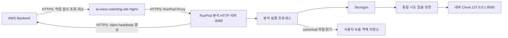

# RunPod HTTP 분석 서버 수정 계획

작성일: 2026-09-13. 이 문서는 구현 전 설계를 정리한 계획 정본이다. **후속 사용자 요청으로 코드 구현·8080 서버·HTTP Expose 배포 및 재기동 복원을 수행했으며, 실제 결과와 미완료 조건은 [보완 수행 기록](runpod_http_deployment_20260913.md)을 기준으로 확인한다.** AWS Backend와 고정 도메인 Nginx 수정은 담당자가 진행한다.

기존 설계 경위는 [Backend–RunPod HTTP 전환 계획](runpod_http_callback_revision_plan_20260910.md), **현재 요청·결과 DTO·시간·digest·오류·포트의 기준은 [v1.1 계약 확정 회신](runpod_http_contract_v1_20260913.md)과 첨부 JSON Schema**다. 이 문서는 RunPod 구현 순서와 실행 구조를 구체화한다. 아래 신규 파일명·설정명과 실행 구조는 구현 계획이며 현재 배포된 기능이 아니다. 초기 제안과 충돌하면 확정 계약을 우선한다.

**진행 순서:** v1.1 HTTP 서버·분석 코어 연결 → 자동 기동·비밀 설정 복원 → 내부 `:8080` 확인 → 기존 포트를 보존한 `8080/http` Expose → Proxy HTTPS 확인·Nginx 인계 → 개발자 실제 처리 확인·분석 접수 활성화. AWS 보완을 기다리는 동안 서버 구현과 진단용 listener 준비까지 진행할 수 있다. AWS callback·저장소가 준비되지 않으면 `/health`는 200이어도 `/readyz`는 503이며 업무 접수를 받지 않는다.

## 1. 기준과 목표

| 구분 | 근거 |
|---|---|
| 로컬 분석 소스 | `agent/prepare-gated-ctc-training`, `fb54a1b506e57a3d71913d5c81ab8bab4408dab2` |
| 마지막 확인 RunPod 배포 | `6618a396fb4d1c0d69ab76402bc2450a253be248` |
| Backend 기준 | develop·담당자 배포 회신 `33efef6ec90970003d1e8b66bcdb2a097038ed0f`. Actuator 200·서비스 active/running·DB V15는 담당자 확인 |
| 마지막 RunPod 관리 API 관측 | 2026-09-13 19:28:46 KST: `urwnuesv7o4fv6`, RUNNING, Expose 목록은 `22/tcp`만 있음 |
| 마지막 RunPod 내부 관측 | 2026-09-13 19:29:52 KST: Clova 200 ready, 전체 서비스 503, Redis worker `environment_file_missing`. 8080 listener와 HTTP 전용 env 파일 없음 |
| 마지막 공개 HTTP 관측 | 2026-09-13 19:28:39 KST: Backend OpenAPI 200, 고정 AI 도메인 `/health`·`/readyz` 503 |
| 상세 관측·인계 | [계약 확정 회신](runpod_http_contract_v1_20260913.md)의 관측 근거, [HTTP 연결 인계 문서](runpod_http_handoff_20260913.md) |

위 표는 최초 계획의 기준 관측이다. 후속 구현·배포 관측은 수행 기록에서 확인한다. 운영 작업마다 현재 대상과 상태를 다시 확인하며 PR #47 보완·배포 완료 여부도 담당자의 실제 SHA로 구분한다.

목표는 AWS Backend가 고정 주소로 분석 작업을 접수하고, RunPod가 기존 Seungun → 같은 시도의 입술 분석 → Clova 설명을 실행한 뒤 Backend에 결과를 전달하는 것이다. 모델 가중치·진단 기준·선택 음소·검증된 문장 fallback은 유지한다. 지원하지 않는 STT·점수·교정을 추가하지 않는다.

Backend–RunPod HTTP에는 동의 증빙·정책 revision·요청별 처리 권한 grant·서명을 넣지 않는다. 사용자 로그인·녹음 소유 관계 확인은 Backend, 양방향 서버 인증과 파일 무결성 확인은 각 수신 경계에서 유지한다. 기존 Redis 계약은 별도 adapter에 남기며 새 HTTP 요청을 가짜 grant로 변환하지 않는다.

## 2. 확정 연결 구조와 8080 포트



| 항목 | 적용할 구성 |
|---|---|
| 분석 서버 listen | `0.0.0.0:8080`, HTTP |
| RunPod HTTP Expose | `8080/http` 추가. 기존 SSH 포트 보존 |
| RunPod upstream | `https://<배포 시 확인한 Pod ID>-8080.proxy.runpod.net` |
| 고정 Backend 설정 | `RUNPOD_ENDPOINT_URL=https://ai.voice-coaching.site` |
| 기존 Clova | `127.0.0.1:8000` 유지, 분석 코어에서 내부 호출 |
| 외부 TLS | 고정 도메인과 RunPod Proxy에서 HTTPS. 내부 분석 listen을 임의로 443으로 바꾸지 않음 |

현재 Pod ID로 조합한 후보는 `https://urwnuesv7o4fv6-8080.proxy.runpod.net`이지만 **아직 포트와 서버가 없는 예정 주소**다. 실제 listen 충돌·Pod ID·HTTP Expose를 배포 시 재확인한 후에만 사용 가능한 upstream으로 인계한다.

Nginx 담당자에게 실제 upstream, Host/SNI, URI 보존, Authorization 헤더 전달, 요청 크기·timeout을 전달한다. 프록시의 POST 자동 재시도로 작업을 재발행하지 않고 Backend의 request/execution 단위 재전송을 사용한다. Pod가 바뀌면 고정 도메인은 유지하고 upstream 및 Host/SNI를 갱신한다. 자동 GPU 시작·Pod 이전·DNS 변경 기능은 이번 서버에 추가하지 않는다.

RunPod Proxy가 접근할 분석 서버는 loopback 전용이 아닌 `0.0.0.0:8080`에 bind한다. `8080/http`가 HTTPS Proxy를 제공하므로 Pod 내부에 별도 인증서나 443 listener를 만들 필요는 없다. 포트를 지정해도 서버 프로세스가 생기지는 않으므로 기동과 Expose를 각각 확인한다. [RunPod 포트 노출 문서](https://docs.runpod.io/pods/configuration/expose-ports)

Proxy URL로 Nginx를 거치지 않고 접속할 수 있으므로 인증·본문 상한·허용 경로 검증은 8080 앱 자체에도 둔다. Clova 8000은 외부에 노출하지 않는다. 운영의 개발용 `/docs`·`/redoc`·OpenAPI 공개는 끄고, 상세 상태는 서버 인증으로 보호한다.

## 3. 구현할 API와 health 계약

업무 API는 `Authorization: Bearer <AI_ANALYSIS_API_TOKEN>`을 검증한다. RunPod 관리 API 키는 이 토큰으로 사용하지 않는다. 비교는 일정 시간 비교를 사용하고 로그·응답에 토큰을 남기지 않는다.

| 경로 | 정상 응답과 책임 |
|---|---|
| `GET /health` | HTTP 프로세스가 응답 가능하면 200 `{"status":"alive"}`. 모델 준비 완료와 구분 |
| `GET /readyz` | 전체 접수 준비가 끝나면 200 `{"status":"ready"}`, 준비·장애·draining 중에는 503 `{"status":"not_ready"}` |
| `GET /health/services` | 서버 인증 후 세부 준비 상태·고정 reason code·revision 제공. 전체 준비 완료 200, 미완료 503 |
| `POST /v1/analysis-jobs` | 계약 검증·슬롯 예약·Backend claim·실행 인계까지 확인한 뒤 202. 같은 실행의 진행 중 재전송은 202, 보유한 종료 결과의 동일 재전송은 200 |
| `GET /v1/analysis-jobs/{requestId}?executionId=...` | 현재 프로세스가 아는 해당 실행 상태를 200으로 반환. 미보유 404, 보유한 다른 실행 세대와 충돌 409 |
| `POST /v1/analysis-jobs/{requestId}/cancel` | body의 `executionId`를 대조하여 취소 진행 202, 이미 종료된 같은 실행은 200. 미보유 404, 다른 실행 세대 409 |

조회에는 `executionId`를 필수로 받는다. 202 응답은 `requestId`, `executionId`, `workerInstanceId`, `status`를 포함하고 실제 분석 완료를 뜻하지 않는다. 조회는 `ACCEPTED`, `RUNNING`, `DELIVERING_RESULT`, `COMPLETED`, `FAILED`, `CANCELLING`, `CANCELLED`와 nullable `reasonCode`만 제공하며 원본·대본·로컬 경로를 반환하지 않는다. `COMPLETED`/`FAILED`는 Backend가 결과 반영을 확인한 뒤 표시한다. Backend DB가 최종 상태다. 내부 API는 DTO를 직접 반환하고 `{result,message,data}` 외피를 붙이지 않는다. `/health/services`의 운영 진단 항목은 업무 DTO와 분리한다.

접수 오류는 인증 누락·불일치 401, 중복 JSON key·형식 오류 400, 잘못된 필드·값 422, 요청 상한 초과 413, JSON 외 Content-Type 415, 실행 세대/같은 ID의 다른 내용 충돌 409, 슬롯 포화 429 + Retry-After, 준비 미완료 또는 claim 확인 불가 503으로 구분한다. 유효한 동일 실행 재전송은 기존 상태를 반환하며 다시 추론하지 않는다.

`/health`와 `/readyz`는 비밀값·자산 경로·진단 원문 없는 최소 응답만 공개한다. Nginx의 분석 readiness 확인은 `/readyz`를 사용한다. Clova의 기존 `:8000/health` 200을 전체 분석 준비 완료로 사용하지 않는다.

## 4. 요청·결과 모델과 공통 코어 분리

[요청·제어 Schema](contracts/runpod_http_control_v1.schema.json)와 [결과 Schema](contracts/runpod_result_v1.schema.json)를 그대로 구현 기준으로 사용한다. 요청·제어 64 KiB, 결과 1 MiB 상한을 적용하고, body를 전부 메모리에 읽기 전에 스트리밍 크기를 제한한다. 요청 압축을 허용하지 않는다. 알 수 없는 필드·중복 key·잘못된 UUID·비정상 수치·지원하지 않는 MIME·만료 deadline·object key 경로 이동·대본 SHA 불일치를 거절한다. media URL, callback URL, bucket은 요청에서 받지 않는다.

HTTP 모델은 nullable 키도 필수로 받고 미제공 값을 명시적 null로 직렬화한다. UUID·ID 정밀도 상한·UTC 밀리초 시각 규칙을 Schema와 맞춘다. RFC 8785 JCS 구현을 사용해 수신한 요청 객체 전체의 `requestPayloadSha256`를 계산하고 claim에 보낸다. Python의 `sort_keys=True`만으로 대체하지 않는다. 대본 SHA는 정규화하지 않은 UTF-8 바이트, 미디어 SHA는 canonical 파일 바이트로 별도 계산한다. 파싱 도중 누락 필드를 기본값으로 채워 다른 본문을 해시하지 않는다.

| 소스 | 현재 결합과 변경 계획 |
|---|---|
| [domain.py](../src/voice_coach/backend_analysis/domain.py) | `AnalysisRequest`가 grant와 베타 계약을 포함. 별도 HTTP DTO와 전송 중립 `AnalysisInput`/`AnalysisOutput`을 만들고 `requestId`, `executionId`, 대본·파일 메타데이터를 명시적으로 매핑 |
| [ports.py](../src/voice_coach/backend_analysis/ports.py) | 저장소·분석 포트가 기존 AnalysisRequest/AnalysisAuthorization을 받음. 미디어 descriptor와 공통 입력을 받는 코어 포트로 분리. HTTP의 실행 식별자를 권한 grant로 명명하거나 대체하지 않음 |
| [service.py](../src/voice_coach/backend_analysis/service.py) | `process()` 첫 단계의 authorize/정책 검증은 Redis 진입 adapter에 남기고, 인증·claim 후 호출하는 공통 분석 실행 함수를 추출 |
| [s3_object_store.py](../src/voice_coach/backend_analysis/adapters/s3_object_store.py) | materialize의 authorization 인자는 현재 사용하지 않음. 공통 descriptor 인자로 정리하면서 prefix 제한·조건부 GET·크기/MIME/SHA 검증·파일 정리 유지 |
| [production.py](../src/voice_coach/backend_analysis/production.py) | factory가 HMAC 설정을 무조건 읽음. 공통 모델 조합, Redis 조합, HTTP 조합을 분리하고 HTTP 시작 경로에서 Redis/HMAC parser를 호출하지 않음 |
| [composition.py](../src/voice_coach/backend_analysis/composition.py) | Redis 전용 오류 타입과 worker 타입 검사에 결합. HTTP composition의 설정 오류·수명 관리를 별도 제공 |
| [seungun.py](../src/voice_coach/backend_analysis/adapters/seungun.py)·[grounded_feedback.py](../src/voice_coach/backend_analysis/grounded_feedback.py) | 입력 타입과 결과 매핑을 공통화하되 Seungun 1회 실행, expected phone/index/시간 구간, 같은 시도 근거, Clova 실패 fallback 유지 |

`workerRevision`은 현재 고정 문자열 `vc-be-redis-worker-v2`를 HTTP 결과에 재사용하지 않고 실제 배포 revision과 HTTP adapter 식별자로 결정한다. `pipelineRevision`은 실행한 모델·파이프라인 근거를 유지한다. 결과에는 claim 소유자인 `workerInstanceId`를 반드시 포함한다. eventId와 본문은 최초 결과 확정 시 한 번 생성하고 전달 재시도에서 바꾸지 않는다. 음성 SHA, 선택 음소 index·구간, 영상 연결과 결과 유형을 결과 serializer에서 다시 대조한다. 문제 없음 결과에 설명·음소 근거를 임의 생성하지 않는다. 결과 하위 DTO·8개 분석 failureCode·제어 reasonCode를 별도로 발명하지 않고 확정 계약을 사용한다.

### 영상 경로의 추가 분리

[visual.py](../src/voice_coach/backend_analysis/adapters/visual.py)의 `_GrantConsentAuthority`는 현재 request grant로 로컬 영상 동의 receipt를 구성한다. 따라서 HTTP 입력 타입만 바꾸면 영상 경로가 실패한다.

HTTP 경로는 `_GrantConsentAuthority`를 호출하지 않는 backend 전용 영상 진입점을 만든다. [영상 facade](../src/voice_coach/pronunciation_attempts/services/video_attempt_facade.py)와 [조합 코드](../src/voice_coach/pronunciation_attempts/composition.py)에서 미디어 정리·landmark 추출·선택 음소 시간 정렬·보완 계산을 재사용 가능한 함수로 분리하고, 기존 consent facade는 기존 경로에서 유지한다. 하위 lineage/binding 타입까지 확인해 HTTP용 식별 근거를 `requestId + executionId + 파일 digest + 선택 음소`에 연결한다. consent receipt나 정책 revision을 가짜로 생성해 기존 facade를 통과시키지 않는다.

영상 실패 시 음성 결과와 검증된 설명 fallback을 보존하는 기존 의미를 유지한다. 완료된 영상 보완만 같은 시도의 Clova 입력에 전달한다. 이 분리를 영상 지원 완료의 필수 조건으로 두며, 음성만 통과한 상태를 전체 기능 완료로 표시하지 않는다.

## 5. 실행 수명·중복·취소

### 프로세스 구조

HTTP 제어 프로세스 1개와 별도 분석 실행 프로세스 1개를 제안한다. HTTP 프로세스가 인증·예약·상태·Backend 통신을 담당하고, 실행 프로세스가 공통 코어와 기존 persistent Seungun 자식 프로세스를 소유한다. IPC는 같은 UID의 로컬 채널로 제한한다. HTTP 요청 thread/event loop에서 장시간 추론을 실행하지 않는다.

실행 프로세스는 spawn 방식으로 시작해 CUDA 초기화 후 fork를 피하고, 모델은 프로세스 수명 동안 재사용한다. HTTP 서버의 여러 worker·개발 reload는 사용하지 않는다. 초기 GPU 슬롯 1개, 대기 슬롯 0개이며 Redis worker와 HTTP executor를 동시에 활성화하지 않는다. Backend outbox가 대기 작업을 보유한다.

### 접수와 claim

1. 인증·JSON·deadline을 검증하고 잠금 아래 `(requestId, executionId)`와 JCS `requestPayloadSha256`를 대조한다.
2. 동일 실행·동일 본문은 이미 가진 상태를 반환한다. 동일 실행·다른 본문은 409. 다른 작업이 슬롯을 보유하면 429.
3. 슬롯을 임시 예약한 뒤 request/execution/workerInstanceId와 `requestPayloadSha256`를 넣어 Backend claim을 호출한다. Backend는 outbox에 고정한 원본 digest와 비교한다. 실제 파일 접근·추론은 claim 성공 전 수행하지 않는다.
4. claim의 응답이 유실되면 같은 workerInstanceId로 동일 claim POST를 재전송하여 확정한다. 별도 claim GET 경로를 가정하지 않는다. 같은 살아 있는 claim은 기존 lease를 반환하고 연장하지 않는다. 확인 중에는 예약을 유지하며, 상한까지 확인할 수 없으면 추론하지 않고 로컬 예약을 정리한다. 이후 소유권 정리는 Backend의 lease 만료 정책에 맡기며 임의의 새 executionId를 만들지 않는다.
5. 성공 응답의 실행 식별자·서버 시각·미만료 lease와 executor 인계를 확인한 뒤 202를 반환한다. 인계 실패는 접수 성공으로 응답하지 않는다. 실행한 분석이 없다면 임의 FAILED 결과를 만들지 않고 Backend lease 만료 복구로 수렴시킨다.

workerInstanceId는 제어 프로세스 기동마다 새 UUID를 발급한다. 새 프로세스는 이전 프로세스의 실행을 조용히 이어받지 않는다. 재시작 후 로컬 조회가 404여도 Backend 작업이 없는 것으로 해석하지 않는다.

### lease·callback·정리

heartbeat 15초, lease 90초, 전체 작업 deadline 15분은 **v1.1 확정값**이다. Backend는 `leaseExpiresAt=min(serverTime+90초,deadlineAt)`을 계산한다. RunPod는 `claimedUntil`·`heartbeatAt`을 보내지 않는다. 응답의 `leaseExpiresAt-serverTime`에서 왕복 지연과 최소 2초 여유를 빼 로컬 단조 시계에 적용한다. 응답 없는 heartbeat로 lease가 갱신되었다고 가정하지 않는다. deadline은 Backend의 논리적 분석 시도 생성부터 대기·실행·callback을 포함하며 Pod 재시작이나 새 executionId로 연장하지 않는다.

서버 간 connect timeout 3초, 한 시도 전체 timeout 10초를 상한으로 적용한다. 남은 lease/deadline이 짧으면 더 줄인다. 일시 오류는 1·2·4·8초에서 최대 15초 + jitter의 backoff와 Retry-After를 적용하며 heartbeat 통신을 막지 않는다. 단순 read timeout만 설정해 전체 요청 시간이 무한히 늘지 않도록 전체 한계를 구현한다.

`RUNNING → DELIVERING_RESULT → Backend 반영 확인`까지 동일 실행을 유지한다. 결과는 최대 1 MiB의 동일 본문으로 재전송하고 callback 응답별 처리 규칙은 확정 계약을 따른다. 200이라도 resultAck의 event/request/execution/analysis ID와 APPLIED 또는 DUPLICATE를 대조한다. HTML·외피·다른 이벤트의 200을 완료로 취급하지 않는다. callback 대기 중에도 heartbeat를 유지하고, 초기 구현은 슬롯을 보유해 결과 대기열이 무제한 늘지 않게 한다. 인증·취소·stale·lease/deadline·callback 전송 실패를 새 분석 FAILED 결과로 덮어쓰지 않는다. 프로세스가 결과를 잃으면 Backend의 lease 만료·새 executionId 복구에 의존하며 exactly-once 추론을 보장한다고 표시하지 않는다.

상태 조회용 종료 기록은 크기·시간 제한 캐시로만 유지하고 영구 작업 원장으로 사용하지 않는다. 초기 제안은 최대 1,024건·15분이며 이후 동일 실행 재전송은 Backend claim의 terminal/stale 응답으로 다시 차단한다.

취소·삭제·deadline·lease 만료 시 결과 반영을 차단하고 `cancel_current()`를 전달한다. 정상 종료 한도를 넘으면 해당 executor와 자식 프로세스 그룹만 종료한 뒤 임시 디렉터리를 정리하고 executor를 재준비한다. 공유 Clova 프로세스를 다른 작업의 취소 수단으로 무조건 종료하지 않는다. 이미 시작한 Clova 생성은 완료/제한시간 종료까지 대기하고 해당 결과를 버린다. 필요하면 내부 health에 생성 중 상태를 추가해 이전 생성 종료와 슬롯 반환을 확인한다. 잔여 생성·파일 정리가 끝나기 전에 새 슬롯을 주지 않는다.

공유 `/workspace`나 B2에 입력·결과 임시 큐를 저장하지 않는다. 실행별 작업 경로는 서버가 생성하고 원본 음성·영상·대본을 로그나 일반 archive에 남기지 않는다. 강제 종료 후 남은 경로 정리는 제한된 작업 root 내부인지 확인한 후 수행한다.

## 6. 시작 설정·검증·readiness

| 대상 | 변경 제안 |
|---|---|
| HTTP 설정 parser | `http_settings.py` 신설. allowlist·타입·범위·HTTPS URL·서로 다른 토큰을 검증하고 안전한 reason code만 보고 |
| HTTP 전용 준비 | `deploy/runpod/prepare_http.py` 신설. Redis 준비 함수의 HMAC 필수값을 우회하지 않고 독립적으로 검증 |
| 비밀 공급원 | `RUNPOD_ANALYSIS_HTTP_ENV_JSON` 신설 제안 → `/root/.config/intelligentai/analysis-http.env` → `/run/intelligentai/analysis-http.env`. 부모 0700·파일 0600, supervisor가 읽어 UID 10001 프로세스에 필요한 값만 전달 |
| 배포 검증 | deployment_attestation에 HTTP용 명시적 schema 추가. release/hash·자산 목록·device·UID/GID·파일 소유/권한·symlink 제한 유지. HTTP schema에는 authorizationKeyId/consentPolicyRevision 없음. 기존 Redis schema 검증을 느슨하게 바꾸지 않음 |
| 시작 명령 | `start_analysis_http.py`, `scripts/serve_backend_analysis_http.py` 신설. 배포 revision 대조 후 서버 실행 |
| supervisor 구성 | `services.http.json` 신설, 기존 Redis `services.json` 보존. 기존 허용 서비스 이름 `api`로 HTTP 제어 프로세스를 등록하고 `clova`와 함께 구성. `boot.sh`/`run_services.sh`/`prepare_runtime.py`에 `AI_ANALYSIS_TRANSPORT=runpod_http`의 명시적 모드 선택 연결. 허용 모드 외 값은 분석 disabled로 처리 |
| 상태 기록 | HTTP 제어 프로세스와 executor의 PID·heartbeat·ready/reason을 원자적으로 기록. 비밀값·사용자 원문 제외 |

HTTP 서버는 모델 초기화와 분리해 `/health`와 503 `/readyz`를 응답할 수 있게 시작한다. 비밀 설정이 없거나 잘못되면 업무 요청을 접수하지 않는다. supervisor가 secret env 부재만으로 진단용 listener까지 실행하지 못하게 만들지 않도록 bootstrap 설정과 분석 준비 상태를 구분한다.

supervisor 재시작 기준은 HTTP 프로세스 liveness이며 `/readyz` 실패를 즉시 재시작 조건으로 삼지 않는다. 소스를 다시 대조한 결과 [supervise_services.py](../deploy/runpod/supervise_services.py)는 HTTP loopback의 `/health`를 허용하며 **8000 포트로 제한하지 않는다.** `services.http.json`의 api health URL을 `http://127.0.0.1:8080/health`, 정상 상태값을 `alive`로 설정하면 된다. 기존 URL 검증을 풀 필요는 없다. HTTP listener의 supervisor 시작 의존성에 Clova ready를 걸지 않고, executor의 실제 준비 조건에서 확인한다. 외부 Backend 장애·슬롯 포화·모델 초기화로 listener 재시작 루프가 생기지 않도록 한다.

`/readyz`는 설정·검증된 배포 자산·Seungun preload·설정된 영상 자산 적재·Clova 준비·실행 프로세스·쓰기 가능한 임시 공간·녹음 저장소 읽기 확인·최근 Backend 연결 근거를 종합한다. 저장소 확인은 담당자가 지정한 작은 전용 readiness 객체에 대한 실제 읽기로 하고, 임의 사용자 파일이나 버킷 전체를 조회하지 않는다. Backend의 인증된 `GET /api/internal/ai/worker-readiness`에서 status ready와 contractVersion `voice-coaching.runpod-http.v1.1`을 확인한다. 외부 확인은 유효기간을 둔 주기적 결과로 사용하며 매 health 요청마다 추론이나 저장소 전체 검사를 하지 않는다. 마지막 성공이 오래됐거나 자격증명이 만료되면 과거 ready를 무기한 유지하지 않는다.

Backend 자체 liveness는 RunPod `/readyz`에 의존시키지 않아 순환 의존을 피한다. 슬롯 사용 중에도 서비스 준비가 유지되면 `/readyz`는 200이며 신규 접수만 429다. 설정 누락·자산 오류·외부 연결 미확인·draining은 503이다. `/health/services`의 overall 상태를 다시 `/readyz` 계산 입력으로 사용하는 순환도 만들지 않는다.

### 입력 설정 목록

다음은 새 HTTP parser·bootstrap에 연결할 제안이며 기존 `.env`에 추가만 해서 동작하지 않는다.

| 이름/묶음 | 역할 |
|---|---|
| `AI_ANALYSIS_TRANSPORT` | 부팅부터 일관되게 `runpod_http` 모드를 선택. Backend의 같은 이름 설정과 주입 대상은 별도 |
| `AI_ANALYSIS_API_TOKEN` | AWS → RunPod 업무 API 인증 |
| `AI_ANALYSIS_CALLBACK_TOKEN` | RunPod → AWS claim·heartbeat·result·readiness 인증 |
| `AI_ANALYSIS_CALLBACK_BASE_URL` | `https://api.voice-coaching.site`. 일반 API 복구와 별개로 신규 내부 경로 배포·인증 확인 필요 |
| `AI_ANALYSIS_HTTP_HOST`, `AI_ANALYSIS_HTTP_PORT` | `0.0.0.0`, `8080` |
| `AI_ANALYSIS_EXECUTION_SLOTS` | 초기 1; 구현에서 지원 범위를 검증 |
| heartbeat·lease·deadline·통신 timeout | 양쪽 계약값과 일치하도록 명시적 parser 추가 |
| 기존 `AI_ANALYSIS_OBJECT_STORAGE_*` 및 AWS credential chain | Backend가 관리하는 canonical 녹음 저장소 읽기. 외부 연구자료 B2와 별도 확인 |
| readiness 객체 key·SHA | 담당자가 제공한 작은 비사용자 데이터의 읽기 확인용 값 |
| 기존 모델·영상·Clova·작업 디렉터리 설정 | 공통 production 조합과 검증에 연결 |

RunPod에는 AWS EC2의 IAM role이 자동 전달되지 않으므로 별도 제한 자격증명/갱신 방법이 필요하다. `AWS_SESSION_TOKEN` 방식이면 만료·재주입·프로세스 갱신까지 인계한다. Bucket·region·endpoint·canonical prefix·객체 VersionId/ETag 조건부 읽기 지원은 같은 저장소 기준으로 확인한다. B2 관리 키를 녹음용 S3 자격증명으로 전용하지 않는다.

### reset 이후 복원할 항목

| 항목 | 복원 경로와 완료 기준 |
|---|---|
| 실행 코드·의존성 | 영구 deployment overlay와 대응 manifest에 신규 HTTP 파일·고정 의존성·40자리 sourceRevision 포함. 부팅 시 `/opt/intelligentai/app`에 재구성한 실제 hash와 대조 |
| 서비스 모드·시작 명령 | Pod 설정의 모드와 기존 boot 진입점을 보존하고, `run_services.sh`가 해당 모드의 services 파일을 선택. SSH 세션에서만 export한 값을 복원 근거로 사용하지 않음 |
| 서비스 토큰·녹음 credential | 지정 비밀 공급원 → root 전용 준비 단계 → `/run` env 재생성. 일반 overlay·manifest·B2 archive에는 값 제외. 누락 시 listener만 진단 상태로 시작 |
| 모델·배포 증빙 | 기존 원본 release·모델 자산·migration 검증을 유지하고 HTTP attestation을 다시 생성·검증. 모델 다운로드나 새 가중치로 임의 대체하지 않음 |
| 실행 상태 | 새 workerInstanceId·빈 실행 캐시로 시작. 과거 PID·ready 파일·lease를 복원해 실행을 계속하지 않음 |

비밀 파일이 없는 경우를 처리하는 bootstrap은 빈 값으로 통과하는 executor를 만들지 않는다. 기존 필수 env 부재 처리로 listener까지 차단하지 않도록 HTTP 전용 bootstrap을 추가한다. root 준비 단계가 설정 오류를 안전한 상태 코드로 기록하고, root supervisor가 유효한 값만 읽어 UID/GID 10001 프로세스에 주입한다. 누락·오류 시 bootstrap 설정만으로 listener를 시작하되 executor는 차단한다. 비밀 파일을 app 사용자에게 읽기 가능하게 바꾸는 방식으로 해결하지 않는다.

## 7. AWS 담당자의 선행 작업과 RunPod 병행 범위

AWS 담당자에게는 [통합 작업 요청서](aws_runpod_http_work_order_20260913.md)를 전달한다. Backend 구현·인증·저장소·Nginx·배포와 회신 항목을 해당 문서 하나에 모았다.

| 담당자 제공·확인 | RunPod에서 필요한 이유 |
|---|---|
| v1.1 계약·두 Schema를 반영한 PR #47 수정·배포 SHA | 최신 develop Jackson 복구 포함. direct DTO·서버 인증·digest·서버 시간·worker 소유권·작업 수명 규칙을 실제 배포와 대조 |
| `POST /api/internal/ai/analyses/{analysisId}/claim` | request/execution/workerInstanceId·본문 digest 비교, 멱등 응답, leaseExpiresAt 반환 |
| `POST /api/internal/ai/analyses/{analysisId}/heartbeat` | lease 갱신 여부·취소·stale·deadline 의미 확정 |
| `POST /api/internal/ai/analyses/{analysisId}/result` | eventId와 동일 결과 중복의 200, stale 409, 삭제 404 의미 |
| `GET /api/internal/ai/worker-readiness` 구현·배포 | callback 토큰을 검증하는 부작용 없는 연결·계약 버전 확인. 위 3개 경로의 동작 검증을 대신하지 않음 |
| 서버 토큰 2개와 회전·주입 방식 | 서로 다른 방향 인증 및 Proxy 우회 직접 접속에도 같은 검증 |
| canonical 저장소 설정·readiness 객체 | RunPod의 실제 읽기와 SHA/조건부 읽기 검증 |
| ffmpeg·ffprobe·Python 경로 및 canonical 생성 준비 | 현재 정규화 false를 유지한 일반 API 복구와 실제 분석 입력 준비를 구분. 출처·버전이 확인된 미디어 런타임은 AWS 담당 범위 |
| Nginx `/readyz`와 업무 URI의 전달 정책 | 초기화 503 유지, Authorization·Host/SNI·경로·크기·timeout 보존 |

실제 업무 요청을 만들거나 claim하는 방식으로 readiness를 대신하지 않는다. Backend 수정 완료 전에도 RunPod 코어·parser·시작 구성을 개발할 수 있지만 양쪽 계약과 필수값이 미완료면 업무 admission은 닫힌 상태를 유지한다.

AWS PR 보완과 미디어 런타임 설치를 RunPod의 Clova 8000 공개로 우회하지 않는다. RunPod 내부 listener 확인과 Expose 준비는 먼저 할 수 있지만, 사용 가능한 분석 upstream 인계와 일반 사용자 접수 활성화는 각각 후속 준비 근거가 필요하다.

## 8. 구현 순서와 파일 산출물

| 단계 | RunPod 작업 | 완료 기준 |
|---|---|---|
| 1. 계약 적용 | 확정 v1.1·두 Schema에서 HTTP DTO·응답·JCS·오류 매핑 정의 | 새로운 계약 재협의를 기다리지 않고 같은 revision으로 구현 시작 가능 |
| 2. 코어 분리 | 공통 입력/출력, service·production·저장소·Seungun·영상·Clova adapter 변경 | HTTP 경로에서 grant/HMAC/Redis 초기화 의존 없음. 기존 의미·검증 유지 |
| 3. HTTP 실행 | `src/voice_coach/backend_analysis/` 아래 `http_models.py`, `http_settings.py`, `http_api.py`, `http_runtime.py`, `adapters/backend_http.py` 신설 | DTO·JCS, 설정, ASGI 경로, 슬롯·executor 수명, AWS client의 책임 분리. 접수·조회·취소·claim·heartbeat·callback 연결 |
| 4. 자동 기동 | HTTP 준비/시작 script, HTTP 배포 manifest, services.http.json, boot 모드·복원 구성 | 컨테이너 재생성 후 비밀 공급원에서 재구성. Redis worker와 GPU 중복 실행 없음 |
| 5. 배포 준비 | 변경 파일 hash·revision·자산 목록·설정 이름·원복 패키지 작성 | 원본 release 보존, 비밀값 없는 새 overlay와 대응 manifest 완비 |
| 6. 내부 8080 기동 | 진단용 listener와 Clova 시작, 모델·설정·AWS 준비 조건 점검 | 내부 health 200. 미준비라면 readyz 503과 인증된 원인 확인, 접수 차단 |
| 7. Expose·Proxy 연결 | 복원 준비 후 기존 포트에 `8080/http` 추가, reset 발생 여부 확인·복원 검증 | 실제 Proxy의 TLS·health·인증 확인. 모델·AWS 연결 완료 후 readyz 200 |
| 8. Nginx 인계 | 아래 양식으로 실제 upstream·관측 시각·revision·미완료 항목 전달 | 고정 도메인과 Proxy 응답 일치, callback 방향도 별도 확인 |
| 9. 개발자 QA·전환 | 실제 음성/영상·중복·취소·장애 결과 확인 후 AWS admission 활성화 | 개발자 근거로 전체 서비스 완료 판정 |

이 저장소의 현재 브랜치는 학습 준비 작업용이므로 구현 시작 시 기존 변경을 보존한 독립 브랜치/checkout에서 진행한다. Backend 수정·PR·AWS 배포는 이 RunPod 구현 브랜치에 섞지 않는다. 기존 Python 환경에서 필요한 HTTP 라이브러리와 고정 버전을 먼저 확인하고, 실제 사용 환경(scorer)에 필요한 의존성만 추가한다.

## 9. 배포·원복 순서

이 절은 후속 배포 요청에서 실행할 절차다. 이번 문서 작업에서 Pod API 변경·SSH 기동 명령을 실행하지 않는다.

### 9.1 배포 자료와 내부 서버 준비

1. 배포 시 현재 Pod ID·상태·전체 ports·시작 명령·revision·SSH 접속 정보와 실행 중인 작업을 확인한다. 과거 SSH 포트와 Pod ID를 상수로 고정하지 않는다. 설정 응답은 필요한 비밀 아닌 필드만 기록한다.
2. AWS 새 분석 접수를 닫고 현재 실행을 drain한다. Nginx preparing 503을 유지한다. 새 HTTP 설정·토큰·저장소·callback 계약의 준비 여부를 분리해 기록한다.
3. 이전 overlay·manifest·서비스 모드의 복구 자료와 비밀 공급원 복원 방법을 확보한다. 모델·원본 release를 덮어쓰지 않는다. 새 overlay의 모든 변경 파일을 manifest에 포함하고 임시 `/opt` 수정만 남기지 않는다.
4. [기존 수정 배포 절차](../deploy/runpod/README.md#수정-배포-순서)에 따라 boot → manager → supervisor 부모 관계를 확인한다. boot가 컨테이너 주 프로세스이면 직접 종료로 컨테이너가 끝날 수 있으므로 원복본·새 overlay·manifest·비밀 공급원을 먼저 준비하고 관리 API를 통한 재기동 구간에 전환한다. PATCH 자체가 reset을 일으켰으면 별도 재시작을 반복하지 않는다. HTTP 준비·검증 후 명시적 HTTP 모드로 Clova와 listener를 시작한다.
5. Pod 내부에서 TCP `0.0.0.0:8080` listen과 `/health` 200을 확인한다. `/readyz`는 실제 의존성에 따라 200 또는 503이어야 한다. 인증 실패와 본문 상한이 앱에 적용되는지 담당자가 확인한다. 임시 가짜 토큰·가짜 모델 결과로 ready 상태를 만들지 않는다.

### 9.2 HTTP Expose 적용과 재기동 복원

RunPod의 `PATCH /v1/pods/{podId}`는 **Pod reset을 일으킬 수 있다.** 현재 실행이 계속 유지된다고 가정하지 않고, 6절의 코드·모드·비밀 복원이 준비된 유지보수 구간에 적용한다. [RunPod Pod 수정 API](https://docs.runpod.io/api-reference/pods/PATCH/pods/podId)

1. 변경 직전 Pod를 다시 조회하고 `ports`의 기존 항목 전체에 `8080/http`를 중복 없이 추가한다. 마지막 관측과 동일하게 `22/tcp`만 있다면 목표는 `["22/tcp", "8080/http"]`다. 실제 목록에 다른 포트가 있으면 임의로 삭제하지 않는다. `8080/tcp`만 설정하는 것으로 HTTP Proxy 노출을 대체하지 않는다.
2. 변경 body는 필요한 필드로 제한한다. env·시작 명령도 변경해야 한다면 현재 설정·공개 SSH 키·비밀 공급원을 보존하는 병합을 먼저 준비한다. 관리 API의 전체 env 응답이나 변경 body를 문서·로그에 출력하지 않는다.
3. PATCH 응답이 유실되면 GET으로 현재 ports·상태·시작 시각을 확인한 뒤 필요한 다음 동작을 판단한다. 동일 변경이나 별도 재시작을 즉시 반복하지 않는다.
4. reset이 발생하면 새 SSH 접속 정보, boot·supervisor 실행, overlay 실제 hash·sourceRevision, HTTP 모드, 비밀 설정의 존재/유효 여부, 새 workerInstanceId, 8080 listener를 재확인한다. 과거 PID나 health 결과를 재사용하지 않는다.
5. 외부에서 실제 `https://<현재 Pod ID>-8080.proxy.runpod.net/health`를 TLS 검증을 켜고 확인한다. `/readyz`, 무인증 업무 접근 거절, 인증된 상세 상태도 각각 구분해 기록한다. 502/503 발생 시 listener·Expose·boot·앱 준비 상태를 나눠 조사한다. Proxy의 HTTP 상태만으로 모델 오류를 단정하지 않는다.

### 9.3 Nginx 인계와 접수 활성화

Proxy `/health` 200은 네트워크 연결 근거다. **사용 가능한 분석 upstream 인계에는 실제 `/readyz` 200과 양방향 인증·Backend v1.1 readiness 확인까지 필요하다.** 그 전에는 예정 URL과 남은 조건만 전달하고 Nginx preparing 503을 유지하도록 인계한다.

```text
[RunPod → AWS 분석 upstream 인계]
관측 시각(KST 또는 UTC):
계약 revision: voice-coaching.runpod-http.v1.1
실제 Pod ID / 상태:
RunPod 배포 sourceRevision / overlay SHA:
내부 listen: 0.0.0.0:8080 (실제 확인 여부)
HTTP Expose: 8080/http (실제 ports 확인 여부)
실제 Proxy URL:
Proxy /health: HTTP 상태와 최소 body
Proxy /readyz: HTTP 상태와 최소 body
업무 API 무인증 거절 / 인증된 상세 상태 확인 여부:
Backend worker-readiness 인증 / 계약 버전 확인 여부:
canonical readiness 객체 읽기 / SHA 확인 여부:
서버 토큰·저장소 자격증명: 설정 완료 여부만 기록
reset 발생 여부 / 코드·설정 복원 확인:
Nginx에 사용할 Host·SNI: 실제 Proxy hostname
접수·조회·취소 경로: /v1/analysis-jobs 및 하위 경로, executionId query 보존
업무 요청 상한: 64 KiB; Authorization 보존; POST 자동 재전송·캐시 금지
Nginx 적용 가능 여부 / 미완료 항목:
개발자 실제 처리 검증 여부 / 일반 사용자 분석 접수 상태:
```

AWS 담당자가 해당 upstream·Host/SNI와 합의된 timeout을 적용한 뒤 고정 도메인의 응답을 Proxy와 대조한다. callback은 `https://api.voice-coaching.site`로 향하는 별도 연결로 확인한다. 내부→Proxy→고정 도메인 연결과 개발자의 실제 처리·복구 검증을 마친 후 AWS 분석 접수를 연다. Pod 교체 시 이 인계 절차로 upstream을 갱신하며 Backend의 고정 URL은 유지한다.

### 9.4 원복

boot 반복 실패, 8080 기동 실패, 배포 hash 불일치, reset 후 설정 복원 실패 또는 연결 단계에서 해소되지 않은 계약 불일치가 있으면 전환을 중단한다. 접수를 닫고 AWS 담당자가 이전 실행 세대를 무효화하거나 만료 처리한 뒤 이전 overlay·manifest·서비스 모드를 복원한다. 부모 프로세스 정리·재구성·health 확인을 같은 절차로 수행한다.

Nginx는 preparing 503으로 되돌린다. 포트 설정 원복이 필요하면 직전에 보존한 실제 목록을 사용하고, 이 변경 역시 reset 가능성을 고려한다. 모델·볼륨·원본 release를 삭제하지 않는다. 이전 Redis도 미설정이면 분석 disabled 상태로 원복하고 Clova 단독 준비를 전체 복구로 보고하지 않는다.

## 10. 확인 범위와 완료 판정

| 구분 | 수행 주체·근거 |
|---|---|
| 이 계획 작성 | 로컬 소스·기존 운영 관측 대조, 문서 링크·형식 정적 확인 |
| 후속 구현 시 정적 확인 | 변경 Python 컴파일, JSON/설정·manifest·권한·의존성·계약 대조. 모델 실행 성공으로 표현하지 않음 |
| 후속 배포 시 운영 확인 | 사용자 요청 범위의 Pod 상태·내부/외부 HTTP·readiness·배포 revision 확인 |
| 실제 처리·품질 QA | 개발자 직접 수행. Claude·브라우저 자동화·자동 회귀 테스트·관련 설정/산출물 생성 없음 |

개발자 완료 판정에는 음성만 처리, 동일 업로드 음성+영상, 교정 필요/문제 없음, 영상 보완 불가, Clova fallback, 잘못된 SHA·객체 변경·토큰 오류, 슬롯 포화, 동일 요청·callback 응답 유실, claim timeout, lease 만료, 작업 중 Pod 종료, 취소·녹음 삭제 후 늦은 결과 거절을 포함한다. 단계별로 HTTP 상태와 DB 반영·파일 정리·선택 음소/구간 근거를 구분한다.

**연결 완료**는 8080 포트가 열렸다는 사실이 아니라, 실제 분석 접수·동일 실행 처리·Backend 결과 반영·취소/복구 및 근거 보존이 담당자 확인을 거쳤을 때 보고한다. 이번 계획 작성에서는 이를 실행하거나 통과했다고 보고하지 않는다.

| 단계별 완료 표기 | 필요한 근거 |
|---|---|
| 8080 서버 기동 | 실제 listener와 내부 `/health` 200. 미준비 원인이 보이는 `/readyz` 503도 진단 기동으로는 정상 |
| HTTP Expose 연결 | 관리 API의 `8080/http`와 해당 Pod Proxy HTTPS `/health` 확인. reset 시 코드·설정 복원 근거 포함 |
| 분석 준비 | 모델·저장소·Backend v1.1·양방향 인증을 갖춘 `/readyz` 200. 슬롯 포화는 접수 429로 구분 |
| AWS 연동 준비 | Nginx 고정 주소 응답·경로·인증 전달과 callback 방향 확인, 일반 사용자 접수는 아직 닫힘 |
| 전체 분석 완료 | 개발자가 실제 입력 처리·DB 결과 반영·취소/복구·근거 보존을 확인하고 접수 활성화 판정 |

최초 계획 갱신에서는 운영 변경을 수행하지 않았다. 이후 사용자가 수행을 요청하여 구현·배포를 진행했으며, 현재 완료 범위·원복본·실제 health·AWS 미완료 설정은 위 수행 기록에 분리했다. 계획의 목표 상태를 실제 분석·품질 검증 통과로 간주하지 않는다.
