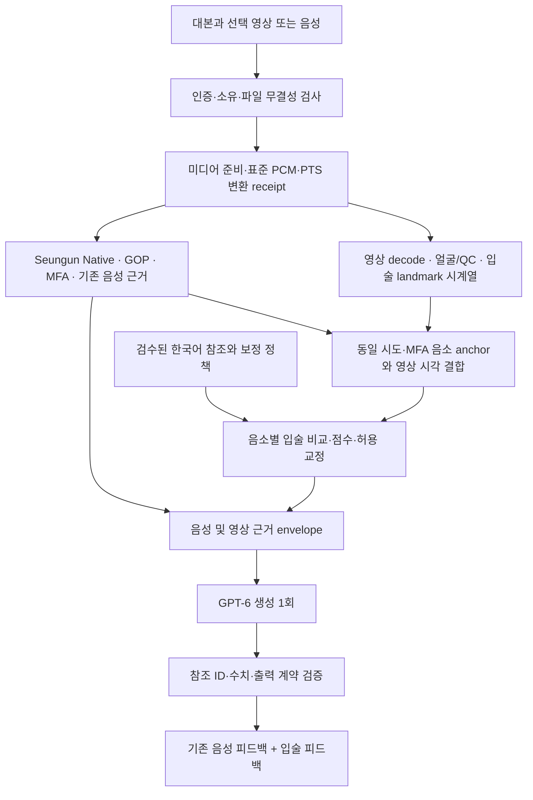

# Canonical 음성·영상 병렬 처리와 입술 점수 설계

2026-10-07. **상태: 소스 조사·문헌 검토·계산식 및 구현안 작성. 제품 코드·운영 설정은 미변경.**

작업 유형: 아키텍처·서비스 로직·점수 모델 설계. `.codex`의 GLOBAL/ARCHITECTURE/SERVICE_LAYER/DOMAIN_MODEL/DOCUMENT 규칙과 `AGENTS.md`를 적용한다. 사용자 요청으로 음소별 영상 점수와 입술 피드백 확장을 설계하며, 검증되지 않은 수치·교정을 현재 결과에 삽입하지 않는다.

## 1. 요청과 확인 범위

- 영상이 제공되면 Seungun 음성 분석과 영상 특징 추출을 같은 요청 안에서 병렬 실행한다.
- MFA가 제공한 음소 구간과 영상 궤적을 연결해 서버가 입술 비교값을 계산한다.
- GPT-6에 기존 음성 근거와 입술 근거를 함께 제공하고 생성은 요청당 한 번 수행한다. 기존 전문가 피드백과 GOP/음성 채점 계약을 보존한다.
- 영상이 없거나 관찰 불가이면 유효한 기존 음성 결과를 유지한다.

검토 소스: AI worktree `94164ad532da687b9ba7d2db1c1bca4dd2dc4088`, Backend worktree `6edbd0ffb777a34ec1272dc8a25fec2e334f779d`. 사용자 주 checkout은 `3879bd995aa14bf3968cf33e4cf7ae08ecc51301`이며 더 오래돼 최신 direct 경로의 판단에 쓰지 않았다. 이번에는 운영 서버를 새로 조회하지 않았다. 직전 배포 관측과 현재 소스의 차이를 live 검증 완료로 표현하지 않는다.

## 2. 영상이 연결되지 않는 지점

| 검토 파일 | 확인된 동작 | 필요한 변경 |
| --- | --- | --- |
| AI `direct_analysis/api.py`, `service.py`, `domain.py` | `audio/wav`와 16k mono PCM 검증, `DirectInput.visual_input=None` | 기존 WAV 계약을 보존하면서 영상 접수용 버전 있는 입력 계약·materialization 추가 |
| AI `direct_analysis/worker.py`, `delivery.py` | `audio.wav`만 실행·보관 경로에 전달 | video digest/자산/시간 변환 receipt와 영상 근거 보관 |
| AI `backend_analysis/canonical_producer.py:produce` | `request.visual_input is None` 요구 | 같은 요청의 media orchestrator를 도입하고 음성 전용 core와 영상 sidecar를 분리 조합 |
| AI `backend_analysis/canonical_bridge.py` | dispatch에 영상 전달이 없고 association에 `visualStatus=NOT_CONNECTED` 기록 | 검증된 영상 envelope를 GPT view와 association에 결속 |
| 활성 announcer H5 `bridge/adapter.py` | 영상 입력 계약 없음, 결과의 `visualCorrectiveClaimsAllowed=False` | 새 frozen H5 schema/prompt/lock·validator·allowlist 동시 생성 |
| 기존 `backend_analysis/adapters/visual.py`, `video_attempt_facade.py` | 과거 Seungun 후보/시간 구조를 사용하며 음성 결과 뒤에서 영상 단계 수행 | 디코드/landmark 수집을 MFA와 독립시키고 MFA anchor로 join. `_PrecomputedSeungun` 패턴처럼 재추론 금지 |
| Backend `CanonicalCallbackCommitter.commitResult` | recording에 visual object가 있거나 기존 segment가 있으면 `503 NOT_READY` | 영상의 보관·정리와 새 결과 저장 계약을 함께 정리. 조건만 삭제하는 방식 금지 |

이전 영상 P0/P1 배포 문서는 9/30 경로의 이력이다. 현재 canonical에 자동 연결됐다는 증거가 아니다. 기존 자산은 40개 기대 음소에 같은 aperture reference를 쓰며 교정 truth가 없는 geometry 자료도 포함한다. 해당 자산의 calibrated 표기를 새 음소별 발음 점수의 근거로 재사용하지 않는다.

## 3. 제공받은 참조 영상

| 항목 | 확인 |
| --- | --- |
| 사용자 지정 파일 | `tests/testvideo1.mp4` |
| 파일 크기 | 2,097,382 bytes |
| 직접 확인 SHA-256 | `e11d1d9ac6a04de67bdff5ddda68284d92d910d343bbf28dc764f2879744eac9` |
| 대본 출처 | 기존 10/4·10/5 분석 기록: “쌀과 콩을 깨끗한 그릇에 담아요” |
| 이번 검토 상태 | 사용자 지정 전문가 참조. 새 landmark/MFA 추출과 음소별 검수표 대조는 미수행 |

이 영상은 먼저 **해당 문장·실제 포함 음소/문맥의 참조 exemplar**로 사용한다. 화자 수·반복 수·검수자·음소별 허용 구간·촬영 조건을 reference manifest에 추가한다. 실제 G2P/MFA 산출 전에는 철자만 보고 음소 coverage를 확정하지 않는다. 다른 문장의 미포함 음소에 값을 채워 넣지 않는다.

같은 파일이 과거 시스템 입력으로도 사용됐다. 따라서 참조와 평가에 이 파일을 동시에 사용해 얻은 높은 유사도는 품질 검증이 될 수 없다. 기존 GPT 음성 점수도 입술 정답 label을 대체하지 않는다. 독립 화자·문장의 정상/오류/관찰 불가 예시가 있어야 보정과 일반화 검증을 할 수 있다.

## 4. 목표 처리 구조

**병렬 구간은 음성 분석과 영상 특징 추출이다. 음소별 영상 점수는 MFA 결과와 영상 특징이 둘 다 준비된 뒤 계산한다.** 영상이 없으면 영상 branch를 만들지 않는다. 영상 실패는 typed result로 회수해 음성 task를 불필요하게 취소하지 않는다. 실패가 sibling을 자동 취소하는 TaskGroup에 영상 예외를 그대로 내보내지 않는다.

### 미디어와 시간 계약

1. 영상만 입력되면 서버에서 내장 음성을 한 번 추출해 canonical PCM을 만든다. 음성과 영상을 함께 받으면 서버의 동일한 정규화 절차로 PCM identity를 검증한다. 일치하지 않는 두 녹음을 합치지 않는다.
2. source video SHA, source audio SHA, prepared PCM SHA를 각각 보존한다. canonical PCM을 여러 번 추출하거나 Seungun을 영상 adapter에서 다시 실행하지 않는다.
3. 프레임은 frameIndex/FPS 대신 실제 PTS를 사용한다. VFR·회전 metadata·audio start offset·resample/crop 변환을 receipt로 기록한다.
4. audio-local `t_a`에서 video PTS로 가는 변환 `t_v=a*t_a+b`를 기록한다. 같은 container에서 알려진 offset은 container/추출 근거로 정한다. drift를 주장하려면 별도 추정 근거가 필요하다.
5. A/V 동기화는 영상 전체의 대응 검증이다. 각 음소의 낮은 점수를 높이기 위해 offset을 제각각 바꾸지 않는다. 실제 조음 선행·동시조음은 문맥별 참조에 포함하고, 촬영 지연과 혼동하지 않는다.

MFA expected index, 실제 정렬 label, onset/nucleus/coda, 단어/음절, 앞뒤 음소, 음성 구간, 변환된 영상 구간을 함께 보존한다. 삭제·대체·무음 초성·0길이·다대일/일대다 정렬을 명시적으로 처리한다. 강제정렬 성공은 해당 음소를 정확히 발음했다는 뜻이 아니다.

## 5. 점수 계산식 — 프로젝트 제안

방법의 출처와 확인 한계는 [문헌 검토](lip-scoring-research-20261007.md)에 있다. 아래 **통합식·가중치·보정 방식은 논문 원문 공식을 그대로 복사한 것이 아니라 한국어 코칭 목적의 설계**다.

### 5.1 관측 특징

프레임 t에서 입술 landmark를 \(p_{tk}\), 얼굴의 안정적인 기준점에서 얻은 중심/roll/scale을 \(c_t,R_t,s_t\)라 하면:

\[
q_{tk}=R_t(p_{tk}-c_t)/s_t.
\]

눈 주변 등 비조음 기준점으로 얼굴 크기·roll을 정규화하고 과도한 yaw/pitch는 보류한다. 현재 프레임의 입 너비로 전체 모양을 정규화해 입술 펼침 신호까지 없애지 않는다. 입술에 자유로운 비선형 변형을 적용해 참조와 맞추지 않는다. 개인 입술 형태 차이는 별도 neutral calibration/참조 분포와 불확실성으로 처리한다.

설명용 특징은 정규화한 입 너비 \(w_t\), 안쪽 입술의 세로 간격 \(h_t\), 안쪽 면적 \(a_t\), \(h_t/(w_t+\epsilon)\), 실제 시간에 대한 변화율이다. 입을 닫은 구간에서는 면적·비율이 불안정할 수 있어 특징 mask를 사용한다. 2D 둥근 윤곽은 3D 돌출량이나 혀 위치를 측정한 값이 아니다. landmark 개수·순서·안쪽/바깥쪽 contour 및 기존 24점 mapping의 차이를 version으로 고정한다.

### 5.2 MFA 음소별 제한된 시계열 거리

평가 음소 i의 영상 특징열 \(X_i\)와 같은 음소·역할·문맥의 참조 \(Y_{ir}\)를 비교한다. 같은 문장의 exemplar가 있으면 해당 occurrence를 먼저 사용한다. 다른 음소를 찾아 가장 비슷한 것에 맞추는 방식은 허용하지 않는다.

landmark와 설명용 특징의 local cost:

\[
d(x_a,y_b)=\alpha\frac1K\sum_k\|q_{ak}-q'_{bk}\|_2^2
 +(1-\alpha)\frac{\sum_{m\in M_i}\omega_m((f_{am}-f'_{bm})/\sigma_m)^2}{\sum_{m\in M_i}\omega_m}.
\]

\(M_i\)는 해당 phone/context에서 관측·검증 가능한 특징, \(\sigma_m>0\)는 참조/측정 오차에서 정한 scale이다. \(\alpha\in[0,1]\)와 \(\omega_m\ge0\)는 version 있는 정책 값으로 둔다. 중복된 aperture·면적 특징을 독립 증거처럼 과대 가중하지 않는다. scale을 추정할 근거가 없으면 우선 기하 거리만 기록하고 보정 점수는 보류한다.

실제 구간 내 상대 시각을 \(u_a,v_b\in[0,1]\), 제한 폭을 \(\rho\), 시간 왜곡 비용을 \(\lambda\ge0\)라 하면:

\[
c(a,b)=\bigl(1+\lambda|u_a-v_b|\bigr)d(x_a,y_b),\quad |u_a-v_b|\le\rho.
\]

대각·수평·수직으로 이어지는 제한 경로에서 누적 비용 최소 경로 \(\pi^*\)를 구한다. 시작/끝점과 연속 수평·수직 이동 상한도 고정한다. 경로가 없으면 보류한다.

\[
D_{ir}=\frac1{|\pi^*|}\sum_{(a,b)\in\pi^*}c(a,b),\quad
D_i=\operatorname{median}_{r\in\mathcal R_i}D_{ir}.
\]

이는 누적합을 최소화한 뒤 선택 경로의 평균을 보고하는 정의다. 평균 자체를 최소화하는 알고리즘과 혼용하지 않는다. 참조가 여러 발음 변형을 포함하면 서로 다른 허용 모드를 먼저 분리하고, 모드 선택 근거와 선택된 reference ID를 기록한다. 임의로 최저 거리 하나만 골라 정상 판정을 만들지 않는다.

짧은 음소에 실제 유효 프레임이 1~2개이면 궤적 동등성은 판정할 수 없다. 별도 정적 관측으로 제한하며, 경계 밖 padding 프레임은 context로만 보관한다. 보간해 만든 프레임 수를 실제 관측 수로 세지 않는다. 속도 normalization이 조음 오류를 숨기지 않도록 음소 길이·폐쇄 시각·이동 경로를 별도 진단한다. 시작 후보 조건은 실제 구간 내 3프레임 이상이며, 이것은 검증된 충분조건이 아니다.

### 5.3 0–100 환산과 품질 보류

연구용 참조 유사도 후보:

\[
S_i^{ref}=100\exp(-D_i/\tau_{v,c}),\quad\tau_{v,c}>0.
\]

거리가 0이면 100이고 커질수록 감소한다. \(\tau\)는 음소/viseme·문맥별 sensitivity이며 데이터로 선택해야 한다. 논문이 보장한 발음 정답 확률이 아니다. 예를 들어 가상의 \(D_i=\tau\)면 약 36.8이 되며, 이 값은 사용자의 실제 점수가 아니다.

운영 점수는 독립 전문가의 **보이는 입술 조음 적절성** 평정으로 보정한 단조 감소 함수 \(g_{v,c}\)를 사용한다. 예: 분리된 개발 자료에서 학습한 isotonic regression.

\[
S_i^{lip}=\begin{cases}100g_{v,c}(D_i),&Q_i=1\text{ 이고 해당 보정 모델이 검증됨}\\
\mathrm{null},&\text{그 외.}\end{cases}
\]

\(Q_i\)는 동일 시도 binding, 얼굴/입술 품질, 시간 동기화, MFA mapping, 실제 프레임 coverage, 참조 적용 범위의 결합 gate다. confidence가 낮다고 점수를 곱해 낮추지 않는다. 관찰 불가를 0점으로 채점하지 않는다. 현재 단일 참조 영상만으로 \(\sigma,\tau,g\)의 화자 간 타당성을 추정했다고 할 수 없다.

문장 입술 점수는 적격 음소만의 평균과 coverage를 함께 제공한다:

\[
S^{lip}=\frac{\sum_{i\in E}w_iS_i^{lip}}{\sum_{i\in E}w_i},\qquad
coverage=|E|/N_{\text{visually eligible target phones}}.
\]

초기 집계 제안은 occurrence별 같은 가중치다. 긴 모음만 과대 반영하는 duration 가중치를 자동 적용하지 않는다. 분모 0 또는 검증한 최소 coverage 미달이면 전체 점수도 null이다. 전체 기대 음소 수, 시각 평가 가능 수, 실제 채점 수를 별도 표시한다. 기존 음성 종합점수와 임의의 70:30 같은 비율로 합치지 않는다.

### 5.4 점수에서 교정으로 가는 규칙

낮은 거리/높은 유사도는 해당 참조와 비슷하다는 뜻이다. 높은 거리 하나만으로 “더 벌리세요”라는 방향은 나오지 않는다. 허용된 특징별 signed deviation, 문맥별 허용 범위, 전문가가 검증한 action mapping이 함께 있어야 방향을 정한다.

| 한국어 적용 범위 | 가능한 초기 관측 | 판정 제한 |
| --- | --- | --- |
| 양순음 ㅁ/ㅂ/ㅃ/ㅍ 및 해당 종성 실현 | 입술 접근·폐쇄·열림의 궤적과 타이밍 | 이 음소들 사이의 비음성·유기성·긴장을 입술 형태만으로 구별하지 않음 |
| /오/, /우/와 원순 glide가 포함된 문맥 | 실제 참조의 너비·높이·윤곽 변화 | 2D 형태로 돌출량·혀 높이·모음 정답을 단정하지 않음 |
| 그 밖의 모음 | 문맥·화자 보정 후 관측 가능한 개구/폭 차이 | 한 문장의 기준을 모든 화자·문장에 적용하지 않음 |
| 혀/성문/비강의 차이가 주된 음소 | 입술의 부수 관측만 | 독립 입술 정확도 점수는 보류 가능 |

이 표는 phoneme→viseme 정답표가 아니라 구현 후보 범위다. 한국어 실제 G2P와 전문가 검수로 확정한다.

## 6. GPT 입력·출력 계약

새 내부 visual evidence에 request/execution, video/PCM digest, core digest, expected index, MFA source/span, 실제 frame PTS/count, alignment/QC/sync 상태, reference/model/mapping/calibration revision을 결속한다. 서비스 내부 원본과 GPT 요약 DTO 및 공개 응답 DTO를 분리한다.

제안 필드: `visualStatus`, `phoneAssessments[]`, `referenceDistance`, `referenceSimilarity`, `visualScore`, `scoreKind`, `coverage`, `reasonCodes`, `allowedObservationIds`, `allowedActionIds`. 모든 null의 이유를 명시한다. 제안 상태는 `NOT_PROVIDED`, `OBSERVED`, `REFERENCE_ONLY`, `SCORED`, `UNSCORABLE`, `FAILED`, `TIMEOUT`이며 기존 공개 schema에 그대로 추가한 상태가 아니다.

- 음성 채점은 기존 GOP 근거·rubric을 따른다. 서버 입술 점수를 GPT가 새로 만들거나 수정하지 않는다.
- GPT는 기존 “단어 → 구체적 연습 방법” 설명에 같은 음소의 허용된 입술 관찰·연습을 덧붙인다. 제공한 영상 ID와 실제 출력에서 참조한 ID를 구분한다.
- raw 영상·전체 좌표 배열의 새 외부 전송은 추가하지 않는다. 검증된 수치와 짧은 사실 요약을 제공한다.
- `REFERENCE_ONLY`에서는 “참조 영상과 이런 차이가 관찰됨”까지만 허용한다. 개인 교정 명령은 검증된 action ID가 있을 때만 제공한다.
- 응답 참조 ID·소유 관계·수치 일치·중복/유한 값·schema를 검사한다. 수치/사실은 서버 renderer로 고정한다. 자유 자연어 전체의 의미를 검증했다고 주장하지 않는다.
- GPT 오류 시 음성 결과와 서버가 만든 입술 관측을 유지하고 기존 fallback 사유를 기록한다. 같은 요청에서 GPT 재호출로 영상 문장을 덧붙이지 않는다.

## 7. DLPC 자원과 실패 처리

현재 관측된 4 CPU affinity·11 GiB RAM·A5000은 제약의 출발점이다. 입술 관찰은 CPU worker 1개로 시작하고 프레임을 제한된 queue로 순차 처리해 모든 RGB 프레임을 RAM에 보관하지 않는다. 기존 8개 global sample은 QC용으로 구분하고 음소 궤적용 dense timestamp 수집을 별도로 구성한다.

영상 요청의 초기 실측 후보 예산은 MFA 1 + GOP 1 + 영상 1 + API/TTS 준비 여유 1 CPU 상당이다. 음성 전용 GOP 2스레드 후보와 별도 profile로 비교한다. Torch thread를 실행 도중 요청마다 변경하지 않는다. resident 시작 시 고정하거나 overlap 스케줄을 조정한다. Native/TTS GPU lock과 전역 core 제한을 보존하며 MediaPipe GPU 실행은 측정 후 별도 선택한다. 4 CPU라는 이유로 모델 프로세스를 4개 복제하지 않는다.

이상적 소요 시간은 `media 준비 + max(audio, visual features) + join/score + GPT` 형태지만 실제 성능은 CPU 경합·I/O·GPU 대기에 따라 달라진다. 속도 향상 수치는 실측 전 미정이다.

영상 deadline은 상위 deadline에서 GPT·검증·저장 여유를 뺀 값으로 제한한다. timeout/취소 시 영상 child를 종료·회수한 뒤 파일 정리하고, 늦게 도착한 결과로 이미 생성된 피드백을 바꾸지 않는다. malformed media·무결성 불일치는 입력 경계에서 거절한다. 검증된 음성 이후의 얼굴 부재/QC/참조 부족은 영상 상태만 보류한다.

## 8. 파일별 구현 순서와 완료 조건

**통합 실행계획:** [Backend 접수·저장·조회 상세 계획](backend-audiovisual-implementation-plan-20261007.md)을 이 절의 실행 명세로 사용한다. 새 계약 제안, media receipt/execution snapshot, handoff 검증·B2 archive, 상세 view/FE, 단계별 gate·롤백을 포함한다. 아래 순서는 계산·AI 구현의 개요이며 Backend 상세 범위를 대체하지 않는다.

**10/7 API 후속 검토:** 공통 시작점은 기존 `POST /api/training-sessions/{sessionId}/analyze`를 유지한다. [세션 API 연결 검토](training-session-analyze-review-20261007.md)의 업로드·선택·Backend dispatch·AI accept·결과 검증/저장·상세 조회를 우선 수직 통합 범위로 삼는다. Direct WAV 경로 확장만으로 이 엔드포인트가 영상 분석을 지원하지는 않는다. 이 경로의 PCM은 Backend가 생성한 것을 재사용하며, Backend/AI의 영상 접수 차단은 새 결과 계약·retention·FE reader가 준비된 뒤 함께 해소한다.

1. **참조 구축:** `testvideo1.mp4`의 미디어/대본/검수 범위를 고정하고 참조의 MFA·landmark를 생성한다. 검수 범위를 넘어선 phone/context는 미지원으로 둔다. reference manifest와 계산 정책을 별도 버전으로 관리한다.
2. **미디어 계약:** AI `direct_analysis/{api,domain,service,store,delivery}.py`와 Backend 영상 소유/저장/업로드 경계를 맞춘다. FE가 영상을 버리지 않고 전달하는지도 실제 소스로 확인한다(이번 FE 소스 검토는 미수행). API/route에는 계산 로직을 두지 않는다.
3. **병렬 orchestration:** 새로운 canonical audiovisual service와 media/visual adapter를 추가한다. 기존 `canonical_producer`를 순수 음성 실행에 유지하고 상위에서 두 branch를 조합한다. visual adapter를 그대로 호출해 Seungun을 재실행하지 않는다.
4. **음소 join/점수:** `visual_feedback` 내부에 MFA anchor 모델, version 있는 reference matcher, 순수 거리/보정 service, gate/action 정책을 둔다. 기존 P6 측정/geometry 검증을 재사용하되 옛 CTC anchor를 MFA 시간으로 잘못 표기하지 않는다.
5. **GPT/공개 계약:** frozen H5·association·result schema·AI/Backend verifier와 reader를 같은 새 계약으로 확장한다. 구형 contract에 `visualScore`를 몰래 삽입하지 않는다. Backend의 영상 recording 차단은 retention/삭제 lifecycle이 준비된 뒤 해소한다. 기존 segment를 무조건 지우지 않는다.
6. **개발자 QA:** 프로젝트 `AGENTS.md`에 따라 개발자가 실제 음성/영상 병렬 실행, 정렬·reference 일치, 다른 화자, 미지원 음소, 영상 오류, deadline/cancel, 메모리·TTS 영향을 검증한다. 이번에 자동 회귀 테스트·관련 실행 산출물은 만들지 않았다.
7. **전환:** 검증한 AI main/Backend develop 변경과 FE reader를 준비한 후 새 immutable bundle과 rollback 묶음으로 drain·전환한다. 코드·schema·reference·prompt·복구 pin을 함께 맞춘다. 현재 운영 전환 완료가 아니다.

완료 근거에는 음성/영상 stage의 실제 시작·종료 시각(중첩 증명), Seungun/GPT dispatch 횟수, score별 출처, null 사유, GPT 제공/참조/표시 영상 근거 수를 포함한다. 참조 자신과의 비교나 기존 API ready 응답으로 새 입술 교정 품질을 통과 처리하지 않는다.
